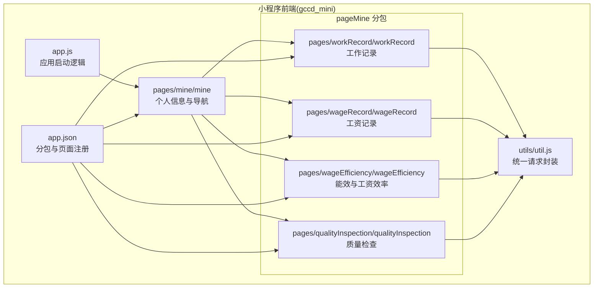
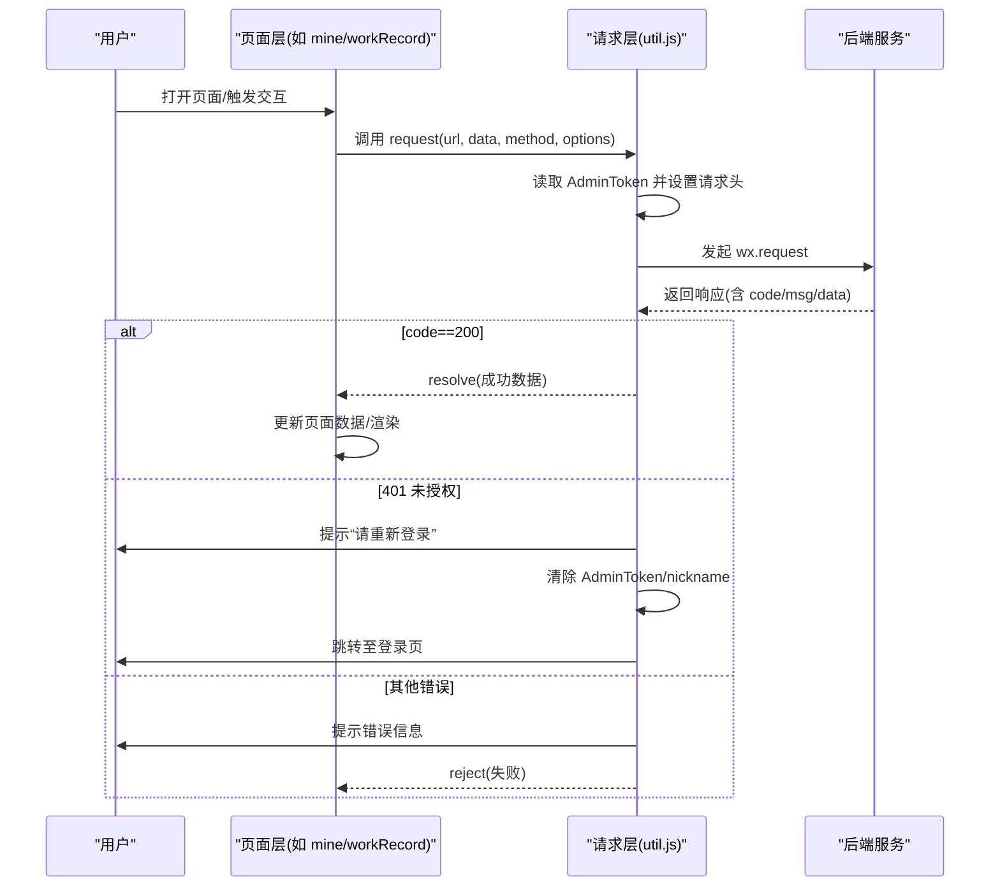
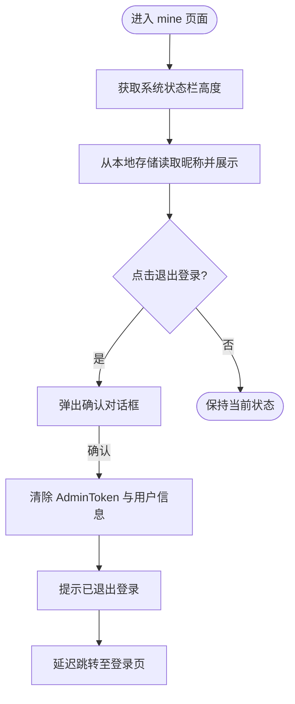
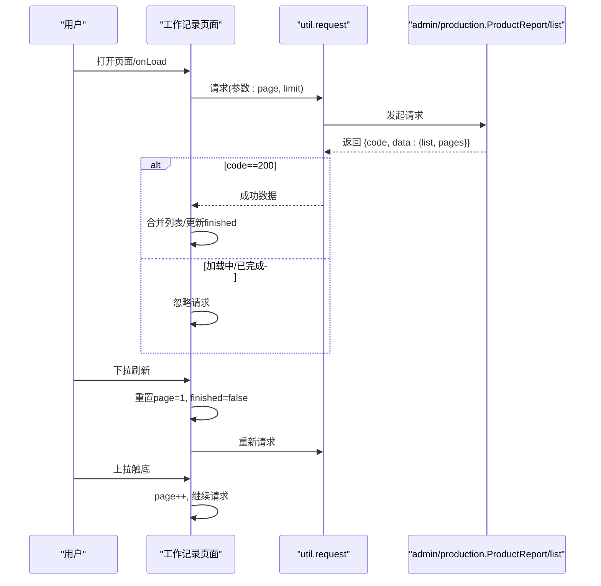
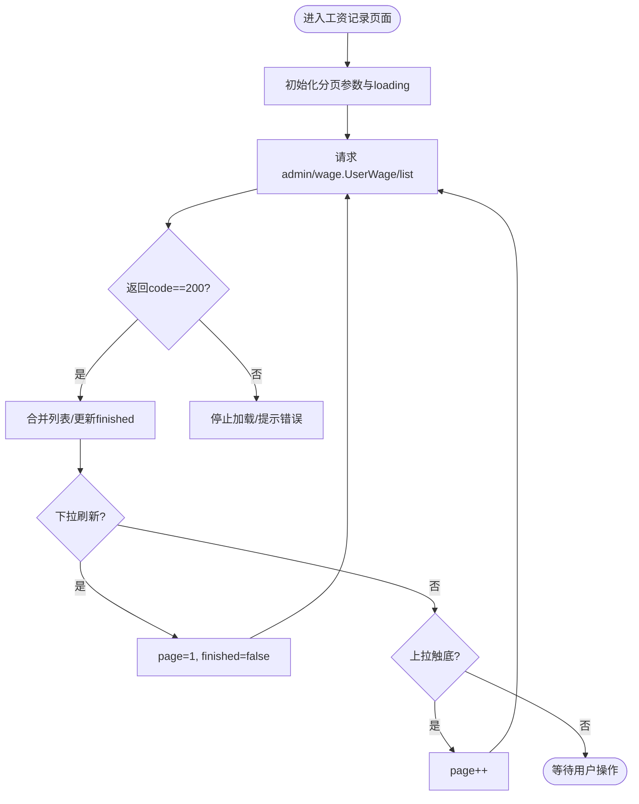
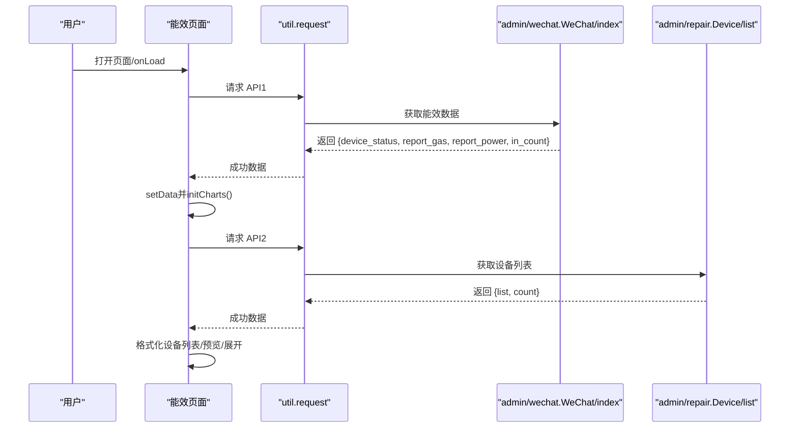
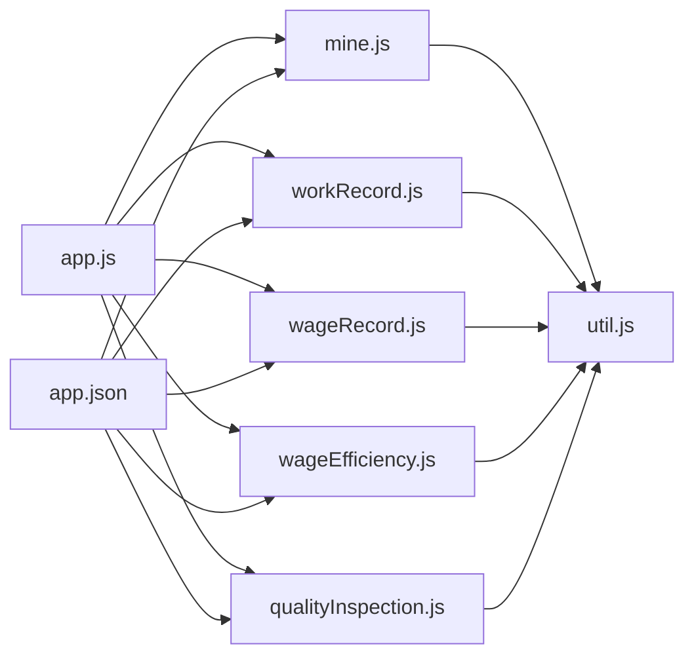

# 个人中心页面

<cite>
**本文引用的文件**
- [app.js](file://gccd_mini/app.js)
- [app.json](file://gccd_mini/app.json)
- [mine.js](file://gccd_mini/pages/mine/mine.js)
- [mine.json](file://gccd_mini/pages/mine/mine.json)
- [workRecord.js](file://gccd_mini/pageMine/pages/workRecord/workRecord.js)
- [workRecord.json](file://gccd_mini/pageMine/pages/workRecord/workRecord.json)
- [wageRecord.js](file://gccd_mini/pageMine/pages/wageRecord/wageRecord.js)
- [wageRecord.json](file://gccd_mini/pageMine/pages/wageRecord/wageRecord.json)
- [wageEfficiency.js](file://gccd_mini/pageMine/pages/wageEfficiency/wageEfficiency.js)
- [wageEfficiency.json](file://gccd_mini/pageMine/pages/wageEfficiency/wageEfficiency.json)
- [qualityInspection.js](file://gccd_mini/pageMine/pages/qualityInspection/qualityInspection.js)
- [qualityInspection.json](file://gccd_mini/pageMine/pages/qualityInspection/qualityInspection.json)
- [util.js](file://gccd_mini/utils/util.js)
</cite>

## 目录
1. [简介](#简介)
2. [项目结构](#项目结构)
3. [核心组件](#核心组件)
4. [架构总览](#架构总览)
5. [详细组件分析](#详细组件分析)
6. [依赖关系分析](#依赖关系分析)
7. [性能考虑](#性能考虑)
8. [故障排查指南](#故障排查指南)
9. [结论](#结论)
10. [附录](#附录)

## 简介
本文件面向“个人中心页面”的开发与维护，系统性梳理其整体设计与功能实现，覆盖以下模块：
- 个人信息展示与退出登录
- 工作记录查看（报工列表）
- 工资记录查看（支持分页与日历标记预留）
- 能效与工资效率分析（图表化展示）
- 质量检查页面（基础骨架）

同时，文档阐述个人中心页面与用户系统的数据对接与权限控制机制，并提供开发最佳实践与用户体验优化建议。

## 项目结构
个人中心相关页面位于小程序前端工程的 pageMine 子包中，主入口为“我的”页面，其他子页面通过分包方式组织，便于按需加载与维护。

**图示来源**
- [app.json:56-99](file://gccd_mini/app.json#L56-L99)
- [app.js:1-33](file://gccd_mini/app.js#L1-L33)
- [mine.js:1-61](file://gccd_mini/pages/mine/mine.js#L1-L61)
- [workRecord.js:1-70](file://gccd_mini/pageMine/pages/workRecord/workRecord.js#L1-L70)
- [wageRecord.js:1-138](file://gccd_mini/pageMine/pages/wageRecord/wageRecord.js#L1-L138)
- [wageEfficiency.js:1-275](file://gccd_mini/pageMine/pages/wageEfficiency/wageEfficiency.js#L1-L275)
- [qualityInspection.js:1-18](file://gccd_mini/pageMine/pages/qualityInspection/qualityInspection.js#L1-L18)
- [util.js:1-98](file://gccd_mini/utils/util.js#L1-L98)

**章节来源**
- [app.json:56-99](file://gccd_mini/app.json#L56-L99)
- [app.js:1-33](file://gccd_mini/app.js#L1-L33)

## 核心组件
- “我的”页面（mine）：负责用户信息展示、退出登录确认与跳转、系统状态栏高度适配。
- 工作记录页面（workRecord）：展示报工列表，支持下拉刷新与上拉加载分页。
- 工资记录页面（wageRecord）：展示工资列表，具备分页与日历组件占位（spotMap、日期缓存等），便于后续扩展。
- 能效与工资效率页面（wageEfficiency）：集成 ECharts 图表，展示能耗与产能趋势，包含设备状态与设备明细表格。
- 质量检查页面（qualityInspection）：基础页面骨架，用于承载质检相关功能。

**章节来源**
- [mine.js:1-61](file://gccd_mini/pages/mine/mine.js#L1-L61)
- [workRecord.js:1-70](file://gccd_mini/pageMine/pages/workRecord/workRecord.js#L1-L70)
- [wageRecord.js:1-138](file://gccd_mini/pageMine/pages/wageRecord/wageRecord.js#L1-L138)
- [wageEfficiency.js:1-275](file://gccd_mini/pageMine/pages/wageEfficiency/wageEfficiency.js#L1-L275)
- [qualityInspection.js:1-18](file://gccd_mini/pageMine/pages/qualityInspection/qualityInspection.js#L1-L18)

## 架构总览
个人中心页面围绕“用户态 + 请求层 + 页面层”的三层结构组织：
- 用户态：通过本地存储的 AdminToken 决定登录状态与页面跳转。
- 请求层：统一封装 wx.request，自动注入 AdminToken，处理通用业务码与错误提示。
- 页面层：各子页面独立逻辑，共享 util.request 与 Vant 组件生态。

**图示来源**
- [util.js:22-94](file://gccd_mini/utils/util.js#L22-L94)
- [app.js:9-21](file://gccd_mini/app.js#L9-L21)
- [mine.js:24-45](file://gccd_mini/pages/mine/mine.js#L24-L45)

## 详细组件分析

### 个人信息与退出登录（mine）
- 功能要点
  - 从本地存储读取用户昵称并展示。
  - 退出登录弹窗确认，清除 AdminToken 与用户信息，提示后跳转登录页。
  - 获取系统状态栏高度以适配自定义导航栏。
- 权限与安全
  - 退出登录后，若无 AdminToken，应用在启动时将强制跳转至登录页。
- 可扩展点
  - 支持头像上传、实名信息、角色权限等字段展示。

**图示来源**
- [mine.js:15-61](file://gccd_mini/pages/mine/mine.js#L15-L61)
- [app.js:9-21](file://gccd_mini/app.js#L9-L21)

**章节来源**
- [mine.js:1-61](file://gccd_mini/pages/mine/mine.js#L1-L61)
- [mine.json:1-11](file://gccd_mini/pages/mine/mine.json#L1-L11)
- [app.js:1-33](file://gccd_mini/app.js#L1-L33)

### 工作记录页面（workRecord）
- 功能要点
  - 分页加载报工列表，支持下拉刷新与上拉加载。
  - 首屏与分页场景合并数据，根据后端返回页数与条数判断是否加载完成。
  - 自定义导航栏高度适配。
- 数据对接
  - 接口：admin/production.ProductReport/list
  - 参数：page、limit
  - 返回：code、data.list、data.pages
- 性能与体验
  - 避免重复请求与并发冲突（loading 标记）。
  - 首次加载与分页拼接数组，减少 DOM 重排。

**图示来源**
- [workRecord.js:19-70](file://gccd_mini/pageMine/pages/workRecord/workRecord.js#L19-L70)
- [util.js:22-94](file://gccd_mini/utils/util.js#L22-L94)

**章节来源**
- [workRecord.js:1-70](file://gccd_mini/pageMine/pages/workRecord/workRecord.js#L1-L70)
- [workRecord.json:1-6](file://gccd_mini/pageMine/pages/workRecord/workRecord.json#L1-L6)

### 工资记录页面（wageRecord）
- 功能要点
  - 分页加载工资列表，支持下拉刷新与上拉加载。
  - 预留日历组件占位（spotMap、日期缓存 dateListMap），便于按月标记与请求去重。
  - 自定义导航栏高度适配。
- 数据对接
  - 接口：admin/wage.UserWage/list
  - 参数：page、limit
  - 返回：code、data.list、data.pages
- 可扩展点
  - 日历选择回调可联动请求该日期的工资明细。
  - 支持“工资条下载”按钮，结合后端导出接口实现。

**图示来源**
- [wageRecord.js:78-138](file://gccd_mini/pageMine/pages/wageRecord/wageRecord.js#L78-L138)
- [util.js:22-94](file://gccd_mini/utils/util.js#L22-L94)

**章节来源**
- [wageRecord.js:1-138](file://gccd_mini/pageMine/pages/wageRecord/wageRecord.js#L1-L138)
- [wageRecord.json:1-7](file://gccd_mini/pageMine/pages/wageRecord/wageRecord.json#L1-L7)

### 能效与工资效率页面（wageEfficiency）
- 功能要点
  - ECharts 图表：能耗（燃气/电力）柱状图、产能（日产量）折线图。
  - 设备状态卡片：设备总数、正常/维修中等状态统计。
  - 设备明细表格：设备名称、编号、状态（正常/维修中），支持预览与展开。
- 数据对接
  - 能效接口：admin/wechat.WeChat/index（返回 device_status、report_gas、report_power、in_count）
  - 设备明细接口：admin/repair.Device/list（分页获取设备列表）
- 图表初始化
  - 通过 ec-canvas 组件 onInit 回调初始化 ECharts 实例并设置选项。

**图示来源**
- [wageEfficiency.js:186-275](file://gccd_mini/pageMine/pages/wageEfficiency/wageEfficiency.js#L186-L275)
- [util.js:22-94](file://gccd_mini/utils/util.js#L22-L94)

**章节来源**
- [wageEfficiency.js:1-275](file://gccd_mini/pageMine/pages/wageEfficiency/wageEfficiency.js#L1-L275)
- [wageEfficiency.json:1-7](file://gccd_mini/pageMine/pages/wageEfficiency/wageEfficiency.json#L1-L7)

### 质量检查页面（qualityInspection）
- 功能要点
  - 页面骨架完善，导航标题为“质量检验”，使用 Vant 图标组件。
  - 作为后续扩展入口，承载质检记录、评分与改进措施等信息管理。
- 开发建议
  - 可复用质量检查相关列表/新增页面的组件与接口，保持风格一致。

**章节来源**
- [qualityInspection.js:1-18](file://gccd_mini/pageMine/pages/qualityInspection/qualityInspection.js#L1-L18)
- [qualityInspection.json:1-7](file://gccd_mini/pageMine/pages/qualityInspection/qualityInspection.json#L1-L7)

## 依赖关系分析
- 页面与工具层
  - mine/workRecord/wageRecord/wageEfficiency/qualityInspection 均依赖 util.request 进行网络请求。
  - mine 使用 Vant 的 Toast/Dialog 组件进行交互提示与确认。
- 应用级控制
  - app.js 在启动时依据 AdminToken 决定初始路由（登录页或工作台）。
  - app.json 定义分包 pageMine，其中包含个人中心相关页面。
- 组件与图表
  - wageEfficiency 依赖 ec-canvas 组件与 ECharts 初始化流程。
  - 各页面使用 @vant/weapp 的图标与空状态组件提升一致性。

**图示来源**
- [mine.js:1-61](file://gccd_mini/pages/mine/mine.js#L1-L61)
- [workRecord.js:1-70](file://gccd_mini/pageMine/pages/workRecord/workRecord.js#L1-L70)
- [wageRecord.js:1-138](file://gccd_mini/pageMine/pages/wageRecord/wageRecord.js#L1-L138)
- [wageEfficiency.js:1-275](file://gccd_mini/pageMine/pages/wageEfficiency/wageEfficiency.js#L1-L275)
- [qualityInspection.js:1-18](file://gccd_mini/pageMine/pages/qualityInspection/qualityInspection.js#L1-L18)
- [util.js:1-98](file://gccd_mini/utils/util.js#L1-L98)
- [app.js:1-33](file://gccd_mini/app.js#L1-L33)
- [app.json:56-99](file://gccd_mini/app.json#L56-L99)

**章节来源**
- [util.js:1-98](file://gccd_mini/utils/util.js#L1-L98)
- [app.json:56-99](file://gccd_mini/app.json#L56-L99)
- [app.js:1-33](file://gccd_mini/app.js#L1-L33)

## 性能考虑
- 请求节流与防抖
  - 通过 loading 标记避免重复请求；在分页场景中先增加 page 再发起请求，防止并发。
- 列表渲染优化
  - 首屏与分页采用数组拼接策略，减少多次 setData 引发的重绘。
- 图表初始化
  - 仅在数据就绪后初始化图表，避免空数据导致的渲染异常。
- 缓存与去重
  - 工资记录页面预留日期缓存（dateListMap），可用于日历按月请求去重，降低网络压力。
- 分包加载
  - 个人中心页面置于分包 pageMine，减少首屏包体与初次加载时间。

[本节为通用指导，无需具体文件引用]

## 故障排查指南
- 401 未授权
  - 现象：出现“请重新登录”提示并跳转登录页。
  - 原因：后端校验 AdminToken 失败或过期。
  - 处理：util.request 已自动清理本地 Token 并跳转登录；前端无需额外处理。
- 网络异常
  - 现象：提示“网络异常，请检查网络”。
  - 原因：wx.request 失败。
  - 处理：检查网络状态与域名白名单配置。
- 业务错误码
  - 现象：根据返回 code 显示对应提示。
  - 处理：关注后端返回 msg，必要时在页面层补充更友好的文案。
- 退出登录无效
  - 现象：点击退出后仍停留在当前页。
  - 处理：确认 mine.js 中的清除逻辑与跳转逻辑是否执行；检查本地存储键名是否一致。

**章节来源**
- [util.js:49-83](file://gccd_mini/utils/util.js#L49-L83)
- [mine.js:24-45](file://gccd_mini/pages/mine/mine.js#L24-L45)

## 结论
个人中心页面以清晰的分层架构与统一的请求封装为基础，实现了个人信息、工作记录、工资记录、能效分析与质量检查的基础能力。通过分包组织与图表化展示，兼顾了可维护性与用户体验。后续可在工资条下载、日历明细、设备详情等方向继续扩展，同时完善权限与审计日志，确保数据安全与合规。

[本节为总结性内容，无需具体文件引用]

## 附录

### 开发最佳实践
- 统一错误处理
  - 所有页面通过 util.request 发起请求，集中处理 401/400/404 等业务码与网络异常。
- 分页与加载状态
  - 使用 loading/finished 控制加载节奏；首次与分页场景分别处理数据合并。
- 图表与组件
  - 图表初始化时机与数据就绪绑定；组件按需引入，避免冗余依赖。
- 权限与安全
  - 严格依赖 AdminToken；退出登录后立即清理本地存储并跳转登录页。
- 用户体验
  - 自定义导航栏高度适配；提供下拉刷新与上拉加载；空状态友好提示。

### 用户体验优化建议
- 加载反馈
  - 长列表分页时提供“加载中/没有更多”提示；图表初始化阶段显示骨架屏。
- 交互确认
  - 删除、导出等敏感操作增加二次确认对话框。
- 数据可视化
  - 能效图表支持缩放与图例切换；设备状态卡片提供快速筛选。
- 无障碍
  - 保证图标与文字对比度；支持小屏幕适配与手势操作。

[本节为通用指导，无需具体文件引用]