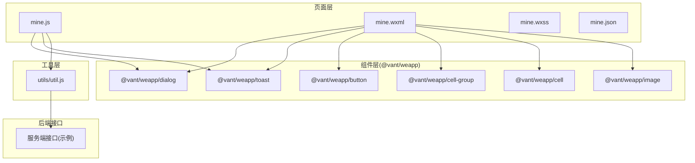
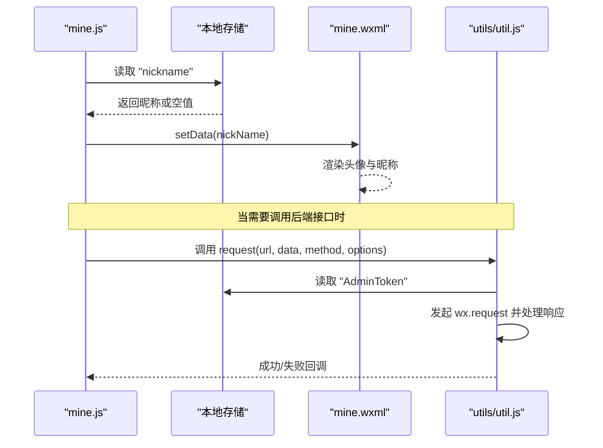
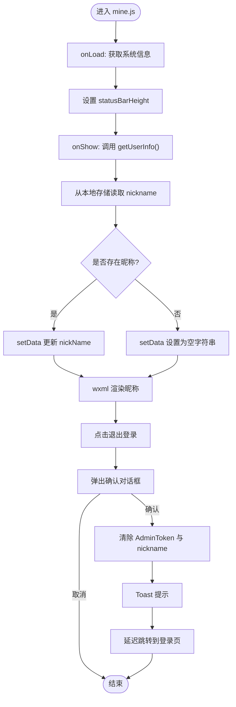
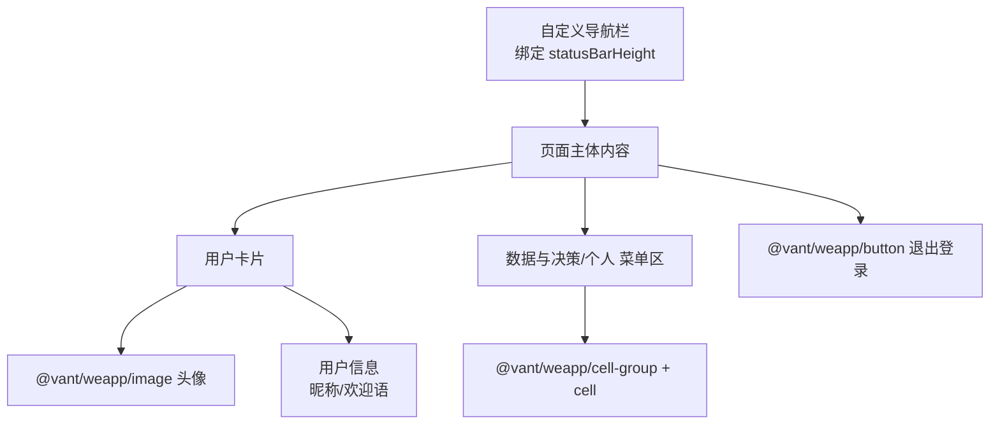
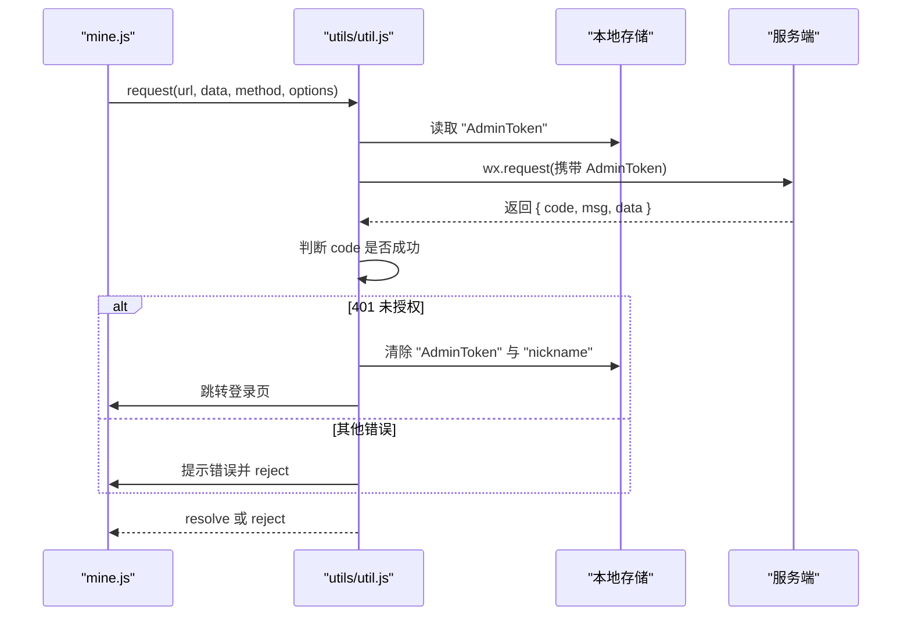
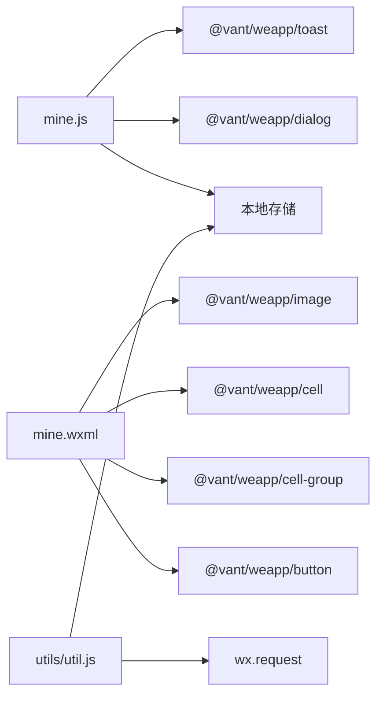

# 个人信息展示

<cite>
**本文引用的文件**
- [mine.js](file://gccd_mini/pages/mine/mine.js)
- [mine.wxml](file://gccd_mini/pages/mine/mine.wxml)
- [mine.wxss](file://gccd_mini/pages/mine/mine.wxss)
- [mine.json](file://gccd_mini/pages/mine/mine.json)
- [util.js](file://gccd_mini/utils/util.js)
- [login.js](file://gccd_mini/pages/login/login.js)
</cite>

## 目录
1. [简介](#简介)
2. [项目结构](#项目结构)
3. [核心组件](#核心组件)
4. [架构概览](#架构概览)
5. [详细组件分析](#详细组件分析)
6. [依赖分析](#依赖分析)
7. [性能考虑](#性能考虑)
8. [故障排查指南](#故障排查指南)
9. [结论](#结论)
10. [附录](#附录)

## 简介
本文件聚焦于“个人信息展示”模块，围绕个人中心页面中的用户昵称显示、头像展示、欢迎语以及页面状态栏适配等实现进行系统化梳理。重点说明 getUserInfo 的数据来源与渲染路径、页面生命周期中的状态栏高度计算与适配、与用户系统的数据交互流程（含 token 校验与本地缓存策略），并给出最佳实践与用户体验优化建议。

## 项目结构
个人信息展示模块位于小程序前端工程 gccd_mini 中，核心文件包括页面 JS、WXML、WXSS、JSON 组件声明，以及通用工具函数 util.js。页面通过 @vant/weapp 组件实现基础 UI，采用本地存储进行用户信息与 token 缓存。

图表来源
- [mine.js:1-61](file://gccd_mini/pages/mine/mine.js#L1-L61)
- [mine.wxml:1-47](file://gccd_mini/pages/mine/mine.wxml#L1-L47)
- [mine.wxss:1-66](file://gccd_mini/pages/mine/mine.wxss#L1-L66)
- [mine.json:1-11](file://gccd_mini/pages/mine/mine.json#L1-L11)
- [util.js:1-98](file://gccd_mini/utils/util.js#L1-L98)

章节来源
- [mine.js:1-61](file://gccd_mini/pages/mine/mine.js#L1-L61)
- [mine.wxml:1-47](file://gccd_mini/pages/mine/mine.wxml#L1-L47)
- [mine.wxss:1-66](file://gccd_mini/pages/mine/mine.wxss#L1-L66)
- [mine.json:1-11](file://gccd_mini/pages/mine/mine.json#L1-L11)
- [util.js:1-98](file://gccd_mini/utils/util.js#L1-L98)

## 核心组件
- 页面控制器 mine.js
  - 负责状态栏高度计算与设置、用户昵称的本地存储读取与渲染、退出登录的确认与清理、页面显示时的刷新。
- 视图模板 mine.wxml
  - 使用自定义导航栏容器，动态绑定状态栏高度；展示头像与昵称；提供“退出登录”按钮事件绑定。
- 样式 mine.wxss
  - 定义用户卡片布局、头像样式、菜单区域与按钮样式，确保在不同机型下的视觉一致性。
- 组件声明 mine.json
  - 引入 @vant/weapp 的 image、cell、cell-group、button、toast、dialog 组件。
- 工具函数 util.js
  - 封装统一的网络请求，自动注入 AdminToken，处理 401 重定向登录，统一封装成功与失败提示。

章节来源
- [mine.js:5-61](file://gccd_mini/pages/mine/mine.js#L5-L61)
- [mine.wxml:1-47](file://gccd_mini/pages/mine/mine.wxml#L1-L47)
- [mine.wxss:1-66](file://gccd_mini/pages/mine/mine.wxss#L1-L66)
- [mine.json:1-11](file://gccd_mini/pages/mine/mine.json#L1-L11)
- [util.js:22-94](file://gccd_mini/utils/util.js#L22-L94)

## 架构概览
个人信息展示模块遵循“页面-组件-工具”的分层设计。页面负责状态与事件，组件负责渲染与交互，工具负责网络请求与错误处理。页面通过本地存储读取用户昵称，通过 @vant/weapp 组件实现 UI 展示，并在需要时调用工具函数发起网络请求。

图表来源
- [mine.js:16-22](file://gccd_mini/pages/mine/mine.js#L16-L22)
- [mine.wxml:10-15](file://gccd_mini/pages/mine/mine.wxml#L10-L15)
- [util.js:22-94](file://gccd_mini/utils/util.js#L22-L94)

## 详细组件分析

### 页面控制器 mine.js
- 数据模型
  - statusBarHeight：用于适配状态栏高度，避免内容被遮挡。
  - nickName：用于展示用户昵称，初始为空字符串。
  - loading：当前未使用，可作为后续加载态扩展点。
- 关键方法
  - getUserInfo：从本地存储读取昵称并更新视图。
  - handleLogout：弹出确认对话框，清除 AdminToken 与用户信息，提示后跳转登录页。
  - onLoad：页面加载时获取系统信息，设置状态栏高度。
  - onShow：页面显示时刷新用户昵称。
- 事件绑定
  - wxml 中的退出登录按钮绑定到 handleLogout。

图表来源
- [mine.js:48-60](file://gccd_mini/pages/mine/mine.js#L48-L60)
- [mine.js:16-22](file://gccd_mini/pages/mine/mine.js#L16-L22)
- [mine.js:25-45](file://gccd_mini/pages/mine/mine.js#L25-L45)
- [mine.wxml:41-43](file://gccd_mini/pages/mine/mine.wxml#L41-L43)

章节来源
- [mine.js:5-61](file://gccd_mini/pages/mine/mine.js#L5-L61)

### 视图模板 mine.wxml
- 自定义导航栏
  - 顶部容器使用内联样式绑定 statusBarHeight，确保内容不被状态栏遮挡。
- 用户卡片
  - 使用 @vant/weapp/image 展示头像，使用 {{nickName || '未登录'}} 动态显示昵称。
- 菜单与按钮
  - 使用 @vant/weapp/cell-group 与 @vant/weapp/cell 实现二级菜单项，使用 @vant/weapp/button 提供“退出登录”入口。
- 组件挂载
  - 通过 <van-toast> 与 <van-dialog> 在页面内注册全局组件实例。

图表来源
- [mine.wxml:2-15](file://gccd_mini/pages/mine/mine.wxml#L2-L15)
- [mine.wxml:17-39](file://gccd_mini/pages/mine/mine.wxml#L17-L39)
- [mine.wxml:41-47](file://gccd_mini/pages/mine/mine.wxml#L41-L47)

章节来源
- [mine.wxml:1-47](file://gccd_mini/pages/mine/mine.wxml#L1-L47)
- [mine.json:1-11](file://gccd_mini/pages/mine/mine.json#L1-L11)

### 样式 mine.wxss
- 页面布局
  - 页面背景色与最小高度保证内容铺满全屏。
- 用户卡片
  - 卡片圆角、阴影与边框提升层级感；头像尺寸与圆角、溢出隐藏保证视觉统一。
- 文字与标签
  - 昵称字号与权重突出主标题；欢迎语字号较小，颜色偏灰，形成层次。
- 菜单与按钮
  - 菜单区圆角与阴影，按钮区域留白，保证触控体验。

章节来源
- [mine.wxss:1-66](file://gccd_mini/pages/mine/mine.wxss#L1-L66)

### 组件声明 mine.json
- 组件映射
  - 将 @vant/weapp 的 image、cell、cell-group、button、toast、dialog 组件映射为本地标签，便于在 wxml 中直接使用。

章节来源
- [mine.json:1-11](file://gccd_mini/pages/mine/mine.json#L1-L11)

### 工具函数 util.js
- 请求封装
  - request 方法统一处理 header 中 AdminToken 注入、响应码判断、401 自动清理与跳转登录。
  - 支持额外成功码配置，便于兼容不同接口约定。
- 错误处理
  - 对 400、401、404 等常见业务码进行明确提示与分支处理，避免页面“卡死”。

图表来源
- [util.js:22-94](file://gccd_mini/utils/util.js#L22-L94)

章节来源
- [util.js:1-98](file://gccd_mini/utils/util.js#L1-L98)

## 依赖分析
- 组件依赖
  - mine.wxml 依赖 @vant/weapp 的 image、cell、cell-group、button、toast、dialog。
- 运行时依赖
  - mine.js 依赖 @vant/weapp 的 toast 与 dialog 组件；依赖本地存储进行用户信息与 token 缓存。
- 工具依赖
  - util.js 依赖 wx.request 与本地存储，提供统一的网络请求与错误处理。

图表来源
- [mine.js:1-4](file://gccd_mini/pages/mine/mine.js#L1-L4)
- [mine.json:2-9](file://gccd_mini/pages/mine/mine.json#L2-L9)
- [util.js:30-36](file://gccd_mini/utils/util.js#L30-L36)

章节来源
- [mine.js:1-61](file://gccd_mini/pages/mine/mine.js#L1-L61)
- [mine.json:1-11](file://gccd_mini/pages/mine/mine.json#L1-L11)
- [util.js:1-98](file://gccd_mini/utils/util.js#L1-L98)

## 性能考虑
- 渲染优化
  - 仅在 onShow 时刷新昵称，避免不必要的 setData 调用。
  - 头像使用固定尺寸与圆角，减少复杂布局计算。
- 网络优化
  - 统一在 request 中注入 AdminToken，减少重复逻辑。
  - 对 401 自动清理缓存并跳转登录，避免无效请求堆积。
- 交互优化
  - 退出登录前弹出确认对话框，降低误操作风险。
  - Toast 与 Dialog 组件按需使用，避免频繁创建实例。

## 故障排查指南
- 昵称未显示
  - 检查本地存储中是否存在 "nickname" 键值；确认 mine.js 中 getUserInfo 的读取逻辑是否被执行。
- 状态栏遮挡
  - 确认 onLoad 中是否正确设置 statusBarHeight；检查 mine.wxml 中自定义导航栏的内联样式绑定。
- 退出登录无效
  - 检查 handleLogout 是否被触发；确认本地存储中 "AdminToken" 与 "nickname" 是否被清除；确认跳转逻辑是否执行。
- 登录失效
  - 若出现 401 提示，检查 AdminToken 是否过期或被清理；确认 util.js 中对 401 的处理逻辑是否生效。

章节来源
- [mine.js:16-22](file://gccd_mini/pages/mine/mine.js#L16-L22)
- [mine.js:48-56](file://gccd_mini/pages/mine/mine.js#L48-L56)
- [mine.js:25-45](file://gccd_mini/pages/mine/mine.js#L25-L45)
- [util.js:57-68](file://gccd_mini/utils/util.js#L57-L68)

## 结论
个人信息展示模块以简洁的页面结构与清晰的数据流实现了昵称与头像的展示，并通过本地存储与 @vant/weapp 组件提供了良好的用户体验。配合工具函数的统一请求封装与 401 自动处理，模块具备较好的可维护性与稳定性。建议后续扩展用户等级标识、头像上传与缓存策略，进一步完善个人中心能力。

## 附录
- 最佳实践
  - 保持 getUserInfo 的轻量性，仅做本地读取与渲染；涉及远程数据时通过工具函数统一处理。
  - 在页面生命周期中合理使用 onLoad/onShow，避免重复请求与过度渲染。
  - 对关键交互（如退出登录）增加二次确认，提升安全性与可靠性。
- 用户体验优化建议
  - 为头像与昵称提供占位符与加载态，改善弱网环境下的感知。
  - 在状态栏高度适配上考虑刘海屏与安全区域差异，确保内容不被遮挡。
  - 对菜单项进行懒加载或分组展示，避免一次性渲染过多节点影响性能。