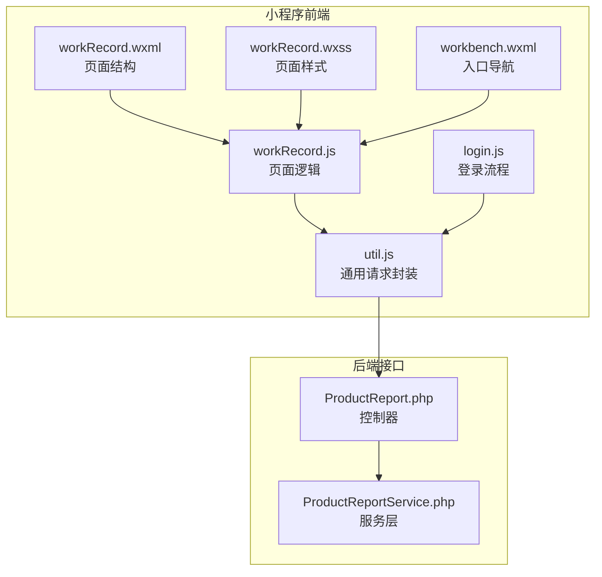
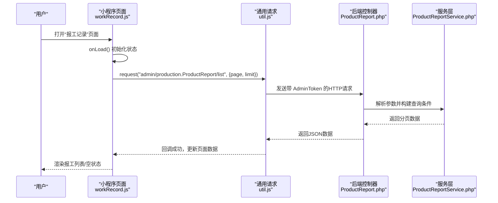
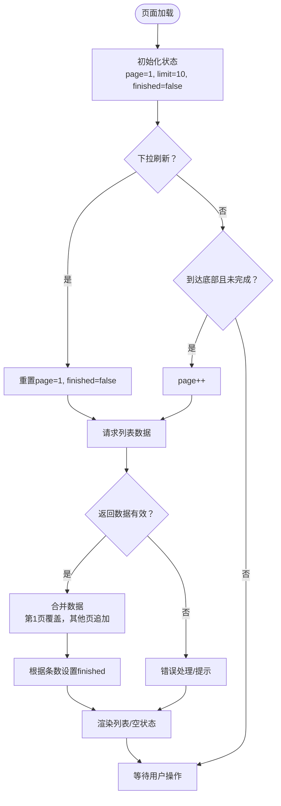
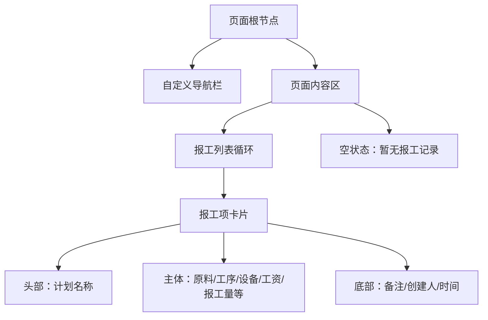
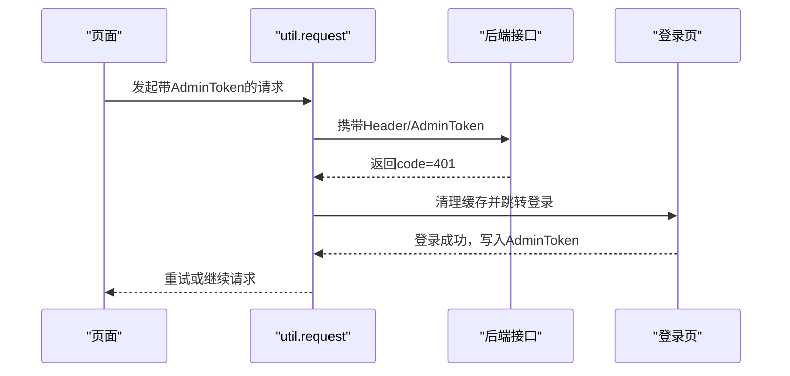
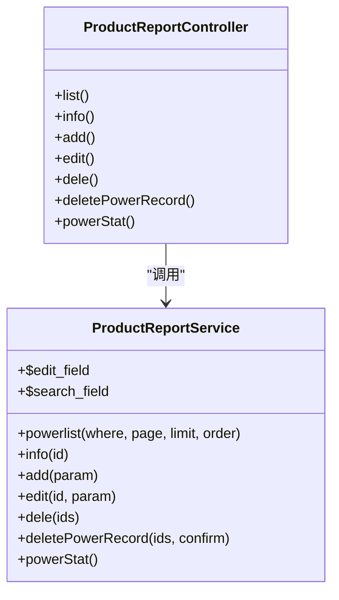
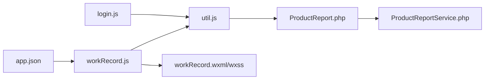

# 工作记录页面

<cite>
**本文引用的文件**
- [workRecord.js](file://gccd_mini/pageMine/pages/workRecord/workRecord.js)
- [workRecord.json](file://gccd_mini/pageMine/pages/workRecord/workRecord.json)
- [workRecord.wxml](file://gccd_mini/pageMine/pages/workRecord/workRecord.wxml)
- [workRecord.wxss](file://gccd_mini/pageMine/pages/workRecord/workRecord.wxss)
- [util.js](file://gccd_mini/utils/util.js)
- [ProductReport.php](file://gccd_server/app/admin/controller/production/ProductReport.php)
- [ProductReportService.php](file://gccd_server/app/common/service/admin/ProductReportService.php)
- [login.js](file://gccd_mini/pages/login/login.js)
- [app.json](file://gccd_mini/app.json)
- [workbench.wxml](file://gccd_mini/pages/workbench/workbench.wxml)
- [wageEfficiency.js](file://gccd_mini/pageMine/pages/wageEfficiency/wageEfficiency.js)
- [wageEfficiency.wxml](file://gccd_mini/pageMine/pages/wageEfficiency/wageEfficiency.wxml)
- [EnergyConsumption.js](file://yarn/src/api/mes/EnergyConsumption/EnergyConsumption.js)
</cite>

## 目录
1. [简介](#简介)
2. [项目结构](#项目结构)
3. [核心组件](#核心组件)
4. [架构总览](#架构总览)
5. [详细组件分析](#详细组件分析)
6. [依赖关系分析](#依赖关系分析)
7. [性能考虑](#性能考虑)
8. [故障排查指南](#故障排查指南)
9. [结论](#结论)
10. [附录](#附录)

## 简介
本文件为“工作记录页面”的详细开发文档，聚焦于报工记录的数据展示、分页加载、时间范围筛选、状态分类与排序、导出与打印、权限安全与用户体验优化。该页面基于小程序前端框架与后端 yylAdmin 接口，实现对生产报工历史的查询与呈现，并与权限系统、登录流程、以及能耗与效率看板形成协同。

## 项目结构
工作记录页面位于小程序前端子包 pageMine 中，采用标准的 wxml/wxss/js/json 结构组织；数据通过统一的工具函数 util.js 封装的请求方法调用后端接口；后端控制器与服务层负责数据聚合与筛选。

**图示来源**
- [workRecord.js:1-70](file://gccd_mini/pageMine/pages/workRecord/workRecord.js#L1-L70)
- [workRecord.wxml:1-101](file://gccd_mini/pageMine/pages/workRecord/workRecord.wxml#L1-L101)
- [workRecord.wxss:1-158](file://gccd_mini/pageMine/pages/workRecord/workRecord.wxss#L1-L158)
- [util.js:1-98](file://gccd_mini/utils/util.js#L1-L98)
- [ProductReport.php:1-331](file://gccd_server/app/admin/controller/production/ProductReport.php#L1-L331)
- [ProductReportService.php:1-200](file://gccd_server/app/common/service/admin/ProductReportService.php#L1-L200)
- [login.js:1-180](file://gccd_mini/pages/login/login.js#L1-L180)
- [workbench.wxml:1-37](file://gccd_mini/pages/workbench/workbench.wxml#L1-L37)

**章节来源**
- [workRecord.js:1-70](file://gccd_mini/pageMine/pages/workRecord/workRecord.js#L1-L70)
- [workRecord.json:1-6](file://gccd_mini/pageMine/pages/workRecord/workRecord.json#L1-L6)
- [workRecord.wxml:1-101](file://gccd_mini/pageMine/pages/workRecord/workRecord.wxml#L1-L101)
- [workRecord.wxss:1-158](file://gccd_mini/pageMine/pages/workRecord/workRecord.wxss#L1-L158)
- [util.js:1-98](file://gccd_mini/utils/util.js#L1-L98)
- [ProductReport.php:1-331](file://gccd_server/app/admin/controller/production/ProductReport.php#L1-L331)
- [ProductReportService.php:1-200](file://gccd_server/app/common/service/admin/ProductReportService.php#L1-L200)
- [login.js:1-180](file://gccd_mini/pages/login/login.js#L1-L180)
- [app.json:1-99](file://gccd_mini/app.json#L1-L99)
- [workbench.wxml:1-37](file://gccd_mini/pages/workbench/workbench.wxml#L1-L37)

## 核心组件
- 页面逻辑：负责分页加载、下拉刷新、空状态提示、数据拼接与渲染。
- 视图结构：以卡片式布局展示每条报工记录的关键字段，包含原料规格、工序、设备、报工数量、人员与备注等。
- 样式：采用阴影、圆角、交互反馈与响应式布局提升可读性与可用性。
- 请求封装：统一封装 wx.request，自动携带 AdminToken，处理 401 重定向登录。
- 后端接口：提供报工列表、信息、删除、统计等接口，支持按多种维度筛选与排序。

**章节来源**
- [workRecord.js:1-70](file://gccd_mini/pageMine/pages/workRecord/workRecord.js#L1-L70)
- [workRecord.wxml:1-101](file://gccd_mini/pageMine/pages/workRecord/workRecord.wxml#L1-L101)
- [workRecord.wxss:1-158](file://gccd_mini/pageMine/pages/workRecord/workRecord.wxss#L1-L158)
- [util.js:1-98](file://gccd_mini/utils/util.js#L1-L98)
- [ProductReport.php:43-251](file://gccd_server/app/admin/controller/production/ProductReport.php#L43-L251)

## 架构总览
工作记录页面从前端到后端的数据流如下：

**图示来源**
- [workRecord.js:19-41](file://gccd_mini/pageMine/pages/workRecord/workRecord.js#L19-L41)
- [util.js:22-94](file://gccd_mini/utils/util.js#L22-L94)
- [ProductReport.php:43-251](file://gccd_server/app/admin/controller/production/ProductReport.php#L43-L251)
- [ProductReportService.php:1-200](file://gccd_server/app/common/service/admin/ProductReportService.php#L1-L200)

## 详细组件分析

### 页面逻辑与数据流
- 分页与加载控制：使用 page/limit 控制请求页码与条数；finished 标记是否加载完毕；loading 防重复请求。
- 下拉刷新：重置 page=1 与 finished=false，重新拉取第一页数据并停止刷新动画。
- 上拉加载：在未完成时增加 page 并追加数据。
- 数据拼接：第一页替换列表，后续页追加合并，保证连续滚动体验。
- 空状态：当列表为空时展示“暂无报工记录”。

**图示来源**
- [workRecord.js:19-70](file://gccd_mini/pageMine/pages/workRecord/workRecord.js#L19-L70)

**章节来源**
- [workRecord.js:1-70](file://gccd_mini/pageMine/pages/workRecord/workRecord.js#L1-L70)

### 视图结构与展示
- 导航栏：自定义导航，左侧返回图标，中间标题“报工记录”，右侧留白。
- 列表项：每个报工记录以卡片形式展示，头部为计划名称，主体包含多项关键信息，底部为备注与创建人/时间。
- 条件渲染：对 yarn_count、card_user、product_user 等字段进行存在性判断再渲染。
- 空状态：无数据时展示“暂无报工记录”。

**图示来源**
- [workRecord.wxml:1-101](file://gccd_mini/pageMine/pages/workRecord/workRecord.wxml#L1-L101)

**章节来源**
- [workRecord.wxml:1-101](file://gccd_mini/pageMine/pages/workRecord/workRecord.wxml#L1-L101)

### 样式设计与交互
- 卡片式布局：圆角、阴影、悬停与按下反馈，增强可读性与交互感。
- 信息排版：标签与数值分离，支持换行与断词，适配移动端阅读。
- 响应式：在较大屏幕下限制最大宽度并居中显示。
- 空状态提示：居中展示，提升用户感知。

**章节来源**
- [workRecord.wxss:1-158](file://gccd_mini/pageMine/pages/workRecord/workRecord.wxss#L1-L158)

### 请求封装与权限集成
- 统一请求：封装 wx.request，自动附加 AdminToken，支持额外成功码。
- 错误处理：对 401 自动清理本地存储并跳转登录页；对 400/404/其它错误分别提示。
- 登录流程：登录成功后写入 AdminToken、昵称、部门、角色、是否超管等信息，随后跳转工作台。

**图示来源**
- [util.js:22-94](file://gccd_mini/utils/util.js#L22-L94)
- [login.js:76-118](file://gccd_mini/pages/login/login.js#L76-L118)

**章节来源**
- [util.js:1-98](file://gccd_mini/utils/util.js#L1-L98)
- [login.js:1-180](file://gccd_mini/pages/login/login.js#L1-L180)

### 后端接口与数据模型
- 列表接口：支持分页、排序、搜索条件（如计划名称、工序编码、设备编码、起止日期等），返回 list、pages、count 等分页信息。
- 信息/编辑/删除：提供详情、编辑、删除等能力。
- 统计接口：提供能耗统计等扩展能力，供效率看板复用。

**图示来源**
- [ProductReport.php:43-331](file://gccd_server/app/admin/controller/production/ProductReport.php#L43-L331)
- [ProductReportService.php:47-120](file://gccd_server/app/common/service/admin/ProductReportService.php#L47-L120)

**章节来源**
- [ProductReport.php:1-331](file://gccd_server/app/admin/controller/production/ProductReport.php#L1-L331)
- [ProductReportService.php:1-200](file://gccd_server/app/common/service/admin/ProductReportService.php#L1-L200)

### 与效率看板的数据协同
- 效率看板通过相同后端接口获取能耗与产能数据，用于图表展示；工作记录页面则专注于报工明细与历史查询。
- 两者共享同一 AdminToken 与权限体系，确保数据访问一致性。

**章节来源**
- [wageEfficiency.js:186-203](file://gccd_mini/pageMine/pages/wageEfficiency/wageEfficiency.js#L186-L203)
- [wageEfficiency.wxml:89-103](file://gccd_mini/pageMine/pages/wageEfficiency/wageEfficiency.wxml#L89-L103)

### 功能实现要点

#### 时间范围筛选
- 后端支持 create_start_date 与 create_end_date 查询条件，前端可扩展在筛选面板传入对应参数。
- 建议在现有列表接口基础上新增日期范围参数，保持与现有分页/排序一致。

**章节来源**
- [ProductReport.php:245-248](file://gccd_server/app/admin/controller/production/ProductReport.php#L245-L248)

#### 状态分类与排序
- 后端支持排序参数注入，前端可传递 order 字段以实现按时间、计划名称等字段排序。
- 状态分类（如设备状态、报工状态）可在后端聚合后返回，前端按字段渲染不同样式或徽标。

**章节来源**
- [ProductReport.php:33-38](file://gccd_server/app/admin/controller/production/ProductReport.php#L33-L38)

#### 导出与打印
- 当前页面未内置导出/打印按钮。建议在导航栏右侧增加“导出”入口，调用后端导出接口或前端将当前筛选结果转为 PDF/Excel。
- 打印：可利用浏览器打印样式或小程序端打印组件，结合现有列表结构输出。

**章节来源**
- [workRecord.wxml:1-101](file://gccd_mini/pageMine/pages/workRecord/workRecord.wxml#L1-L101)

#### 用户权限与安全
- 登录成功后写入 AdminToken 与用户信息；所有请求自动携带 AdminToken。
- 401 时自动清空缓存并跳转登录，保障敏感数据访问安全。
- 建议在后端对报工记录的可见范围进行用户角色/部门维度校验。

**章节来源**
- [util.js:34-67](file://gccd_mini/utils/util.js#L34-L67)
- [login.js:96-113](file://gccd_mini/pages/login/login.js#L96-L113)

#### 用户体验优化
- 卡片交互：按下反馈与阴影变化，提升点击确认感。
- 响应式布局：在大屏下限制宽度并居中，减少横向滚动。
- 空状态：明确提示“暂无报工记录”，避免用户困惑。
- 刷新与加载：下拉刷新与上拉加载配合，保证长列表流畅体验。

**章节来源**
- [workRecord.wxss:25-28](file://gccd_mini/pageMine/pages/workRecord/workRecord.wxss#L25-L28)
- [workRecord.wxss:121-126](file://gccd_mini/pageMine/pages/workRecord/workRecord.wxss#L121-L126)
- [workRecord.wxml:97-100](file://gccd_mini/pageMine/pages/workRecord/workRecord.wxml#L97-L100)

## 依赖关系分析
- 页面依赖：workRecord.js 依赖 util.js 进行网络请求；wxml/wxss 提供视图与样式；app.json 定义页面路径与分包。
- 后端依赖：控制器依赖服务层，服务层依赖模型与数据库查询。
- 权限依赖：登录页负责令牌发放与存储，util.js 负责携带令牌与处理 401。

**图示来源**
- [workRecord.js:1-70](file://gccd_mini/pageMine/pages/workRecord/workRecord.js#L1-L70)
- [util.js:1-98](file://gccd_mini/utils/util.js#L1-L98)
- [ProductReport.php:1-331](file://gccd_server/app/admin/controller/production/ProductReport.php#L1-L331)
- [ProductReportService.php:1-200](file://gccd_server/app/common/service/admin/ProductReportService.php#L1-L200)
- [login.js:1-180](file://gccd_mini/pages/login/login.js#L1-L180)
- [app.json:64-71](file://gccd_mini/app.json#L64-L71)

**章节来源**
- [app.json:1-99](file://gccd_mini/app.json#L1-L99)
- [workbench.wxml:25-36](file://gccd_mini/pages/workbench/workbench.wxml#L25-L36)

## 性能考虑
- 分页策略：合理设置 limit，避免一次性加载过多数据导致内存压力。
- 渲染优化：列表项采用虚拟列表或懒渲染（如需）以降低首屏与滚动成本。
- 缓存策略：对筛选条件与结果进行短期缓存，减少重复请求。
- 网络优化：在弱网环境下提供更友好的加载提示与重试机制。

## 故障排查指南
- 登录失效：出现 401 时会自动跳转登录页，确认 AdminToken 是否被清除或过期。
- 网络异常：检查网络状态与域名白名单，确保请求地址可达。
- 数据为空：确认筛选条件是否过于严格，或后端是否存在数据。
- 列表不更新：检查下拉刷新与上拉加载逻辑，确保 finished 与 page 状态正确。

**章节来源**
- [util.js:57-67](file://gccd_mini/utils/util.js#L57-L67)
- [workRecord.js:53-69](file://gccd_mini/pageMine/pages/workRecord/workRecord.js#L53-L69)

## 结论
工作记录页面以清晰的卡片化展示与完善的分页/刷新机制为核心，结合统一的权限与请求封装，实现了对报工历史的高效查询。后续可在筛选、排序、导出/打印、状态分类等方面进一步完善，同时与效率看板形成数据协同，提升整体运营可视化水平。

## 附录

### API 定义（与工作记录相关）
- 列表接口
  - 方法：POST
  - 地址：/admin/production.ProductReport/list
  - 参数：page、limit、排序与搜索条件（如计划名称、工序编码、设备编码、起止日期等）
  - 返回：分页数据（list、pages、count）

- 详情/编辑/删除
  - 详情：/admin/production.ProductReport/info
  - 编辑：/admin/production.ProductReport/edit
  - 删除：/admin/production.ProductReport/dele

- 能耗统计
  - 统计：/admin/production.ProductReport/powerStat

**章节来源**
- [ProductReport.php:43-331](file://gccd_server/app/admin/controller/production/ProductReport.php#L43-L331)
- [EnergyConsumption.js:9-100](file://yarn/src/api/mes/EnergyConsumption/EnergyConsumption.js#L9-L100)