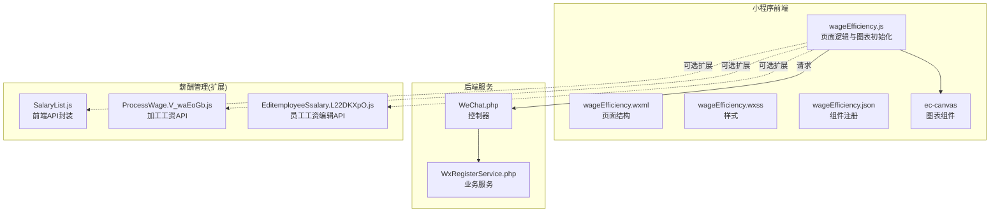
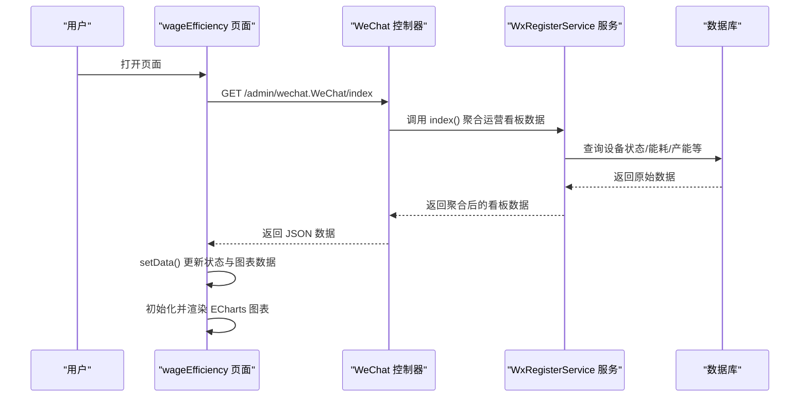
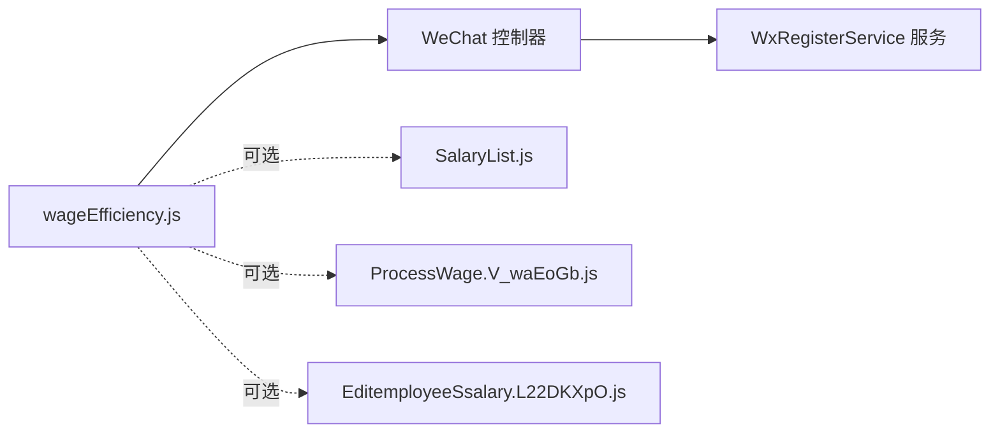

# 工资效率页面

<cite>
**本文引用的文件**
- [wageEfficiency.js](file://gccd_mini/pageMine/pages/wageEfficiency/wageEfficiency.js)
- [wageEfficiency.json](file://gccd_mini/pageMine/pages/wageEfficiency/wageEfficiency.json)
- [wageEfficiency.wxml](file://gccd_mini/pageMine/pages/wageEfficiency/wageEfficiency.wxml)
- [wageEfficiency.wxss](file://gccd_mini/pageMine/pages/wageEfficiency/wageEfficiency.wxss)
- [WeChat.php](file://gccd_server/app/admin/controller/wechat/WeChat.php)
- [WxRegisterService.php](file://gccd_server/app/common/service/wechat/WxRegisterService.php)
- [SalaryList.js](file://yarn/src/api/mes/SalaryList/SalaryList.js)
- [ProcessWage.V_waEoGb.js](file://yarn/admin/js/ProcessSalary.V_waEoGb.js)
- [EditemployeeSsalary.L22DKXpO.js](file://yarn/admin/js/EditemployeeSsalary.L22DKXpO.js)
</cite>

## 目录
1. [简介](#简介)
2. [项目结构](#项目结构)
3. [核心组件](#核心组件)
4. [架构概览](#架构概览)
5. [详细组件分析](#详细组件分析)
6. [依赖关系分析](#依赖关系分析)
7. [性能考虑](#性能考虑)
8. [故障排查指南](#故障排查指南)
9. [结论](#结论)
10. [附录](#附录)

## 简介
本文件面向“工资效率页面”的开发与维护，系统性梳理前端页面、后端接口与薪酬管理系统的数据对接方式，重点覆盖以下能力：
- 工资效率统计与趋势分析：能耗趋势、设备产能趋势
- 绩效评估与成本分析：设备状态、异常提示、数据来源与口径
- 时间范围选择与对比分析：接口参数支持起止日期筛选
- 高级功能：部门对比、个人排名（需在薪酬管理模块扩展）
- 权限与数据访问控制：基于后端接口的鉴权与数据过滤
- 报表生成与数据导出：接口支持导出能力

注意：当前工资效率页面主要展示“设备运行状态”“能耗趋势”“设备产能趋势”等运营看板类数据；关于“工资效率”的具体计算公式、部门对比与个人排名等高级功能，需结合薪酬管理模块进行扩展。

## 项目结构
工资效率页面位于小程序前端工程中，采用标准的 wxml/wxss/js 结构，并通过自定义组件渲染图表。后端提供统一的 wechat 接口用于运营看板数据聚合。

图示来源
- [wageEfficiency.js:1-275](file://gccd_mini/pageMine/pages/wageEfficiency/wageEfficiency.js#L1-L275)
- [WeChat.php:180-264](file://gccd_server/app/admin/controller/wechat/WeChat.php#L180-L264)
- [WxRegisterService.php:427-487](file://gccd_server/app/common/service/wechat/WxRegisterService.php#L427-L487)
- [SalaryList.js:1-28](file://yarn/src/api/mes/SalaryList/SalaryList.js#L1-L28)
- [ProcessWage.V_waEoGb.js:1-1](file://yarn/admin/js/ProcessSalary.V_waEoGb.js#L1-L1)
- [EditemployeeSsalary.L22DKXpO.js:1-1](file://yarn/admin/js/EditemployeeSsalary.L22DKXpO.js#L1-L1)

章节来源
- [wageEfficiency.js:1-275](file://gccd_mini/pageMine/pages/wageEfficiency/wageEfficiency.js#L1-L275)
- [wageEfficiency.json:1-7](file://gccd_mini/pageMine/pages/wageEfficiency/wageEfficiency.json#L1-L7)
- [wageEfficiency.wxml:1-106](file://gccd_mini/pageMine/pages/wageEfficiency/wageEfficiency.wxml#L1-L106)
- [wageEfficiency.wxss:1-272](file://gccd_mini/pageMine/pages/wageEfficiency/wageEfficiency.wxss#L1-L272)

## 核心组件
- 页面逻辑与图表初始化：负责加载设备状态、能耗趋势、产能趋势数据，并初始化 ECharts 图表。
- 页面结构与样式：提供自定义导航栏、设备状态卡片、设备明细表格、图表容器等布局。
- 图表组件：通过 ec-canvas 渲染能耗与产能趋势图。
- 后端接口：提供运营看板数据聚合接口，支持按日期范围查询。

章节来源
- [wageEfficiency.js:39-275](file://gccd_mini/pageMine/pages/wageEfficiency/wageEfficiency.js#L39-L275)
- [wageEfficiency.wxml:1-106](file://gccd_mini/pageMine/pages/wageEfficiency/wageEfficiency.wxml#L1-L106)
- [wageEfficiency.wxss:1-272](file://gccd_mini/pageMine/pages/wageEfficiency/wageEfficiency.wxss#L1-L272)

## 架构概览
工资效率页面的数据流从小程序前端发起，经由后端 wechat 控制器聚合运营看板数据，再返回给前端进行可视化展示。薪酬管理相关能力作为扩展模块接入，用于支撑更深入的工资效率分析。

图示来源
- [wageEfficiency.js:186-203](file://gccd_mini/pageMine/pages/wageEfficiency/wageEfficiency.js#L186-L203)
- [WeChat.php:180-186](file://gccd_server/app/admin/controller/wechat/WeChat.php#L180-L186)
- [WxRegisterService.php:427-487](file://gccd_server/app/common/service/wechat/WxRegisterService.php#L427-L487)

## 详细组件分析

### 页面结构与交互
- 自定义导航栏：包含返回按钮与标题，适配状态栏高度。
- 设备运行状态卡片：展示设备总数、正常、运行中、未启动等关键指标。
- 设备状态明细：支持手风琴展开/收起，分页展示设备名称与状态。
- 图表容器：能耗趋势与设备产能趋势两个图表区域。

章节来源
- [wageEfficiency.wxml:1-106](file://gccd_mini/pageMine/pages/wageEfficiency/wageEfficiency.wxml#L1-L106)
- [wageEfficiency.wxss:1-272](file://gccd_mini/pageMine/pages/wageEfficiency/wageEfficiency.wxss#L1-L272)

### 图表初始化与渲染
- 能耗趋势图：柱状图展示燃气消耗与电力消耗，支持旋转坐标轴标签。
- 产能趋势图：折线图展示日产量，带面积填充与平滑曲线。
- 图表初始化：通过 ec-canvas 的 onInit 回调创建 ECharts 实例并设置配置。

章节来源
- [wageEfficiency.js:5-23](file://gccd_mini/pageMine/pages/wageEfficiency/wageEfficiency.js#L5-L23)
- [wageEfficiency.js:75-130](file://gccd_mini/pageMine/pages/wageEfficiency/wageEfficiency.js#L75-L130)
- [wageEfficiency.js:133-184](file://gccd_mini/pageMine/pages/wageEfficiency/wageEfficiency.js#L133-L184)
- [wageEfficiency.js:243-262](file://gccd_mini/pageMine/pages/wageEfficiency/wageEfficiency.js#L243-L262)

### 数据加载与接口调用
- 运营看板数据：调用后端 wechat.index 接口，返回设备状态、燃气/电力报表、日产量等数据。
- 设备明细：调用 admin/repair.Device/list 接口，限制单次最大条目，支持手风琴预览。
- 图表数据绑定：将后端返回的日期序列与数值序列映射到图表配置。

章节来源
- [wageEfficiency.js:186-203](file://gccd_mini/pageMine/pages/wageEfficiency/wageEfficiency.js#L186-L203)
- [wageEfficiency.js:209-233](file://gccd_mini/pageMine/pages/wageEfficiency/wageEfficiency.js#L209-L233)

### 工资效率计算与数据处理（扩展建议）
当前页面未直接展示“工资效率”指标。若需实现，建议在薪酬管理模块扩展如下能力：
- 计算逻辑：例如“单位产值人工成本”“人均产出”“部门效率排名”等指标，需结合薪酬数据与生产数据。
- 数据对接：前端通过 SalaryList.js、ProcessWage.V_waEoGb.js、EditemployeeSsalary.L22DKXpO.js 等接口获取薪酬与加工工资数据。
- 时间范围：接口参数支持 start_date/end_date，便于对比分析。
- 对比分析：按部门/产线/个人维度聚合，输出排名与趋势。

章节来源
- [SalaryList.js:1-28](file://yarn/src/api/mes/SalaryList/SalaryList.js#L1-L28)
- [ProcessWage.V_waEoGb.js:1-1](file://yarn/admin/js/ProcessSalary.V_waEoGb.js#L1-L1)
- [EditemployeeSsalary.L22DKXpO.js:1-1](file://yarn/admin/js/EditemployeeSsalary.L22DKXpO.js#L1-L1)

### 报表生成与数据导出（扩展建议）
- 导出接口：后端 WeChat 控制器提供 exportProcessDailyReport 方法，可用于导出工序日报表。
- 前端集成：可在页面增加“导出”按钮，调用对应接口并触发下载。

章节来源
- [WeChat.php:248-261](file://gccd_server/app/admin/controller/wechat/WeChat.php#L248-L261)

## 依赖关系分析
- 前端依赖：ec-canvas 图表组件、@vant/weapp 图标组件、本地工具函数 util.request。
- 后端依赖：WeChat 控制器与 WxRegisterService 服务，负责运营看板数据聚合。
- 薪酬管理扩展：SalaryList.js、ProcessWage.V_waEoGb.js、EditemployeeSsalary.L22DKXpO.js 提供薪酬相关接口。

图示来源
- [wageEfficiency.js:1-275](file://gccd_mini/pageMine/pages/wageEfficiency/wageEfficiency.js#L1-L275)
- [WeChat.php:180-264](file://gccd_server/app/admin/controller/wechat/WeChat.php#L180-L264)
- [SalaryList.js:1-28](file://yarn/src/api/mes/SalaryList/SalaryList.js#L1-L28)
- [ProcessWage.V_waEoGb.js:1-1](file://yarn/admin/js/ProcessSalary.V_waEoGb.js#L1-L1)
- [EditemployeeSsalary.L22DKXpO.js:1-1](file://yarn/admin/js/EditemployeeSsalary.L22DKXpO.js#L1-L1)

## 性能考虑
- 图表渲染：避免在每次 setData 后重复初始化图表实例，当前实现已通过 selectComponent 与 onInit 控制初始化时机。
- 数据量控制：设备明细接口限制单次最大条目，防止一次性渲染过多节点导致卡顿。
- 样式优化：使用相对单位与弹性布局，提升不同屏幕尺寸下的适配性。
- 网络请求：合理设置请求超时与重试策略，避免频繁刷新造成资源浪费。

## 故障排查指南
- 图表不显示：确认 ec-canvas 组件已正确注册，且 onInit 回调被调用；检查 setData 是否在请求完成后执行。
- 数据为空：核对后端接口返回结构与字段映射，确保日期序列与数值序列一一对应。
- 设备明细加载失败：检查网络请求状态码与错误回调，确认接口权限与参数传递。
- 图表样式异常：检查 wxss 中容器高度与图表尺寸设置，确保在不同机型上保持一致。

章节来源
- [wageEfficiency.js:243-262](file://gccd_mini/pageMine/pages/wageEfficiency/wageEfficiency.js#L243-L262)
- [wageEfficiency.js:209-233](file://gccd_mini/pageMine/pages/wageEfficiency/wageEfficiency.js#L209-L233)
- [wageEfficiency.wxss:68-71](file://gccd_mini/pageMine/pages/wageEfficiency/wageEfficiency.wxss#L68-L71)

## 结论
工资效率页面当前聚焦于运营看板数据的可视化呈现，具备设备状态、能耗趋势与产能趋势的核心能力。若需实现“工资效率”的深度分析（如单位产值人工成本、部门/个人排名、趋势对比），建议在薪酬管理模块扩展相应接口与计算逻辑，并与现有运营看板接口协同工作，形成完整的数据链路。

## 附录

### 接口定义（后端）
- 运营看板数据
  - 方法：GET
  - 路径：/admin/wechat.WeChat/index
  - 参数：无固定必填参数，可结合业务扩展
  - 返回：设备状态、燃气/电力报表、日产量等
- 设备明细
  - 方法：POST
  - 路径：/admin/repair.Device/list
  - 参数：page、limit（建议 limit 不超过 500）
  - 返回：设备列表与总数
- 工序日报表导出
  - 方法：GET
  - 路径：/admin/wechat.WeChat/exportProcessDailyReport
  - 参数：start_date、end_date

章节来源
- [WeChat.php:180-261](file://gccd_server/app/admin/controller/wechat/WeChat.php#L180-L261)