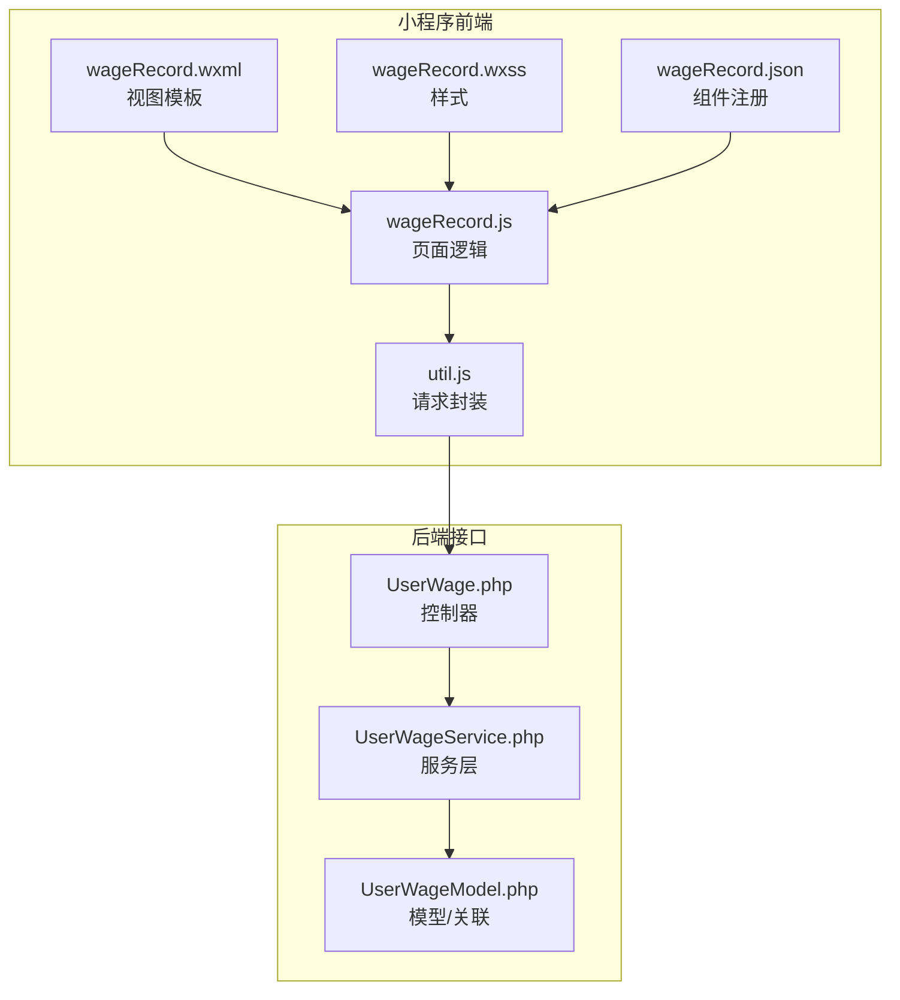
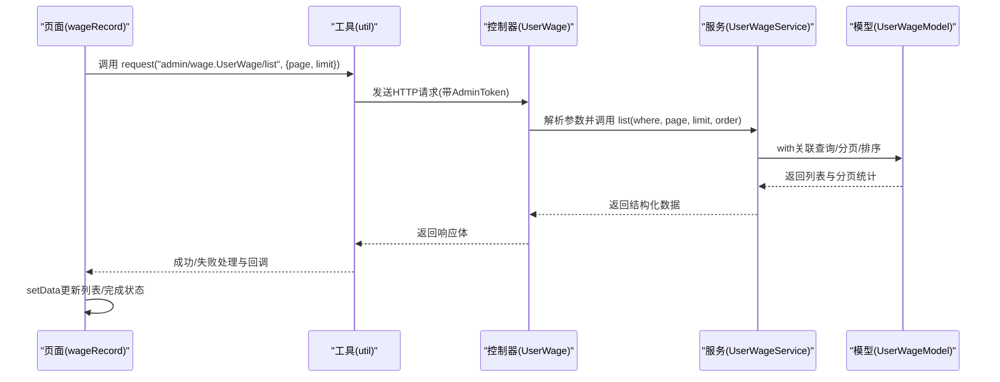
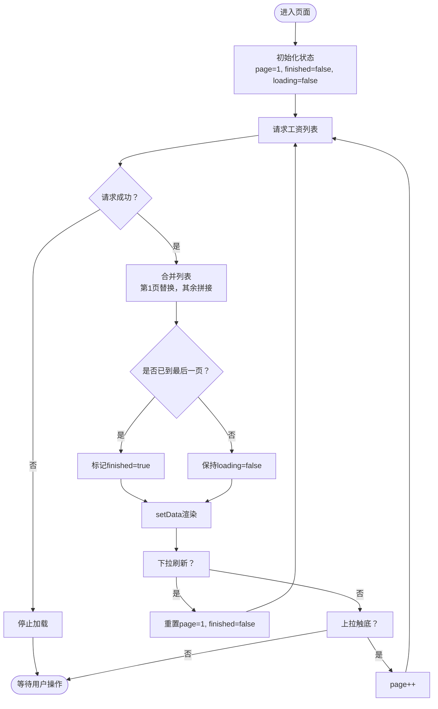
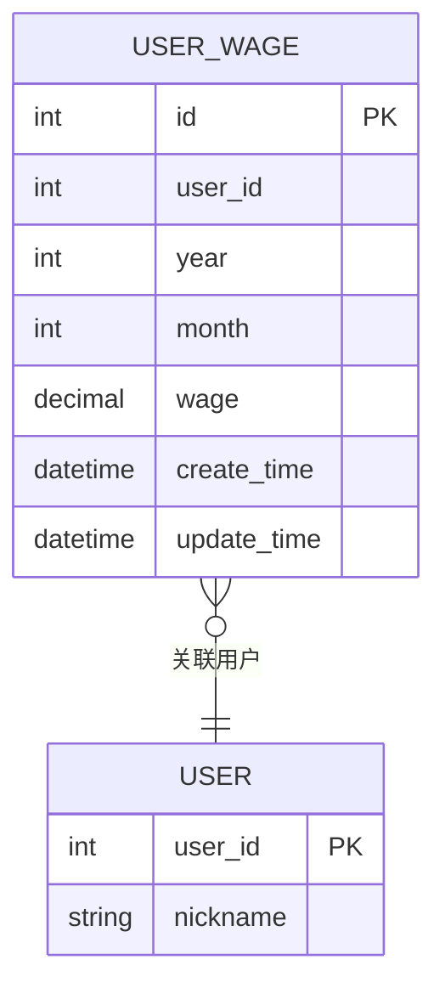
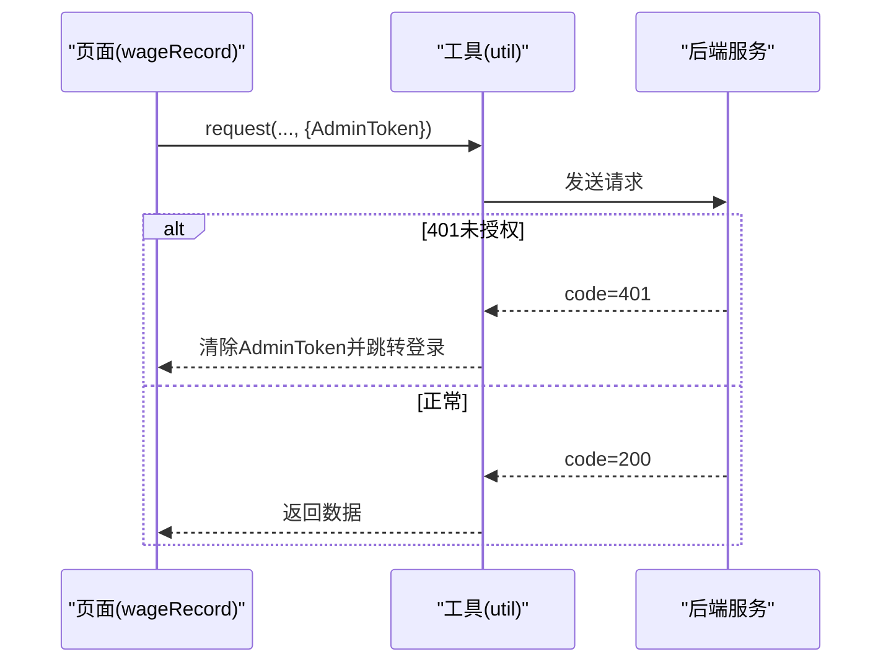
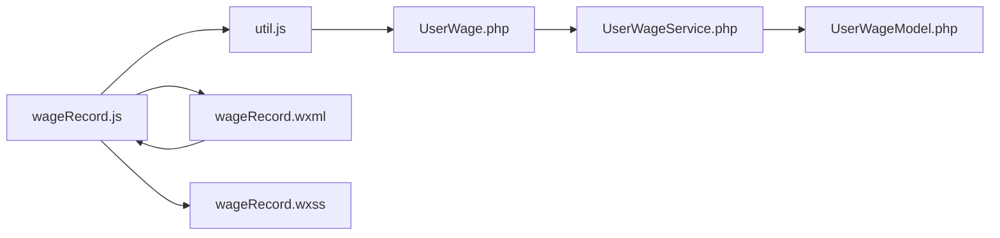

# 工资记录页面

<cite>
**本文引用的文件**
- [wageRecord.js](file://gccd_mini/pageMine/pages/wageRecord/wageRecord.js)
- [wageRecord.json](file://gccd_mini/pageMine/pages/wageRecord/wageRecord.json)
- [wageRecord.wxml](file://gccd_mini/pageMine/pages/wageRecord/wageRecord.wxml)
- [wageRecord.wxss](file://gccd_mini/pageMine/pages/wageRecord/wageRecord.wxss)
- [util.js](file://gccd_mini/utils/util.js)
- [UserWage.php](file://gccd_server/app/admin/controller/wage/UserWage.php)
- [UserWageService.php](file://gccd_server/app/common/service/admin/UserWageService.php)
- [UserWageModel.php](file://gccd_server/app/common/model/admin/UserWageModel.php)
- [permission.js](file://yarn/src/permission.js)
</cite>

## 目录
1. [简介](#简介)
2. [项目结构](#项目结构)
3. [核心组件](#核心组件)
4. [架构总览](#架构总览)
5. [详细组件分析](#详细组件分析)
6. [依赖关系分析](#依赖关系分析)
7. [性能考虑](#性能考虑)
8. [故障排查指南](#故障排查指南)
9. [结论](#结论)
10. [附录](#附录)

## 简介
本文件面向“工资记录页面”的前端实现与后端接口对接，围绕以下目标展开：工资明细列表展示、发放状态标识、时间筛选、数据获取与渲染、排序与分页、空状态提示、以及与权限系统的集成。文档同时给出关键流程图与时序图，帮助开发者快速理解并进行后续扩展与优化。

## 项目结构
工资记录页面位于小程序前端工程中，采用标准的 WXML + WXSS + JS 结构，并通过工具函数封装统一的请求方法；后端提供统一的 API 控制器与服务层，支持分页、排序与搜索条件过滤。

图表来源
- [wageRecord.wxml:1-42](file://gccd_mini/pageMine/pages/wageRecord/wageRecord.wxml#L1-L42)
- [wageRecord.wxss:1-89](file://gccd_mini/pageMine/pages/wageRecord/wageRecord.wxss#L1-L89)
- [wageRecord.js:1-138](file://gccd_mini/pageMine/pages/wageRecord/wageRecord.js#L1-L138)
- [util.js:1-98](file://gccd_mini/utils/util.js#L1-L98)
- [UserWage.php:38-72](file://gccd_server/app/admin/controller/wage/UserWage.php#L38-L72)
- [UserWageService.php:64-79](file://gccd_server/app/common/service/admin/UserWageService.php#L64-L79)
- [UserWageModel.php:1-23](file://gccd_server/app/common/model/admin/UserWageModel.php#L1-L23)

章节来源
- [wageRecord.js:1-138](file://gccd_mini/pageMine/pages/wageRecord/wageRecord.js#L1-L138)
- [wageRecord.json:1-7](file://gccd_mini/pageMine/pages/wageRecord/wageRecord.json#L1-L7)
- [wageRecord.wxml:1-42](file://gccd_mini/pageMine/pages/wageRecord/wageRecord.wxml#L1-L42)
- [wageRecord.wxss:1-89](file://gccd_mini/pageMine/pages/wageRecord/wageRecord.wxss#L1-L89)
- [util.js:1-98](file://gccd_mini/utils/util.js#L1-L98)
- [UserWage.php:38-72](file://gccd_server/app/admin/controller/wage/UserWage.php#L38-L72)
- [UserWageService.php:64-79](file://gccd_server/app/common/service/admin/UserWageService.php#L64-L79)
- [UserWageModel.php:1-23](file://gccd_server/app/common/model/admin/UserWageModel.php#L1-L23)

## 核心组件
- 页面逻辑（wageRecord.js）：负责初始化、下拉刷新、上拉加载、分页控制、列表渲染、空状态显示、以及与工具函数的请求交互。
- 视图模板（wageRecord.wxml）：定义导航栏、列表项结构、空状态占位。
- 样式（wageRecord.wxss）：定义卡片式布局、列表项样式、金额高亮等视觉表现。
- 请求封装（util.js）：统一封装 wx.request，处理响应码、鉴权失效跳转、错误提示与网络异常。
- 后端控制器（UserWage.php）：接收分页、排序、搜索参数，构造查询条件并调用服务层。
- 服务层（UserWageService.php）：实现分页计算、排序规则、关联查询与数据聚合。
- 模型（UserWageModel.php）：定义主表与用户表的关联绑定，便于在列表中直接携带用户名字段。

章节来源
- [wageRecord.js:78-102](file://gccd_mini/pageMine/pages/wageRecord/wageRecord.js#L78-L102)
- [wageRecord.wxml:16-41](file://gccd_mini/pageMine/pages/wageRecord/wageRecord.wxml#L16-L41)
- [wageRecord.wxss:11-82](file://gccd_mini/pageMine/pages/wageRecord/wageRecord.wxss#L11-L82)
- [util.js:22-94](file://gccd_mini/utils/util.js#L22-L94)
- [UserWage.php:38-72](file://gccd_server/app/admin/controller/wage/UserWage.php#L38-L72)
- [UserWageService.php:64-79](file://gccd_server/app/common/service/admin/UserWageService.php#L64-L79)
- [UserWageModel.php:14-22](file://gccd_server/app/common/model/admin/UserWageModel.php#L14-L22)

## 架构总览
从前端到后端的数据流如下：小程序页面发起请求，工具函数统一处理鉴权与错误，后端控制器解析参数、拼装查询条件，服务层执行分页与排序，最终返回包含分页信息与列表数据的结构化结果。

图表来源
- [wageRecord.js:78-102](file://gccd_mini/pageMine/pages/wageRecord/wageRecord.js#L78-L102)
- [util.js:22-94](file://gccd_mini/utils/util.js#L22-L94)
- [UserWage.php:38-72](file://gccd_server/app/admin/controller/wage/UserWage.php#L38-L72)
- [UserWageService.php:64-79](file://gccd_server/app/common/service/admin/UserWageService.php#L64-L79)
- [UserWageModel.php:14-22](file://gccd_server/app/common/model/admin/UserWageModel.php#L14-L22)

## 详细组件分析

### 页面数据获取与渲染
- 初始化与状态管理：页面在加载时获取系统状态栏高度并触发首次列表请求；内部维护分页、加载与完成状态，避免重复请求与过度加载。
- 分页与无限滚动：上拉触底时递增页码并继续请求；当后端返回列表长度小于每页数量或达到总页数时标记完成，停止继续加载。
- 下拉刷新：重置页码与完成状态后重新请求，完成后停止刷新动画。
- 列表渲染：使用 wx:for 遍历列表，展示姓名、年月、实发金额等字段；空状态时显示“暂无工资记录”。

图表来源
- [wageRecord.js:78-137](file://gccd_mini/pageMine/pages/wageRecord/wageRecord.js#L78-L137)
- [wageRecord.wxml:16-41](file://gccd_mini/pageMine/pages/wageRecord/wageRecord.wxml#L16-L41)

章节来源
- [wageRecord.js:78-137](file://gccd_mini/pageMine/pages/wageRecord/wageRecord.js#L78-L137)
- [wageRecord.wxml:16-41](file://gccd_mini/pageMine/pages/wageRecord/wageRecord.wxml#L16-L41)

### 后端接口与数据格式
- 接口路径：admin/wage.UserWage/list
- 请求方式：POST
- 参数：page、limit（必填），可选搜索与时间范围参数（由控制器解析）
- 返回结构：包含 code、msg、data 的统一响应体；其中 data 包含 count、pages、page、limit、list 等字段
- 默认排序：按创建时间倒序
- 关联字段：通过模型关联绑定用户名字段，便于直接展示

图表来源
- [UserWageModel.php:14-22](file://gccd_server/app/common/model/admin/UserWageModel.php#L14-L22)
- [UserWageService.php:64-79](file://gccd_server/app/common/service/admin/UserWageService.php#L64-L79)
- [UserWage.php:38-72](file://gccd_server/app/admin/controller/wage/UserWage.php#L38-L72)

章节来源
- [UserWage.php:38-72](file://gccd_server/app/admin/controller/wage/UserWage.php#L38-L72)
- [UserWageService.php:64-79](file://gccd_server/app/common/service/admin/UserWageService.php#L64-L79)
- [UserWageModel.php:14-22](file://gccd_server/app/common/model/admin/UserWageModel.php#L14-L22)

### 权限与鉴权集成
- 小程序端：请求头携带 AdminToken；当后端返回 401 时，前端清除本地存储并跳转登录页。
- 管理端前端（Vue）：全局前置守卫根据用户角色动态生成路由，未登录用户被重定向至登录页。
- 建议：工资记录页面应结合后端权限校验，确保仅具备相应角色或菜单权限的用户可见。

图表来源
- [util.js:57-68](file://gccd_mini/utils/util.js#L57-L68)
- [permission.js:21-68](file://yarn/src/permission.js#L21-L68)

章节来源
- [util.js:57-68](file://gccd_mini/utils/util.js#L57-L68)
- [permission.js:21-68](file://yarn/src/permission.js#L21-L68)

### 功能扩展建议
- 时间筛选：在现有搜索参数基础上增加 create_start_date/create_end_date，控制器与服务层已支持。
- 排序：服务层默认按创建时间倒序，如需其他字段排序，可在控制器传入 order 参数。
- 搜索：支持用户名、编号等字段模糊查询，控制器已实现关联查询与 in 条件。
- 发放状态标识：可在列表项中增加状态标签与颜色区分，结合后端字段进行展示。

章节来源
- [UserWage.php:44-69](file://gccd_server/app/admin/controller/wage/UserWage.php#L44-L69)
- [UserWageService.php:68-76](file://gccd_server/app/common/service/admin/UserWageService.php#L68-L76)

## 依赖关系分析
- 前端依赖：页面逻辑依赖工具函数进行网络请求；视图模板依赖页面数据进行渲染；JSON 文件声明所需组件。
- 后端依赖：控制器依赖服务层；服务层依赖模型与数据库查询；模型通过关联绑定用户名字段。

图表来源
- [wageRecord.js:1-138](file://gccd_mini/pageMine/pages/wageRecord/wageRecord.js#L1-L138)
- [util.js:1-98](file://gccd_mini/utils/util.js#L1-L98)
- [wageRecord.wxml:1-42](file://gccd_mini/pageMine/pages/wageRecord/wageRecord.wxml#L1-L42)
- [wageRecord.wxss:1-89](file://gccd_mini/pageMine/pages/wageRecord/wageRecord.wxss#L1-L89)
- [UserWage.php:38-72](file://gccd_server/app/admin/controller/wage/UserWage.php#L38-L72)
- [UserWageService.php:64-79](file://gccd_server/app/common/service/admin/UserWageService.php#L64-L79)
- [UserWageModel.php:1-23](file://gccd_server/app/common/model/admin/UserWageModel.php#L1-L23)

章节来源
- [wageRecord.js:1-138](file://gccd_mini/pageMine/pages/wageRecord/wageRecord.js#L1-L138)
- [util.js:1-98](file://gccd_mini/utils/util.js#L1-L98)
- [wageRecord.wxml:1-42](file://gccd_mini/pageMine/pages/wageRecord/wageRecord.wxml#L1-L42)
- [wageRecord.wxss:1-89](file://gccd_mini/pageMine/pages/wageRecord/wageRecord.wxss#L1-L89)
- [UserWage.php:38-72](file://gccd_server/app/admin/controller/wage/UserWage.php#L38-L72)
- [UserWageService.php:64-79](file://gccd_server/app/common/service/admin/UserWageService.php#L64-L79)
- [UserWageModel.php:1-23](file://gccd_server/app/common/model/admin/UserWageModel.php#L1-L23)

## 性能考虑
- 首屏渲染：列表为空时显示空状态组件，减少空白区域；卡片阴影与圆角提升可读性但注意层级深度。
- 分页加载：避免一次性拉取过多数据；上拉加载时仅在未完成状态下请求，防止重复请求。
- 缓存策略：当前实现未见前端缓存逻辑；可在页面级缓存最近一次请求结果，结合日期维度做去重（例如已请求月份不再重复请求）。
- 网络优化：统一请求头携带 AdminToken，减少鉴权失败重试；对频繁触发的请求（如滚动）可考虑节流/防抖。
- 数据结构：后端返回包含 pages、count 等分页元信息，前端据此判断是否继续加载，降低无效请求。

章节来源
- [wageRecord.js:78-137](file://gccd_mini/pageMine/pages/wageRecord/wageRecord.js#L78-L137)
- [util.js:22-94](file://gccd_mini/utils/util.js#L22-L94)
- [UserWageService.php:74-78](file://gccd_server/app/common/service/admin/UserWageService.php#L74-L78)

## 故障排查指南
- 登录态失效：当后端返回 401 时，前端会清除本地令牌并跳转登录页；检查 AdminToken 是否正确存储与传递。
- 网络异常：请求失败时弹出“网络异常，请检查网络”提示；确认域名与网络配置。
- 业务错误：根据返回 code 分类处理，如 400、404 等；前端会提示具体消息。
- 列表不更新：下拉刷新后需等待请求完成再停止刷新动画；确认回调链路完整。

章节来源
- [util.js:49-90](file://gccd_mini/utils/util.js#L49-L90)
- [wageRecord.js:117-126](file://gccd_mini/pageMine/pages/wageRecord/wageRecord.js#L117-L126)

## 结论
工资记录页面以简洁的分页与列表渲染为核心，配合统一的请求封装与后端服务层，实现了稳定的列表展示能力。建议后续补充时间筛选、排序与状态标识等交互细节，并在前端层面引入缓存与节流策略以进一步提升体验与性能。

## 附录
- 组件与页面文件清单
  - 视图：wageRecord.wxml
  - 样式：wageRecord.wxss
  - 逻辑：wageRecord.js
  - 组件注册：wageRecord.json
  - 请求封装：util.js
  - 后端控制器：UserWage.php
  - 服务层：UserWageService.php
  - 模型：UserWageModel.php
  - 权限守卫：permission.js