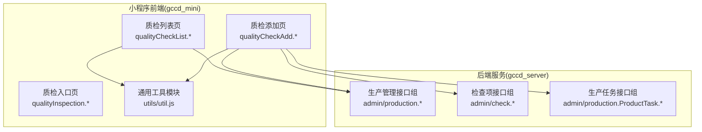
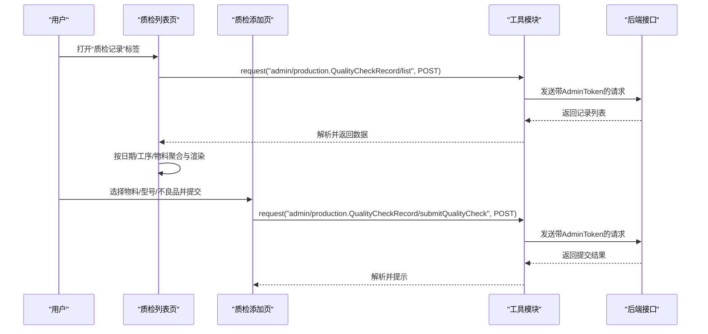
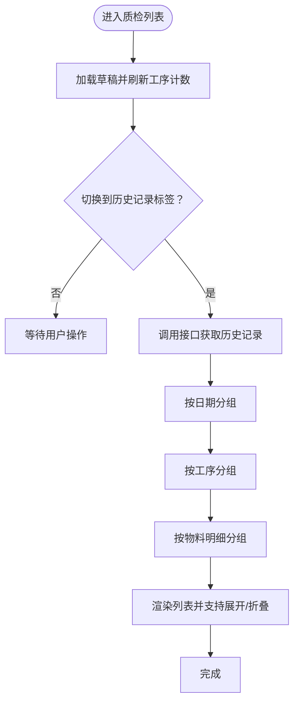
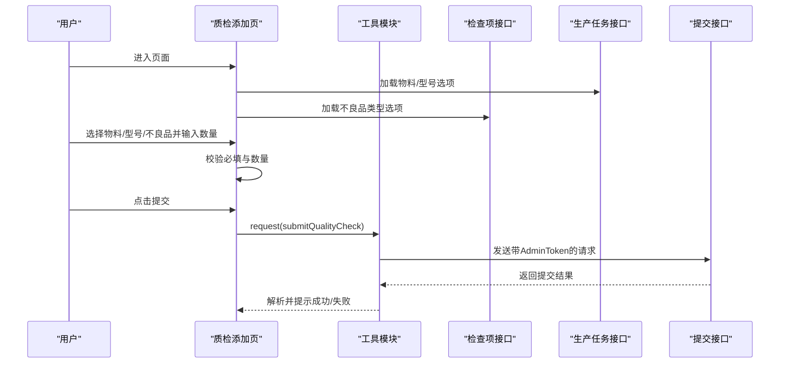
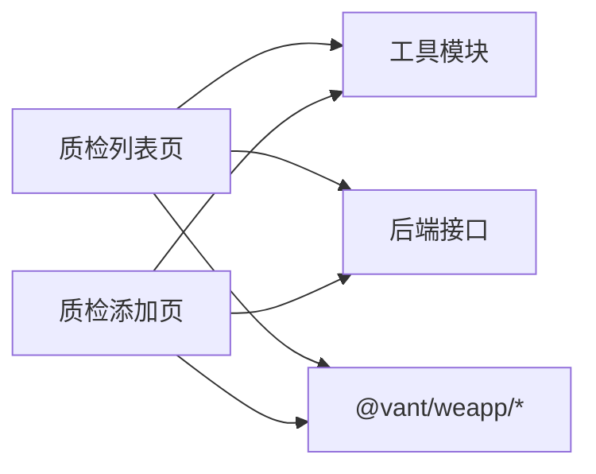

# 质量检查页面

<cite>
**本文引用的文件**
- [qualityCheckList.js](file://gccd_mini/pageWorkOrder/pages/qualityCheckList/qualityCheckList.js)
- [qualityCheckList.json](file://gccd_mini/pageWorkOrder/pages/qualityCheckList/qualityCheckList.json)
- [qualityCheckList.wxml](file://gccd_mini/pageWorkOrder/pages/qualityCheckList/qualityCheckList.wxml)
- [qualityCheckAdd.js](file://gccd_mini/pageWorkOrder/pages/qualityCheckAdd/qualityCheckAdd.js)
- [qualityCheckAdd.json](file://gccd_mini/pageWorkOrder/pages/qualityCheckAdd/qualityCheckAdd.json)
- [qualityCheckAdd.wxml](file://gccd_mini/pageWorkOrder/pages/qualityCheckAdd/qualityCheckAdd.wxml)
- [qualityInspection.js](file://gccd_mini/pageMine/pages/qualityInspection/qualityInspection.js)
- [qualityInspection.json](file://gccd_mini/pageMine/pages/qualityInspection/qualityInspection.json)
- [qualityInspection.wxml](file://gccd_mini/pageMine/pages/qualityInspection/qualityInspection.wxml)
- [util.js](file://gccd_mini/utils/util.js)
</cite>

## 目录
1. [简介](#简介)
2. [项目结构](#项目结构)
3. [核心组件](#核心组件)
4. [架构总览](#架构总览)
5. [详细组件分析](#详细组件分析)
6. [依赖关系分析](#依赖关系分析)
7. [性能考虑](#性能考虑)
8. [故障排查指南](#故障排查指南)
9. [结论](#结论)
10. [附录](#附录)

## 简介
本文件为“质量检查页面”的详细开发文档，覆盖以下目标：
- 质检记录查看：支持按日期分组的历史记录浏览，展开查看每道工序及每条记录的不良品明细。
- 质量评分统计：基于记录中的不良品数量进行统计汇总，支持按日期、工序、物料维度聚合。
- 检查结果分析：支持按白班/夜班拆分统计，计算每条记录的缺陷支数与总体不良品统计。
- 数据来源与处理：通过统一工具模块调用后端接口，获取质检记录并进行前端聚合与渲染。
- 时间筛选与分类：支持按日期分组与工序维度查看；草稿保存与本地缓存提升体验。
- 权限与安全：通过统一请求封装携带鉴权令牌，保障接口访问安全。
- 可视化与报告：提供基础的统计卡片与列表展示，便于后续扩展图表与报表。

## 项目结构
质量检查页面由三个主要页面组成：
- 质检列表页：提供“每日质检”和“质检记录”两个标签页，支持草稿刷新与历史记录加载。
- 质检添加页：提供物料选择、成品型号选择、不良品项目多选与白班/夜班数量录入，支持草稿保存与提交。
- 质检入口页（待完善）：当前为占位页面，预留导航入口与基础交互。

**图示来源**
- [qualityCheckList.js:1-174](file://gccd_mini/pageWorkOrder/pages/qualityCheckList/qualityCheckList.js#L1-L174)
- [qualityCheckAdd.js:1-336](file://gccd_mini/pageWorkOrder/pages/qualityCheckAdd/qualityCheckAdd.js#L1-L336)
- [util.js:22-94](file://gccd_mini/utils/util.js#L22-L94)

**章节来源**
- [qualityCheckList.js:1-174](file://gccd_mini/pageWorkOrder/pages/qualityCheckList/qualityCheckList.js#L1-L174)
- [qualityCheckAdd.js:1-336](file://gccd_mini/pageWorkOrder/pages/qualityCheckAdd/qualityCheckAdd.js#L1-L336)
- [qualityInspection.js:1-18](file://gccd_mini/pageMine/pages/qualityInspection/qualityInspection.js#L1-L18)

## 核心组件
- 质检列表页（qualityCheckList）
  - 功能：每日质检（含草稿计数）、历史记录（按日期分组、按工序分组、按物料明细）。
  - 关键逻辑：时间计算、草稿刷新、历史记录加载与分组、展开/折叠控制。
- 质检添加页（qualityCheckAdd）
  - 功能：物料与成品型号选择、不良品项目多选、白班/夜班数量录入、记录预览与提交。
  - 关键逻辑：物料/型号/不良品选项加载、搜索过滤、草稿保存与恢复、提交流程与防重复提交。
- 通用工具模块（util）
  - 功能：统一请求封装、鉴权令牌注入、错误处理与跳转登录。
- 质检入口页（qualityInspection）
  - 功能：占位页面，预留导航与基础交互。

**章节来源**
- [qualityCheckList.js:1-174](file://gccd_mini/pageWorkOrder/pages/qualityCheckList/qualityCheckList.js#L1-L174)
- [qualityCheckAdd.js:1-336](file://gccd_mini/pageWorkOrder/pages/qualityCheckAdd/qualityCheckAdd.js#L1-L336)
- [util.js:22-94](file://gccd_mini/utils/util.js#L22-L94)
- [qualityInspection.js:1-18](file://gccd_mini/pageMine/pages/qualityInspection/qualityInspection.js#L1-L18)

## 架构总览
质量检查页面采用“页面-工具模块-后端接口”的三层结构：
- 页面层：负责用户交互、数据绑定与事件处理。
- 工具层：封装网络请求、鉴权与错误处理。
- 接口层：后端提供生产管理与检查项相关接口，供页面调用。

**图示来源**
- [qualityCheckList.js:88-166](file://gccd_mini/pageWorkOrder/pages/qualityCheckList/qualityCheckList.js#L88-L166)
- [qualityCheckAdd.js:272-305](file://gccd_mini/pageWorkOrder/pages/qualityCheckAdd/qualityCheckAdd.js#L272-L305)
- [util.js:22-94](file://gccd_mini/utils/util.js#L22-L94)

## 详细组件分析

### 质检列表页（qualityCheckList）
- 页面布局与交互
  - 顶部自定义导航栏，包含返回按钮与标题。
  - 两标签页：
    - 每日质检：显示工序卡片与草稿计数，点击进入添加页。
    - 质检记录：按日期倒序排列，支持逐级展开查看工序与明细。
- 数据与逻辑
  - 草稿刷新：根据本地存储的草稿更新工序卡片的计数。
  - 历史加载：调用后端接口获取记录，按日期分组，再按工序分组，最后按物料明细展示。
  - 展开/折叠：支持日期卡片与工序卡片的展开/折叠，优化长列表可读性。
  - 时间处理：计算“昨日 07:00 ~ 今日 07:00”的统计周期。
- 关键实现路径
  - 列表加载与分组：[qualityCheckList.js:88-166](file://gccd_mini/pageWorkOrder/pages/qualityCheckList/qualityCheckList.js#L88-L166)
  - 周数计算：[qualityCheckList.js:168-172](file://gccd_mini/pageWorkOrder/pages/qualityCheckList/qualityCheckList.js#L168-L172)
  - 草稿刷新：[qualityCheckList.js:75-85](file://gccd_mini/pageWorkOrder/pages/qualityCheckList/qualityCheckList.js#L75-L85)
  - 页面模板渲染：[qualityCheckList.wxml:55-118](file://gccd_mini/pageWorkOrder/pages/qualityCheckList/qualityCheckList.wxml#L55-L118)

**图示来源**
- [qualityCheckList.js:88-166](file://gccd_mini/pageWorkOrder/pages/qualityCheckList/qualityCheckList.js#L88-L166)
- [qualityCheckList.wxml:66-112](file://gccd_mini/pageWorkOrder/pages/qualityCheckList/qualityCheckList.wxml#L66-L112)

**章节来源**
- [qualityCheckList.js:1-174](file://gccd_mini/pageWorkOrder/pages/qualityCheckList/qualityCheckList.js#L1-L174)
- [qualityCheckList.json:1-8](file://gccd_mini/pageWorkOrder/pages/qualityCheckList/qualityCheckList.json#L1-L8)
- [qualityCheckList.wxml:1-120](file://gccd_mini/pageWorkOrder/pages/qualityCheckList/qualityCheckList.wxml#L1-L120)

### 质检添加页（qualityCheckAdd）
- 页面布局与交互
  - 顶部自定义导航栏，包含返回按钮与标题。
  - 分步骤表单：选择物料、选择成品型号、选择不良品项目、输入白班/夜班数量、预览与提交。
  - 弹窗组件：物料/型号/不良品选择弹窗，支持搜索与多选。
- 数据与逻辑
  - 物料与型号：从生产任务接口加载，构建唯一标识与展示标签。
  - 不良品类型：从检查项接口加载，支持按名称或编号搜索。
  - 草稿：本地缓存当前日期与工序下的记录，支持恢复与清理。
  - 提交：校验必填与数量，组装提交数据，防重复提交。
- 关键实现路径
  - 物料/型号/不良品加载：[qualityCheckAdd.js:61-152](file://gccd_mini/pageWorkOrder/pages/qualityCheckAdd/qualityCheckAdd.js#L61-L152)
  - 搜索与过滤：[qualityCheckAdd.js:113-133](file://gccd_mini/pageWorkOrder/pages/qualityCheckAdd/qualityCheckAdd.js#L113-L133)
  - 记录添加与移除：[qualityCheckAdd.js:218-259](file://gccd_mini/pageWorkOrder/pages/qualityCheckAdd/qualityCheckAdd.js#L218-L259)
  - 提交流程：[qualityCheckAdd.js:262-305](file://gccd_mini/pageWorkOrder/pages/qualityCheckAdd/qualityCheckAdd.js#L262-L305)
  - 草稿保存与恢复：[qualityCheckAdd.js:320-334](file://gccd_mini/pageWorkOrder/pages/qualityCheckAdd/qualityCheckAdd.js#L320-L334)
  - 页面模板渲染：[qualityCheckAdd.wxml:1-220](file://gccd_mini/pageWorkOrder/pages/qualityCheckAdd/qualityCheckAdd.wxml#L1-L220)

**图示来源**
- [qualityCheckAdd.js:61-152](file://gccd_mini/pageWorkOrder/pages/qualityCheckAdd/qualityCheckAdd.js#L61-L152)
- [qualityCheckAdd.js:262-305](file://gccd_mini/pageWorkOrder/pages/qualityCheckAdd/qualityCheckAdd.js#L262-L305)
- [util.js:22-94](file://gccd_mini/utils/util.js#L22-L94)

**章节来源**
- [qualityCheckAdd.js:1-336](file://gccd_mini/pageWorkOrder/pages/qualityCheckAdd/qualityCheckAdd.js#L1-L336)
- [qualityCheckAdd.json:1-10](file://gccd_mini/pageWorkOrder/pages/qualityCheckAdd/qualityCheckAdd.json#L1-L10)
- [qualityCheckAdd.wxml:1-220](file://gccd_mini/pageWorkOrder/pages/qualityCheckAdd/qualityCheckAdd.wxml#L1-L220)

### 质检入口页（qualityInspection）
- 当前状态：占位页面，仅包含自定义导航栏与提示文案，预留后续接入“检验列表与提报逻辑”。

**章节来源**
- [qualityInspection.js:1-18](file://gccd_mini/pageMine/pages/qualityInspection/qualityInspection.js#L1-L18)
- [qualityInspection.json:1-7](file://gccd_mini/pageMine/pages/qualityInspection/qualityInspection.json#L1-L7)
- [qualityInspection.wxml:1-9](file://gccd_mini/pageMine/pages/qualityInspection/qualityInspection.wxml#L1-L9)

## 依赖关系分析
- 组件内聚与耦合
  - 质检列表页与添加页均依赖工具模块进行网络请求与鉴权。
  - 列表页依赖后端“质量检查记录列表”接口；添加页依赖“质量检查记录提交”“检查项列表”“生产任务列表”接口。
- 外部依赖
  - Vant Weapp 组件库用于图标、弹窗、对话框、标签页等 UI 组件。
  - 微信小程序系统 API 用于系统信息获取、导航、存储与提示。
- 可能的循环依赖
  - 页面与工具模块之间为单向依赖，无循环依赖风险。
- 权限与安全
  - 请求头统一注入 AdminToken，未认证时自动跳转登录页。

**图示来源**
- [qualityCheckList.json:1-8](file://gccd_mini/pageWorkOrder/pages/qualityCheckList/qualityCheckList.json#L1-L8)
- [qualityCheckAdd.json:1-10](file://gccd_mini/pageWorkOrder/pages/qualityCheckAdd/qualityCheckAdd.json#L1-L10)
- [util.js:34-36](file://gccd_mini/utils/util.js#L34-L36)

**章节来源**
- [qualityCheckList.json:1-8](file://gccd_mini/pageWorkOrder/pages/qualityCheckList/qualityCheckList.json#L1-L8)
- [qualityCheckAdd.json:1-10](file://gccd_mini/pageWorkOrder/pages/qualityCheckAdd/qualityCheckAdd.json#L1-L10)
- [util.js:34-36](file://gccd_mini/utils/util.js#L34-L36)

## 性能考虑
- 列表渲染优化
  - 使用展开/折叠减少一次性渲染节点数量，提升滚动性能。
  - 对长列表使用分页或懒加载策略（当前限制了最大条数，建议后续扩展）。
- 网络请求优化
  - 合理设置请求超时与重试机制，避免页面长时间无响应。
  - 在提交流程中增加防重复提交锁，减少无效请求。
- 本地缓存
  - 草稿采用本地存储，减少重复输入成本，注意在提交成功后及时清理。
- 图标与样式
  - 使用轻量级图标与简洁样式，避免过度绘制影响性能。

## 故障排查指南
- 登录失效
  - 现象：出现“请重新登录”提示并跳转登录页。
  - 处理：清除本地令牌与昵称，重新登录后重试。
- 请求失败
  - 现象：出现“请求失败”或“网络异常，请检查网络”提示。
  - 处理：检查网络状态与接口地址，确认 AdminToken 是否有效。
- 数据为空
  - 现象：历史记录为空或提示暂无记录。
  - 处理：确认查询条件（日期范围、工序）是否正确，或稍后再试。
- 提交失败
  - 现象：提交后提示失败或页面卡住。
  - 处理：检查必填项与数量是否满足要求，确认网络稳定后重试。

**章节来源**
- [util.js:49-83](file://gccd_mini/utils/util.js#L49-L83)
- [qualityCheckAdd.js:286-304](file://gccd_mini/pageWorkOrder/pages/qualityCheckAdd/qualityCheckAdd.js#L286-L304)

## 结论
质量检查页面已完成核心功能闭环：从“每日质检”到“历史记录”，再到“添加记录与提交”。页面通过统一工具模块与后端接口对接，具备良好的可维护性与扩展性。建议后续增强：
- 数据可视化：引入图表组件展示质量趋势与合格率。
- 报表导出：支持将历史记录导出为报表。
- 权限细化：结合用户角色对不同工序与日期范围进行访问控制。
- 搜索与筛选：在历史记录中增加更细粒度的筛选条件（如物料、型号、缺陷类型）。

## 附录
- 关键接口说明（以调用点为准）
  - 获取历史记录：admin/production.QualityCheckRecord/list（POST）
  - 提交质检：admin/production.QualityCheckRecord/submitQualityCheck（POST）
  - 检查项列表：admin/check.Check/list（POST）
  - 生产任务列表：admin/production.ProductTask/list（POST）

**章节来源**
- [qualityCheckList.js:90-94](file://gccd_mini/pageWorkOrder/pages/qualityCheckList/qualityCheckList.js#L90-L94)
- [qualityCheckAdd.js:139-151](file://gccd_mini/pageWorkOrder/pages/qualityCheckAdd/qualityCheckAdd.js#L139-L151)
- [qualityCheckAdd.js:286-287](file://gccd_mini/pageWorkOrder/pages/qualityCheckAdd/qualityCheckAdd.js#L286-L287)