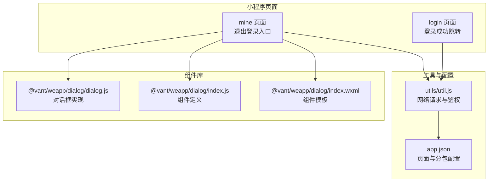
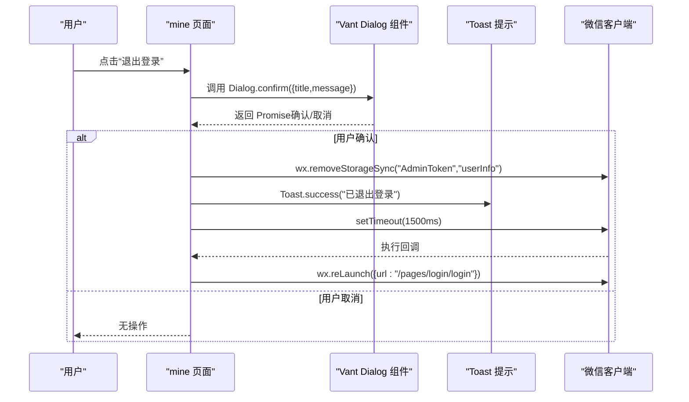
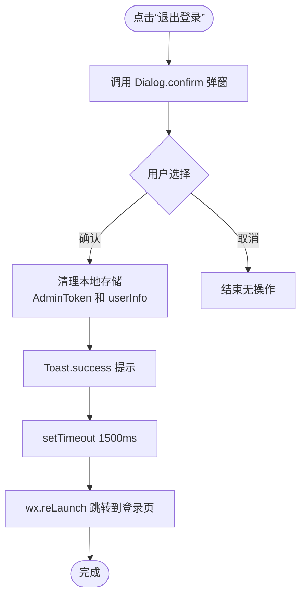
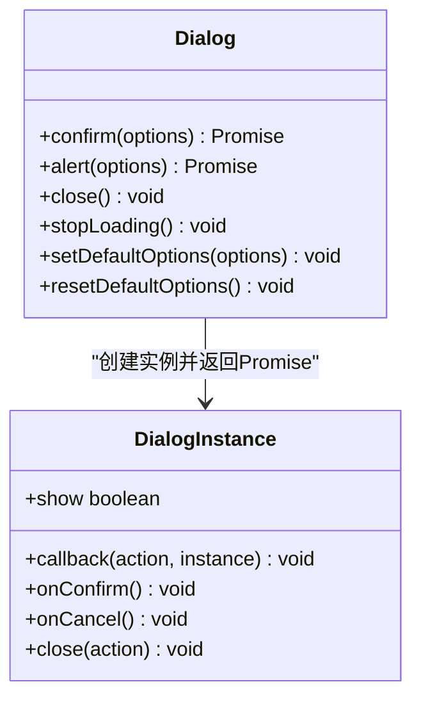
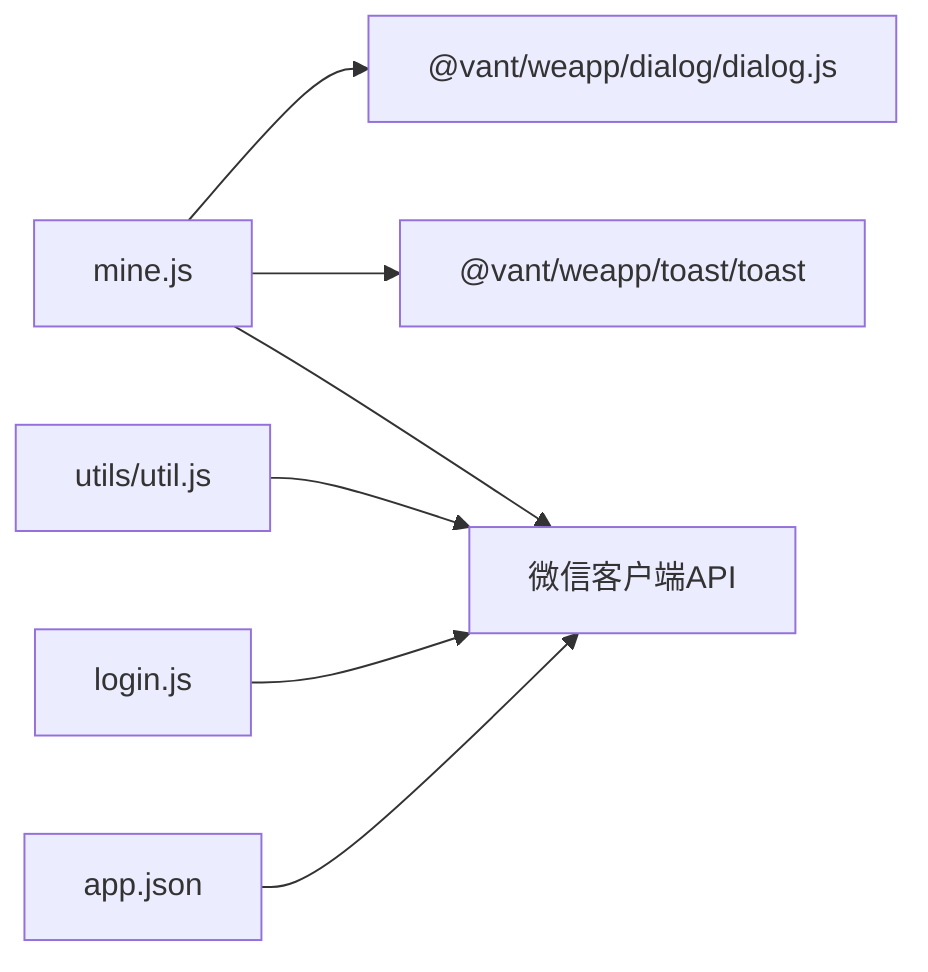

# 退出登录功能

<cite>
**本文引用的文件**
- [mine.js](file://gccd_mini/pages/mine/mine.js)
- [mine.json](file://gccd_mini/pages/mine/mine.json)
- [mine.wxml](file://gccd_mini/pages/mine/mine.wxml)
- [util.js](file://gccd_mini/utils/util.js)
- [login.js](file://gccd_mini/pages/login/login.js)
- [dialog.js](file://gccd_mini/miniprogram_npm/@vant/weapp/dialog/dialog.js)
- [dialog.index.js](file://gccd_mini/miniprogram_npm/@vant/weapp/dialog/index.js)
- [dialog.wxml](file://gccd_mini/miniprogram_npm/@vant/weapp/dialog/index.wxml)
- [app.json](file://gccd_mini/app.json)
</cite>

## 目录
1. [简介](#简介)
2. [项目结构](#项目结构)
3. [核心组件](#核心组件)
4. [架构概览](#架构概览)
5. [详细组件分析](#详细组件分析)
6. [依赖关系分析](#依赖关系分析)
7. [性能考量](#性能考量)
8. [故障排查指南](#故障排查指南)
9. [结论](#结论)

## 简介
本文件围绕小程序端“退出登录”功能进行深入技术文档化，重点覆盖以下方面：
- handleLogout 方法的完整实现流程：确认对话框展示、用户选择处理、本地存储清理、页面跳转与延迟机制。
- Dialog.confirm 的使用方式与交互体验设计要点。
- 本地存储中 AdminToken 与 userInfo 的清除机制及安全性考虑。
- 退出登录后的页面跳转逻辑，重点说明 wx.reLaunch 的使用与延迟处理。
- 错误处理与异常情况处理方案。

## 项目结构
退出登录功能主要涉及以下模块：
- 我的页面（mine）：承载“退出登录”入口按钮与交互逻辑。
- Vant Weapp 对话框组件：提供确认对话框能力。
- 工具类 util：封装统一的网络请求与鉴权头注入，包含 401 自动登出逻辑。
- 登录页（login）：负责登录成功后的页面跳转策略。
- 应用配置（app.json）：定义页面与分包路径，影响跳转行为。

图表来源
- [mine.js:1-61](file://gccd_mini/pages/mine/mine.js#L1-L61)
- [dialog.js:1-92](file://gccd_mini/miniprogram_npm/@vant/weapp/dialog/dialog.js#L1-L92)
- [dialog.index.js:1-126](file://gccd_mini/miniprogram_npm/@vant/weapp/dialog/index.js#L1-L126)
- [dialog.wxml:32-126](file://gccd_mini/miniprogram_npm/@vant/weapp/dialog/index.wxml#L32-L126)
- [util.js:1-98](file://gccd_mini/utils/util.js#L1-L98)
- [login.js:76-118](file://gccd_mini/pages/login/login.js#L76-L118)
- [app.json:1-99](file://gccd_mini/app.json#L1-L99)

章节来源
- [mine.js:1-61](file://gccd_mini/pages/mine/mine.js#L1-L61)
- [dialog.js:1-92](file://gccd_mini/miniprogram_npm/@vant/weapp/dialog/dialog.js#L1-L92)
- [util.js:1-98](file://gccd_mini/utils/util.js#L1-L98)
- [login.js:76-118](file://gccd_mini/pages/login/login.js#L76-L118)
- [app.json:1-99](file://gccd_mini/app.json#L1-L99)

## 核心组件
- mine 页面：提供“退出登录”按钮，绑定 handleLogout 事件，负责弹出确认对话框、清理本地存储、提示与延迟跳转。
- Vant Weapp 对话框：通过 Dialog.confirm 提供“确认/取消”交互，支持 Promise 化回调。
- 工具类 util：在请求头中携带 AdminToken，并在 401 时自动清理本地存储并跳转登录页。
- 登录页：登录成功后使用 wx.reLaunch 进入 Tab 首页，确保页面栈被清空。
- 应用配置：定义页面与分包路径，影响跳转目标与页面栈行为。

章节来源
- [mine.js:24-45](file://gccd_mini/pages/mine/mine.js#L24-L45)
- [dialog.js:43-69](file://gccd_mini/miniprogram_npm/@vant/weapp/dialog/dialog.js#L43-L69)
- [util.js:34-67](file://gccd_mini/utils/util.js#L34-L67)
- [login.js:108-113](file://gccd_mini/pages/login/login.js#L108-L113)
- [app.json:24-55](file://gccd_mini/app.json#L24-L55)

## 架构概览
退出登录的端到端流程如下：

图表来源
- [mine.js:25-44](file://gccd_mini/pages/mine/mine.js#L25-L44)
- [dialog.js:43-69](file://gccd_mini/miniprogram_npm/@vant/weapp/dialog/dialog.js#L43-L69)
- [util.js:62-67](file://gccd_mini/utils/util.js#L62-L67)

## 详细组件分析

### mine 页面：handleLogout 实现
- 触发条件：点击“退出登录”按钮，绑定事件为 handleLogout。
- 对话框确认：调用 Dialog.confirm 显示标题与消息，Promise 成功表示确认，拒绝表示取消。
- 数据清理：移除本地存储中的 AdminToken 与 userInfo。
- 用户反馈：Toast.success 提示“已退出登录”。
- 延迟跳转：设置 1500ms 延迟，确保提示可见，随后 wx.reLaunch 到登录页。
- 页面栈影响：wx.reLaunch 将清空当前页面栈，避免返回键回到受保护页面。

图表来源
- [mine.js:25-44](file://gccd_mini/pages/mine/mine.js#L25-L44)

章节来源
- [mine.js:24-45](file://gccd_mini/pages/mine/mine.js#L24-L45)
- [mine.wxml:41-43](file://gccd_mini/pages/mine/mine.wxml#L41-L43)
- [mine.json:2-9](file://gccd_mini/pages/mine/mine.json#L2-L9)

### Vant Weapp 对话框：Dialog.confirm 使用
- 能力概述：Dialog.confirm 基于 Dialog 默认实现，将 showCancelButton 设为 true，返回 Promise。
- 回调机制：Promise resolve 表示确认，reject 表示取消或遮罩点击关闭。
- 组件模板：组件模板根据 showConfirmButton/showCancelButton 渲染不同按钮布局。
- 交互体验：支持主题、按钮文案、颜色、过渡动画等配置，保证一致性与可访问性。

图表来源
- [dialog.js:43-69](file://gccd_mini/miniprogram_npm/@vant/weapp/dialog/dialog.js#L43-L69)
- [dialog.index.js:82-99](file://gccd_mini/miniprogram_npm/@vant/weapp/dialog/index.js#L82-L99)
- [dialog.wxml:32-126](file://gccd_mini/miniprogram_npm/@vant/weapp/dialog/index.wxml#L32-L126)

章节来源
- [dialog.js:1-92](file://gccd_mini/miniprogram_npm/@vant/weapp/dialog/dialog.js#L1-L92)
- [dialog.index.js:1-126](file://gccd_mini/miniprogram_npm/@vant/weapp/dialog/index.js#L1-L126)
- [dialog.wxml:32-126](file://gccd_mini/miniprogram_npm/@vant/weapp/dialog/index.wxml#L32-L126)

### 本地存储清理与安全性
- 存储键名：AdminToken（登录令牌）、userInfo（用户信息）。
- 清理时机：用户确认退出后立即移除，避免残留敏感信息。
- 安全建议：
  - 仅清理必要键，避免误删其他业务数据。
  - 在关键页面（如“我的”）不再读取敏感键，防止误用。
  - 结合网络层鉴权：util 在请求头注入 AdminToken，若后端返回 401，会自动清理并跳转登录页，形成双重保障。

章节来源
- [mine.js:30-34](file://gccd_mini/pages/mine/mine.js#L30-L34)
- [util.js:34-67](file://gccd_mini/utils/util.js#L34-L67)

### 页面跳转与延迟处理
- 目标页面：登录页（/pages/login/login），由 wx.reLaunch 跳转。
- 延迟策略：1500ms，确保用户看到“已退出登录”的 Toast 提示。
- 页面栈行为：wx.reLaunch 清空当前页面栈，避免返回键导致页面回退。
- 登录页对比：登录成功后同样使用 wx.reLaunch 进入 Tab 首页，保持一致的页面栈清理策略。

章节来源
- [mine.js:36-41](file://gccd_mini/pages/mine/mine.js#L36-L41)
- [login.js:108-113](file://gccd_mini/pages/login/login.js#L108-L113)
- [app.json:24-55](file://gccd_mini/app.json#L24-L55)

## 依赖关系分析
- mine 页面依赖 Vant Dialog 组件以实现确认对话框。
- mine 页面依赖 Toast 组件用于成功提示。
- mine 页面依赖 wx API（removeStorageSync、reLaunch、setTimeout）完成数据清理与页面跳转。
- util.js 作为网络层工具，负责请求头注入与 401 自动登出，间接影响退出后的安全边界。
- app.json 中的页面与分包配置决定跳转目标与页面栈行为。

图表来源
- [mine.js:1-61](file://gccd_mini/pages/mine/mine.js#L1-L61)
- [dialog.js:1-92](file://gccd_mini/miniprogram_npm/@vant/weapp/dialog/dialog.js#L1-L92)
- [util.js:1-98](file://gccd_mini/utils/util.js#L1-L98)
- [login.js:76-118](file://gccd_mini/pages/login/login.js#L76-L118)
- [app.json:1-99](file://gccd_mini/app.json#L1-L99)

章节来源
- [mine.js:1-61](file://gccd_mini/pages/mine/mine.js#L1-L61)
- [util.js:1-98](file://gccd_mini/utils/util.js#L1-L98)
- [login.js:76-118](file://gccd_mini/pages/login/login.js#L76-L118)
- [app.json:1-99](file://gccd_mini/app.json#L1-L99)

## 性能考量
- 对话框弹窗成本低：Dialog.confirm 为轻量组件，Promise 化回调避免阻塞主线程。
- Toast 提示：短时提示，对性能影响微乎其微。
- 延迟跳转：1500ms 延迟时间适中，兼顾用户体验与资源释放。
- 页面栈清理：wx.reLaunch 清空页面栈，减少内存占用与导航历史负担。

## 故障排查指南
- 症状：点击“退出登录”无响应
  - 排查：确认 mine.wxml 中按钮是否绑定 handleLogout；确认 mine.json 是否引入 van-dialog 与 van-toast。
  - 参考：[mine.wxml:41-43](file://gccd_mini/pages/mine/mine.wxml#L41-L43)、[mine.json:2-9](file://gccd_mini/pages/mine/mine.json#L2-L9)
- 症状：确认对话框未出现
  - 排查：检查 @vant/weapp/dialog 组件是否正确引入；确认上下文选择器与节点是否存在。
  - 参考：[dialog.js:43-64](file://gccd_mini/miniprogram_npm/@vant/weapp/dialog/dialog.js#L43-L64)
- 症状：退出后仍可返回受保护页面
  - 排查：确认 wx.reLaunch 是否执行；确认页面栈是否被清空；检查 app.json 中页面配置。
  - 参考：[mine.js:36-41](file://gccd_mini/pages/mine/mine.js#L36-L41)、[app.json:24-55](file://gccd_mini/app.json#L24-L55)
- 症状：本地存储未清理导致下次直接进入受保护页面
  - 排查：确认 wx.removeStorageSync 是否调用；检查键名是否正确。
  - 参考：[mine.js:30-34](file://gccd_mini/pages/mine/mine.js#L30-L34)
- 症状：网络层 401 未触发自动登出
  - 排查：确认请求头是否注入 AdminToken；确认 util.js 中 401 分支逻辑。
  - 参考：[util.js:34-67](file://gccd_mini/utils/util.js#L34-L67)

章节来源
- [mine.wxml:41-43](file://gccd_mini/pages/mine/mine.wxml#L41-L43)
- [mine.json:2-9](file://gccd_mini/pages/mine/mine.json#L2-L9)
- [dialog.js:43-64](file://gccd_mini/miniprogram_npm/@vant/weapp/dialog/dialog.js#L43-L64)
- [mine.js:30-41](file://gccd_mini/pages/mine/mine.js#L30-L41)
- [app.json:24-55](file://gccd_mini/app.json#L24-L55)
- [util.js:34-67](file://gccd_mini/utils/util.js#L34-L67)

## 结论
退出登录功能通过“确认对话框 + 本地存储清理 + 延迟跳转 + 页面栈清理”的组合，实现了清晰、安全、易用的用户体验。Dialog.confirm 提供了标准的用户确认交互，wx.reLaunch 确保页面栈被清空，util.js 的 401 自动登出进一步强化了安全边界。建议在后续迭代中：
- 明确 userInfo 的实际存储键名，避免与 AdminToken 不一致导致遗漏清理。
- 在关键页面增加权限校验，防止因页面栈问题导致的越权访问。
- 对延迟时间进行可配置化，以适配不同机型与网络环境。