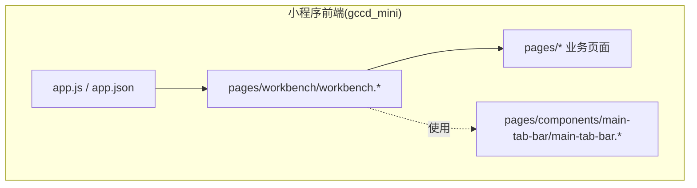
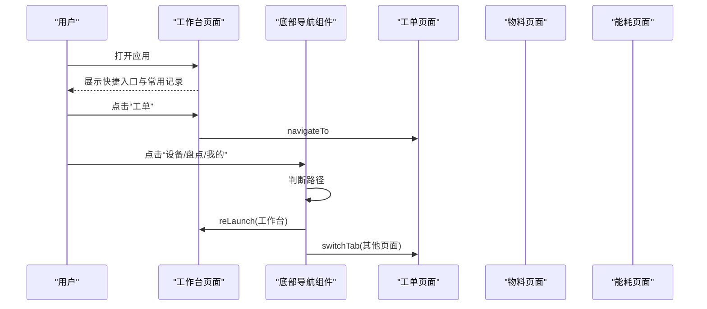
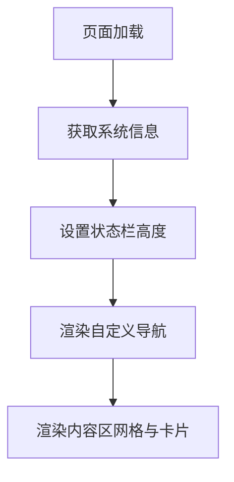
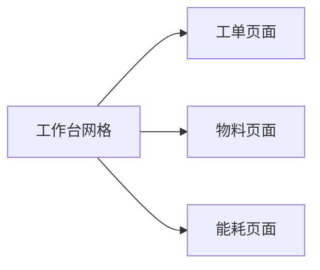
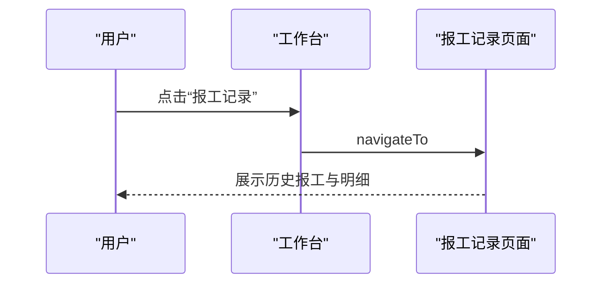
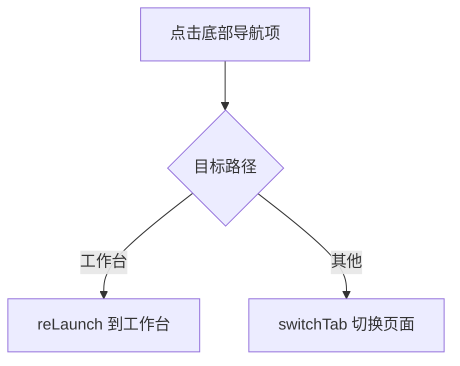
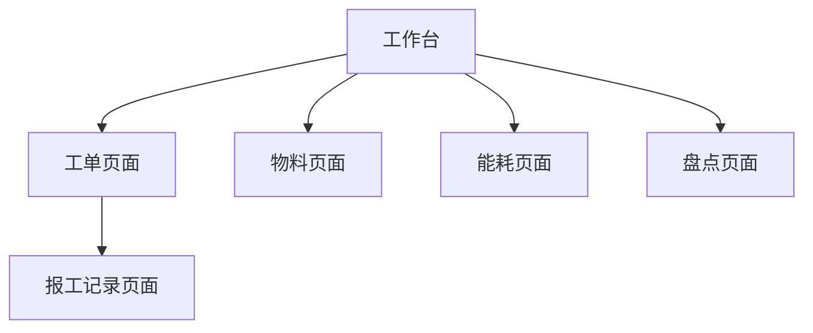
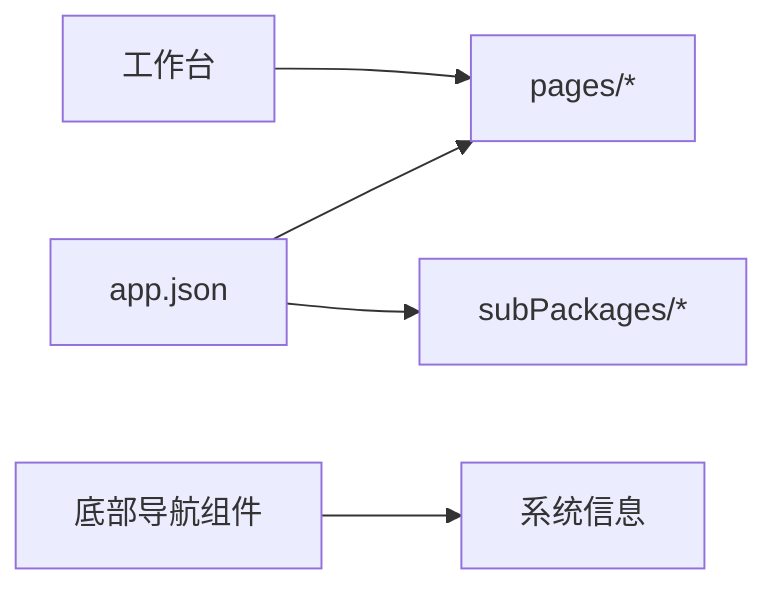

# 工作台页面

<cite>
**本文引用的文件**
- [workbench.js](file://gccd_mini/pages/workbench/workbench.js)
- [workbench.json](file://gccd_mini/pages/workbench/workbench.json)
- [workbench.wxml](file://gccd_mini/pages/workbench/workbench.wxml)
- [workbench.wxss](file://gccd_mini/pages/workbench/workbench.wxss)
- [app.js](file://gccd_mini/app.js)
- [app.json](file://gccd_mini/app.json)
- [main-tab-bar.js](file://gccd_mini/pages/components/main-tab-bar/main-tab-bar.js)
- [main-tab-bar.wxml](file://gccd_mini/pages/components/main-tab-bar/main-tab-bar.wxml)
- [main-tab-bar.wxss](file://gccd_mini/pages/components/main-tab-bar/main-tab-bar.wxss)
- [workOrder.js](file://gccd_mini/pages/workOrder/workOrder.js)
- [material.js](file://gccd_mini/pages/material/material.js)
- [energy.js](file://gccd_mini/pages/energy/energy.js)
- [stocktake.js](file://gccd_mini/pages/stocktake/stocktake.js)
</cite>

## 目录
1. [简介](#简介)
2. [项目结构](#项目结构)
3. [核心组件](#核心组件)
4. [架构总览](#架构总览)
5. [详细组件分析](#详细组件分析)
6. [依赖分析](#依赖分析)
7. [性能考虑](#性能考虑)
8. [故障排查指南](#故障排查指南)
9. [结论](#结论)
10. [附录](#附录)

## 简介
本文件面向前端与产品/运营同学，系统性梳理“工作台页面”的整体设计、功能组织与交互体验。重点覆盖：
- 页面布局与导航结构
- 快捷入口与常用功能设计
- 数据展示与业务关联
- 与其他业务页面的联动与数据流转
- 响应式与多端适配策略
- 性能优化与最佳实践

## 项目结构
工作台页面位于小程序前端工程 gccd_mini 中，采用分包与自定义导航结合的方式组织页面与组件。

图表来源
- [app.json:1-99](file://gccd_mini/app.json#L1-L99)
- [workbench.wxml:1-38](file://gccd_mini/pages/workbench/workbench.wxml#L1-L38)
- [main-tab-bar.js:1-56](file://gccd_mini/pages/components/main-tab-bar/main-tab-bar.js#L1-L56)

章节来源
- [app.json:1-99](file://gccd_mini/app.json#L1-L99)
- [workbench.wxml:1-38](file://gccd_mini/pages/workbench/workbench.wxml#L1-L38)
- [main-tab-bar.js:1-56](file://gccd_mini/pages/components/main-tab-bar/main-tab-bar.js#L1-L56)

## 核心组件
- 自定义导航栏：工作台页面采用自定义导航样式，顶部留白适配刘海屏安全区，标题居中，左右占位用于扩展。
- 快速入口网格：包含“工单”“物料”“能耗”三大常用入口，采用卡片式布局，悬停态反馈良好。
- 常用记录卡片：提供“报工记录”快捷入口，左侧配色图标，右侧文本与操作按钮，视觉层次清晰。
- 底部导航：与全局 tabBar 对齐，包含“工作台”“设备”“盘点”“我的”，支持 reLaunch 回到工作台首页。

章节来源
- [workbench.json:1-5](file://gccd_mini/pages/workbench/workbench.json#L1-L5)
- [workbench.wxml:1-38](file://gccd_mini/pages/workbench/workbench.wxml#L1-L38)
- [workbench.wxss:1-126](file://gccd_mini/pages/workbench/workbench.wxss#L1-L126)
- [main-tab-bar.js:1-56](file://gccd_mini/pages/components/main-tab-bar/main-tab-bar.js#L1-L56)
- [main-tab-bar.wxml:1-16](file://gccd_mini/pages/components/main-tab-bar/main-tab-bar.wxml#L1-L16)
- [main-tab-bar.wxss:1-41](file://gccd_mini/pages/components/main-tab-bar/main-tab-bar.wxss#L1-L41)

## 架构总览
工作台作为入口页，承担“业务入口聚合+状态引导”的职责。其与业务页面的交互主要通过页面路由与分包加载实现。

图表来源
- [workbench.wxml:10-21](file://gccd_mini/pages/workbench/workbench.wxml#L10-L21)
- [main-tab-bar.js:44-53](file://gccd_mini/pages/components/main-tab-bar/main-tab-bar.js#L44-L53)
- [app.js:13-21](file://gccd_mini/app.js#L13-L21)

章节来源
- [workbench.wxml:10-36](file://gccd_mini/pages/workbench/workbench.wxml#L10-L36)
- [main-tab-bar.js:44-53](file://gccd_mini/pages/components/main-tab-bar/main-tab-bar.js#L44-L53)
- [app.js:13-21](file://gccd_mini/app.js#L13-L21)

## 详细组件分析

### 自定义导航与内容区域
- 导航栏：自定义样式，顶部内边距动态绑定系统状态栏高度，确保在不同机型上正确显示。
- 内容区：采用背景色与最小高度保证页面完整性；网格与卡片采用圆角、阴影与渐变提升可读性与层级感。

图表来源
- [workbench.js:5-13](file://gccd_mini/pages/workbench/workbench.js#L5-L13)
- [workbench.wxml:1-7](file://gccd_mini/pages/workbench/workbench.wxml#L1-L7)
- [workbench.wxss:1-6](file://gccd_mini/pages/workbench/workbench.wxss#L1-L6)

章节来源
- [workbench.js:5-13](file://gccd_mini/pages/workbench/workbench.js#L5-L13)
- [workbench.wxml:1-7](file://gccd_mini/pages/workbench/workbench.wxml#L1-L7)
- [workbench.wxss:1-6](file://gccd_mini/pages/workbench/workbench.wxss#L1-L6)

### 快捷入口网格
- 结构：三列等分布局，卡片内含标题与描述，支持悬停态过渡。
- 交互：点击卡片通过导航器跳转至对应业务页面，保持页面栈清晰。

图表来源
- [workbench.wxml:9-22](file://gccd_mini/pages/workbench/workbench.wxml#L9-L22)

章节来源
- [workbench.wxml:9-22](file://gccd_mini/pages/workbench/workbench.wxml#L9-L22)
- [workbench.wxss:19-55](file://gccd_mini/pages/workbench/workbench.wxss#L19-L55)

### 常用记录卡片
- 结构：左侧圆形渐变图标，中部标题与描述，右侧“查看”操作按钮。
- 交互：点击卡片跳转至“报工记录”页面，便于快速回溯历史数据。

图表来源
- [workbench.wxml:25-36](file://gccd_mini/pages/workbench/workbench.wxml#L25-L36)

章节来源
- [workbench.wxml:25-36](file://gccd_mini/pages/workbench/workbench.wxml#L25-L36)
- [workbench.wxss:57-126](file://gccd_mini/pages/workbench/workbench.wxss#L57-L126)

### 底部导航组件
- 功能：统一承载“工作台/设备/盘点/我的”四类入口，支持安全区底部内边距适配。
- 交互：点击“工作台”使用 reLaunch 回到首页，其他页面使用 switchTab 切换；避免子页面栈导致的导航异常。

图表来源
- [main-tab-bar.js:44-53](file://gccd_mini/pages/components/main-tab-bar/main-tab-bar.js#L44-L53)

章节来源
- [main-tab-bar.js:1-56](file://gccd_mini/pages/components/main-tab-bar/main-tab-bar.js#L1-L56)
- [main-tab-bar.wxml:1-16](file://gccd_mini/pages/components/main-tab-bar/main-tab-bar.wxml#L1-L16)
- [main-tab-bar.wxss:1-41](file://gccd_mini/pages/components/main-tab-bar/main-tab-bar.wxss#L1-L41)

### 与业务页面的数据与流程关联
- 工单页面：工作台“工单”入口直接进入工单列表页；工单页内部包含进行中/已完成双标签页、下拉刷新、上拉加载、扫码报修等能力。
- 物料页面：工作台“物料”入口进入物料与领料记录管理页；支持筛选、分页、图片上传与报修流程。
- 能耗页面：工作台“能耗”入口进入能耗记录页；支持分页与图片上传、报修流程。
- 盘点/质量检查：通过“盘点”入口进入相关列表页，快速发起盘点或质检任务。

图表来源
- [workbench.wxml:10-21](file://gccd_mini/pages/workbench/workbench.wxml#L10-L21)
- [workOrder.js:308-328](file://gccd_mini/pages/workOrder/workOrder.js#L308-L328)
- [material.js:399-402](file://gccd_mini/pages/material/material.js#L399-L402)
- [energy.js:447-451](file://gccd_mini/pages/energy/energy.js#L447-L451)
- [stocktake.js:14-20](file://gccd_mini/pages/stocktake/stocktake.js#L14-L20)

章节来源
- [workbench.wxml:10-21](file://gccd_mini/pages/workbench/workbench.wxml#L10-L21)
- [workOrder.js:308-328](file://gccd_mini/pages/workOrder/workOrder.js#L308-L328)
- [material.js:399-402](file://gccd_mini/pages/material/material.js#L399-L402)
- [energy.js:447-451](file://gccd_mini/pages/energy/energy.js#L447-L451)
- [stocktake.js:14-20](file://gccd_mini/pages/stocktake/stocktake.js#L14-L20)

## 依赖分析
- 页面依赖
  - 工作台依赖自定义导航与底部导航组件，样式通过 wxss 控制。
  - 底部导航组件依赖系统信息（状态栏/安全区），保证在不同机型上的适配。
- 路由与分包
  - app.json 声明全局 pages 与分包 root，工作台与业务页面通过分包组织，减少首屏体积。
  - 底部导航对“工作台”使用 reLaunch，其他页面使用 switchTab，避免子页面栈导致的导航异常。

图表来源
- [app.json:1-99](file://gccd_mini/app.json#L1-L99)
- [main-tab-bar.js:32-41](file://gccd_mini/pages/components/main-tab-bar/main-tab-bar.js#L32-L41)

章节来源
- [app.json:1-99](file://gccd_mini/app.json#L1-L99)
- [main-tab-bar.js:32-41](file://gccd_mini/pages/components/main-tab-bar/main-tab-bar.js#L32-L41)

## 性能考虑
- 首屏与分包
  - 通过 subPackages 将设备、物料、能耗、我的等业务分包，降低工作台首屏加载压力。
- 懒加载
  - app.json 启用 lazyCodeLoading，按需加载组件代码，减少初始包体。
- 样式与渲染
  - 使用 wxss 控制阴影、圆角与渐变，避免复杂 JS 计算；网格与卡片采用 flex 布局，利于渲染优化。
- 交互反馈
  - 悬停态与点击态通过类名切换，避免频繁重排；底部导航使用固定高度与安全区适配，减少布局抖动。

章节来源
- [app.json:23-23](file://gccd_mini/app.json#L23-L23)
- [workbench.wxss:19-55](file://gccd_mini/pages/workbench/workbench.wxss#L19-L55)
- [main-tab-bar.wxss:1-41](file://gccd_mini/pages/components/main-tab-bar/main-tab-bar.wxss#L1-L41)

## 故障排查指南
- 自定义导航遮挡/留白异常
  - 检查工作台页面是否正确获取系统信息并设置状态栏高度；确认自定义导航的 top 内边距绑定生效。
- 底部导航点击无反应
  - 检查底部导航组件的事件绑定与路径判断逻辑；确认“工作台”使用 reLaunch，“其他”使用 switchTab。
- 页面跳转后栈异常
  - 确认从子页面返回“工作台”时使用 reLaunch，避免停留在子页面栈顶。
- 分包页面无法访问
  - 检查 app.json 中 subPackages 的 root 与 pages 配置是否正确，页面路径是否匹配。

章节来源
- [workbench.js:5-13](file://gccd_mini/pages/workbench/workbench.js#L5-L13)
- [main-tab-bar.js:44-53](file://gccd_mini/pages/components/main-tab-bar/main-tab-bar.js#L44-L53)
- [app.json:56-98](file://gccd_mini/app.json#L56-L98)

## 结论
工作台页面以“简洁入口+清晰导航”为核心，通过自定义导航与底部组件实现统一风格与一致体验。配合分包与懒加载策略，有效控制首屏体积与交互流畅度。建议在后续迭代中持续关注：
- 快捷入口的业务价值与使用频率，定期评估与调整布局
- 数据展示的可读性与可操作性，如增加状态徽标、快捷筛选
- 与业务页面的联动体验，如从“报工记录”返回工作台时的状态恢复

## 附录
- 最佳实践
  - 使用分包组织业务页面，减少首屏依赖
  - 自定义导航与底部组件统一风格，避免重复实现
  - 交互反馈明确（悬停、点击、加载），提升可用性
- 用户体验优化建议
  - 在网格入口增加状态提示（如未完成工单数）
  - 常用记录卡片支持“最近使用”排序
  - 底部导航图标与文字大小适配小屏设备