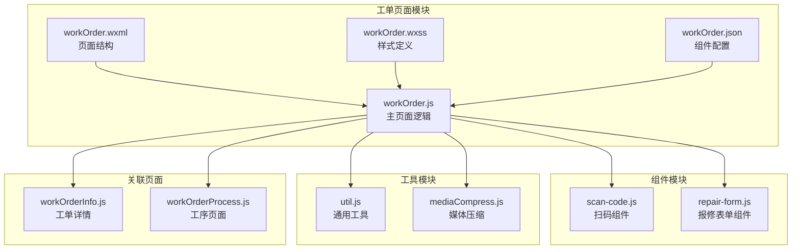
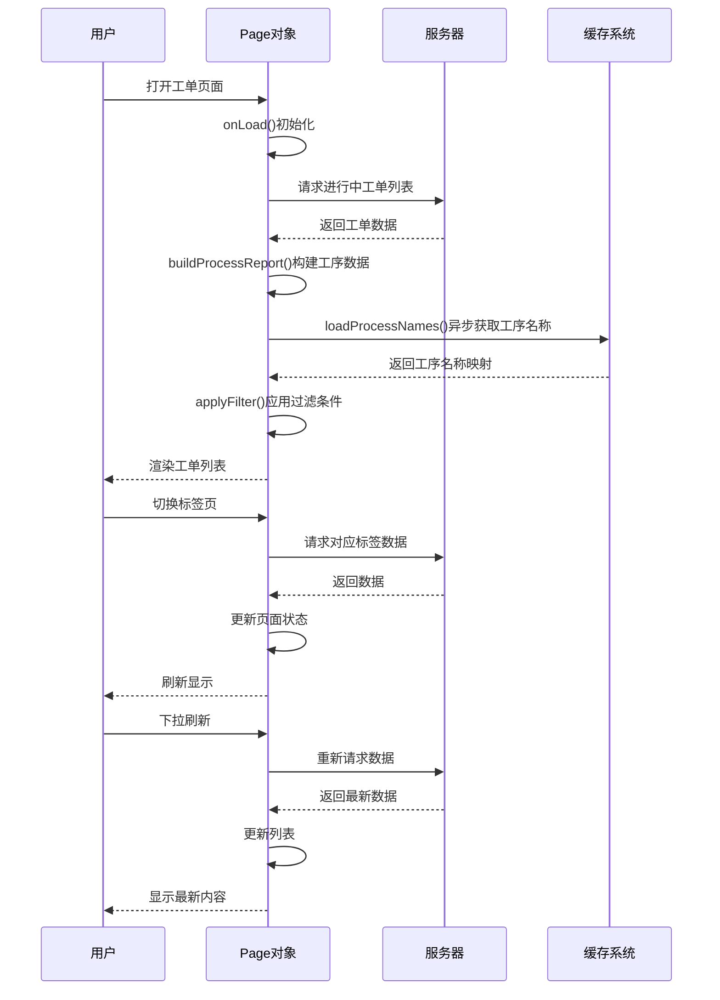
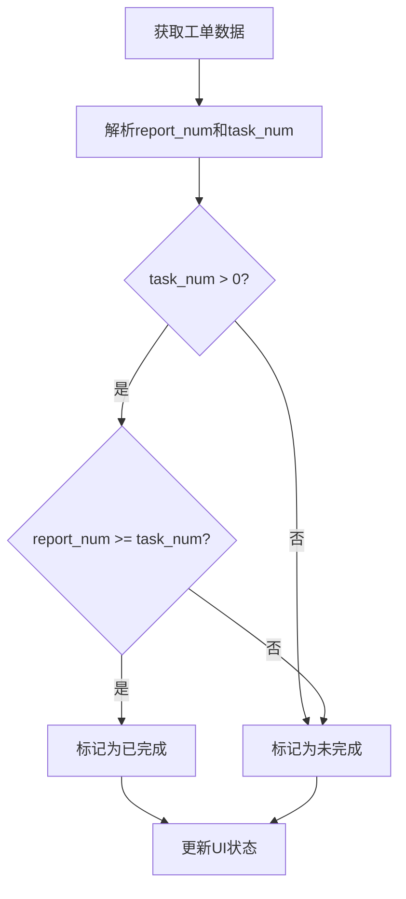
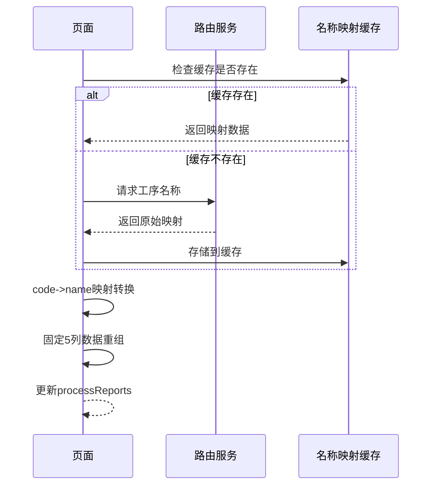
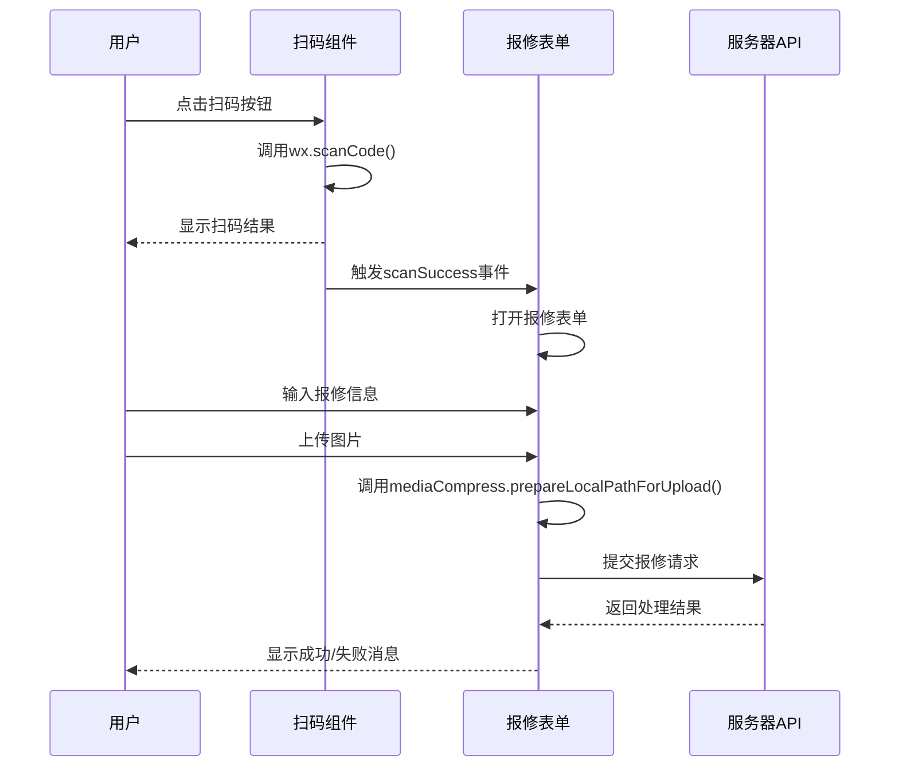
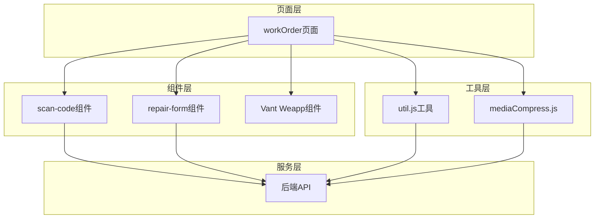
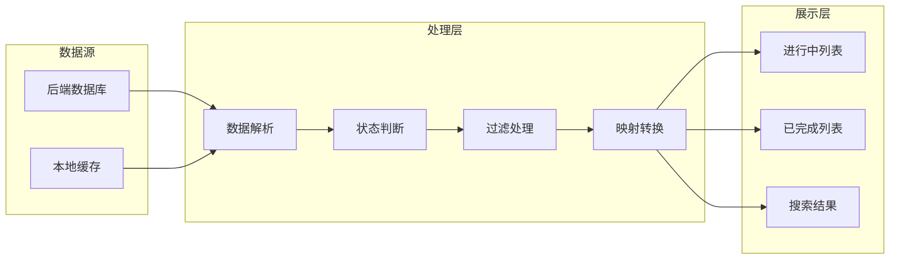

# 工单列表页面

<cite>
**本文档引用的文件**
- [workOrder.js](file://gccd_mini/pages/workOrder/workOrder.js)
- [workOrder.json](file://gccd_mini/pages/workOrder/workOrder.json)
- [workOrder.wxml](file://gccd_mini/pages/workOrder/workOrder.wxml)
- [workOrder.wxss](file://gccd_mini/pages/workOrder/workOrder.wxss)
- [scan-code.js](file://gccd_mini/pages/components/scan-code/scan-code.js)
- [repair-form.js](file://gccd_mini/pages/components/repair-form/repair-form.js)
- [util.js](file://gccd_mini/utils/util.js)
- [mediaCompress.js](file://gccd_mini/utils/mediaCompress.js)
- [workOrderInfo.js](file://gccd_mini/pageWorkOrder/pages/workOrderInfo/workOrderInfo.js)
- [workOrderProcess.js](file://gccd_mini/pageWorkOrder/pages/workOrderProcess/workOrderProcess.js)
- [app.json](file://gccd_mini/app.json)
</cite>

## 目录
1. [简介](#简介)
2. [项目结构](#项目结构)
3. [核心组件](#核心组件)
4. [架构概览](#架构概览)
5. [详细组件分析](#详细组件分析)
6. [依赖关系分析](#依赖关系分析)
7. [性能考虑](#性能考虑)
8. [故障排除指南](#故障排除指南)
9. [结论](#结论)

## 简介

工单列表页面是高齿传动项目中的核心功能模块，负责展示和管理生产过程中的工单任务。该页面实现了双标签切换（进行中/已完成）、分页加载、数据过滤、扫码报修等完整功能，为用户提供直观高效的工单管理体验。

## 项目结构

工单列表页面采用模块化设计，主要包含以下核心文件：



**图表来源**
- [workOrder.js:1-796](file://gccd_mini/pages/workOrder/workOrder.js#L1-L796)
- [workOrder.wxml:1-221](file://gccd_mini/pages/workOrder/workOrder.wxml#L1-L221)
- [scan-code.js:1-63](file://gccd_mini/pages/components/scan-code/scan-code.js#L1-L63)
- [repair-form.js:1-261](file://gccd_mini/pages/components/repair-form/repair-form.js#L1-L261)

**章节来源**
- [workOrder.js:1-796](file://gccd_mini/pages/workOrder/workOrder.js#L1-L796)
- [workOrder.json:1-17](file://gccd_mini/pages/workOrder/workOrder.json#L1-L17)

## 核心组件

### 页面状态管理

页面采用响应式数据绑定，通过 `data` 对象管理所有状态信息：

- **导航栏状态**: `statusBarHeight`、`subTabSafeBottom`
- **分页状态**: `page`、`limit`、`count`、`pages`、`loadingMore`、`noMore`
- **标签切换**: `activeTab` 控制进行中/已完成标签页
- **过滤状态**: `filterYSpec`、`filterCSpec`、`filterCModel`
- **数据缓存**: `fullList`、`fullFinishedList`

### 核心功能特性

1. **双标签切换系统**: 实现进行中和已完成工单的独立展示
2. **智能分页加载**: 支持无限滚动和下拉刷新
3. **实时数据过滤**: 多维度搜索条件支持
4. **动态工序映射**: 固定5道工序的名称映射机制
5. **扫码报修集成**: 内置二维码扫描和图片上传功能

**章节来源**
- [workOrder.js:6-61](file://gccd_mini/pages/workOrder/workOrder.js#L6-L61)
- [workOrder.js:95-109](file://gccd_mini/pages/workOrder/workOrder.js#L95-L109)

## 架构概览

工单列表页面采用MVVM架构模式，结合微信小程序原生组件和Vant Weapp组件库：



**图表来源**
- [workOrder.js:189-305](file://gccd_mini/pages/workOrder/workOrder.js#L189-L305)
- [workOrder.js:142-187](file://gccd_mini/pages/workOrder/workOrder.js#L142-L187)

## 详细组件分析

### 工单状态判断逻辑

工单完成状态通过 `report_num >= task_num` 规则判断：



**图表来源**
- [workOrder.js:111-116](file://gccd_mini/pages/workOrder/workOrder.js#L111-L116)

### 固定工序展示机制

系统实现固定5道工序的展示，确保界面一致性：

| 工序编号 | 固定名称 |
|---------|---------|
| 断钢 | 断钢 |
| 穿孔 | 穿孔 |
| 球化 | 球化 |
| 矫直 | 矫直 |
| 酸洗 | 酸洗 |

动态名称映射流程：



**图表来源**
- [workOrder.js:118-187](file://gccd_mini/pages/workOrder/workOrder.js#L118-L187)

### 数据过滤系统

多维度搜索条件支持：

- **圆钢型号**: `filterYSpec`
- **断钢型号**: `filterCSpec`  
- **成品型号**: `filterCModel`

过滤算法特点：
- 忽略大小写
- 支持部分匹配
- 实时响应用户输入
- 自动重置功能

**章节来源**
- [workOrder.js:63-93](file://gccd_mini/pages/workOrder/workOrder.js#L63-L93)

### 分页加载机制

```mermaid
flowchart TD
A[用户滚动到页面底部] --> B{是否还有更多数据?}
B --> |否| C[显示"没有更多了"]
B --> |是| D[设置loadingMore=true]
D --> E[计算下一页页码]
E --> F[发起API请求]
F --> G{请求成功?}
G --> |否| H[显示错误提示]
G --> |是| I[合并新数据到列表]
I --> J{是否到达最后一页?}
J --> |是| K[设置noMore=true]
J --> |否| L[继续加载]
K --> M[更新页面状态]
L --> M
H --> N[恢复loading状态]
M --> O[渲染更新后的列表]
```

**图表来源**
- [workOrder.js:661-701](file://gccd_mini/pages/workOrder/workOrder.js#L661-L701)

### 扫码报修功能

扫码报修集成多个组件协作：



**图表来源**
- [scan-code.js:6-27](file://gccd_mini/pages/components/scan-code/scan-code.js#L6-L27)
- [repair-form.js:21-259](file://gccd_mini/pages/components/repair-form/repair-form.js#L21-L259)

### 页面交互设计

#### 手势操作支持

1. **下拉刷新**: 支持两个标签页的独立刷新
2. **上拉加载**: 智能检测滚动位置，自动触发分页加载
3. **滑动删除**: 通过拖拽按钮实现工单删除操作

#### 按钮布局优化

浮动操作按钮采用拖拽设计：
- 初始位置：右下角
- 支持边界约束
- 平滑动画过渡
- 响应式适配不同屏幕尺寸

**章节来源**
- [workOrder.js:649-701](file://gccd_mini/pages/workOrder/workOrder.js#L649-L701)
- [workOrder.js:703-767](file://gccd_mini/pages/workOrder/workOrder.js#L703-L767)

## 依赖关系分析

### 组件依赖图



**图表来源**
- [workOrder.json:3-16](file://gccd_mini/pages/workOrder/workOrder.json#L3-L16)
- [util.js:22-94](file://gccd_mini/utils/util.js#L22-L94)

### 数据流分析



**图表来源**
- [workOrder.js:189-305](file://gccd_mini/pages/workOrder/workOrder.js#L189-L305)

**章节来源**
- [workOrder.js:142-187](file://gccd_mini/pages/workOrder/workOrder.js#L142-L187)

## 性能考虑

### 优化策略

1. **懒加载机制**
   - 标签页切换时才加载对应数据
   - 避免一次性加载所有工单数据

2. **缓存策略**
   - 工序名称映射缓存
   - 分页数据缓存
   - 减少重复网络请求

3. **虚拟滚动**
   - 大数据量时的性能优化
   - 滚动性能提升

4. **图片压缩**
   - 上传前自动压缩
   - 降低带宽消耗

### 用户体验优化

1. **加载状态反馈**
   - 下拉刷新指示器
   - 加载更多状态提示
   - 空状态友好提示

2. **交互响应性**
   - 按钮点击反馈
   - 滑动操作响应
   - 错误状态明确提示

## 故障排除指南

### 常见问题及解决方案

#### 数据加载失败
- **症状**: 页面空白或显示错误
- **原因**: 网络请求超时或服务器错误
- **解决**: 检查网络连接，重试加载

#### 工序名称显示异常
- **症状**: 工序名称显示为代码而非中文
- **原因**: 工序名称映射缓存失效
- **解决**: 刷新页面或重启应用

#### 扫码功能异常
- **症状**: 扫码无响应或失败
- **原因**: 权限问题或设备兼容性
- **解决**: 检查相机权限，更换设备测试

#### 图片上传失败
- **症状**: 图片无法上传或显示错误
- **原因**: 文件过大或格式不支持
- **解决**: 压缩图片或更换格式

**章节来源**
- [util.js:85-94](file://gccd_mini/utils/util.js#L85-L94)
- [mediaCompress.js:48-98](file://gccd_mini/utils/mediaCompress.js#L48-L98)

## 结论

工单列表页面通过精心设计的架构和丰富的功能特性，为用户提供了高效便捷的工单管理体验。其核心优势包括：

1. **完整的功能覆盖**: 从基础的工单展示到高级的扫码报修
2. **优秀的用户体验**: 流畅的交互设计和及时的状态反馈
3. **良好的性能表现**: 智能的缓存策略和优化的数据加载机制
4. **可靠的稳定性**: 完善的错误处理和故障恢复机制

该页面的设计充分体现了现代移动应用的最佳实践，为后续的功能扩展和维护奠定了坚实的基础。