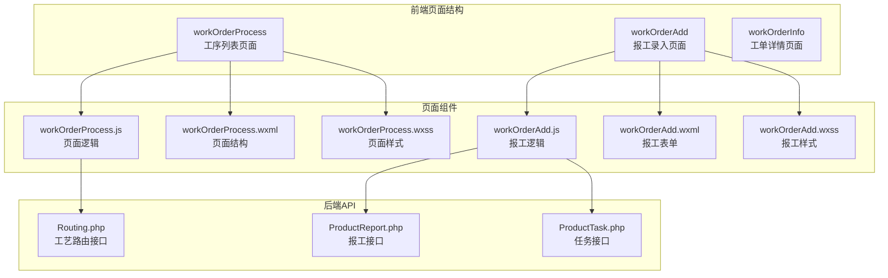
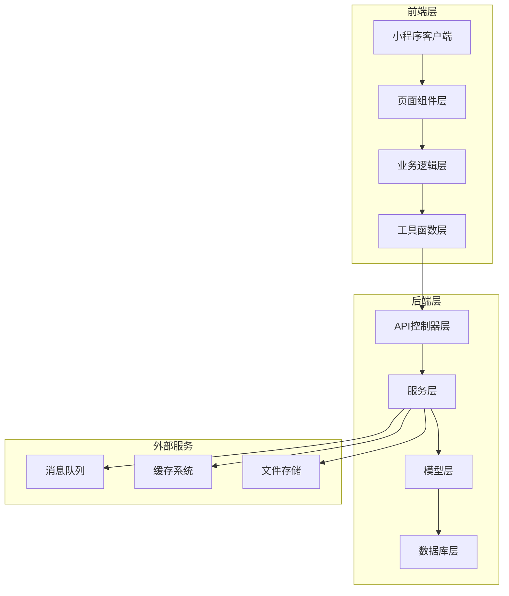
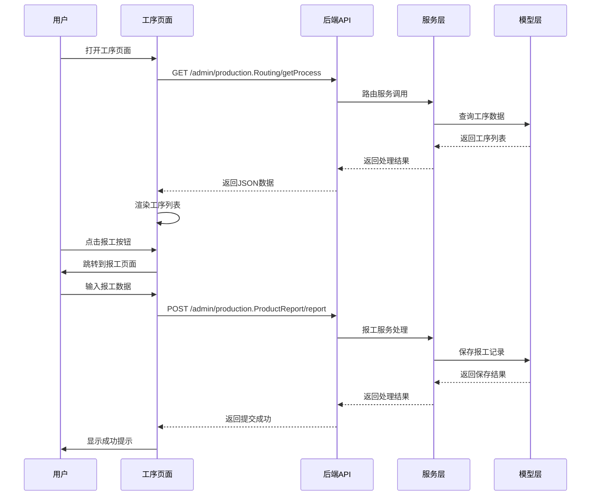
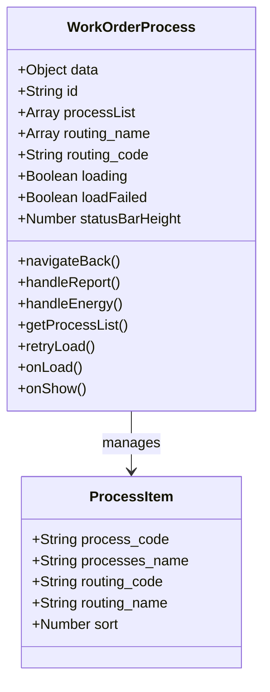
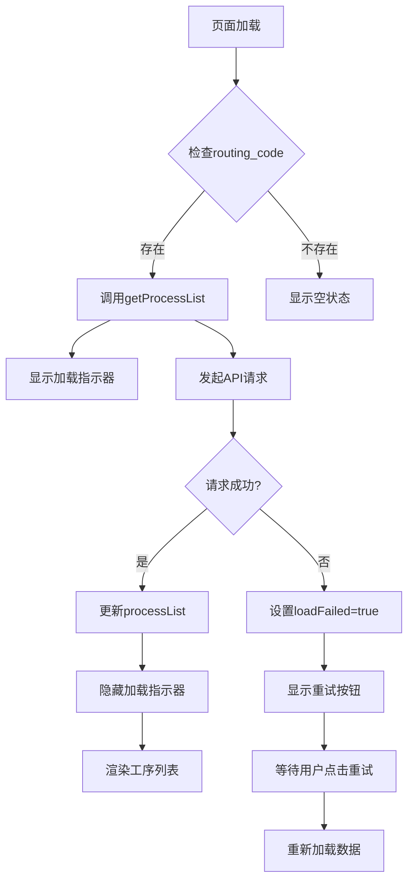
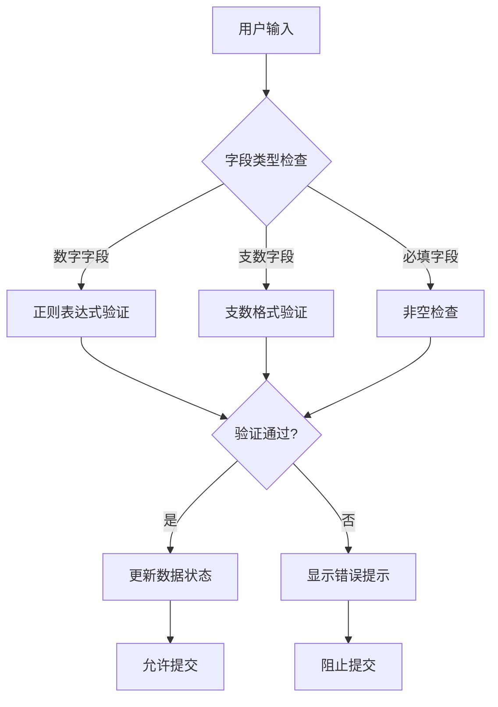
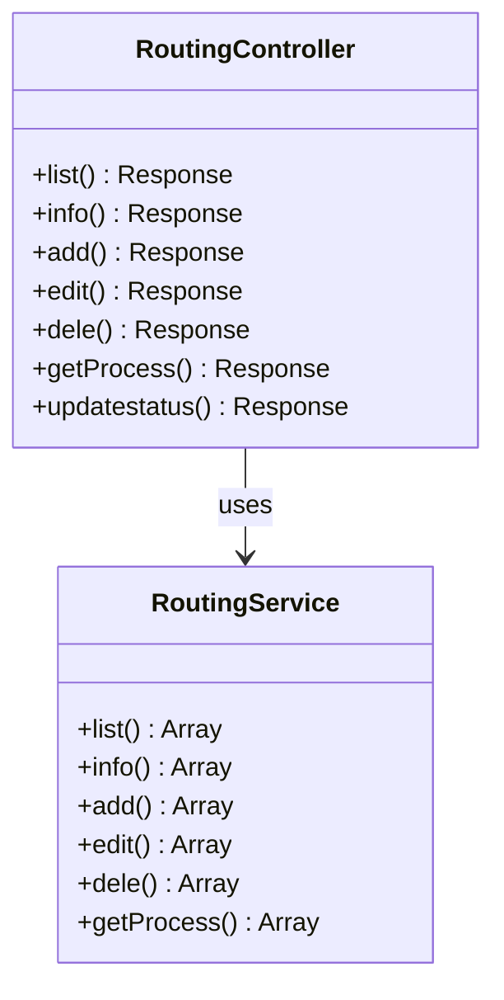
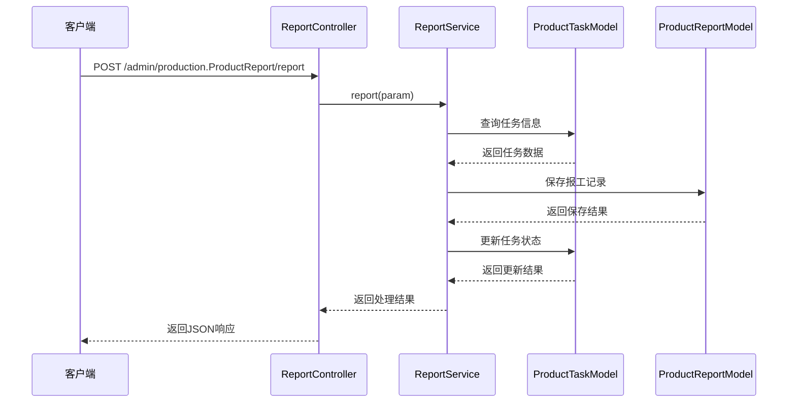
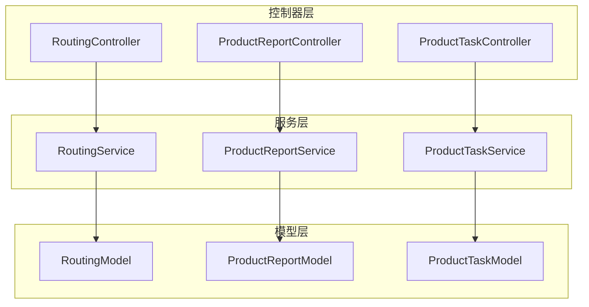

# 工单流程页面

<cite>
**本文档引用的文件**
- [workOrderProcess.js](file://gccd_mini/pageWorkOrder/pages/workOrderProcess/workOrderProcess.js)
- [workOrderProcess.json](file://gccd_mini/pageWorkOrder/pages/workOrderProcess/workOrderProcess.json)
- [workOrderProcess.wxml](file://gccd_mini/pageWorkOrder/pages/workOrderProcess/workOrderProcess.wxml)
- [workOrderProcess.wxss](file://gccd_mini/pageWorkOrder/pages/workOrderProcess/workOrderProcess.wxss)
- [workOrderAdd.js](file://gccd_mini/pageWorkOrder/pages/workOrderAdd/workOrderAdd.js)
- [workOrderAdd.json](file://gccd_mini/pageWorkOrder/pages/workOrderAdd/workOrderAdd.json)
- [workOrderAdd.wxml](file://gccd_mini/pageWorkOrder/pages/workOrderAdd/workOrderAdd.wxml)
- [workOrderAdd.wxss](file://gccd_mini/pageWorkOrder/pages/workOrderAdd/workOrderAdd.wxss)
- [Routing.php](file://gccd_server/app/admin/controller/production/Routing.php)
- [ProductReport.php](file://gccd_server/app/admin/controller/production/ProductReport.php)
- [ProductTask.php](file://gccd_server/app/admin/controller/production/ProductTask.php)
- [RoutingService.php](file://gccd_server/app/common/service/admin/RoutingService.php)
- [ProductReportService.php](file://gccd_server/app/common/service/admin/ProductReportService.php)
- [ProductTaskService.php](file://gccd_server/app/common/service/admin/ProductTaskService.php)
- [util.js](file://gccd_mini/utils/util.js)
</cite>

## 目录
1. [简介](#简介)
2. [项目结构](#项目结构)
3. [核心组件](#核心组件)
4. [架构概览](#架构概览)
5. [详细组件分析](#详细组件分析)
6. [依赖关系分析](#依赖关系分析)
7. [性能考虑](#性能考虑)
8. [故障排除指南](#故障排除指南)
9. [结论](#结论)

## 简介

工单流程页面是高齿传动项目中的核心功能模块，负责展示和管理生产工单的工序流程。该页面实现了以下关键功能：

- **固定5道工序展示**：基于工艺路线动态加载和显示标准工序序列
- **工序报工管理**：提供完整的报工数据录入和提交功能
- **进度跟踪**：实时显示各工序的完成状态和报工进度
- **动态数据加载**：通过API接口实时获取工序信息和报工状态
- **用户交互优化**：直观的操作界面和流畅的用户体验

该系统采用前后端分离架构，前端使用微信小程序框架，后端基于ThinkPHP 6.0开发，实现了完整的生产制造执行系统(MES)功能。

## 项目结构

工单流程页面位于项目的页面工作区中，采用模块化的文件组织方式：



**图表来源**
- [workOrderProcess.js:1-116](file://gccd_mini/pageWorkOrder/pages/workOrderProcess/workOrderProcess.js#L1-L116)
- [workOrderAdd.js:1-800](file://gccd_mini/pageWorkOrder/pages/workOrderAdd/workOrderAdd.js#L1-L800)
- [Routing.php:1-166](file://gccd_server/app/admin/controller/production/Routing.php#L1-L166)

**章节来源**
- [workOrderProcess.js:1-116](file://gccd_mini/pageWorkOrder/pages/workOrderProcess/workOrderProcess.js#L1-L116)
- [workOrderAdd.js:1-800](file://gccd_mini/pageWorkOrder/pages/workOrderAdd/workOrderAdd.js#L1-L800)

## 核心组件

### 工序列表页面组件

工单流程页面的核心组件负责展示和管理工序信息：

- **数据管理**：维护工序列表、工艺名称、加载状态等数据
- **API集成**：通过util.js封装的请求方法与后端API交互
- **用户交互**：处理报工按钮点击、页面导航等用户操作
- **状态管理**：管理加载状态、错误状态和页面生命周期

### 报工录入组件

报工页面提供了完整的报工数据录入功能：

- **表单验证**：实时验证输入数据的有效性
- **动态字段**：根据不同工序显示相应的必填字段
- **数据绑定**：双向绑定报工数量、备注等信息
- **提交处理**：统一处理报工数据的提交和反馈

**章节来源**
- [workOrderProcess.js:4-116](file://gccd_mini/pageWorkOrder/pages/workOrderProcess/workOrderProcess.js#L4-L116)
- [workOrderAdd.js:4-800](file://gccd_mini/pageWorkOrder/pages/workOrderAdd/workOrderAdd.js#L4-L800)

## 架构概览

系统采用前后端分离的架构设计，实现了清晰的职责分离：



**图表来源**
- [Routing.php:1-166](file://gccd_server/app/admin/controller/production/Routing.php#L1-L166)
- [ProductReport.php:1-416](file://gccd_server/app/admin/controller/production/ProductReport.php#L1-L416)
- [ProductTask.php:1-151](file://gccd_server/app/admin/controller/production/ProductTask.php#L1-L151)

### 数据流架构



**图表来源**
- [workOrderProcess.js:44-75](file://gccd_mini/pageWorkOrder/pages/workOrderProcess/workOrderProcess.js#L44-L75)
- [workOrderAdd.js:752-796](file://gccd_mini/pageWorkOrder/pages/workOrderAdd/workOrderAdd.js#L752-L796)
- [ProductReport.php:329-334](file://gccd_server/app/admin/controller/production/ProductReport.php#L329-L334)

## 详细组件分析

### 工序列表页面组件

#### 数据结构设计

页面使用标准化的数据结构来管理工序信息：



**图表来源**
- [workOrderProcess.js:4-116](file://gccd_mini/pageWorkOrder/pages/workOrderProcess/workOrderProcess.js#L4-L116)

#### 动态加载机制

页面实现了智能的动态加载机制：

- **首次加载**：页面初始化时自动获取工序列表
- **状态管理**：通过loading和loadFailed状态控制UI显示
- **错误处理**：网络异常时提供重试机制
- **生命周期管理**：onShow钩子处理页面返回时的数据刷新

#### 用户交互流程



**图表来源**
- [workOrderProcess.js:44-80](file://gccd_mini/pageWorkOrder/pages/workOrderProcess/workOrderProcess.js#L44-L80)

**章节来源**
- [workOrderProcess.js:4-116](file://gccd_mini/pageWorkOrder/pages/workOrderProcess/workOrderProcess.js#L4-L116)
- [workOrderProcess.wxml:1-44](file://gccd_mini/pageWorkOrder/pages/workOrderProcess/workOrderProcess.wxml#L1-L44)

### 报工录入组件

#### 表单验证系统

报工页面实现了多层次的表单验证机制：



**图表来源**
- [workOrderAdd.js:172-211](file://gccd_mini/pageWorkOrder/pages/workOrderAdd/workOrderAdd.js#L172-L211)

#### 工序特有字段处理

不同工序具有不同的必填字段要求：

| 工序名称 | 必填字段 | 特殊要求 |
|---------|---------|----------|
| 断钢 | 设备名称、不良品明细 | 不良品数量必须大于0 |
| 穿孔 | 设备名称、生产人员、开车人员 | 人员选择不能为空 |
| 酸洗 | 生产人员 | 需要选择不满勤人员 |
| 球化 | 设备名称、生产人员 | 人员选择不能为空 |
| 矫直 | 设备名称、代理班长 | 代理班长选择可选 |

**章节来源**
- [workOrderAdd.js:652-731](file://gccd_mini/pageWorkOrder/pages/workOrderAdd/workOrderAdd.js#L652-L731)

### 后端API集成

#### 工艺路由API

后端提供了完整的工艺路由管理接口：



**图表来源**
- [Routing.php:25-166](file://gccd_server/app/admin/controller/production/Routing.php#L25-L166)
- [RoutingService.php:26-277](file://gccd_server/app/common/service/admin/RoutingService.php#L26-L277)

#### 报工API处理流程



**图表来源**
- [ProductReport.php:329-334](file://gccd_server/app/admin/controller/production/ProductReport.php#L329-L334)
- [ProductReportService.php:518-642](file://gccd_server/app/common/service/admin/ProductReportService.php#L518-L642)

**章节来源**
- [Routing.php:159-164](file://gccd_server/app/admin/controller/production/Routing.php#L159-L164)
- [ProductReport.php:329-387](file://gccd_server/app/admin/controller/production/ProductReport.php#L329-L387)

## 依赖关系分析

### 前端依赖关系

```mermaid
graph LR
subgraph "页面依赖"
A[workOrderProcess.js] --> B[util.js]
A --> C[@vant/weapp/components]
D[workOrderAdd.js] --> B
D --> C
end
subgraph "第三方库"
C --> D[Vant Weapp UI]
B --> E[HTTP请求封装]
end
subgraph "样式依赖"
F[workOrderProcess.wxss] --> G[基础样式变量]
H[workOrderAdd.wxss] --> G
end
```

**图表来源**
- [workOrderProcess.js:1-3](file://gccd_mini/pageWorkOrder/pages/workOrderProcess/workOrderProcess.js#L1-L3)
- [workOrderAdd.js:1-3](file://gccd_mini/pageWorkOrder/pages/workOrderAdd/workOrderAdd.js#L1-L3)

### 后端服务依赖



**图表来源**
- [RoutingService.php:26-277](file://gccd_server/app/common/service/admin/RoutingService.php#L26-L277)
- [ProductReportService.php:41-81](file://gccd_server/app/common/service/admin/ProductReportService.php#L41-L81)

**章节来源**
- [util.js](file://gccd_mini/utils/util.js)
- [RoutingService.php:26-277](file://gccd_server/app/common/service/admin/RoutingService.php#L26-L277)

## 性能考虑

### 前端性能优化

1. **懒加载策略**：页面按需加载数据，避免不必要的资源消耗
2. **状态缓存**：利用小程序的页面缓存机制减少重复请求
3. **虚拟列表**：对于大量数据采用虚拟滚动技术
4. **图片优化**：使用合适的图片格式和尺寸

### 后端性能优化

1. **数据库索引**：为常用查询字段建立索引
2. **查询优化**：使用JOIN查询减少数据库访问次数
3. **缓存机制**：对热点数据进行缓存
4. **分页处理**：大数据量时采用分页查询

### 网络优化

1. **请求合并**：将多个小请求合并为批量请求
2. **压缩传输**：启用Gzip压缩减少传输体积
3. **CDN加速**：静态资源使用CDN分发
4. **连接复用**：复用HTTP连接减少握手开销

## 故障排除指南

### 常见问题及解决方案

#### 数据加载失败

**问题症状**：
- 页面显示"加载失败，请点击重试"
- 重试按钮不可用或点击无响应

**排查步骤**：
1. 检查网络连接状态
2. 验证routing_code参数是否正确
3. 查看后端API响应状态
4. 检查浏览器开发者工具中的网络请求

**解决方案**：
- 实现自动重试机制
- 提供详细的错误信息
- 添加离线数据缓存

#### 报工提交失败

**问题症状**：
- 报工表单提交后无响应
- 显示"提交失败"错误提示

**排查步骤**：
1. 检查必填字段是否完整
2. 验证数据格式是否正确
3. 查看后端日志中的错误信息
4. 确认用户权限是否足够

**解决方案**：
- 实现表单预验证
- 提供具体的错误指导
- 添加防重复提交机制

#### 数据同步问题

**问题症状**：
- 页面显示的数据与实际不符
- 报工后状态未更新

**排查步骤**：
1. 检查缓存数据是否过期
2. 验证API响应数据完整性
3. 查看数据库中的实际数据
4. 确认时间戳和版本信息

**解决方案**：
- 实现数据版本控制
- 添加手动刷新功能
- 建立数据同步机制

**章节来源**
- [workOrderProcess.js:67-74](file://gccd_mini/pageWorkOrder/pages/workOrderProcess/workOrderProcess.js#L67-L74)
- [workOrderAdd.js:752-796](file://gccd_mini/pageWorkOrder/pages/workOrderAdd/workOrderAdd.js#L752-L796)

## 结论

工单流程页面作为生产制造执行系统的核心组件，实现了以下关键价值：

### 技术优势

1. **架构清晰**：前后端分离设计，职责明确
2. **扩展性强**：模块化设计便于功能扩展
3. **用户体验佳**：直观的操作界面和流畅的交互体验
4. **数据安全**：完善的权限控制和数据验证机制

### 业务价值

1. **提高效率**：自动化的工作流程减少了人工操作
2. **保证质量**：标准化的工序管理和报工流程
3. **降低成本**：减少错误和返工，提高生产效率
4. **增强透明度**：实时的进度跟踪和状态显示

### 发展建议

1. **移动端优化**：进一步优化移动端的用户体验
2. **智能化功能**：集成AI辅助决策和预测分析
3. **集成扩展**：与其他ERP系统的深度集成
4. **数据分析**：加强生产数据的分析和可视化

该系统为高齿传动项目的数字化转型奠定了坚实的基础，通过持续的优化和改进，将为企业创造更大的价值。