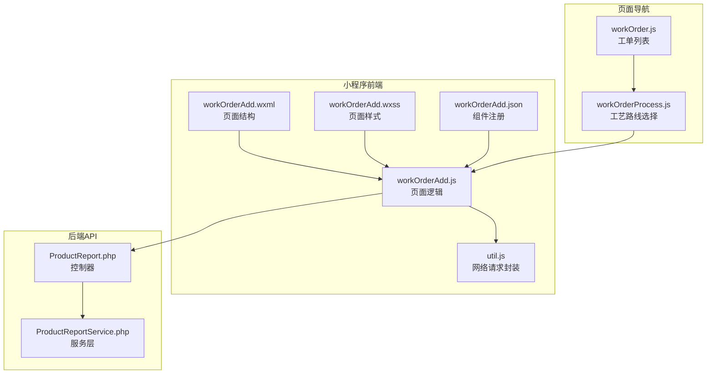
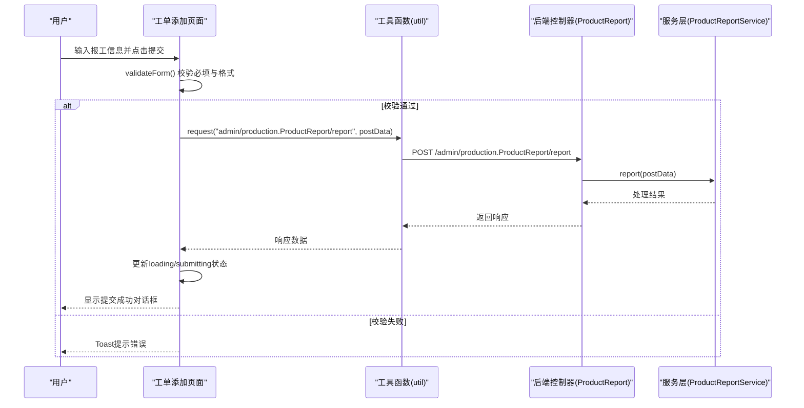
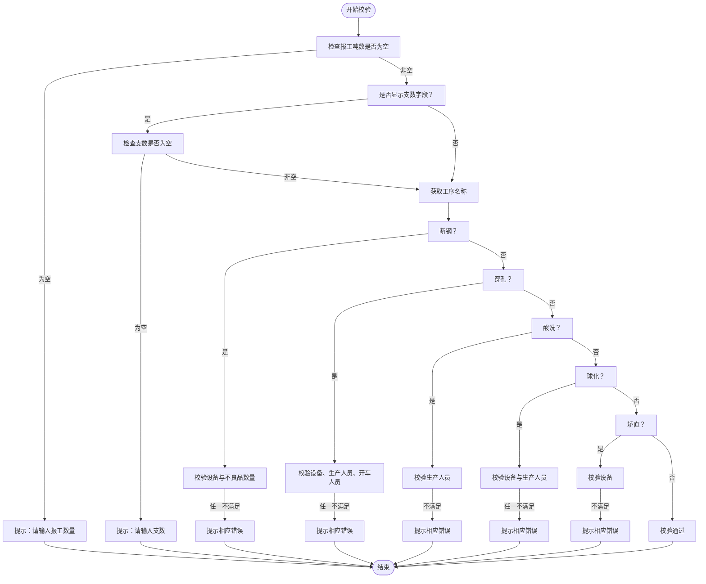
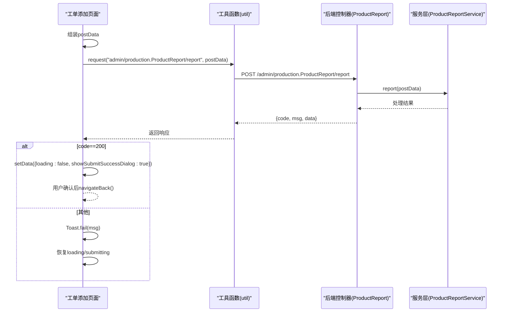
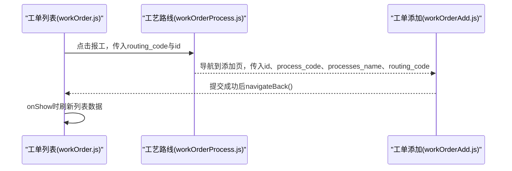
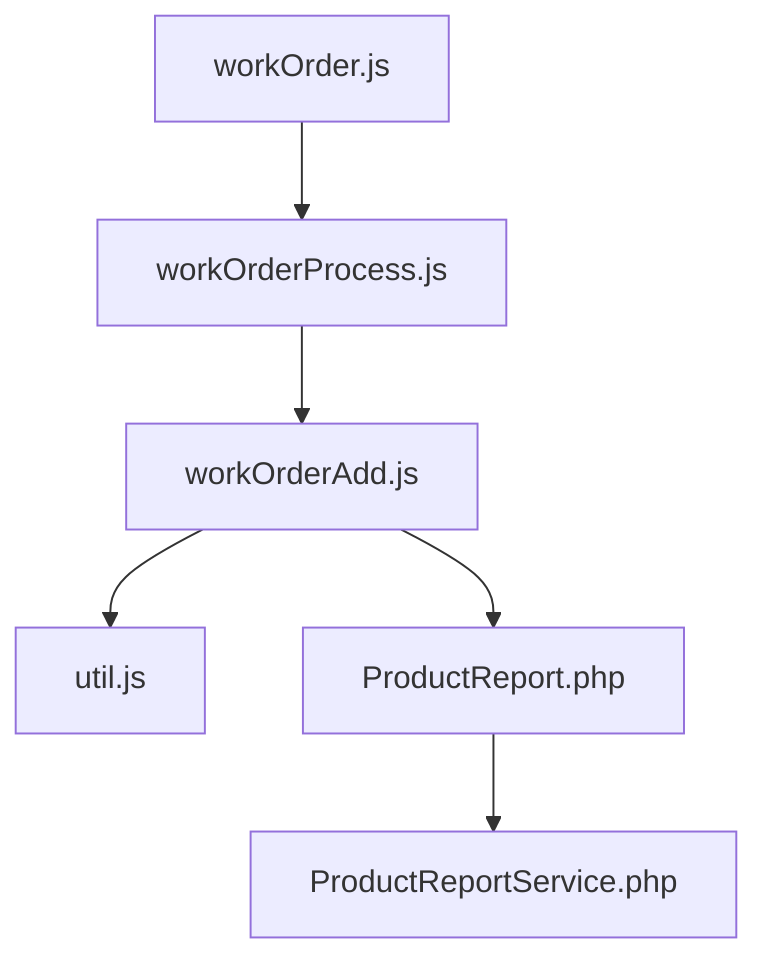

# 工单添加页面

<cite>
**本文档引用的文件**
- [workOrderAdd.js](file://gccd_mini/pageWorkOrder/pages/workOrderAdd/workOrderAdd.js)
- [workOrderAdd.json](file://gccd_mini/pageWorkOrder/pages/workOrderAdd/workOrderAdd.json)
- [workOrderAdd.wxml](file://gccd_mini/pageWorkOrder/pages/workOrderAdd/workOrderAdd.wxml)
- [workOrderAdd.wxss](file://gccd_mini/pageWorkOrder/pages/workOrderAdd/workOrderAdd.wxss)
- [util.js](file://gccd_mini/utils/util.js)
- [workOrderProcess.js](file://gccd_mini/pageWorkOrder/pages/workOrderProcess/workOrderProcess.js)
- [workOrder.js](file://gccd_mini/pages/workOrder/workOrder.js)
- [ProductReport.php](file://gccd_server/app/admin/controller/production/ProductReport.php)
- [ProductReportService.php](file://gccd_server/app/common/service/admin/ProductReportService.php)
</cite>

## 目录
1. [简介](#简介)
2. [项目结构](#项目结构)
3. [核心组件](#核心组件)
4. [架构概览](#架构概览)
5. [详细组件分析](#详细组件分析)
6. [依赖关系分析](#依赖关系分析)
7. [性能考虑](#性能考虑)
8. [故障排除指南](#故障排除指南)
9. [结论](#结论)
10. [附录](#附录)

## 简介
本文件为工单添加页面的详细开发文档，涵盖表单设计与实现、数据验证规则、提交流程、错误处理机制，以及与后端API的交互方式。文档还阐述了页面状态管理、用户输入处理、与工单列表页面的数据同步机制，并提供表单开发的最佳实践和用户体验优化建议。

## 项目结构
工单添加页面位于微信小程序前端工程中，采用典型的页面-组件结构，配合自定义工具函数与后端API控制器实现完整的报工流程。

**图表来源**
- [workOrderAdd.js:1-916](file://gccd_mini/pageWorkOrder/pages/workOrderAdd/workOrderAdd.js#L1-L916)
- [workOrderAdd.wxml:1-184](file://gccd_mini/pageWorkOrder/pages/workOrderAdd/workOrderAdd.wxml#L1-L184)
- [workOrderAdd.wxss:1-208](file://gccd_mini/pageWorkOrder/pages/workOrderAdd/workOrderAdd.wxss#L1-L208)
- [workOrderAdd.json:1-17](file://gccd_mini/pageWorkOrder/pages/workOrderAdd/workOrderAdd.json#L1-L17)
- [util.js:1-98](file://gccd_mini/utils/util.js#L1-L98)
- [workOrderProcess.js:1-116](file://gccd_mini/pageWorkOrder/pages/workOrderProcess/workOrderProcess.js#L1-L116)
- [workOrder.js:1-796](file://gccd_mini/pages/workOrder/workOrder.js#L1-L796)
- [ProductReport.php:1-416](file://gccd_server/app/admin/controller/production/ProductReport.php#L1-L416)
- [ProductReportService.php:1-200](file://gccd_server/app/common/service/admin/ProductReportService.php#L1-L200)

**章节来源**
- [workOrderAdd.js:1-916](file://gccd_mini/pageWorkOrder/pages/workOrderAdd/workOrderAdd.js#L1-L916)
- [workOrderAdd.wxml:1-184](file://gccd_mini/pageWorkOrder/pages/workOrderAdd/workOrderAdd.wxml#L1-L184)
- [workOrderAdd.wxss:1-208](file://gccd_mini/pageWorkOrder/pages/workOrderAdd/workOrderAdd.wxss#L1-L208)
- [workOrderAdd.json:1-17](file://gccd_mini/pageWorkOrder/pages/workOrderAdd/workOrderAdd.json#L1-L17)
- [util.js:1-98](file://gccd_mini/utils/util.js#L1-L98)
- [workOrderProcess.js:1-116](file://gccd_mini/pageWorkOrder/pages/workOrderProcess/workOrderProcess.js#L1-L116)
- [workOrder.js:1-796](file://gccd_mini/pages/workOrder/workOrder.js#L1-L796)
- [ProductReport.php:1-416](file://gccd_server/app/admin/controller/production/ProductReport.php#L1-L416)
- [ProductReportService.php:1-200](file://gccd_server/app/common/service/admin/ProductReportService.php#L1-L200)

## 核心组件
- 页面逻辑与状态管理：负责表单字段绑定、输入校验、弹窗控制、数据提交与错误处理。
- 视图与交互：基于Vant Weapp组件库构建，包含字段输入、选择器弹窗、表格展示等。
- 工具函数：统一的网络请求封装，处理鉴权、错误提示与响应解析。
- 页面导航：从工单列表进入工艺路线选择，再进入工单添加页面。
- 后端API：提供报工记录的增删改查、报工计算、列表查询等接口。

**章节来源**
- [workOrderAdd.js:1-916](file://gccd_mini/pageWorkOrder/pages/workOrderAdd/workOrderAdd.js#L1-L916)
- [workOrderAdd.wxml:1-184](file://gccd_mini/pageWorkOrder/pages/workOrderAdd/workOrderAdd.wxml#L1-L184)
- [util.js:1-98](file://gccd_mini/utils/util.js#L1-L98)
- [workOrderProcess.js:1-116](file://gccd_mini/pageWorkOrder/pages/workOrderProcess/workOrderProcess.js#L1-L116)
- [workOrder.js:1-796](file://gccd_mini/pages/workOrder/workOrder.js#L1-L796)
- [ProductReport.php:1-416](file://gccd_server/app/admin/controller/production/ProductReport.php#L1-L416)

## 架构概览
页面从前端发起请求，通过工具函数封装网络请求，调用后端控制器接口，服务层处理业务逻辑并返回结果。页面根据响应更新UI状态，完成报工提交与反馈。

**图表来源**
- [workOrderAdd.js:752-858](file://gccd_mini/pageWorkOrder/pages/workOrderAdd/workOrderAdd.js#L752-L858)
- [util.js:22-94](file://gccd_mini/utils/util.js#L22-L94)
- [ProductReport.php:329-334](file://gccd_server/app/admin/controller/production/ProductReport.php#L329-L334)
- [ProductReportService.php:1-200](file://gccd_server/app/common/service/admin/ProductReportService.php#L1-L200)

## 详细组件分析

### 表单设计与字段
- 基本信息区域：关联单号、工序名称与编码、工艺名称与编码、物料型号（圆钢/断钢/成品）、已报工吨数。
- 工序报工区域：
  - 报工支数（穿孔/球化/矫直显示，支持计算吨数）
  - 报工吨数（通用字段）
  - 设备名称（断钢/穿孔/球化/矫直）
  - 生产人员、开车人员（穿孔/酸洗/球化）
  - 不满勤人员及上班时长（穿孔/球化/酸洗）
  - 不良品类型与数量（断钢/穿孔）
  - 备注
  - 是否代理班长（矫直）

字段展示与交互由wxml控制，数据绑定与事件处理在js中实现。

**章节来源**
- [workOrderAdd.wxml:11-128](file://gccd_mini/pageWorkOrder/pages/workOrderAdd/workOrderAdd.wxml#L11-L128)
- [workOrderAdd.js:5-79](file://gccd_mini/pageWorkOrder/pages/workOrderAdd/workOrderAdd.js#L5-L79)

### 数据验证规则
- 必填校验：报工吨数必填；若显示支数字段则支数必填。
- 工序特异校验：
  - 断钢：需选择设备；不良品数量均需大于0。
  - 穿孔：需选择设备；生产人员与开车人员均需选择。
  - 酸洗：需选择生产人员。
  - 球化：需选择设备与生产人员。
  - 矫直：需选择设备；可选择是否代理班长。
- 数字格式校验：报工吨数与支数仅允许数字与小数点，非法输入给出Toast提示。

**图表来源**
- [workOrderAdd.js:652-731](file://gccd_mini/pageWorkOrder/pages/workOrderAdd/workOrderAdd.js#L652-L731)

**章节来源**
- [workOrderAdd.js:652-731](file://gccd_mini/pageWorkOrder/pages/workOrderAdd/workOrderAdd.js#L652-L731)

### 数据提交流程
- 参数构建：根据工序动态组装postData，包含关联单号、工艺编码、工序编码、物料ID、报工吨数、备注、不良品明细、是否代理班长、支数（可选）、设备信息与人员列表等。
- 提交请求：调用工具函数util.request，目标URL为“admin/production.ProductReport/report”，方法POST。
- 响应处理：成功返回码200显示成功对话框并返回上一页；失败时区分业务错误与网络错误，Toast提示并恢复loading状态。

**图表来源**
- [workOrderAdd.js:752-858](file://gccd_mini/pageWorkOrder/pages/workOrderAdd/workOrderAdd.js#L752-L858)
- [util.js:22-94](file://gccd_mini/utils/util.js#L22-L94)
- [ProductReport.php:329-334](file://gccd_server/app/admin/controller/production/ProductReport.php#L329-L334)

**章节来源**
- [workOrderAdd.js:752-858](file://gccd_mini/pageWorkOrder/pages/workOrderAdd/workOrderAdd.js#L752-L858)
- [util.js:22-94](file://gccd_mini/utils/util.js#L22-L94)
- [ProductReport.php:329-334](file://gccd_server/app/admin/controller/production/ProductReport.php#L329-L334)

### 错误处理机制
- 前端错误：输入格式错误、必填字段缺失、工序特异校验失败，通过Toast提示。
- 网络错误：util.request统一拦截401/400/404等状态码，提示重新登录或请求错误，并拒绝Promise。
- 提交错误：区分业务错误与网络异常，网络异常提示“若网络不稳定可能已提交成功，请到列表核对后再试”。

**章节来源**
- [workOrderAdd.js:652-858](file://gccd_mini/pageWorkOrder/pages/workOrderAdd/workOrderAdd.js#L652-L858)
- [util.js:44-91](file://gccd_mini/utils/util.js#L44-L91)

### 页面与后端API交互
- 工具函数封装：统一设置AdminToken头，处理异常响应与错误提示。
- 报工计算接口：当显示支数字段时，可调用“admin/production.ProductReport/count”根据支数与关联单号计算吨数。
- 报工提交接口：POST “admin/production.ProductReport/report”，提交工序特异字段与通用字段。
- 人员与设备查询：通过“admin/system.User/productlist”和“admin/repair.Device/list”获取下拉选项。
- 工单详情：POST “admin/production.ProductTask/info”获取关联单据信息。

**章节来源**
- [util.js:22-94](file://gccd_mini/utils/util.js#L22-L94)
- [workOrderAdd.js:144-170](file://gccd_mini/pageWorkOrder/pages/workOrderAdd/workOrderAdd.js#L144-L170)
- [workOrderAdd.js:219-242](file://gccd_mini/pageWorkOrder/pages/workOrderAdd/workOrderAdd.js#L219-L242)
- [workOrderAdd.js:307-338](file://gccd_mini/pageWorkOrder/pages/workOrderAdd/workOrderAdd.js#L307-L338)
- [workOrderAdd.js:547-587](file://gccd_mini/pageWorkOrder/pages/workOrderAdd/workOrderAdd.js#L547-L587)

### 页面状态管理与用户输入处理
- 状态字段：包含loading、submitting、showSubmitSuccessDialog、各字段值、弹窗开关、选项列表、人员与设备选择状态等。
- 输入处理：统一onInputChange与onYarnCountInput处理数字输入与格式校验，非法输入Toast提示。
- 弹窗控制：通过showDefectivePopup、showDevicePopup、showUserPopup控制不同选择器的显示与隐藏。
- 人员与设备选择：支持多选，通过tempUserField区分当前操作字段，确认后写入对应显示文本与对象数组。

**章节来源**
- [workOrderAdd.js:5-79](file://gccd_mini/pageWorkOrder/pages/workOrderAdd/workOrderAdd.js#L5-L79)
- [workOrderAdd.js:172-211](file://gccd_mini/pageWorkOrder/pages/workOrderAdd/workOrderAdd.js#L172-L211)
- [workOrderAdd.js:376-507](file://gccd_mini/pageWorkOrder/pages/workOrderAdd/workOrderAdd.js#L376-L507)

### 与工单列表页面的数据同步
- 工单列表：固定5道工序顺序，按工序名称匹配报工数据，渲染报工汇总表。
- 工单流程：从工单列表进入工艺路线选择，再进入工单添加页面，参数携带id、process_code、processes_name、routing_code等。
- 数据同步：工单列表通过路由缓存与按需加载保证数据一致性；工单添加页面提交成功后返回上一页，列表页onShow时刷新数据。

**图表来源**
- [workOrder.js:315-328](file://gccd_mini/pages/workOrder/workOrder.js#L315-L328)
- [workOrderProcess.js:22-31](file://gccd_mini/pageWorkOrder/pages/workOrderProcess/workOrderProcess.js#L22-L31)
- [workOrder.js:105-115](file://gccd_mini/pages/workOrder/workOrder.js#L105-L115)

**章节来源**
- [workOrder.js:1-796](file://gccd_mini/pages/workOrder/workOrder.js#L1-L796)
- [workOrderProcess.js:1-116](file://gccd_mini/pageWorkOrder/pages/workOrderProcess/workOrderProcess.js#L1-L116)
- [workOrderAdd.js:880-908](file://gccd_mini/pageWorkOrder/pages/workOrderAdd/workOrderAdd.js#L880-L908)

## 依赖关系分析
- 页面依赖Vant Weapp组件：field、cell、popup、picker、radio等。
- 页面依赖工具函数：统一网络请求与错误处理。
- 页面依赖后端控制器与服务层：报工接口、计算接口、列表查询等。
- 页面间导航：工单列表→工艺路线→工单添加。

**图表来源**
- [workOrderAdd.js:1-916](file://gccd_mini/pageWorkOrder/pages/workOrderAdd/workOrderAdd.js#L1-L916)
- [util.js:1-98](file://gccd_mini/utils/util.js#L1-L98)
- [ProductReport.php:1-416](file://gccd_server/app/admin/controller/production/ProductReport.php#L1-L416)
- [ProductReportService.php:1-200](file://gccd_server/app/common/service/admin/ProductReportService.php#L1-L200)
- [workOrderProcess.js:1-116](file://gccd_mini/pageWorkOrder/pages/workOrderProcess/workOrderProcess.js#L1-L116)
- [workOrder.js:1-796](file://gccd_mini/pages/workOrder/workOrder.js#L1-L796)

**章节来源**
- [workOrderAdd.js:1-916](file://gccd_mini/pageWorkOrder/pages/workOrderAdd/workOrderAdd.js#L1-L916)
- [util.js:1-98](file://gccd_mini/utils/util.js#L1-L98)
- [ProductReport.php:1-416](file://gccd_server/app/admin/controller/production/ProductReport.php#L1-L416)
- [ProductReportService.php:1-200](file://gccd_server/app/common/service/admin/ProductReportService.php#L1-L200)
- [workOrderProcess.js:1-116](file://gccd_mini/pageWorkOrder/pages/workOrderProcess/workOrderProcess.js#L1-L116)
- [workOrder.js:1-796](file://gccd_mini/pages/workOrder/workOrder.js#L1-L796)

## 性能考虑
- 防重复提交：_submitLock与submitting双重控制，避免重复点击导致重复提交。
- 输入防抖：支数输入支持防抖计算，减少频繁请求。
- 分页与懒加载：人员与设备列表支持分页，提升大列表性能。
- 状态最小化：仅在必要时setData，减少不必要的视图更新。

[本节为通用指导，无需列出具体文件来源]

## 故障排除指南
- 提交失败：检查网络状态与后端响应；若提示“网络不稳定可能已提交成功”，建议到工单列表核对。
- 登录失效：401状态自动清理本地token并跳转登录页。
- 必填字段缺失：根据Toast提示补充完整信息。
- 工序特异校验失败：按工序要求补齐设备、人员或不良品数量。

**章节来源**
- [workOrderAdd.js:841-855](file://gccd_mini/pageWorkOrder/pages/workOrderAdd/workOrderAdd.js#L841-L855)
- [util.js:57-68](file://gccd_mini/utils/util.js#L57-L68)

## 结论
工单添加页面通过清晰的表单设计、严格的校验规则、完善的错误处理与前后端协作，实现了高效稳定的报工流程。页面状态管理与用户体验优化确保了在复杂工序场景下的易用性与可靠性。

[本节为总结性内容，无需列出具体文件来源]

## 附录

### 最佳实践与用户体验优化建议
- 输入体验：对数字输入提供即时格式校验与Toast提示，避免无效输入。
- 交互反馈：提交过程中显示loading与禁用按钮，防止重复提交。
- 数据一致性：提交成功后立即返回上一页并触发列表刷新，确保数据实时可见。
- 工序适配：针对不同工序动态显示字段，减少无关信息干扰。
- 错误引导：提供明确的错误文案与修复建议，降低用户困惑。

[本节为通用指导，无需列出具体文件来源]