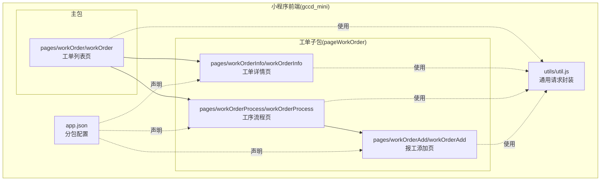
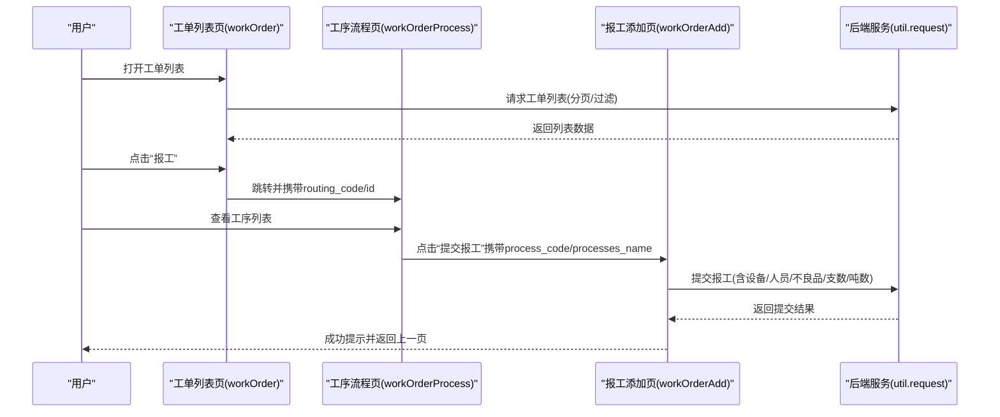
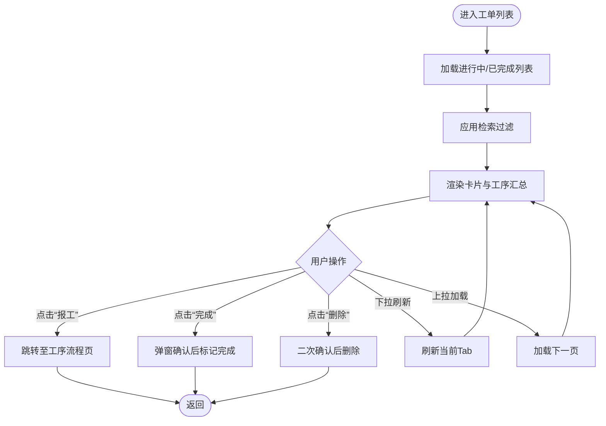
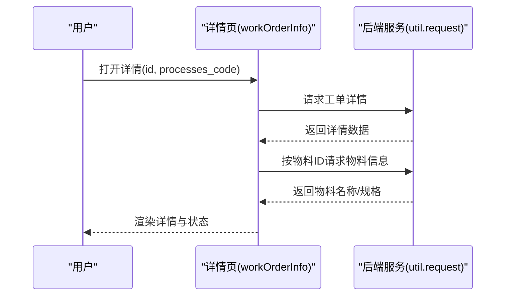
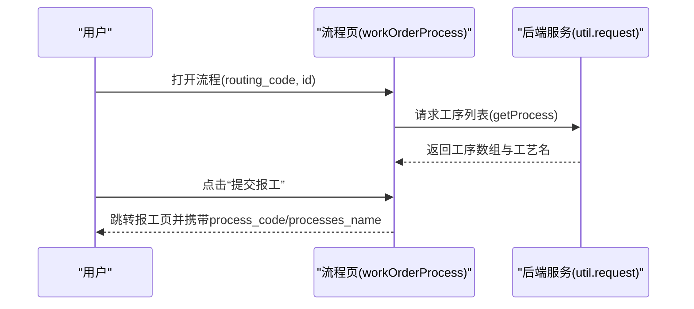
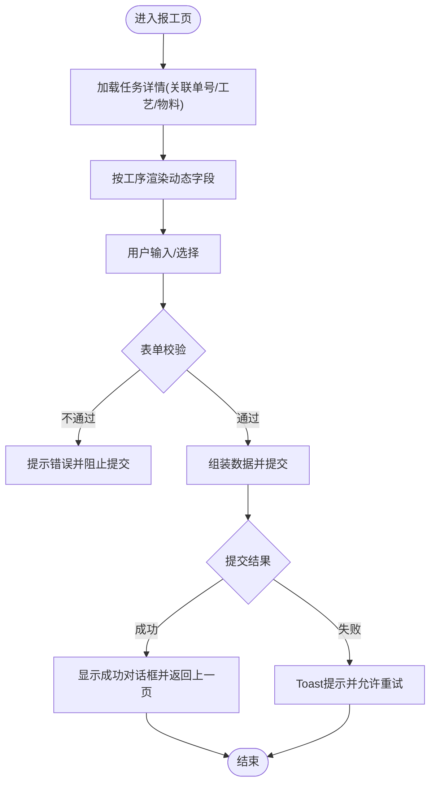
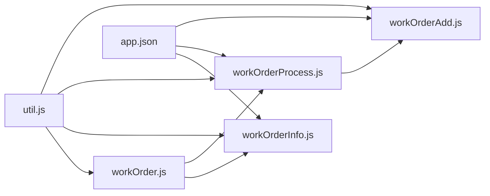

# 工单管理页面

<cite>
**本文引用的文件**
- [workOrder.js](file://gccd_mini/pages/workOrder/workOrder.js)
- [workOrder.json](file://gccd_mini/pages/workOrder/workOrder.json)
- [workOrder.wxml](file://gccd_mini/pages/workOrder/workOrder.wxml)
- [workOrder.wxss](file://gccd_mini/pages/workOrder/workOrder.wxss)
- [workOrderInfo.js](file://gccd_mini/pageWorkOrder/pages/workOrderInfo/workOrderInfo.js)
- [workOrderInfo.json](file://gccd_mini/pageWorkOrder/pages/workOrderInfo/workOrderInfo.json)
- [workOrderInfo.wxml](file://gccd_mini/pageWorkOrder/pages/workOrderInfo/workOrderInfo.wxml)
- [workOrderProcess.js](file://gccd_mini/pageWorkOrder/pages/workOrderProcess/workOrderProcess.js)
- [workOrderProcess.json](file://gccd_mini/pageWorkOrder/pages/workOrderProcess/workOrderProcess.json)
- [workOrderProcess.wxml](file://gccd_mini/pageWorkOrder/pages/workOrderProcess/workOrderProcess.wxml)
- [workOrderAdd.js](file://gccd_mini/pageWorkOrder/pages/workOrderAdd/workOrderAdd.js)
- [workOrderAdd.json](file://gccd_mini/pageWorkOrder/pages/workOrderAdd/workOrderAdd.json)
- [workOrderAdd.wxml](file://gccd_mini/pageWorkOrder/pages/workOrderAdd/workOrderAdd.wxml)
- [workOrderAdd.wxss](file://gccd_mini/pageWorkOrder/pages/workOrderAdd/workOrderAdd.wxss)
- [util.js](file://gccd_mini/utils/util.js)
- [app.json](file://gccd_mini/app.json)
- [app.js](file://gccd_mini/app.js)
</cite>

## 目录
1. [简介](#简介)
2. [项目结构](#项目结构)
3. [核心组件](#核心组件)
4. [架构总览](#架构总览)
5. [详细组件分析](#详细组件分析)
6. [依赖关系分析](#依赖关系分析)
7. [性能考量](#性能考量)
8. [故障排查指南](#故障排查指南)
9. [结论](#结论)
10. [附录](#附录)

## 简介
本文件面向“工单管理页面”的开发与维护，系统性梳理工单列表、详情、报工（添加）、流程（工序）页面的设计与实现，覆盖状态展示、筛选与搜索、表单校验、数据提交、页面间传参与状态同步、以及最佳实践与体验优化建议。目标是帮助开发者快速理解与迭代该模块。

## 项目结构
工单相关页面位于小程序前端工程的子包中，采用按页面拆分的组织方式，便于独立开发与维护。

图表来源
- [app.json:74-84](file://gccd_mini/app.json#L74-L84)
- [workOrder.js:307-328](file://gccd_mini/pages/workOrder/workOrder.js#L307-L328)
- [workOrderProcess.js:22-41](file://gccd_mini/pageWorkOrder/pages/workOrderProcess/workOrderProcess.js#L22-L41)
- [workOrderAdd.js:752-762](file://gccd_mini/pageWorkOrder/pages/workOrderAdd/workOrderAdd.js#L752-L762)

章节来源
- [app.json:56-98](file://gccd_mini/app.json#L56-L98)
- [workOrder.js:1-796](file://gccd_mini/pages/workOrder/workOrder.js#L1-L796)
- [workOrderInfo.js:1-235](file://gccd_mini/pageWorkOrder/pages/workOrderInfo/workOrderInfo.js#L1-L235)
- [workOrderProcess.js:1-116](file://gccd_mini/pageWorkOrder/pages/workOrderProcess/workOrderProcess.js#L1-L116)
- [workOrderAdd.js:1-916](file://gccd_mini/pageWorkOrder/pages/workOrderAdd/workOrderAdd.js#L1-L916)

## 核心组件
- 工单列表页：负责展示进行中/已完成工单、检索过滤、分页加载、完成标记、扫码报修入口等。
- 工单详情页：展示工单基础信息、状态文本、物料信息、计划与报工数量、各工序报工汇总等。
- 工序流程页：展示工艺下的工序清单，提供“提交报工”入口，支持失败重试。
- 报工添加页：按工序差异动态渲染字段，包含设备/人员/不良品/支数/吨数等，提供表单校验与提交。

章节来源
- [workOrder.js:111-187](file://gccd_mini/pages/workOrder/workOrder.js#L111-L187)
- [workOrderInfo.js:56-124](file://gccd_mini/pageWorkOrder/pages/workOrderInfo/workOrderInfo.js#L56-L124)
- [workOrderProcess.js:43-74](file://gccd_mini/pageWorkOrder/pages/workOrderProcess/workOrderProcess.js#L43-L74)
- [workOrderAdd.js:546-731](file://gccd_mini/pageWorkOrder/pages/workOrderAdd/workOrderAdd.js#L546-L731)

## 架构总览
页面间通过路由参数传递关键数据（如工单ID、工艺编码、工序编码），统一通过工具层发起HTTP请求，遵循统一鉴权头与错误处理策略。

图表来源
- [workOrder.js:315-328](file://gccd_mini/pages/workOrder/workOrder.js#L315-L328)
- [workOrderProcess.js:22-41](file://gccd_mini/pageWorkOrder/pages/workOrderProcess/workOrderProcess.js#L22-L41)
- [workOrderAdd.js:752-762](file://gccd_mini/pageWorkOrder/pages/workOrderAdd/workOrderAdd.js#L752-L762)
- [util.js:22-94](file://gccd_mini/utils/util.js#L22-L94)

## 详细组件分析

### 工单列表页（workOrder）
- 数据与状态
  - 分页与加载：进行中/已完成分别维护页码、总数、分页数、加载中/无更多等状态。
  - 检索与过滤：支持圆钢/断钢/成品型号三字段输入，实时应用过滤。
  - 工序报工汇总：按固定工序序列构建“断钢/穿孔/球化/矫直/酸洗”五列，异步补全工序名与报工数。
  - 状态展示：基于“已报工/计划数量”判断是否完成，显示不同Tab。
- 交互与行为
  - 切换Tab自动懒加载对应列表。
  - 下拉刷新与上拉加载更多。
  - 完成标记：弹窗确认后调用编辑接口将状态置为完成。
  - 删除任务：二次确认后批量删除。
  - 扫码报修：扫码后弹出维修表单，支持图片上传与提交。
- 页面布局
  - 自定义导航栏 + 检索条 + Tab容器 + 列表卡片 + 底部栏。

图表来源
- [workOrder.js:189-305](file://gccd_mini/pages/workOrder/workOrder.js#L189-L305)
- [workOrder.js:330-402](file://gccd_mini/pages/workOrder/workOrder.js#L330-L402)
- [workOrder.js:649-701](file://gccd_mini/pages/workOrder/workOrder.js#L649-L701)

章节来源
- [workOrder.js:1-796](file://gccd_mini/pages/workOrder/workOrder.js#L1-L796)
- [workOrder.wxml:1-221](file://gccd_mini/pages/workOrder/workOrder.wxml#L1-L221)
- [workOrder.wxss:1-399](file://gccd_mini/pages/workOrder/workOrder.wxss#L1-L399)
- [workOrder.json:1-17](file://gccd_mini/pages/workOrder/workOrder.json#L1-L17)

### 工单详情页（workOrderInfo）
- 功能要点
  - 获取工单详情并格式化状态文本（未生产/生产中/生产完成）。
  - 拉取物料信息拼接显示。
  - 提供拖拽浮动按钮区域，支持自定义位置。
- 页面布局
  - 自定义导航栏 + 信息展示区 + 操作按钮区。

图表来源
- [workOrderInfo.js:56-124](file://gccd_mini/pageWorkOrder/pages/workOrderInfo/workOrderInfo.js#L56-L124)
- [workOrderInfo.js:126-143](file://gccd_mini/pageWorkOrder/pages/workOrderInfo/workOrderInfo.js#L126-L143)

章节来源
- [workOrderInfo.js:1-235](file://gccd_mini/pageWorkOrder/pages/workOrderInfo/workOrderInfo.js#L1-L235)
- [workOrderInfo.wxml:1-44](file://gccd_mini/pageWorkOrder/pages/workOrderInfo/workOrderInfo.wxml#L1-L44)
- [workOrderInfo.json:1-7](file://gccd_mini/pageWorkOrder/pages/workOrderInfo/workOrderInfo.json#L1-L7)

### 工序流程页（workOrderProcess）
- 功能要点
  - 根据路由参数中的工艺编码请求工序列表，支持失败重试。
  - 为每个工序提供“提交报工”入口，携带工序编码与名称。
- 页面布局
  - 自定义导航栏 + 加载/空/失败状态 + 工序列表 + 操作按钮。

图表来源
- [workOrderProcess.js:43-74](file://gccd_mini/pageWorkOrder/pages/workOrderProcess/workOrderProcess.js#L43-L74)
- [workOrderProcess.js:22-41](file://gccd_mini/pageWorkOrder/pages/workOrderProcess/workOrderProcess.js#L22-L41)

章节来源
- [workOrderProcess.js:1-116](file://gccd_mini/pageWorkOrder/pages/workOrderProcess/workOrderProcess.js#L1-L116)
- [workOrderProcess.wxml:1-44](file://gccd_mini/pageWorkOrder/pages/workOrderProcess/workOrderProcess.wxml#L1-L44)
- [workOrderProcess.json:1-8](file://gccd_mini/pageWorkOrder/pages/workOrderProcess/workOrderProcess.json#L1-L8)

### 报工添加页（workOrderAdd）
- 动态字段与校验
  - 根据工序名称动态显示/隐藏字段（设备、生产人员、开车人员、不满勤、支数、吨数、不良品等）。
  - 输入校验：支数/吨数数字格式校验，必填项校验，断钢/穿孔等特殊校验。
  - 不良品明细：支持多类型、数量编辑与删除。
  - 不满勤：支持多人与上班时长录入。
- 选择器与弹窗
  - 不良品类型选择、设备选择、人员选择（支持多选与搜索过滤）。
  - 型号选择（当前被注释，保留接口调用逻辑）。
- 提交流程
  - 表单校验通过后组装数据，按工序差异附加字段，提交后统一处理loading与成功提示，支持防重复提交。
- 页面布局
  - 自定义导航栏 + 报工信息只读区 + 工序报工表单 + 提交按钮 + 各类弹窗。

图表来源
- [workOrderAdd.js:546-587](file://gccd_mini/pageWorkOrder/pages/workOrderAdd/workOrderAdd.js#L546-L587)
- [workOrderAdd.js:652-731](file://gccd_mini/pageWorkOrder/pages/workOrderAdd/workOrderAdd.js#L652-L731)
- [workOrderAdd.js:752-762](file://gccd_mini/pageWorkOrder/pages/workOrderAdd/workOrderAdd.js#L752-L762)

章节来源
- [workOrderAdd.js:1-916](file://gccd_mini/pageWorkOrder/pages/workOrderAdd/workOrderAdd.js#L1-L916)
- [workOrderAdd.wxml:1-184](file://gccd_mini/pageWorkOrder/pages/workOrderAdd/workOrderAdd.wxml#L1-L184)
- [workOrderAdd.wxss:1-208](file://gccd_mini/pageWorkOrder/pages/workOrderAdd/workOrderAdd.wxss#L1-L208)
- [workOrderAdd.json:1-17](file://gccd_mini/pageWorkOrder/pages/workOrderAdd/workOrderAdd.json#L1-L17)

## 依赖关系分析
- 组件耦合
  - 列表页与流程页存在直接跳转依赖；流程页与报工页存在直接跳转依赖。
  - 详情页与列表页通过参数传递实现弱耦合。
- 外部依赖
  - 统一请求封装：鉴权头、业务码判定、错误提示、401跳转登录。
  - Vant Weapp 组件库：按钮、字段、弹窗、加载、空状态等。
- 分包与页面注册
  - 工单相关页面注册于子包，利于按需加载与隔离。

图表来源
- [util.js:22-94](file://gccd_mini/utils/util.js#L22-L94)
- [workOrder.js:1-796](file://gccd_mini/pages/workOrder/workOrder.js#L1-L796)
- [workOrderInfo.js:1-235](file://gccd_mini/pageWorkOrder/pages/workOrderInfo/workOrderInfo.js#L1-L235)
- [workOrderProcess.js:1-116](file://gccd_mini/pageWorkOrder/pages/workOrderProcess/workOrderProcess.js#L1-L116)
- [workOrderAdd.js:1-916](file://gccd_mini/pageWorkOrder/pages/workOrderAdd/workOrderAdd.js#L1-L916)
- [app.json:74-84](file://gccd_mini/app.json#L74-L84)

章节来源
- [util.js:1-98](file://gccd_mini/utils/util.js#L1-L98)
- [app.json:1-99](file://gccd_mini/app.json#L1-L99)

## 性能考量
- 列表渲染优化
  - 使用固定工序列与缓存工序名映射，减少重复请求与计算。
  - 分页加载与下拉刷新分离，避免重复请求。
- 表单交互
  - 支数计算采用防抖/节流策略，避免频繁请求。
  - 弹窗选择器分页/搜索过滤，降低一次性渲染压力。
- 网络与错误
  - 统一请求封装集中处理401/400/404等场景，减少页面重复逻辑。
  - 失败重试与空状态提示提升可用性。

## 故障排查指南
- 登录失效
  - 现象：出现“请重新登录”提示并跳转登录页。
  - 排查：确认本地AdminToken是否存在与有效；检查网络与域名配置。
- 接口失败
  - 现象：Toast提示“请求失败/网络异常/资源不存在”。
  - 排查：检查路由URL、请求方法、参数完整性；查看后端日志。
- 数据未更新
  - 现象：返回上一页后数据未刷新。
  - 排查：确保onShow中触发刷新逻辑；避免重复请求。
- 表单提交重复
  - 现象：重复点击导致重复提交。
  - 排查：启用提交锁与loading状态；成功后关闭弹窗并返回上一页。

章节来源
- [util.js:57-83](file://gccd_mini/utils/util.js#L57-L83)
- [workOrder.js:350-362](file://gccd_mini/pages/workOrder/workOrder.js#L350-L362)
- [workOrderAdd.js:752-762](file://gccd_mini/pageWorkOrder/pages/workOrderAdd/workOrderAdd.js#L752-L762)

## 结论
工单管理页面以清晰的分层设计与统一的工具层为基础，实现了从列表到详情、流程再到报工的完整闭环。通过动态字段、完善的校验与弹窗交互，兼顾了复杂业务场景与移动端体验。建议持续关注分包加载、缓存策略与错误兜底，进一步提升稳定性与性能。

## 附录
- 页面间参数传递
  - 列表 → 流程：routing_code、id
  - 流程 → 报工：process_code、processes_name
  - 列表 → 详情：id、processes_code
- 最佳实践
  - 表单校验前置，失败即阻断提交。
  - 使用统一Toast/Dialog，保持一致的交互反馈。
  - 对关键接口增加重试与降级提示。
  - 对大列表采用虚拟滚动或更细粒度分页。