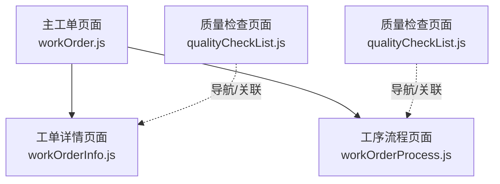
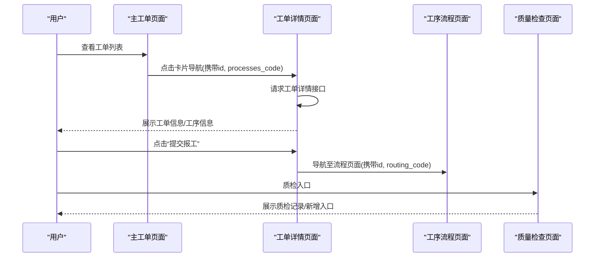
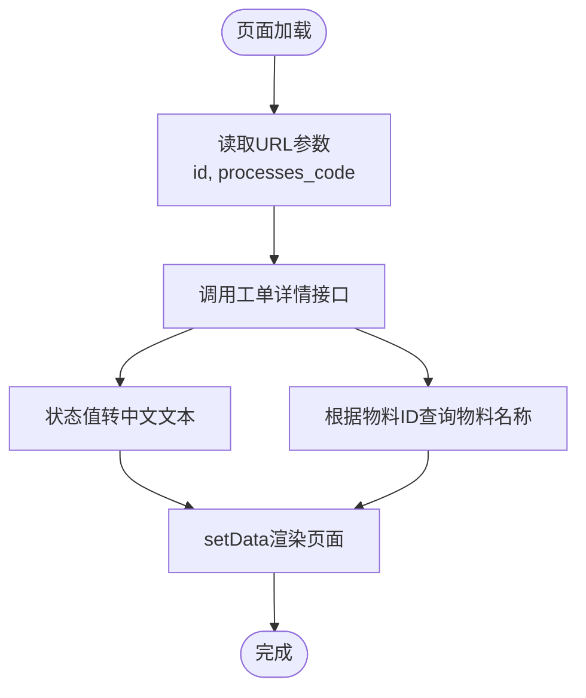
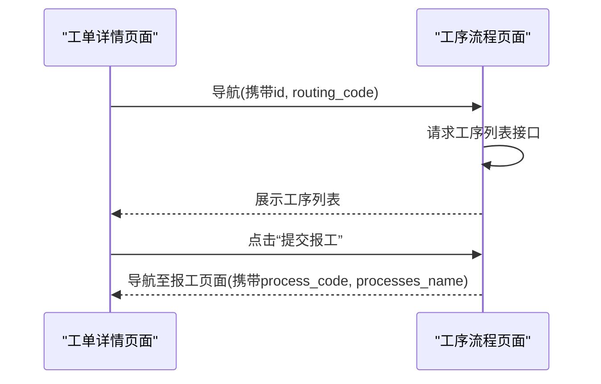
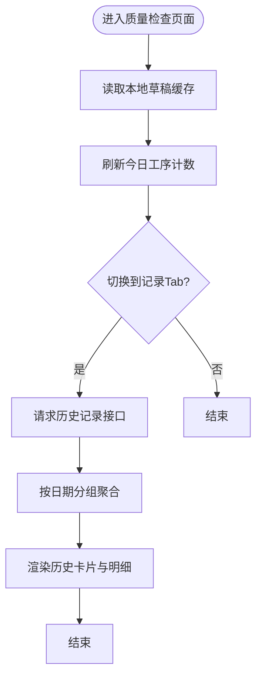
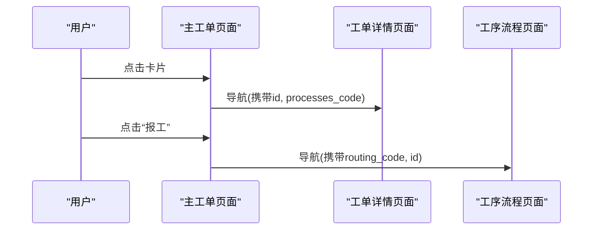
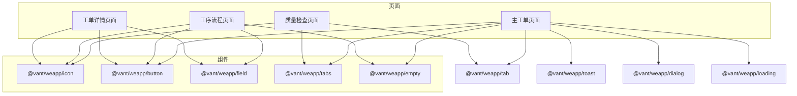

# 工单详情页面

<cite>
**本文档引用的文件**
- [workOrderInfo.js](file://gccd_mini/pageWorkOrder/pages/workOrderInfo/workOrderInfo.js)
- [workOrderInfo.json](file://gccd_mini/pageWorkOrder/pages/workOrderInfo/workOrderInfo.json)
- [workOrderInfo.wxml](file://gccd_mini/pageWorkOrder/pages/workOrderInfo/workOrderInfo.wxml)
- [workOrderInfo.wxss](file://gccd_mini/pageWorkOrder/pages/workOrderInfo/workOrderInfo.wxss)
- [workOrderProcess.js](file://gccd_mini/pageWorkOrder/pages/workOrderProcess/workOrderProcess.js)
- [workOrderProcess.json](file://gccd_mini/pageWorkOrder/pages/workOrderProcess/workOrderProcess.json)
- [workOrderProcess.wxml](file://gccd_mini/pageWorkOrder/pages/workOrderProcess/workOrderProcess.wxml)
- [workOrderProcess.wxss](file://gccd_mini/pageWorkOrder/pages/workOrderProcess/workOrderProcess.wxss)
- [qualityCheckList.js](file://gccd_mini/pageWorkOrder/pages/qualityCheckList/qualityCheckList.js)
- [qualityCheckList.json](file://gccd_mini/pageWorkOrder/pages/qualityCheckList/qualityCheckList.json)
- [qualityCheckList.wxml](file://gccd_mini/pageWorkOrder/pages/qualityCheckList/qualityCheckList.wxml)
- [qualityCheckList.wxss](file://gccd_mini/pageWorkOrder/pages/qualityCheckList/qualityCheckList.wxss)
- [workOrder.js](file://gccd_mini/pages/workOrder/workOrder.js)
- [workOrder.json](file://gccd_mini/pages/workOrder/workOrder.json)
- [workOrder.wxml](file://gccd_mini/pages/workOrder/workOrder.wxml)
- [workOrder.wxss](file://gccd_mini/pages/workOrder/workOrder.wxss)
</cite>

## 目录
1. [简介](#简介)
2. [项目结构](#项目结构)
3. [核心组件](#核心组件)
4. [架构总览](#架构总览)
5. [详细组件分析](#详细组件分析)
6. [依赖关系分析](#依赖关系分析)
7. [性能考虑](#性能考虑)
8. [故障排查指南](#故障排查指南)
9. [结论](#结论)
10. [附录](#附录)

## 简介
本文件面向工单详情页面的开发与使用，系统性梳理页面的功能职责、数据来源与展示逻辑，覆盖工单基础信息、生产任务详情、工序进度跟踪、质量检查记录等模块。同时阐明页面与工单流程页面的导航关系、与主工单页面的数据联动，以及布局设计、信息层级组织与移动端适配策略。最后提供技术实现要点与用户体验设计建议，帮助开发者高效完成页面开发与维护。

## 项目结构
工单详情页面位于小程序前端工程的工单模块目录下，采用按页面拆分的组织方式，便于独立开发与维护。页面由 JS（逻辑）、WXML（结构）、WXSS（样式）、JSON（组件声明）四部分组成，并与主工单页面、流程页面、质量检查页面形成清晰的导航与数据流转关系。

图表来源
- [workOrder.js:307-328](file://gccd_mini/pages/workOrder/workOrder.js#L307-L328)
- [workOrderInfo.js:56-124](file://gccd_mini/pageWorkOrder/pages/workOrderInfo/workOrderInfo.js#L56-L124)
- [workOrderProcess.js:22-41](file://gccd_mini/pageWorkOrder/pages/workOrderProcess/workOrderProcess.js#L22-L41)
- [qualityCheckList.js:47-52](file://gccd_mini/pageWorkOrder/pages/qualityCheckList/qualityCheckList.js#L47-L52)

章节来源
- [workOrder.js:307-328](file://gccd_mini/pages/workOrder/workOrder.js#L307-L328)
- [workOrderInfo.js:56-124](file://gccd_mini/pageWorkOrder/pages/workOrderInfo/workOrderInfo.js#L56-L124)
- [workOrderProcess.js:22-41](file://gccd_mini/pageWorkOrder/pages/workOrderProcess/workOrderProcess.js#L22-L41)
- [qualityCheckList.js:47-52](file://gccd_mini/pageWorkOrder/pages/qualityCheckList/qualityCheckList.js#L47-L52)

## 核心组件
- 工单详情页面（workOrderInfo）
  - 职责：展示工单基础信息、工序信息、报工与不良品数据；支持状态文本转换与物料名称查询；提供可拖动悬浮按钮占位（当前未启用）。
  - 数据来源：通过接口获取工单详情与物料信息，状态值映射为中文状态文本。
  - 展示要点：两段信息区块（工单信息、工序信息），字段包含计划名称、任务编号、关联编号、工单状态、创建时间、圆钢/断钢/成品型号、工序/工艺名称、计划数量、已报工吨数/支数、不良品数量等。
- 工序流程页面（workOrderProcess）
  - 职责：展示与当前工单关联的工艺流程工序列表，提供“提交报工”入口，支持加载失败重试。
  - 数据来源：根据路由编码获取工序列表，携带工单ID用于后续报工。
- 质量检查页面（qualityCheckList）
  - 职责：提供“每日质检”与“质检记录”两个Tab，支持新增质检与查看历史记录。
  - 数据来源：历史记录接口按日期分组聚合，支持展开/折叠查看明细。
- 主工单页面（workOrder）
  - 职责：作为入口，承载进行中/已完成工单列表，提供筛选、分页、刷新、完成标记、报工导航等功能。
  - 与详情页关系：点击卡片项导航至详情页，携带工单ID与工序编码参数。

章节来源
- [workOrderInfo.js:5-37](file://gccd_mini/pageWorkOrder/pages/workOrderInfo/workOrderInfo.js#L5-L37)
- [workOrderProcess.js:4-13](file://gccd_mini/pageWorkOrder/pages/workOrderProcess/workOrderProcess.js#L4-L13)
- [qualityCheckList.js:3-19](file://gccd_mini/pageWorkOrder/pages/qualityCheckList/qualityCheckList.js#L3-L19)
- [workOrder.js:307-328](file://gccd_mini/pages/workOrder/workOrder.js#L307-L328)

## 架构总览
工单详情页面在整体架构中承担“信息聚合与展示”的角色，数据自后端接口拉取，页面内部进行格式化与状态转换，最终以结构化的UI呈现。页面与主工单页面、流程页面、质量检查页面之间存在明确的导航与数据传递关系。

图表来源
- [workOrder.js:307-328](file://gccd_mini/pages/workOrder/workOrder.js#L307-L328)
- [workOrderInfo.js:56-124](file://gccd_mini/pageWorkOrder/pages/workOrderInfo/workOrderInfo.js#L56-L124)
- [workOrderProcess.js:22-41](file://gccd_mini/pageWorkOrder/pages/workOrderProcess/workOrderProcess.js#L22-L41)
- [qualityCheckList.js:47-52](file://gccd_mini/pageWorkOrder/pages/qualityCheckList/qualityCheckList.js#L47-L52)

## 详细组件分析

### 工单详情页面（workOrderInfo）
- 数据模型与字段
  - 基础信息：计划名称、任务编号、关联编号、工单状态、创建时间
  - 工序信息：圆钢型号、断钢型号、成品型号、工序名称/编码、工艺名称/编码、计划数量、已报工吨数、已报工支数、不良品数量
  - 物料名称：通过物料ID查询并拼接显示
- 状态显示逻辑
  - 将数值型状态转换为中文状态文本，便于用户理解
- 数据获取流程
  - 首次加载与页面显示时均触发详情接口请求
  - 成功后更新页面数据，失败或异常统一提示
- UI布局与交互
  - 两段信息区块，字段以只读表单形式展示
  - 提供可拖动悬浮按钮容器（当前未启用具体按钮）

图表来源
- [workOrderInfo.js:146-167](file://gccd_mini/pageWorkOrder/pages/workOrderInfo/workOrderInfo.js#L146-L167)
- [workOrderInfo.js:56-124](file://gccd_mini/pageWorkOrder/pages/workOrderInfo/workOrderInfo.js#L56-L124)
- [workOrderInfo.js:126-143](file://gccd_mini/pageWorkOrder/pages/workOrderInfo/workOrderInfo.js#L126-L143)

章节来源
- [workOrderInfo.js:5-37](file://gccd_mini/pageWorkOrder/pages/workOrderInfo/workOrderInfo.js#L5-L37)
- [workOrderInfo.js:56-124](file://gccd_mini/pageWorkOrder/pages/workOrderInfo/workOrderInfo.js#L56-L124)
- [workOrderInfo.js:126-143](file://gccd_mini/pageWorkOrder/pages/workOrderInfo/workOrderInfo.js#L126-L143)
- [workOrderInfo.wxml:10-36](file://gccd_mini/pageWorkOrder/pages/workOrderInfo/workOrderInfo.wxml#L10-L36)
- [workOrderInfo.wxss:25-37](file://gccd_mini/pageWorkOrder/pages/workOrderInfo/workOrderInfo.wxss#L25-L37)

### 工序流程页面（workOrderProcess）
- 数据模型与字段
  - 工序列表：工序名称、工序编码、工艺名称、工艺编码
  - 路由信息：当前路由名称与编码
  - 工单ID：用于后续报工导航
- 功能逻辑
  - 根据路由编码请求工序列表
  - 支持加载中、加载失败、无数据三种状态
  - 提供“提交报工”按钮，点击后携带工序编码与名称进入报工流程
- UI布局与交互
  - 列表卡片展示工序与工艺信息
  - 按钮区域提供操作入口

图表来源
- [workOrderProcess.js:22-41](file://gccd_mini/pageWorkOrder/pages/workOrderProcess/workOrderProcess.js#L22-L41)
- [workOrderProcess.js:43-75](file://gccd_mini/pageWorkOrder/pages/workOrderProcess/workOrderProcess.js#L43-L75)
- [workOrderProcess.wxml:25-38](file://gccd_mini/pageWorkOrder/pages/workOrderProcess/workOrderProcess.wxml#L25-L38)

章节来源
- [workOrderProcess.js:4-13](file://gccd_mini/pageWorkOrder/pages/workOrderProcess/workOrderProcess.js#L4-L13)
- [workOrderProcess.js:43-75](file://gccd_mini/pageWorkOrder/pages/workOrderProcess/workOrderProcess.js#L43-L75)
- [workOrderProcess.wxml:10-44](file://gccd_mini/pageWorkOrder/pages/workOrderProcess/workOrderProcess.wxml#L10-L44)

### 质量检查页面（qualityCheckList）
- 数据模型与字段
  - Tab1：今日质检，按工序统计“未填报/已提交”状态
  - Tab2：质检记录，按日期分组，每组内按工序分组，支持展开/折叠查看明细
- 功能逻辑
  - 通过历史记录接口获取列表，按日期归并
  - 支持本地草稿缓存，实时刷新今日计数
  - 提供“去质检”入口，跳转至新增质检页面
- UI布局与交互
  - 日期横幅、工序卡片、历史卡片、明细列表
  - 支持展开/折叠查看明细

图表来源
- [qualityCheckList.js:75-85](file://gccd_mini/pageWorkOrder/pages/qualityCheckList/qualityCheckList.js#L75-L85)
- [qualityCheckList.js:87-166](file://gccd_mini/pageWorkOrder/pages/qualityCheckList/qualityCheckList.js#L87-L166)
- [qualityCheckList.wxml:10-118](file://gccd_mini/pageWorkOrder/pages/qualityCheckList/qualityCheckList.wxml#L10-L118)

章节来源
- [qualityCheckList.js:3-19](file://gccd_mini/pageWorkOrder/pages/qualityCheckList/qualityCheckList.js#L3-L19)
- [qualityCheckList.js:75-166](file://gccd_mini/pageWorkOrder/pages/qualityCheckList/qualityCheckList.js#L75-L166)
- [qualityCheckList.wxml:10-118](file://gccd_mini/pageWorkOrder/pages/qualityCheckList/qualityCheckList.wxml#L10-L118)

### 主工单页面（workOrder）
- 导航关系
  - 点击卡片项导航至工单详情页面，携带工单ID与工序编码
  - 点击“报工”按钮导航至工序流程页面，携带路由编码与工单ID
- 数据与交互
  - 进行中/已完成双Tab，支持筛选、分页、刷新
  - 工序报工汇总表按固定工序顺序展示

图表来源
- [workOrder.js:307-328](file://gccd_mini/pages/workOrder/workOrder.js#L307-L328)
- [workOrder.wxml:44-99](file://gccd_mini/pages/workOrder/workOrder.wxml#L44-L99)

章节来源
- [workOrder.js:307-328](file://gccd_mini/pages/workOrder/workOrder.js#L307-L328)
- [workOrder.wxml:44-99](file://gccd_mini/pages/workOrder/workOrder.wxml#L44-L99)

## 依赖关系分析
- 页面依赖
  - 工单详情页面依赖工具类进行接口请求与提示
  - 工序流程页面依赖工具类进行接口请求与提示
  - 质量检查页面依赖工具类进行接口请求与本地存储
  - 主工单页面作为入口，依赖多个子页面进行导航
- 组件依赖
  - 使用Vant Weapp组件库的图标、按钮、字段、空状态等组件
- 数据依赖
  - 工单详情页面依赖工单详情与物料信息接口
  - 工序流程页面依赖路由工序列表接口
  - 质量检查页面依赖历史质检记录接口

图表来源
- [workOrderInfo.json:2-6](file://gccd_mini/pageWorkOrder/pages/workOrderInfo/workOrderInfo.json#L2-L6)
- [workOrderProcess.json:2-7](file://gccd_mini/pageWorkOrder/pages/workOrderProcess/workOrderProcess.json#L2-L7)
- [qualityCheckList.json:1-8](file://gccd_mini/pageWorkOrder/pages/qualityCheckList/qualityCheckList.json#L1-L8)
- [workOrder.json:3-16](file://gccd_mini/pages/workOrder/workOrder.json#L3-L16)

章节来源
- [workOrderInfo.json:2-6](file://gccd_mini/pageWorkOrder/pages/workOrderInfo/workOrderInfo.json#L2-L6)
- [workOrderProcess.json:2-7](file://gccd_mini/pageWorkOrder/pages/workOrderProcess/workOrderProcess.json#L2-L7)
- [qualityCheckList.json:1-8](file://gccd_mini/pageWorkOrder/pages/qualityCheckList/qualityCheckList.json#L1-L8)
- [workOrder.json:3-16](file://gccd_mini/pages/workOrder/workOrder.json#L3-L16)

## 性能考虑
- 接口请求优化
  - 在页面显示时统一触发详情请求，避免重复请求与竞态
  - 对加载失败场景提供重试机制，提升稳定性
- 渲染性能
  - 使用分段区块与卡片化布局，减少长列表渲染压力
  - 仅在必要时更新数据，避免频繁setData
- 移动端体验
  - 使用rpx单位保证多设备适配
  - 控制阴影与圆角等视觉效果的使用范围，避免过度绘制

## 故障排查指南
- 接口请求失败
  - 统一使用提示组件反馈错误信息，检查网络状态与接口返回码
- 数据为空或异常
  - 校验参数完整性（如工单ID、路由编码），确保导航参数正确传递
- 状态显示异常
  - 确认状态值映射逻辑与后端返回一致，避免未知状态分支
- 质检记录为空
  - 检查历史记录接口分页参数与日期范围，确认本地草稿缓存键值

章节来源
- [workOrderInfo.js:117-123](file://gccd_mini/pageWorkOrder/pages/workOrderInfo/workOrderInfo.js#L117-L123)
- [workOrderProcess.js:67-74](file://gccd_mini/pageWorkOrder/pages/workOrderProcess/workOrderProcess.js#L67-L74)
- [qualityCheckList.js:159-162](file://gccd_mini/pageWorkOrder/pages/qualityCheckList/qualityCheckList.js#L159-L162)

## 结论
工单详情页面围绕“信息展示”与“流程导航”两大目标构建，通过清晰的页面分工与组件化设计，实现了从主工单到详情、再到流程与质量检查的完整闭环。开发过程中应重点关注数据获取时机、状态转换与UI一致性，结合移动端适配策略与性能优化手段，持续提升用户体验与系统稳定性。

## 附录
- 开发要点
  - 参数传递：确保导航时携带必要的ID与编码参数
  - 状态管理：集中处理状态值映射与错误提示
  - 数据联动：与主工单页面、流程页面、质量检查页面保持一致的数据契约
- 用户体验建议
  - 信息层级：将关键信息置于首屏可见区域，次要信息通过折叠/分组展示
  - 操作路径：简化从详情到报工、质检的跳转路径，减少用户操作成本
  - 反馈机制：对加载、失败、成功场景提供明确的可视化反馈