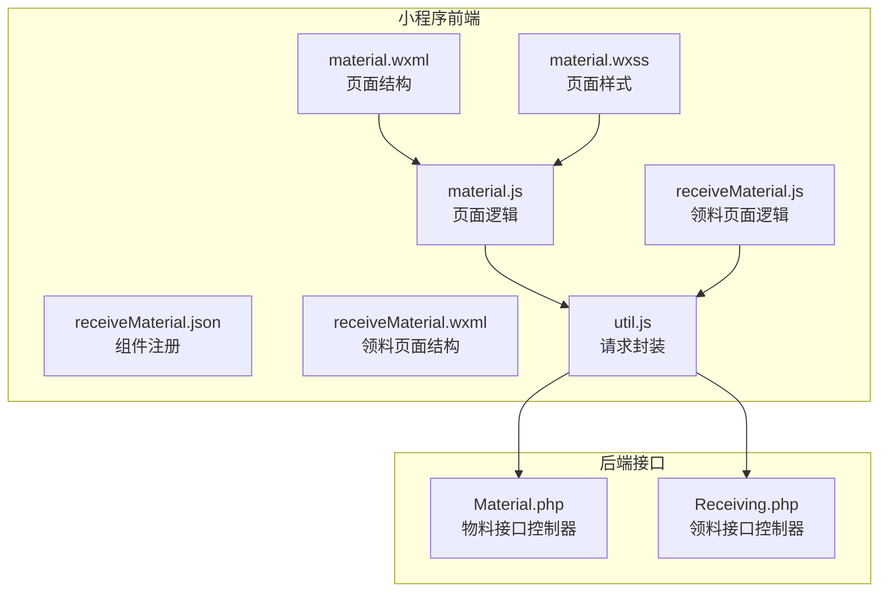
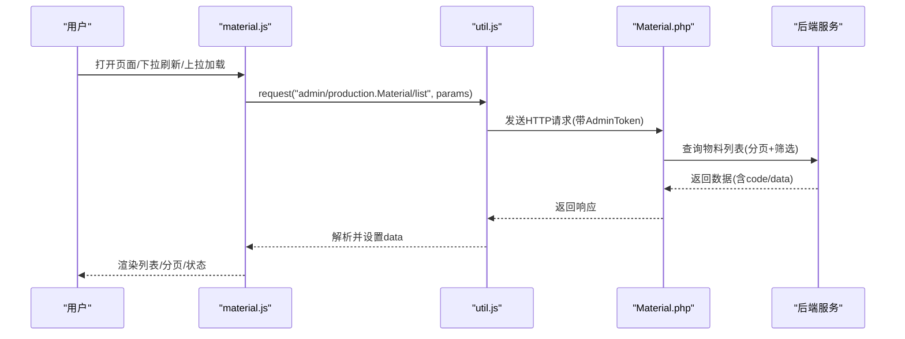
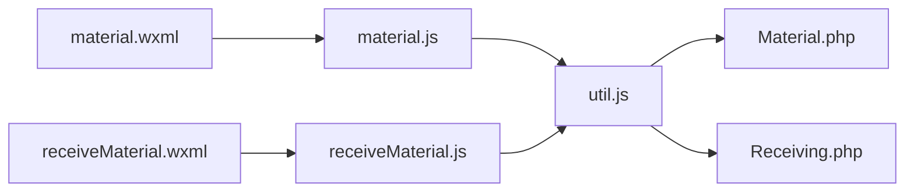

# 物料列表页面

<cite>
**本文引用的文件**
- [material.js](file://gccd_mini/pages/material/material.js)
- [material.json](file://gccd_mini/pages/material/material.json)
- [material.wxml](file://gccd_mini/pages/material/material.wxml)
- [material.wxss](file://gccd_mini/pages/material/material.wxss)
- [receiveMaterial.js](file://gccd_mini/pageMaterial/pages/receiveMaterial/receiveMaterial.js)
- [receiveMaterial.json](file://gccd_mini/pageMaterial/pages/receiveMaterial/receiveMaterial.json)
- [receiveMaterial.wxml](file://gccd_mini/pageMaterial/pages/receiveMaterial/receiveMaterial.wxml)
- [util.js](file://gccd_mini/utils/util.js)
- [Material.php](file://gccd_server/app/admin/controller/production/Material.php)
- [Receiving.php](file://gccd_server/app/admin/controller/receiving/Receiving.php)
</cite>

## 目录
1. [简介](#简介)
2. [项目结构](#项目结构)
3. [核心组件](#核心组件)
4. [架构总览](#架构总览)
5. [详细组件分析](#详细组件分析)
6. [依赖关系分析](#依赖关系分析)
7. [性能考量](#性能考量)
8. [故障排查指南](#故障排查指南)
9. [结论](#结论)
10. [附录](#附录)

## 简介
本文件面向“物料列表页面”的开发与维护，系统性梳理前端页面的交互设计、数据获取与展示机制、分页与搜索筛选、与后端接口的对接方式、以及性能优化与最佳实践。读者无需深入源码即可理解页面整体设计与实现要点。

## 项目结构
物料列表页面位于小程序前端工程 gccd_mini 的 pages/material 目录，配套的“领料”子页面位于 pageMaterial/pages/receiveMaterial。页面通过自定义组件与 Vant Weapp 组件组合实现，数据通过统一的工具函数 util.js 发起请求，后端接口由 ThinkPHP 框架提供。

**图表来源**
- [material.js:1-905](file://gccd_mini/pages/material/material.js#L1-L905)
- [material.wxml:1-239](file://gccd_mini/pages/material/material.wxml#L1-L239)
- [material.wxss:1-261](file://gccd_mini/pages/material/material.wxss#L1-L261)
- [receiveMaterial.js:1-282](file://gccd_mini/pageMaterial/pages/receiveMaterial/receiveMaterial.js#L1-L282)
- [receiveMaterial.wxml:1-74](file://gccd_mini/pageMaterial/pages/receiveMaterial/receiveMaterial.wxml#L1-L74)
- [util.js:1-98](file://gccd_mini/utils/util.js#L1-L98)
- [Material.php:1-148](file://gccd_server/app/admin/controller/production/Material.php#L1-L148)
- [Receiving.php:1-119](file://gccd_server/app/admin/controller/receiving/Receiving.php#L1-L119)

**章节来源**
- [material.js:1-905](file://gccd_mini/pages/material/material.js#L1-L905)
- [material.json:1-17](file://gccd_mini/pages/material/material.json#L1-L17)
- [material.wxml:1-239](file://gccd_mini/pages/material/material.wxml#L1-L239)
- [material.wxss:1-261](file://gccd_mini/pages/material/material.wxss#L1-L261)
- [receiveMaterial.js:1-282](file://gccd_mini/pageMaterial/pages/receiveMaterial/receiveMaterial.js#L1-L282)
- [receiveMaterial.json:1-16](file://gccd_mini/pageMaterial/pages/receiveMaterial/receiveMaterial.json#L1-L16)
- [receiveMaterial.wxml:1-74](file://gccd_mini/pageMaterial/pages/receiveMaterial/receiveMaterial.wxml#L1-L74)
- [util.js:1-98](file://gccd_mini/utils/util.js#L1-L98)

## 核心组件
- 物料列表页（material.js）：负责物料列表的加载、分页、搜索与筛选、下拉刷新、上拉加载更多、状态显示、以及跳转至“领料页面”。
- 领料页面（receiveMaterial.js）：负责物料选择、数量输入、提交领料单。
- 请求封装（util.js）：统一封装 wx.request，处理鉴权头、业务码判断、错误提示与登录态失效跳转。
- 后端控制器（Material.php、Receiving.php）：提供物料列表、新增/编辑/删除、领料列表与新增等接口。

**章节来源**
- [material.js:1-905](file://gccd_mini/pages/material/material.js#L1-L905)
- [receiveMaterial.js:1-282](file://gccd_mini/pageMaterial/pages/receiveMaterial/receiveMaterial.js#L1-L282)
- [util.js:1-98](file://gccd_mini/utils/util.js#L1-L98)
- [Material.php:1-148](file://gccd_server/app/admin/controller/production/Material.php#L1-L148)
- [Receiving.php:1-119](file://gccd_server/app/admin/controller/receiving/Receiving.php#L1-L119)

## 架构总览
物料列表页面采用“页面 + 组件 + 工具函数 + 后端接口”的分层架构：
- 页面层：material.js 负责状态管理、事件处理、分页与搜索。
- 组件层：Vant Weapp 组件（如 tabs、search、popup、uploader 等）提供交互能力。
- 工具层：util.js 统一处理请求、鉴权与错误处理。
- 接口层：Material.php、Receiving.php 提供物料与领料相关接口。

**图表来源**
- [material.js:198-251](file://gccd_mini/pages/material/material.js#L198-L251)
- [util.js:22-94](file://gccd_mini/utils/util.js#L22-L94)
- [Material.php:39-79](file://gccd_server/app/admin/controller/production/Material.php#L39-L79)

## 详细组件分析

### 物料列表页（material.js）
- 数据结构与状态
  - 列表数据：list、count、pages、currentPage、pageSize
  - 加载状态：loading、loadingMore
  - 搜索与筛选：searchParams（material_name、material_thickness、material_model、manufacturer、supplier）
  - 防抖计时器：searchTimer
  - 标签页切换：activeTab（0=物料列表，1=领料记录）

- 关键流程
  - 初始化与生命周期：onLoad、onShow 中调用 getList() 获取数据；onUnload 清理防抖定时器。
  - 列表加载：getList(page, isLoadMore) 支持分页与加载更多；自动移除空值参数；根据 isLoadMore 合并列表。
  - 下拉刷新：onPullDownRefresh 根据当前标签页调用 getList(1) 或 getReceivingList(1)，完成后停止刷新。
  - 上拉加载：onReachBottom 根据当前标签页判断是否加载更多。
  - 搜索与筛选：onSearchChange 使用 300ms 防抖触发 getList；onFilterChange 动态更新 searchParams；onClick 打开筛选弹窗；onSubmitFilter/onResetFilter 提交与重置筛选。
  - 状态显示：物料列表项包含库存、型号、规格、厚度、供应商、厂家等字段；领料记录按状态映射文本与样式。
  - 交互：点击列表项可跳转详情（预留 navigateToDetail），浮动按钮跳转至“领料页面”。

- 错误处理与提示
  - 业务码非 200：Toast.fail 显示错误消息；必要时停止 loading。
  - 登录态失效：util.js 检测 401，清理本地 token 并跳转登录页。

- 性能与体验
  - 防抖：onSearchChange 使用定时器减少频繁请求。
  - 合并渲染：加载更多时将新数据追加到现有列表，避免全量替换。
  - 空态：无数据时展示空状态组件。

**章节来源**
- [material.js:6-78](file://gccd_mini/pages/material/material.js#L6-L78)
- [material.js:198-251](file://gccd_mini/pages/material/material.js#L198-L251)
- [material.js:259-283](file://gccd_mini/pages/material/material.js#L259-L283)
- [material.js:292-311](file://gccd_mini/pages/material/material.js#L292-L311)
- [material.js:318-381](file://gccd_mini/pages/material/material.js#L318-L381)
- [material.js:774-800](file://gccd_mini/pages/material/material.js#L774-L800)

### 领料页面（receiveMaterial.js）
- 数据结构与状态
  - 列表数据：materialList、originalMaterialList、selectedMaterials、selectedMaterialsInfo
  - 分页：currentPage、pageSize、totalPages、totalCount、hasMore
  - 搜索：searchValue
  - 提交：submitting、showSubmitSuccessDialog

- 关键流程
  - 列表加载：getMaterialList(page, isLoadMore) 支持分页与加载更多；搜索时重置页码并重新请求。
  - 选择与数量：onMaterialSelect 接收选中物料ID，构建 selectedMaterialsInfo；onQuantityChange 更新数量；removeMaterial 移除物料。
  - 提交：submitReceiving 校验数量有效性，准备 content 数组，调用 util.request 提交领料单。
  - 成功反馈：showSubmitSuccessDialog 弹窗提示，确认后清空状态并返回上一页。

- 错误处理
  - 接口失败：Toast.fail 并恢复 loading/submitting 状态。
  - 网络不稳定提示：提交失败时提示用户稍后核对列表。

**章节来源**
- [receiveMaterial.js:4-23](file://gccd_mini/pageMaterial/pages/receiveMaterial/receiveMaterial.js#L4-L23)
- [receiveMaterial.js:61-115](file://gccd_mini/pageMaterial/pages/receiveMaterial/receiveMaterial.js#L61-L115)
- [receiveMaterial.js:131-140](file://gccd_mini/pageMaterial/pages/receiveMaterial/receiveMaterial.js#L131-L140)
- [receiveMaterial.js:142-199](file://gccd_mini/pageMaterial/pages/receiveMaterial/receiveMaterial.js#L142-L199)
- [receiveMaterial.js:220-281](file://gccd_mini/pageMaterial/pages/receiveMaterial/receiveMaterial.js#L220-L281)

### 请求封装（util.js）
- 统一请求：request(url, data, method, options) 返回 Promise。
- 鉴权：在 header 中注入 AdminToken。
- 业务码处理：200 视为成功；401 清理 token 并跳转登录；400/404 等提示具体错误；其他业务码统一提示。
- 网络异常：fail 回调提示网络异常。

**章节来源**
- [util.js:22-94](file://gccd_mini/utils/util.js#L22-L94)

### 后端接口（Material.php、Receiving.php）
- 物料接口（Material.php）
  - list：支持按 material_spec、material_name、material_model、supplier、manufacturer、material_property、stock、create_start_date、create_end_date 等字段筛选，返回分页数据。
  - add/edit/dele：新增、编辑、删除物料。
- 领料接口（Receiving.php）
  - list：支持按 receiving_code、relation_code、create_start_date、create_end_date 等字段筛选，返回分页数据。
  - add：接收 content 数组（material_id、material_num），创建领料单。

**章节来源**
- [Material.php:39-79](file://gccd_server/app/admin/controller/production/Material.php#L39-L79)
- [Material.php:97-133](file://gccd_server/app/admin/controller/production/Material.php#L97-L133)
- [Receiving.php:38-63](file://gccd_server/app/admin/controller/receiving/Receiving.php#L38-L63)
- [Receiving.php:81-88](file://gccd_server/app/admin/controller/receiving/Receiving.php#L81-L88)

## 依赖关系分析
- 页面与组件
  - material.wxml 注册并使用 Vant Weapp 组件（tabs、search、popup、uploader、toast、dialog 等）。
  - receiveMaterial.wxml 注册并使用 Vant Weapp 组件（search、checkbox、cell、field、popup、dialog 等）。
- 页面与工具
  - material.js、receiveMaterial.js 均通过 util.request 调用后端接口。
- 页面与后端
  - material.js 调用 admin/production.Material/list、admin/receiving.Receiving/list。
  - receiveMaterial.js 调用 admin/stock.InStock/mateiallist、admin/receiving.Receiving/add。

**图表来源**
- [material.wxml:1-239](file://gccd_mini/pages/material/material.wxml#L1-L239)
- [material.js:1-905](file://gccd_mini/pages/material/material.js#L1-L905)
- [receiveMaterial.wxml:1-74](file://gccd_mini/pageMaterial/pages/receiveMaterial/receiveMaterial.wxml#L1-L74)
- [receiveMaterial.js:1-282](file://gccd_mini/pageMaterial/pages/receiveMaterial/receiveMaterial.js#L1-L282)
- [util.js:1-98](file://gccd_mini/utils/util.js#L1-L98)
- [Material.php:1-148](file://gccd_server/app/admin/controller/production/Material.php#L1-L148)
- [Receiving.php:1-119](file://gccd_server/app/admin/controller/receiving/Receiving.php#L1-L119)

**章节来源**
- [material.json:1-17](file://gccd_mini/pages/material/material.json#L1-L17)
- [receiveMaterial.json:1-16](file://gccd_mini/pageMaterial/pages/receiveMaterial/receiveMaterial.json#L1-L16)

## 性能考量
- 请求节流与防抖
  - 物料搜索使用 300ms 防抖，减少无效请求，提升交互流畅度。
- 分页与增量加载
  - 列表采用分页加载，加载更多时仅追加数据，避免全量渲染。
- 状态与样式
  - 使用 loading/ loadingMore 控制加载态，避免重复触发。
  - 针对不同状态（待审核/已通过/已拒绝）设置不同样式类，便于快速识别。
- 图片上传优化
  - 上传前进行压缩与预处理，减少体积与等待时间。
- 缓存与同步
  - 前端未见显式缓存策略；建议在业务允许范围内对“只读列表数据”做短期缓存，并在下拉刷新时强制更新，确保数据新鲜度。

[本节为通用性能建议，不直接分析具体文件，故无“章节来源”]

## 故障排查指南
- 登录态失效
  - 现象：出现“请重新登录”提示并跳转登录页。
  - 处理：util.js 已自动清理本地 token 并跳转登录；确认 AdminToken 是否正确存储。
- 接口请求失败
  - 现象：Toast 提示“接口请求失败”或“网络异常”。
  - 处理：检查网络状态、域名白名单、后端服务可用性；确认 AdminToken 是否过期。
- 业务错误码
  - 现象：Toast 提示具体业务错误（如参数错误、资源不存在）。
  - 处理：根据返回 msg 修复请求参数或联系后端排查。
- 列表空白或不更新
  - 现象：无数据或刷新后不变。
  - 处理：确认 onPullDownRefresh 是否正确调用 getList(1)/getReceivingList(1)；检查 searchParams 是否包含空值导致过滤异常。
- 防抖导致搜索延迟
  - 现象：输入后未立即触发搜索。
  - 处理：调整防抖时长或在点击“搜索”按钮时主动触发 getList(1)。

**章节来源**
- [util.js:57-68](file://gccd_mini/utils/util.js#L57-L68)
- [material.js:244-250](file://gccd_mini/pages/material/material.js#L244-L250)
- [material.js:152-158](file://gccd_mini/pages/material/material.js#L152-L158)

## 结论
物料列表页面通过清晰的分层架构与组件化设计，实现了物料信息的高效展示、灵活的搜索与筛选、稳定的分页加载与状态提示。结合后端接口提供的多字段筛选与分页能力，页面具备良好的可扩展性与可维护性。建议在后续迭代中完善前端缓存策略、增强错误兜底与日志上报，并持续优化交互细节以提升用户体验。

## 附录

### 页面与组件清单
- 物料列表页
  - 结构：material.wxml
  - 逻辑：material.js
  - 样式：material.wxss
  - 组件注册：material.json
- 领料页面
  - 结构：receiveMaterial.wxml
  - 逻辑：receiveMaterial.js
  - 样式：无（复用公共样式）
  - 组件注册：receiveMaterial.json
- 工具函数
  - 请求封装：util.js

**章节来源**
- [material.wxml:1-239](file://gccd_mini/pages/material/material.wxml#L1-L239)
- [material.js:1-905](file://gccd_mini/pages/material/material.js#L1-L905)
- [material.wxss:1-261](file://gccd_mini/pages/material/material.wxss#L1-L261)
- [material.json:1-17](file://gccd_mini/pages/material/material.json#L1-L17)
- [receiveMaterial.wxml:1-74](file://gccd_mini/pageMaterial/pages/receiveMaterial/receiveMaterial.wxml#L1-L74)
- [receiveMaterial.js:1-282](file://gccd_mini/pageMaterial/pages/receiveMaterial/receiveMaterial.js#L1-L282)
- [receiveMaterial.json:1-16](file://gccd_mini/pageMaterial/pages/receiveMaterial/receiveMaterial.json#L1-L16)
- [util.js:1-98](file://gccd_mini/utils/util.js#L1-L98)