# 物料接收复制页面

<cite>
**本文档引用的文件**
- [receiveMaterial.js](file://gccd_mini/pageMaterial/pages/receiveMaterial copy/receiveMaterial.js)
- [receiveMaterial.json](file://gccd_mini/pageMaterial/pages/receiveMaterial copy/receiveMaterial.json)
- [receiveMaterial.wxml](file://gccd_mini/pageMaterial/pages/receiveMaterial copy/receiveMaterial.wxml)
- [receiveMaterial.wxss](file://gccd_mini/pageMaterial/pages/receiveMaterial copy/receiveMaterial.wxss)
- [receiveMaterial.js](file://gccd_mini/pageMaterial/pages/receiveMaterial/receiveMaterial.js)
- [receiveMaterial.json](file://gccd_mini/pageMaterial/pages/receiveMaterial/receiveMaterial.json)
- [receiveMaterial.wxml](file://gccd_mini/pageMaterial/pages/receiveMaterial/receiveMaterial.wxml)
- [receiveMaterial.wxss](file://gccd_mini/pageMaterial/pages/receiveMaterial/receiveMaterial.wxss)
- [util.js](file://gccd_mini/utils/util.js)
- [app.json](file://gccd_mini/app.json)
</cite>

## 目录
1. [简介](#简介)
2. [项目结构](#项目结构)
3. [核心组件](#核心组件)
4. [架构概览](#架构概览)
5. [详细组件分析](#详细组件分析)
6. [依赖关系分析](#依赖关系分析)
7. [性能考虑](#性能考虑)
8. [故障排除指南](#故障排除指南)
9. [结论](#结论)
10. [附录](#附录)

## 简介

物料接收复制页面是高齿传动项目中物料管理模块的重要组成部分，专门用于物料接收操作。该页面提供了直观的用户界面和完整的业务逻辑，支持物料搜索、筛选、批量选择和数量输入等功能。本文档将深入分析复制页面的设计和实现，包括与主接收页面的差异对比、特殊功能实现、业务逻辑、数据同步机制以及用户界面设计等方面。

## 项目结构

物料接收复制页面位于微信小程序项目的特定目录结构中，采用模块化组织方式：

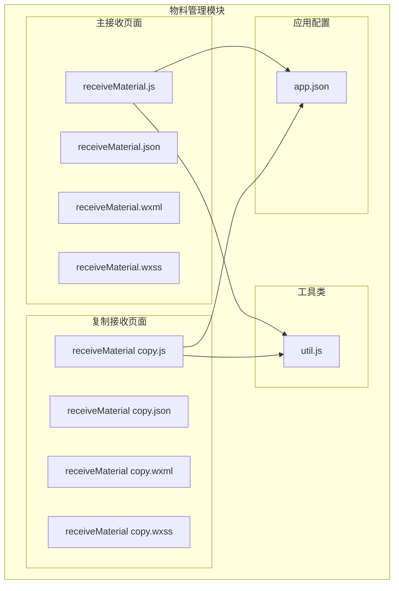

**图表来源**
- [receiveMaterial.js:1-282](file://gccd_mini/pageMaterial/pages/receiveMaterial/receiveMaterial.js#L1-L282)
- [receiveMaterial.js:1-296](file://gccd_mini/pageMaterial/pages/receiveMaterial copy/receiveMaterial.js#L1-L296)
- [util.js:1-98](file://gccd_mini/utils/util.js#L1-L98)
- [app.json:86-91](file://gccd_mini/app.json#L86-L91)

**章节来源**
- [receiveMaterial.js:1-296](file://gccd_mini/pageMaterial/pages/receiveMaterial copy/receiveMaterial.js#L1-L296)
- [receiveMaterial.json:1-14](file://gccd_mini/pageMaterial/pages/receiveMaterial copy/receiveMaterial.json#L1-L14)
- [receiveMaterial.wxml:1-84](file://gccd_mini/pageMaterial/pages/receiveMaterial copy/receiveMaterial.wxml#L1-L84)
- [receiveMaterial.wxss:1-181](file://gccd_mini/pageMaterial/pages/receiveMaterial copy/receiveMaterial.wxss#L1-L181)

## 核心组件

### 数据模型对比

两个接收页面采用了不同的数据管理模式：

| 组件 | 主接收页面 | 复制接收页面 |
|------|------------|--------------|
| **数据结构** | 单一列表 + 选中详情 | 过滤列表 + 原始列表 |
| **状态管理** | 完整状态对象 | 简化状态对象 |
| **筛选机制** | 内置搜索 | 独立筛选弹窗 |
| **交互模式** | 弹窗确认 | 底部操作栏 |

### 核心功能对比

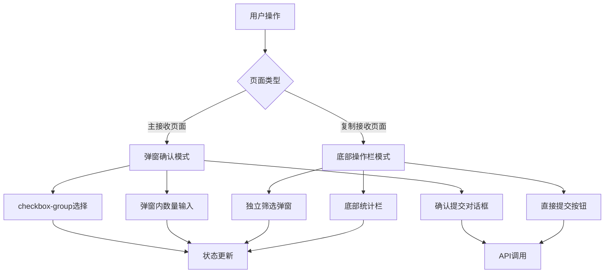

**图表来源**
- [receiveMaterial.js:142-166](file://gccd_mini/pageMaterial/pages/receiveMaterial/receiveMaterial.js#L142-L166)
- [receiveMaterial.js:148-176](file://gccd_mini/pageMaterial/pages/receiveMaterial copy/receiveMaterial.js#L148-L176)

**章节来源**
- [receiveMaterial.js:1-282](file://gccd_mini/pageMaterial/pages/receiveMaterial/receiveMaterial.js#L1-L282)
- [receiveMaterial.js:1-296](file://gccd_mini/pageMaterial/pages/receiveMaterial copy/receiveMaterial.js#L1-L296)

## 架构概览

### 整体架构设计

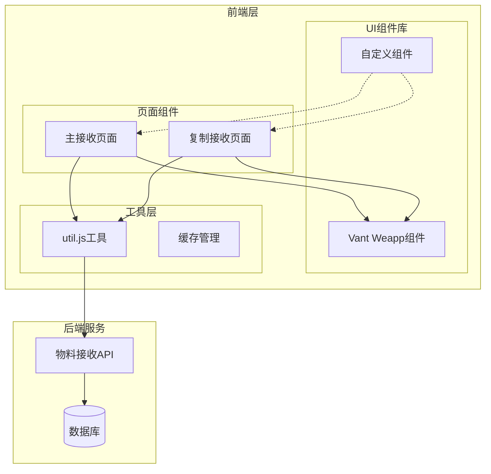

**图表来源**
- [receiveMaterial.js:1-282](file://gccd_mini/pageMaterial/pages/receiveMaterial/receiveMaterial.js#L1-L282)
- [receiveMaterial.js:1-296](file://gccd_mini/pageMaterial/pages/receiveMaterial copy/receiveMaterial.js#L1-L296)
- [util.js:22-94](file://gccd_mini/utils/util.js#L22-L94)

### 数据流架构

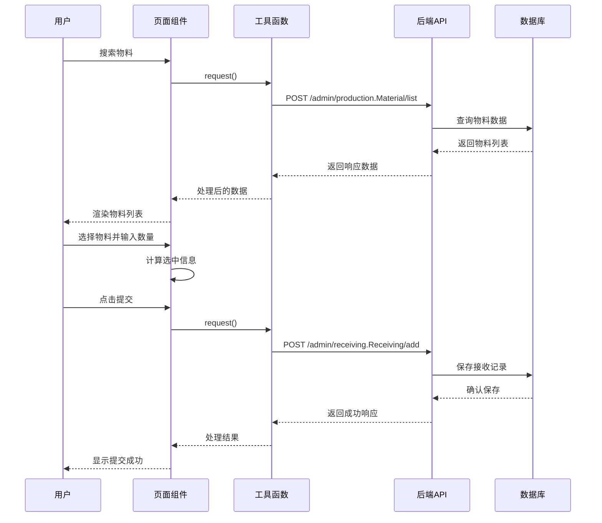

**图表来源**
- [receiveMaterial.js:28-60](file://gccd_mini/pageMaterial/pages/receiveMaterial copy/receiveMaterial.js#L28-L60)
- [receiveMaterial.js:195-257](file://gccd_mini/pageMaterial/pages/receiveMaterial copy/receiveMaterial.js#L195-L257)
- [util.js:22-94](file://gccd_mini/utils/util.js#L22-L94)

## 详细组件分析

### 复制接收页面组件分析

#### 数据结构设计

复制接收页面采用了更加灵活的数据结构设计：

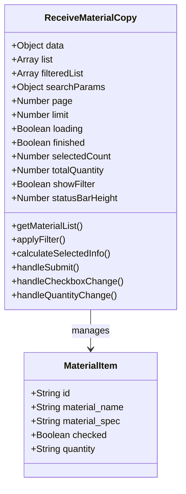

**图表来源**
- [receiveMaterial.js:4-19](file://gccd_mini/pageMaterial/pages/receiveMaterial copy/receiveMaterial.js#L4-L19)
- [receiveMaterial.js:42-46](file://gccd_mini/pageMaterial/pages/receiveMaterial copy/receiveMaterial.js#L42-L46)

#### 核心业务逻辑

##### 物料列表管理

复制页面实现了完整的物料列表管理功能：

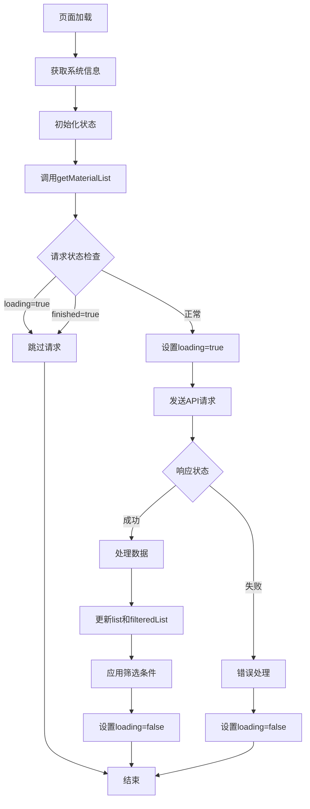

**图表来源**
- [receiveMaterial.js:28-60](file://gccd_mini/pageMaterial/pages/receiveMaterial copy/receiveMaterial.js#L28-L60)
- [receiveMaterial.js:98-127](file://gccd_mini/pageMaterial/pages/receiveMaterial copy/receiveMaterial.js#L98-L127)

##### 筛选功能实现

复制页面提供了独立的筛选弹窗功能：

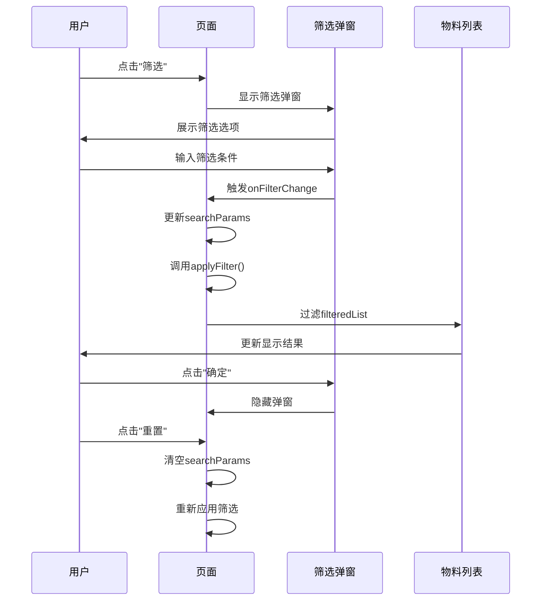

**图表来源**
- [receiveMaterial.js:62-146](file://gccd_mini/pageMaterial/pages/receiveMaterial copy/receiveMaterial.js#L62-L146)
- [receiveMaterial.wxml:55-83](file://gccd_mini/pageMaterial/pages/receiveMaterial copy/receiveMaterial.wxml#L55-L83)

##### 交互优化设计

复制页面在交互设计方面进行了多项优化：

| 功能特性 | 实现方式 | 用户体验 |
|----------|----------|----------|
| **底部操作栏** | 固定定位 + 统计信息 | 实时显示选中状态 |
| **独立筛选弹窗** | 右侧滑入式弹窗 | 不影响主列表显示 |
| **数量输入优化** | 直接更新指定项 | 避免全列表重渲染 |
| **实时计算** | 变更即计算 | 即时反馈用户操作 |

**章节来源**
- [receiveMaterial.js:1-296](file://gccd_mini/pageMaterial/pages/receiveMaterial copy/receiveMaterial.js#L1-L296)
- [receiveMaterial.wxml:1-84](file://gccd_mini/pageMaterial/pages/receiveMaterial copy/receiveMaterial.wxml#L1-L84)
- [receiveMaterial.wxss:92-151](file://gccd_mini/pageMaterial/pages/receiveMaterial copy/receiveMaterial.wxss#L92-L151)

### 主接收页面组件分析

#### 弹窗确认模式

主接收页面采用了不同的交互模式：

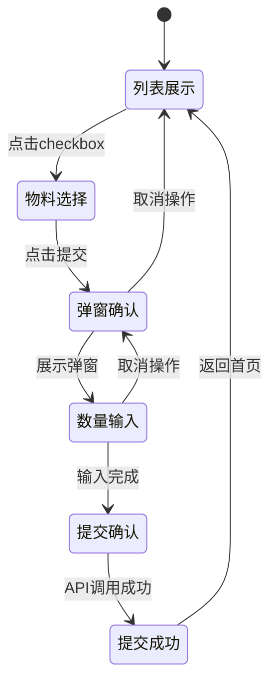

**图表来源**
- [receiveMaterial.js:25-39](file://gccd_mini/pageMaterial/pages/receiveMaterial/receiveMaterial.js#L25-L39)
- [receiveMaterial.wxml:42-74](file://gccd_mini/pageMaterial/pages/receiveMaterial/receiveMaterial.wxml#L42-L74)

#### 状态管理差异

| 状态属性 | 主接收页面 | 复制接收页面 |
|----------|------------|--------------|
| **selectedMaterials** | 选中物料ID数组 | 未使用 |
| **selectedMaterialsInfo** | 选中物料详情数组 | 未使用 |
| **filteredList** | 未使用 | 过滤后的物料列表 |
| **searchParams** | 未使用 | 筛选参数对象 |
| **statusBarHeight** | 未使用 | 状态栏高度 |

**章节来源**
- [receiveMaterial.js:4-23](file://gccd_mini/pageMaterial/pages/receiveMaterial/receiveMaterial.js#L4-L23)
- [receiveMaterial.js:4-19](file://gccd_mini/pageMaterial/pages/receiveMaterial copy/receiveMaterial.js#L4-L19)

## 依赖关系分析

### 组件依赖图

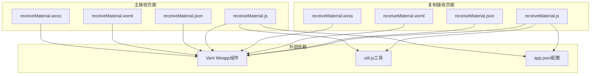

**图表来源**
- [receiveMaterial.js:1-2](file://gccd_mini/pageMaterial/pages/receiveMaterial copy/receiveMaterial.js#L1-L2)
- [receiveMaterial.js:1-2](file://gccd_mini/pageMaterial/pages/receiveMaterial/receiveMaterial.js#L1-L2)
- [receiveMaterial.json:2-13](file://gccd_mini/pageMaterial/pages/receiveMaterial copy/receiveMaterial.json#L2-L13)
- [receiveMaterial.json:2-15](file://gccd_mini/pageMaterial/pages/receiveMaterial/receiveMaterial.json#L2-L15)

### 数据依赖关系

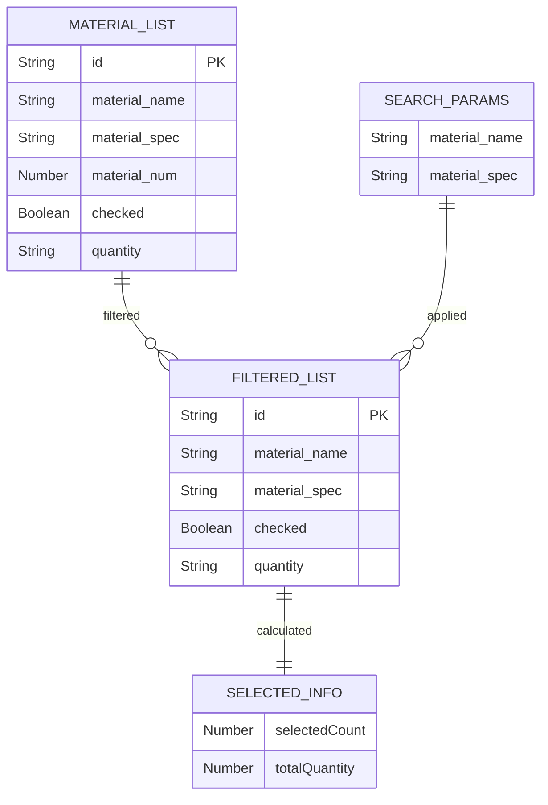

**图表来源**
- [receiveMaterial.js:6-18](file://gccd_mini/pageMaterial/pages/receiveMaterial copy/receiveMaterial.js#L6-L18)
- [receiveMaterial.js:178-193](file://gccd_mini/pageMaterial/pages/receiveMaterial copy/receiveMaterial.js#L178-L193)

**章节来源**
- [receiveMaterial.js:1-296](file://gccd_mini/pageMaterial/pages/receiveMaterial copy/receiveMaterial.js#L1-L296)
- [receiveMaterial.js:1-282](file://gccd_mini/pageMaterial/pages/receiveMaterial/receiveMaterial.js#L1-L282)

## 性能考虑

### 性能优化策略

#### 数据更新优化

复制页面实现了精确的数据更新机制：

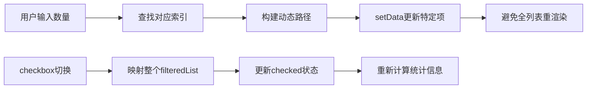

**图表来源**
- [receiveMaterial.js:164-176](file://gccd_mini/pageMaterial/pages/receiveMaterial copy/receiveMaterial.js#L164-L176)
- [receiveMaterial.js:148-161](file://gccd_mini/pageMaterial/pages/receiveMaterial copy/receiveMaterial.js#L148-L161)

#### 内存管理优化

| 优化点 | 实现方式 | 效果 |
|--------|----------|------|
| **分页加载** | 10条/页限制 | 减少内存占用 |
| **按需渲染** | wx:for循环 | 提升渲染性能 |
| **状态隔离** | 独立filteredList | 避免不必要的重渲染 |
| **事件节流** | loading状态控制 | 防止重复请求 |

### 性能监控指标

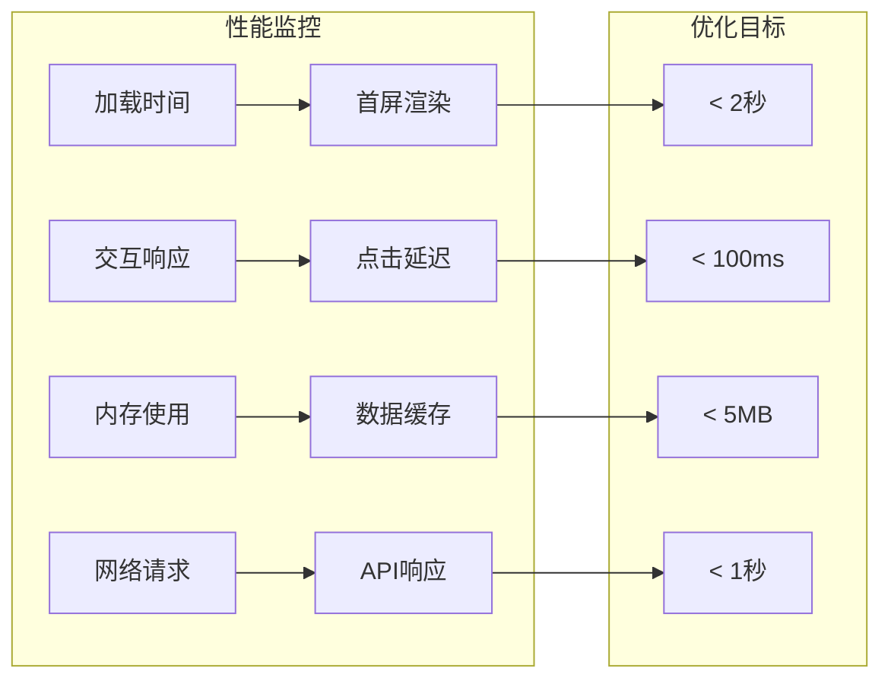

## 故障排除指南

### 常见问题诊断

#### 数据加载问题

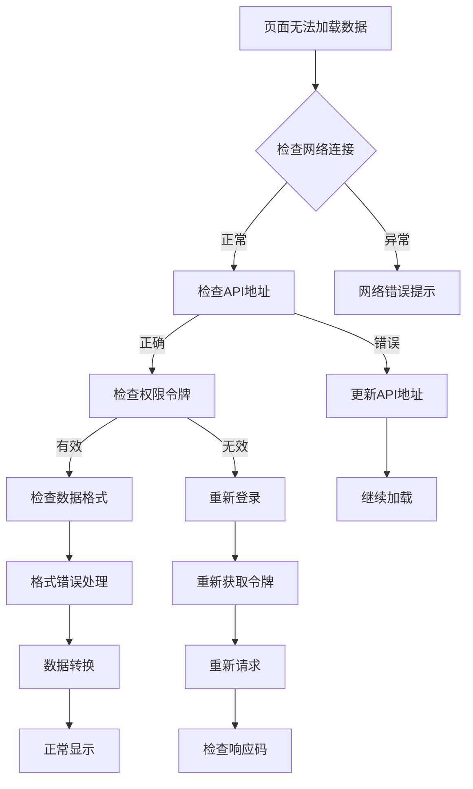

**图表来源**
- [util.js:22-94](file://gccd_mini/utils/util.js#L22-L94)

#### 用户交互问题

| 问题类型 | 症状表现 | 解决方案 |
|----------|----------|----------|
| **筛选无效** | 筛选条件不生效 | 检查applyFilter方法调用 |
| **数量输入异常** | 数字输入错误 | 验证handleQuantityChange逻辑 |
| **提交失败** | 提交按钮无响应 | 检查handleSubmit验证逻辑 |
| **页面卡顿** | 操作响应缓慢 | 优化setData调用频率 |

**章节来源**
- [receiveMaterial.js:195-257](file://gccd_mini/pageMaterial/pages/receiveMaterial copy/receiveMaterial.js#L195-L257)
- [util.js:18-98](file://gccd_mini/utils/util.js#L18-L98)

### 调试技巧

#### 开发者工具使用

1. **网络面板监控**
   - 查看API请求状态码
   - 监控响应时间
   - 检查请求头信息

2. **应用面板调试**
   - 设置断点跟踪数据流
   - 监控内存使用情况
   - 检查组件生命周期

3. **控制台日志**
   - 输出关键变量值
   - 记录错误堆栈
   - 跟踪异步操作

## 结论

物料接收复制页面作为高齿传动项目的重要组成部分，在设计和实现上体现了以下特点：

### 技术优势

1. **用户体验优化**
   - 独立筛选弹窗提升操作效率
   - 底部操作栏提供即时反馈
   - 实时计算增强交互体验

2. **性能优化**
   - 精确数据更新避免全量重渲染
   - 分页加载控制内存占用
   - 事件节流防止重复请求

3. **代码质量**
   - 清晰的状态管理
   - 完善的错误处理
   - 良好的可维护性

### 改进建议

1. **功能扩展**
   - 添加批量操作功能
   - 增强筛选条件
   - 优化移动端交互

2. **性能提升**
   - 实现数据缓存机制
   - 优化图片加载
   - 减少网络请求次数

3. **用户体验**
   - 添加加载动画
   - 增强错误提示
   - 优化响应速度

## 附录

### 开发规范

#### 代码风格

1. **命名规范**
   - 变量使用驼峰命名
   - 函数使用动词开头
   - 常量使用大写下划线

2. **注释规范**
   - 关键函数添加注释
   - 复杂逻辑添加说明
   - 参数和返回值描述

3. **文件组织**
   - 按功能模块划分
   - 统一文件命名
   - 相关文件放在一起

#### 测试建议

1. **单元测试**
   - 核心函数测试
   - 边界条件测试
   - 错误处理测试

2. **集成测试**
   - 端到端流程测试
   - API接口测试
   - 性能测试

3. **兼容性测试**
   - 不同设备测试
   - 不同系统版本测试
   - 不同网络环境测试