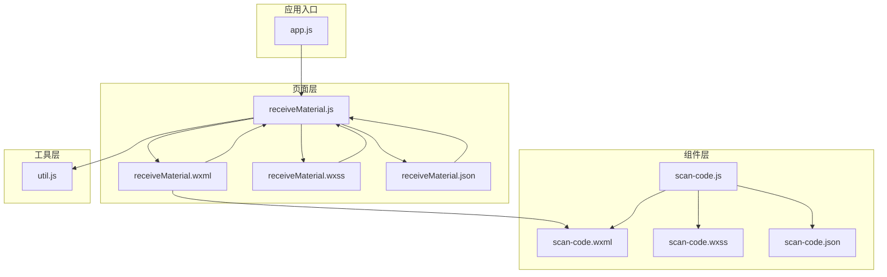
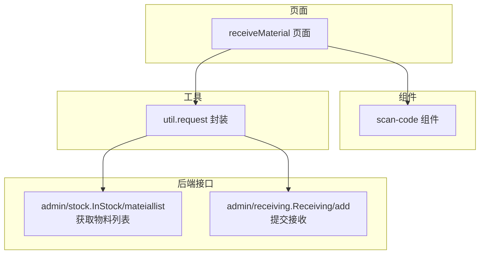
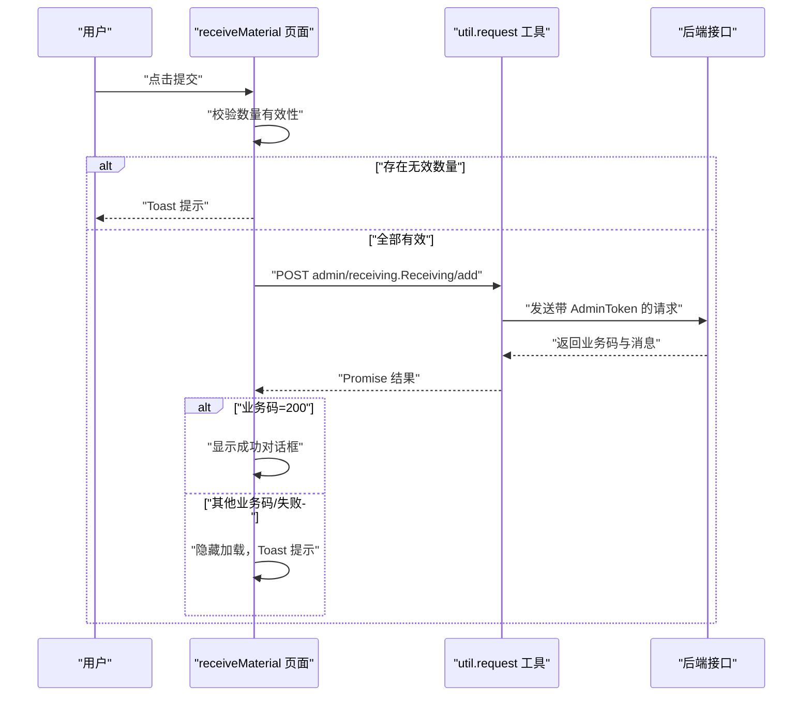
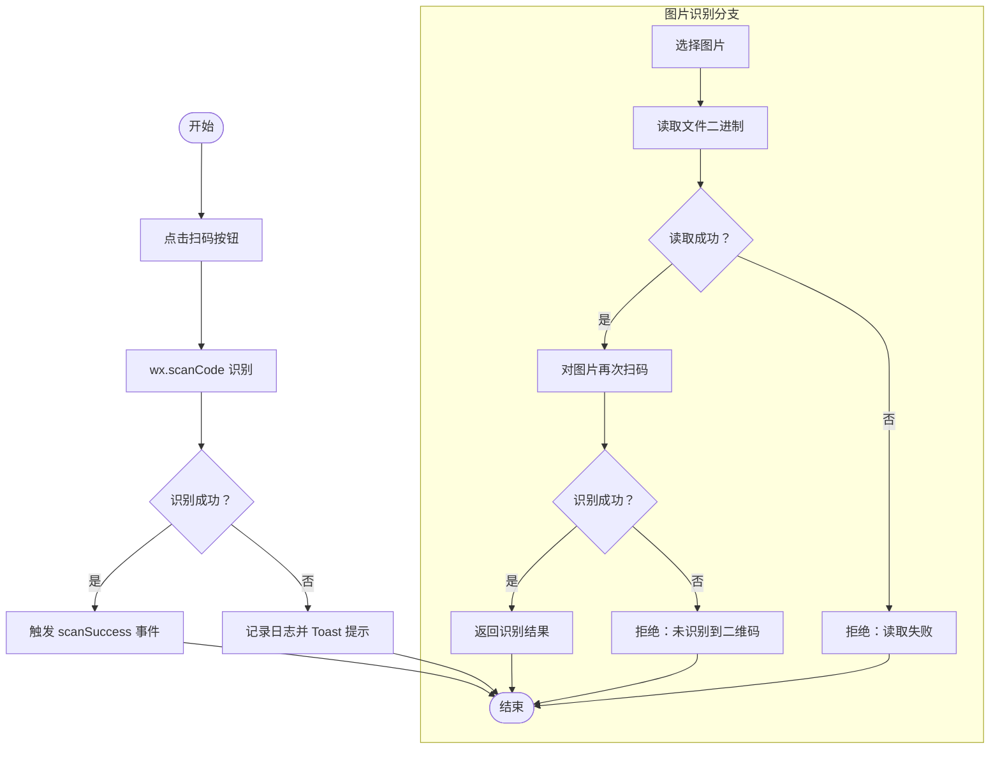
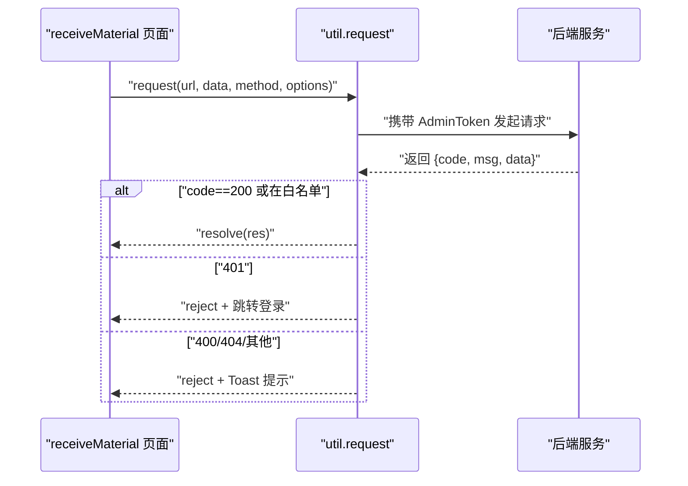
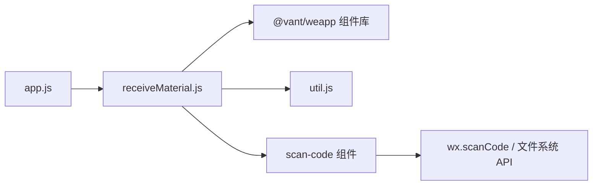

# 物料接收页面

<cite>
**本文引用的文件**
- [receiveMaterial.js](file://gccd_mini/pageMaterial/pages/receiveMaterial/receiveMaterial.js)
- [receiveMaterial.json](file://gccd_mini/pageMaterial/pages/receiveMaterial/receiveMaterial.json)
- [receiveMaterial.wxml](file://gccd_mini/pageMaterial/pages/receiveMaterial/receiveMaterial.wxml)
- [receiveMaterial.wxss](file://gccd_mini/pageMaterial/pages/receiveMaterial/receiveMaterial.wxss)
- [util.js](file://gccd_mini/utils/util.js)
- [scan-code.js](file://gccd_mini/pages/components/scan-code/scan-code.js)
- [scan-code.json](file://gccd_mini/pages/components/scan-code/scan-code.json)
- [scan-code.wxml](file://gccd_mini/pages/components/scan-code/scan-code.wxml)
- [scan-code.wxss](file://gccd_mini/pages/components/scan-code/scan-code.wxss)
- [app.js](file://gccd_mini/app.js)
</cite>

## 目录
1. [简介](#简介)
2. [项目结构](#项目结构)
3. [核心组件](#核心组件)
4. [架构总览](#架构总览)
5. [详细组件分析](#详细组件分析)
6. [依赖关系分析](#依赖关系分析)
7. [性能考虑](#性能考虑)
8. [故障排查指南](#故障排查指南)
9. [结论](#结论)
10. [附录](#附录)

## 简介
本文件面向“物料接收页面”的开发与维护，系统性梳理页面整体设计与功能实现，覆盖扫码入库、物料信息录入、数量确认、质量检查等核心流程，并重点说明扫码功能的技术方案（二维码识别、条形码扫描、图片识别）、物料接收表单的数据校验与提交处理、与库存系统的数据对接（库存更新、入库记录生成、状态同步），以及用户体验设计（操作引导、错误提示、成功反馈）。同时提供开发最佳实践与常见问题解决方案，帮助开发者快速理解与迭代该页面。

## 项目结构
物料接收页面位于小程序前端工程 gccd_mini 的 pageMaterial/pages/receiveMaterial 目录，采用标准的 WXML + WXSS + JS + JSON 组合，配合通用工具模块与可复用扫描组件，形成清晰的页面层、组件层与工具层分层。

图表来源
- [receiveMaterial.js:1-282](file://gccd_mini/pageMaterial/pages/receiveMaterial/receiveMaterial.js#L1-L282)
- [receiveMaterial.wxml:1-74](file://gccd_mini/pageMaterial/pages/receiveMaterial/receiveMaterial.wxml#L1-L74)
- [receiveMaterial.wxss:1-92](file://gccd_mini/pageMaterial/pages/receiveMaterial/receiveMaterial.wxss#L1-L92)
- [receiveMaterial.json:1-16](file://gccd_mini/pageMaterial/pages/receiveMaterial/receiveMaterial.json#L1-L16)
- [scan-code.js:1-63](file://gccd_mini/pages/components/scan-code/scan-code.js#L1-L63)
- [scan-code.wxml:1-6](file://gccd_mini/pages/components/scan-code/scan-code.wxml#L1-L6)
- [scan-code.wxss:1-13](file://gccd_mini/pages/components/scan-code/scan-code.wxss#L1-L13)
- [scan-code.json:1-6](file://gccd_mini/pages/components/scan-code/scan-code.json#L1-L6)
- [util.js:1-98](file://gccd_mini/utils/util.js#L1-L98)
- [app.js:1-33](file://gccd_mini/app.js#L1-L33)

章节来源
- [receiveMaterial.js:1-282](file://gccd_mini/pageMaterial/pages/receiveMaterial/receiveMaterial.js#L1-L282)
- [receiveMaterial.wxml:1-74](file://gccd_mini/pageMaterial/pages/receiveMaterial/receiveMaterial.wxml#L1-L74)
- [receiveMaterial.wxss:1-92](file://gccd_mini/pageMaterial/pages/receiveMaterial/receiveMaterial.wxss#L1-L92)
- [receiveMaterial.json:1-16](file://gccd_mini/pageMaterial/pages/receiveMaterial/receiveMaterial.json#L1-L16)
- [scan-code.js:1-63](file://gccd_mini/pages/components/scan-code/scan-code.js#L1-L63)
- [scan-code.wxml:1-6](file://gccd_mini/pages/components/scan-code/scan-code.wxml#L1-L6)
- [scan-code.wxss:1-13](file://gccd_mini/pages/components/scan-code/scan-code.wxss#L1-L13)
- [scan-code.json:1-6](file://gccd_mini/pages/components/scan-code/scan-code.json#L1-L6)
- [util.js:1-98](file://gccd_mini/utils/util.js#L1-L98)
- [app.js:1-33](file://gccd_mini/app.js#L1-L33)

## 核心组件
- 物料接收页面（receiveMaterial）
  - 负责物料列表展示、搜索、多选、数量录入、弹窗确认、提交处理与结果反馈。
  - 使用 Vant Weapp 组件库实现搜索、勾选、输入、弹窗、对话框等 UI。
- 扫码组件（scan-code）
  - 封装微信原生扫码能力，支持二维码/条形码识别与图片识别，触发自定义事件供父页面消费。
- 工具模块（util）
  - 统一封装网络请求与鉴权头注入，统一处理业务码与错误提示，提供可扩展的成功码白名单。

章节来源
- [receiveMaterial.js:1-282](file://gccd_mini/pageMaterial/pages/receiveMaterial/receiveMaterial.js#L1-L282)
- [receiveMaterial.json:1-16](file://gccd_mini/pageMaterial/pages/receiveMaterial/receiveMaterial.json#L1-L16)
- [scan-code.js:1-63](file://gccd_mini/pages/components/scan-code/scan-code.js#L1-L63)
- [util.js:1-98](file://gccd_mini/utils/util.js#L1-L98)

## 架构总览
物料接收页面的前端架构遵循“页面 + 组件 + 工具”三层设计，页面通过工具模块发起后端请求，组件负责扫码与图片识别，最终在页面内完成表单校验与提交。

图表来源
- [receiveMaterial.js:62-115](file://gccd_mini/pageMaterial/pages/receiveMaterial/receiveMaterial.js#L62-L115)
- [receiveMaterial.js:251-281](file://gccd_mini/pageMaterial/pages/receiveMaterial/receiveMaterial.js#L251-L281)
- [util.js:22-94](file://gccd_mini/utils/util.js#L22-L94)

## 详细组件分析

### 页面：物料接收（receiveMaterial）
- 数据模型
  - 页面状态：加载状态、分页参数、搜索值、物料列表、原始物料列表、选中物料ID集合、选中物料详情与数量、提交状态、弹窗开关、成功对话框等。
- 关键流程
  - 初始化与导航：获取系统状态栏高度、加载物料列表。
  - 列表加载：支持下拉刷新与上拉加载更多，分页参数由页面维护，搜索时重置页码并清空原始列表缓存。
  - 多选与数量录入：通过复选框组选择物料，弹出底部弹窗进行数量录入与移除，数量输入支持数字键盘与步进器联动。
  - 表单校验：提交前校验每个选中物料的数量是否有效。
  - 提交处理：构造提交内容，加锁防止重复提交，调用工具模块发起请求，根据响应结果展示成功对话框或错误提示。
- 用户体验
  - 成功提交后弹出确认对话框，避免误触重复提交。
  - 错误提示使用 Toast，失败后保留已选物料以便修正。
  - 弹窗底部固定提交按钮，保证易用性。

图表来源
- [receiveMaterial.js:220-281](file://gccd_mini/pageMaterial/pages/receiveMaterial/receiveMaterial.js#L220-L281)
- [util.js:22-94](file://gccd_mini/utils/util.js#L22-L94)

章节来源
- [receiveMaterial.js:1-282](file://gccd_mini/pageMaterial/pages/receiveMaterial/receiveMaterial.js#L1-L282)
- [receiveMaterial.wxml:1-74](file://gccd_mini/pageMaterial/pages/receiveMaterial/receiveMaterial.wxml#L1-L74)
- [receiveMaterial.wxss:1-92](file://gccd_mini/pageMaterial/pages/receiveMaterial/receiveMaterial.wxss#L1-L92)
- [receiveMaterial.json:1-16](file://gccd_mini/pageMaterial/pages/receiveMaterial/receiveMaterial.json#L1-L16)

### 组件：扫码（scan-code）
- 功能概述
  - 封装 wx.scanCode，支持从相机或相册识别二维码与条形码。
  - 支持从指定图片路径识别二维码，返回识别结果或抛出错误。
  - 触发 scanSuccess 自定义事件，便于父页面接收结果。
- 技术要点
  - 识别类型限定为 qrCode 与 barCode。
  - 对取消扫码场景进行区分，避免误报。
  - 图片识别流程包含读取二进制文件与二次扫码，统一错误处理与加载提示。

图表来源
- [scan-code.js:7-61](file://gccd_mini/pages/components/scan-code/scan-code.js#L7-L61)

章节来源
- [scan-code.js:1-63](file://gccd_mini/pages/components/scan-code/scan-code.js#L1-L63)
- [scan-code.wxml:1-6](file://gccd_mini/pages/components/scan-code/scan-code.wxml#L1-L6)
- [scan-code.wxss:1-13](file://gccd_mini/pages/components/scan-code/scan-code.wxss#L1-L13)
- [scan-code.json:1-6](file://gccd_mini/pages/components/scan-code/scan-code.json#L1-L6)

### 工具模块：网络请求封装（util）
- 请求封装
  - 统一请求地址前缀、注入 AdminToken，支持额外成功码白名单。
  - 统一处理 401、400、404 等业务码与网络异常，必要时跳转登录。
- 在页面中的使用
  - 物料列表：POST admin/stock.InStock/mateiallist
  - 接收提交：POST admin/receiving.Receiving/add

图表来源
- [util.js:22-94](file://gccd_mini/utils/util.js#L22-L94)
- [receiveMaterial.js:76-114](file://gccd_mini/pageMaterial/pages/receiveMaterial/receiveMaterial.js#L76-L114)
- [receiveMaterial.js:251-281](file://gccd_mini/pageMaterial/pages/receiveMaterial/receiveMaterial.js#L251-L281)

章节来源
- [util.js:1-98](file://gccd_mini/utils/util.js#L1-L98)
- [receiveMaterial.js:62-115](file://gccd_mini/pageMaterial/pages/receiveMaterial/receiveMaterial.js#L62-L115)
- [receiveMaterial.js:251-281](file://gccd_mini/pageMaterial/pages/receiveMaterial/receiveMaterial.js#L251-L281)

## 依赖关系分析
- 页面依赖
  - receiveMaterial 依赖 Vant Weapp 组件（搜索、勾选、输入、弹窗、对话框）。
  - receiveMaterial 依赖 util.request 进行网络请求。
  - receiveMaterial 内嵌 scan-code 组件，用于扫码入口。
- 组件依赖
  - scan-code 依赖微信原生 wx.scanCode 与文件系统 API。
- 应用入口
  - app.js 控制登录态与首页跳转，间接影响页面访问权限。

图表来源
- [receiveMaterial.json:2-15](file://gccd_mini/pageMaterial/pages/receiveMaterial/receiveMaterial.json#L2-L15)
- [util.js:1-98](file://gccd_mini/utils/util.js#L1-L98)
- [scan-code.js:1-63](file://gccd_mini/pages/components/scan-code/scan-code.js#L1-L63)
- [app.js:1-33](file://gccd_mini/app.js#L1-L33)

章节来源
- [receiveMaterial.json:1-16](file://gccd_mini/pageMaterial/pages/receiveMaterial/receiveMaterial.json#L1-L16)
- [util.js:1-98](file://gccd_mini/utils/util.js#L1-L98)
- [scan-code.js:1-63](file://gccd_mini/pages/components/scan-code/scan-code.js#L1-L63)
- [app.js:1-33](file://gccd_mini/app.js#L1-L33)

## 性能考虑
- 列表加载
  - 使用分页参数 limit/page 控制每次请求量，避免一次性渲染过多节点。
  - 上拉加载时仅在 hasMore 且当前页小于总页数时触发，减少无效请求。
- 交互节流
  - 提交阶段设置提交锁与 loading 状态，防止重复点击。
  - 搜索时重置页码并延迟请求，避免频繁抖动。
- 渲染优化
  - 列表项使用 wx:for + wx:key，提升渲染效率。
  - 弹窗内容使用 scroll-view，避免页面整体滚动带来的重排。

章节来源
- [receiveMaterial.js:62-129](file://gccd_mini/pageMaterial/pages/receiveMaterial/receiveMaterial.js#L62-L129)
- [receiveMaterial.js:220-281](file://gccd_mini/pageMaterial/pages/receiveMaterial/receiveMaterial.js#L220-L281)

## 故障排查指南
- 网络与鉴权
  - 若出现“请重新登录”，检查 AdminToken 是否过期或被清除，确认 util.request 中的头部注入逻辑。
  - 若出现“网络异常”，检查设备网络状态与域名配置。
- 提交失败
  - 若提示“接口请求失败，若网络不稳定可能已提交成功”，建议稍后到列表核对，避免重复提交。
  - 若提示“请填写所有物料的领料数量”，检查弹窗中数量输入是否为空或非正数。
- 扫码失败
  - 若扫码取消，不会触发错误提示；若识别失败，查看控制台日志并确认二维码/条形码清晰度。
  - 图片识别需确保文件路径有效与权限允许。

章节来源
- [util.js:49-90](file://gccd_mini/utils/util.js#L49-L90)
- [receiveMaterial.js:230-277](file://gccd_mini/pageMaterial/pages/receiveMaterial/receiveMaterial.js#L230-L277)
- [scan-code.js:17-26](file://gccd_mini/pages/components/scan-code/scan-code.js#L17-L26)
- [scan-code.js:36-61](file://gccd_mini/pages/components/scan-code/scan-code.js#L36-L61)

## 结论
物料接收页面通过清晰的分层设计与可复用组件，实现了扫码入库、物料选择与数量确认、提交校验与结果反馈的完整闭环。结合工具模块的统一鉴权与错误处理，页面具备良好的稳定性与可维护性。后续可在扫码识别鲁棒性、库存对接的实时性与一致性、以及质量检查流程的可视化等方面持续优化。

## 附录

### 开发最佳实践
- 表单校验
  - 数量输入建议限制为正整数，避免浮点或负数导致库存异常。
  - 提交前统一校验必填与格式，失败时聚焦到具体字段。
- 错误处理
  - 对 401 统一跳转登录，400/404 明确提示，其他业务码统一 Toast 提示并记录日志。
- 交互设计
  - 成功提交后固定“确定”按钮，避免误触重复提交。
  - 弹窗内数量输入与步进器联动，提升输入效率。
- 性能优化
  - 列表分页与懒加载，避免一次性渲染大量节点。
  - 提交阶段禁用按钮与显示加载，提升用户感知。

### 常见问题与解决方案
- 二维码/条形码无法识别
  - 确保光线充足、二维码清晰、无反光或遮挡。
  - 优先使用相机扫码，必要时再尝试图片识别。
- 提交后库存未更新
  - 网络不稳定时可能出现“已提交成功但提示失败”，建议稍后刷新列表核对。
- 登录失效导致接口失败
  - 401 时自动清理缓存并跳转登录页，重新登录后重试。