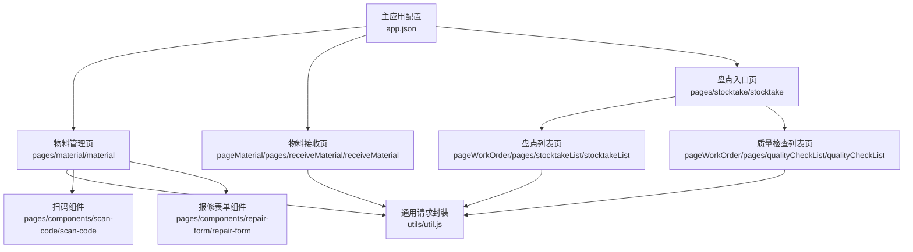
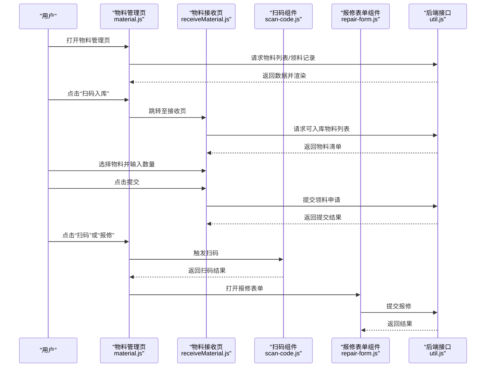
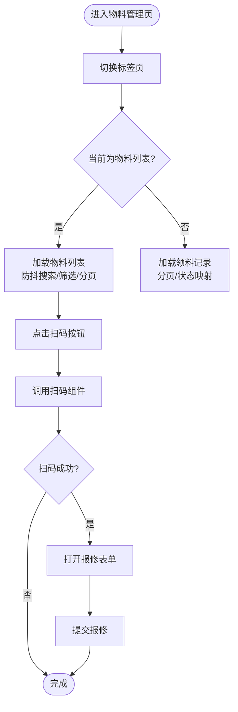
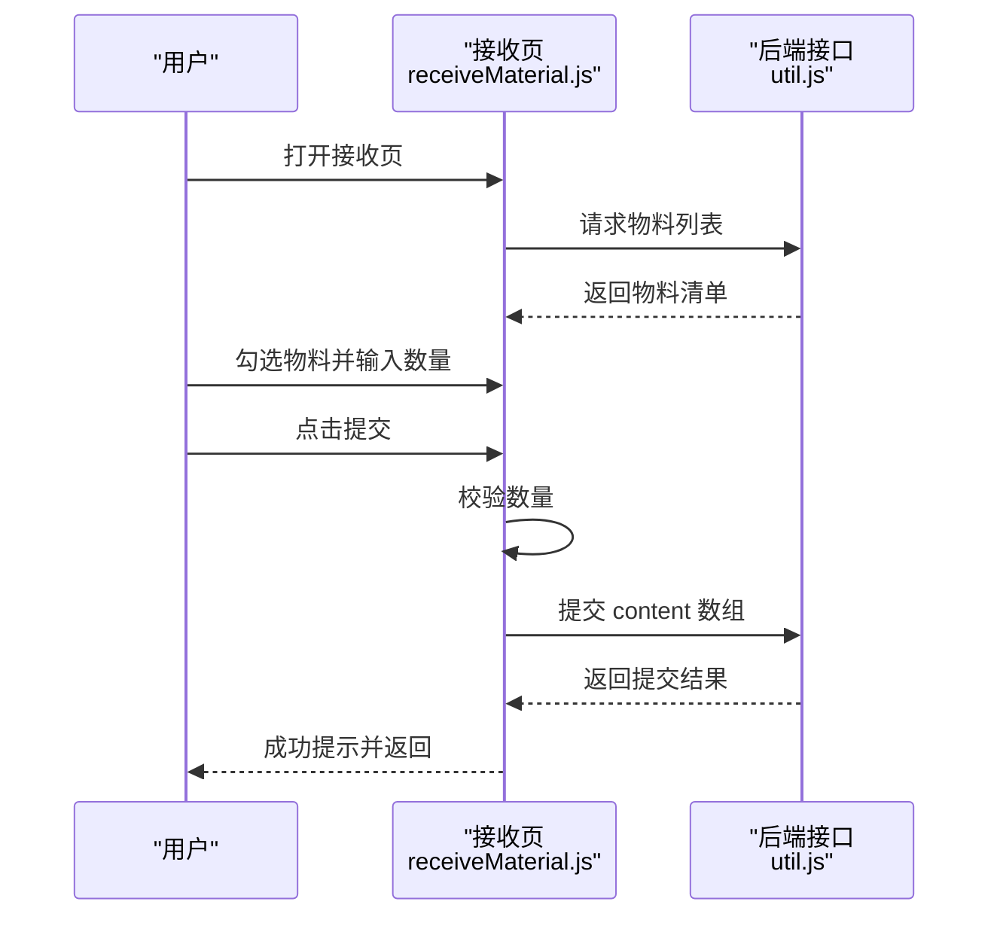
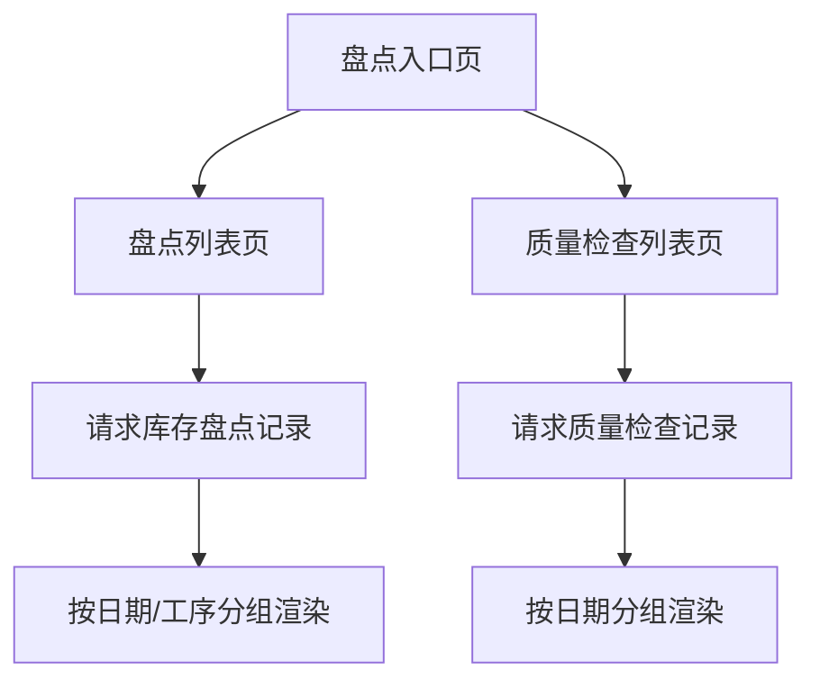
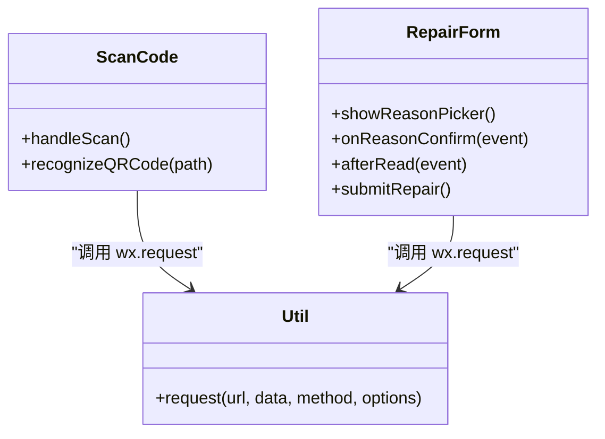
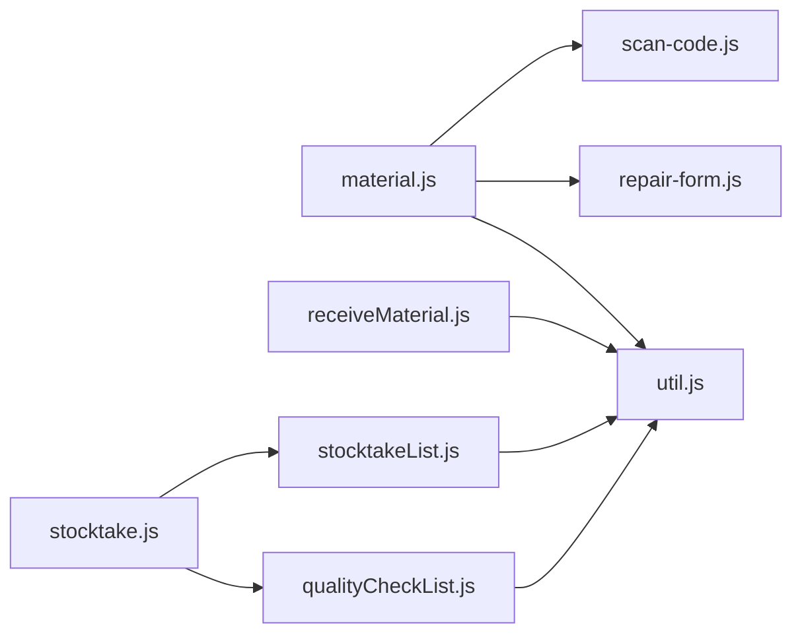

# 物料管理页面

<cite>
**本文引用的文件**   
- [gccd_mini/pages/material/material.js](file://gccd_mini/pages/material/material.js)
- [gccd_mini/pages/material/material.json](file://gccd_mini/pages/material/material.json)
- [gccd_mini/pageMaterial/pages/receiveMaterial/receiveMaterial.js](file://gccd_mini/pageMaterial/pages/receiveMaterial/receiveMaterial.js)
- [gccd_mini/pageMaterial/pages/receiveMaterial/receiveMaterial.json](file://gccd_mini/pageMaterial/pages/receiveMaterial/receiveMaterial.json)
- [gccd_mini/pages/stocktake/stocktake.js](file://gccd_mini/pages/stocktake/stocktake.js)
- [gccd_mini/pages/stocktake/stocktake.json](file://gccd_mini/pages/stocktake/stocktake.json)
- [gccd_mini/pageWorkOrder/pages/stocktakeList/stocktakeList.js](file://gccd_mini/pageWorkOrder/pages/stocktakeList/stocktakeList.js)
- [gccd_mini/pageWorkOrder/pages/stocktakeList/stocktakeList.json](file://gccd_mini/pageWorkOrder/pages/stocktakeList/stocktakeList.json)
- [gccd_mini/pageWorkOrder/pages/qualityCheckList/qualityCheckList.js](file://gccd_mini/pageWorkOrder/pages/qualityCheckList/qualityCheckList.js)
- [gccd_mini/pageWorkOrder/pages/qualityCheckList/qualityCheckList.json](file://gccd_mini/pageWorkOrder/pages/qualityCheckList/qualityCheckList.json)
- [gccd_mini/utils/util.js](file://gccd_mini/utils/util.js)
- [gccd_mini/pages/components/scan-code/scan-code.js](file://gccd_mini/pages/components/scan-code/scan-code.js)
- [gccd_mini/pages/components/scan-code/scan-code.json](file://gccd_mini/pages/components/scan-code/scan-code.json)
- [gccd_mini/pages/components/repair-form/repair-form.js](file://gccd_mini/pages/components/repair-form/repair-form.js)
- [gccd_mini/pages/components/repair-form/repair-form.json](file://gccd_mini/pages/components/repair-form/repair-form.json)
- [gccd_mini/app.json](file://gccd_mini/app.json)
- [gccd_mini/app.js](file://gccd_mini/app.js)
</cite>

## 目录
1. [引言](#引言)
2. [项目结构](#项目结构)
3. [核心组件](#核心组件)
4. [架构总览](#架构总览)
5. [详细组件分析](#详细组件分析)
6. [依赖关系分析](#依赖关系分析)
7. [性能考虑](#性能考虑)
8. [故障排查指南](#故障排查指南)
9. [结论](#结论)
10. [附录](#附录)

## 引言
本开发文档围绕物料管理页面及其相关子页面展开，系统性梳理物料分类展示、库存查询、物料接收（扫码入库）、领料出库、盘点与质量检查、以及与库存系统的数据对接与同步机制。文档同时提供最佳实践与流程优化建议，帮助开发者快速理解与迭代该模块。

## 项目结构
物料管理相关页面主要分布在以下目录：
- 主物料页：pages/material
- 物料接收页：pageMaterial/pages/receiveMaterial
- 盘点与质量检查入口页：pages/stocktake
- 盘点与质量检查列表页：pageWorkOrder/pages/stocktakeList、pageWorkOrder/pages/qualityCheckList
- 通用工具与组件：utils、pages/components

图表来源
- [gccd_mini/app.json:1-99](file://gccd_mini/app.json#L1-L99)
- [gccd_mini/pages/material/material.js:1-905](file://gccd_mini/pages/material/material.js#L1-L905)
- [gccd_mini/pageMaterial/pages/receiveMaterial/receiveMaterial.js:1-282](file://gccd_mini/pageMaterial/pages/receiveMaterial/receiveMaterial.js#L1-L282)
- [gccd_mini/pages/stocktake/stocktake.js:1-22](file://gccd_mini/pages/stocktake/stocktake.js#L1-L22)
- [gccd_mini/pageWorkOrder/pages/stocktakeList/stocktakeList.js:1-194](file://gccd_mini/pageWorkOrder/pages/stocktakeList/stocktakeList.js#L1-L194)
- [gccd_mini/pageWorkOrder/pages/qualityCheckList/qualityCheckList.js:1-174](file://gccd_mini/pageWorkOrder/pages/qualityCheckList/qualityCheckList.js#L1-L174)
- [gccd_mini/utils/util.js:1-98](file://gccd_mini/utils/util.js#L1-L98)
- [gccd_mini/pages/components/scan-code/scan-code.js:1-63](file://gccd_mini/pages/components/scan-code/scan-code.js#L1-L63)
- [gccd_mini/pages/components/repair-form/repair-form.js:1-261](file://gccd_mini/pages/components/repair-form/repair-form.js#L1-L261)

章节来源
- [gccd_mini/app.json:1-99](file://gccd_mini/app.json#L1-L99)

## 核心组件
- 物料管理页（material）：负责物料列表展示、筛选、分页、领料记录查看、扫码入口与报修表单集成。
- 物料接收页（receiveMaterial）：负责扫码入库、物料选择、数量确认、提交入库。
- 盘点入口页（stocktake）：提供盘点与质量检查入口导航。
- 盘点列表页（stocktakeList）：展示历史盘点记录，按日期与工序分组。
- 质量检查列表页（qualityCheckList）：展示历史质量检查记录，按日期分组。
- 通用工具（util）：封装统一请求与鉴权头，处理业务码与错误提示。
- 扫码组件（scan-code）：封装扫码能力，供物料管理页复用。
- 报修表单组件（repair-form）：封装报修表单与图片上传，供物料管理页复用。

章节来源
- [gccd_mini/pages/material/material.js:1-905](file://gccd_mini/pages/material/material.js#L1-L905)
- [gccd_mini/pageMaterial/pages/receiveMaterial/receiveMaterial.js:1-282](file://gccd_mini/pageMaterial/pages/receiveMaterial/receiveMaterial.js#L1-L282)
- [gccd_mini/pages/stocktake/stocktake.js:1-22](file://gccd_mini/pages/stocktake/stocktake.js#L1-L22)
- [gccd_mini/pageWorkOrder/pages/stocktakeList/stocktakeList.js:1-194](file://gccd_mini/pageWorkOrder/pages/stocktakeList/stocktakeList.js#L1-L194)
- [gccd_mini/pageWorkOrder/pages/qualityCheckList/qualityCheckList.js:1-174](file://gccd_mini/pageWorkOrder/pages/qualityCheckList/qualityCheckList.js#L1-L174)
- [gccd_mini/utils/util.js:1-98](file://gccd_mini/utils/util.js#L1-L98)
- [gccd_mini/pages/components/scan-code/scan-code.js:1-63](file://gccd_mini/pages/components/scan-code/scan-code.js#L1-L63)
- [gccd_mini/pages/components/repair-form/repair-form.js:1-261](file://gccd_mini/pages/components/repair-form/repair-form.js#L1-L261)

## 架构总览
物料管理页面采用“页面+组件+工具函数”的分层架构：
- 页面层：承载业务交互与数据流控制。
- 组件层：扫码、报修表单等可复用能力。
- 工具层：统一请求封装与鉴权头注入。
- 数据对接：通过 util.request 与后端接口通信，接口地址固定前缀与 AdminToken 鉴权。

图表来源
- [gccd_mini/pages/material/material.js:1-905](file://gccd_mini/pages/material/material.js#L1-L905)
- [gccd_mini/pageMaterial/pages/receiveMaterial/receiveMaterial.js:1-282](file://gccd_mini/pageMaterial/pages/receiveMaterial/receiveMaterial.js#L1-L282)
- [gccd_mini/pages/components/scan-code/scan-code.js:1-63](file://gccd_mini/pages/components/scan-code/scan-code.js#L1-L63)
- [gccd_mini/pages/components/repair-form/repair-form.js:1-261](file://gccd_mini/pages/components/repair-form/repair-form.js#L1-L261)
- [gccd_mini/utils/util.js:1-98](file://gccd_mini/utils/util.js#L1-L98)

## 详细组件分析

### 物料管理页（material）
- 功能要点
  - 标签页切换：物料列表与“领料记录”两个标签页，分别加载不同数据源。
  - 物料列表：支持关键词、厚度、型号、制造商、供应商等筛选，分页加载，防抖搜索。
  - 领料记录：支持关键词搜索、分页加载、状态文本与样式映射。
  - 扫码入口：集成扫码组件，支持相机与相册扫码，识别二维码后打开报修表单。
  - 报修表单：支持多选报修原因、图片上传、提交报修。
  - 生命周期：进入页面自动加载物料列表，下拉刷新与上拉加载更多。
- 数据流
  - 列表数据来自“admin/production.Material/list”，领料记录来自“admin/receiving.Receiving/list”。
  - 扫码结果通过事件回调处理，触发报修表单。
- 错误处理
  - 统一通过 util.request 的业务码判断与提示，401 自动跳转登录。

图表来源
- [gccd_mini/pages/material/material.js:1-905](file://gccd_mini/pages/material/material.js#L1-L905)
- [gccd_mini/pages/components/scan-code/scan-code.js:1-63](file://gccd_mini/pages/components/scan-code/scan-code.js#L1-L63)
- [gccd_mini/pages/components/repair-form/repair-form.js:1-261](file://gccd_mini/pages/components/repair-form/repair-form.js#L1-L261)

章节来源
- [gccd_mini/pages/material/material.js:1-905](file://gccd_mini/pages/material/material.js#L1-L905)
- [gccd_mini/pages/material/material.json:1-17](file://gccd_mini/pages/material/material.json#L1-L17)

### 物料接收页（receiveMaterial）
- 功能要点
  - 物料列表：分页加载，支持按名称搜索；区分“原始列表”与“搜索列表”。
  - 多选物料：勾选后生成选中物料详情与数量输入框。
  - 数量校验：提交前校验每个物料的数量必填且大于0。
  - 提交入库：组装 content 数组，调用“admin/receiving.Receiving/add”提交。
  - 成功反馈：弹出成功对话框后返回上一页并清空选中项。
- 数据流
  - 物料列表来自“admin/stock.InStock/mateiallist”，提交来自“admin/receiving.Receiving/add”。

图表来源
- [gccd_mini/pageMaterial/pages/receiveMaterial/receiveMaterial.js:1-282](file://gccd_mini/pageMaterial/pages/receiveMaterial/receiveMaterial.js#L1-L282)
- [gccd_mini/utils/util.js:1-98](file://gccd_mini/utils/util.js#L1-L98)

章节来源
- [gccd_mini/pageMaterial/pages/receiveMaterial/receiveMaterial.js:1-282](file://gccd_mini/pageMaterial/pages/receiveMaterial/receiveMaterial.js#L1-L282)
- [gccd_mini/pageMaterial/pages/receiveMaterial/receiveMaterial.json:1-16](file://gccd_mini/pageMaterial/pages/receiveMaterial/receiveMaterial.json#L1-L16)

### 盘点入口页与列表页（stocktake、stocktakeList）
- 功能要点
  - 盘点入口页：提供“盘点”“质量检查”入口导航。
  - 盘点列表页：按日期与工序分组展示历史盘点记录，支持展开/折叠。
  - 质量检查列表页：按日期分组展示历史质量检查记录，支持展开/折叠。
- 数据流
  - 盘点记录来自“admin/production.Inventory/list”，质量检查来自“admin/production.QualityCheckRecord/list”。

图表来源
- [gccd_mini/pages/stocktake/stocktake.js:1-22](file://gccd_mini/pages/stocktake/stocktake.js#L1-L22)
- [gccd_mini/pageWorkOrder/pages/stocktakeList/stocktakeList.js:1-194](file://gccd_mini/pageWorkOrder/pages/stocktakeList/stocktakeList.js#L1-L194)
- [gccd_mini/pageWorkOrder/pages/qualityCheckList/qualityCheckList.js:1-174](file://gccd_mini/pageWorkOrder/pages/qualityCheckList/qualityCheckList.js#L1-L174)
- [gccd_mini/utils/util.js:1-98](file://gccd_mini/utils/util.js#L1-L98)

章节来源
- [gccd_mini/pages/stocktake/stocktake.js:1-22](file://gccd_mini/pages/stocktake/stocktake.js#L1-L22)
- [gccd_mini/pages/stocktake/stocktake.json:1-7](file://gccd_mini/pages/stocktake/stocktake.json#L1-L7)
- [gccd_mini/pageWorkOrder/pages/stocktakeList/stocktakeList.js:1-194](file://gccd_mini/pageWorkOrder/pages/stocktakeList/stocktakeList.js#L1-L194)
- [gccd_mini/pageWorkOrder/pages/stocktakeList/stocktakeList.json:1-8](file://gccd_mini/pageWorkOrder/pages/stocktakeList/stocktakeList.json#L1-L8)
- [gccd_mini/pageWorkOrder/pages/qualityCheckList/qualityCheckList.js:1-174](file://gccd_mini/pageWorkOrder/pages/qualityCheckList/qualityCheckList.js#L1-L174)
- [gccd_mini/pageWorkOrder/pages/qualityCheckList/qualityCheckList.json:1-8](file://gccd_mini/pageWorkOrder/pages/qualityCheckList/qualityCheckList.json#L1-L8)

### 扫码组件与报修表单组件
- 扫码组件（scan-code）
  - 封装 wx.scanCode，支持相机与相册扫码，失败时提示。
  - 可选图片二维码识别能力，触发 scanSuccess 事件。
- 报修表单组件（repair-form）
  - 支持多选报修原因、图片上传、提交报修。
  - 通过 AdminToken 注入请求头，统一错误提示。

图表来源
- [gccd_mini/pages/components/scan-code/scan-code.js:1-63](file://gccd_mini/pages/components/scan-code/scan-code.js#L1-L63)
- [gccd_mini/pages/components/repair-form/repair-form.js:1-261](file://gccd_mini/pages/components/repair-form/repair-form.js#L1-L261)
- [gccd_mini/utils/util.js:1-98](file://gccd_mini/utils/util.js#L1-L98)

章节来源
- [gccd_mini/pages/components/scan-code/scan-code.js:1-63](file://gccd_mini/pages/components/scan-code/scan-code.js#L1-L63)
- [gccd_mini/pages/components/scan-code/scan-code.json:1-6](file://gccd_mini/pages/components/scan-code/scan-code.json#L1-L6)
- [gccd_mini/pages/components/repair-form/repair-form.js:1-261](file://gccd_mini/pages/components/repair-form/repair-form.js#L1-L261)
- [gccd_mini/pages/components/repair-form/repair-form.json:1-11](file://gccd_mini/pages/components/repair-form/repair-form.json#L1-L11)

## 依赖关系分析
- 页面依赖
  - material 依赖 scan-code 与 repair-form 组件，依赖 util.request 进行接口调用。
  - receiveMaterial 依赖 util.request 进行物料列表与提交。
  - stocktake 作为入口页，导航至 stocktakeList 与 qualityCheckList。
- 组件依赖
  - scan-code 与 repair-form 均依赖 util.request 与上传接口。
- 工具依赖
  - util.request 统一注入 AdminToken，处理业务码与错误提示，401 自动跳转登录。

图表来源
- [gccd_mini/pages/material/material.js:1-905](file://gccd_mini/pages/material/material.js#L1-L905)
- [gccd_mini/pageMaterial/pages/receiveMaterial/receiveMaterial.js:1-282](file://gccd_mini/pageMaterial/pages/receiveMaterial/receiveMaterial.js#L1-L282)
- [gccd_mini/pages/stocktake/stocktake.js:1-22](file://gccd_mini/pages/stocktake/stocktake.js#L1-L22)
- [gccd_mini/pageWorkOrder/pages/stocktakeList/stocktakeList.js:1-194](file://gccd_mini/pageWorkOrder/pages/stocktakeList/stocktakeList.js#L1-L194)
- [gccd_mini/pageWorkOrder/pages/qualityCheckList/qualityCheckList.js:1-174](file://gccd_mini/pageWorkOrder/pages/qualityCheckList/qualityCheckList.js#L1-L174)
- [gccd_mini/utils/util.js:1-98](file://gccd_mini/utils/util.js#L1-L98)
- [gccd_mini/pages/components/scan-code/scan-code.js:1-63](file://gccd_mini/pages/components/scan-code/scan-code.js#L1-L63)
- [gccd_mini/pages/components/repair-form/repair-form.js:1-261](file://gccd_mini/pages/components/repair-form/repair-form.js#L1-L261)

章节来源
- [gccd_mini/app.json:1-99](file://gccd_mini/app.json#L1-L99)
- [gccd_mini/app.js:1-33](file://gccd_mini/app.js#L1-L33)

## 性能考虑
- 列表加载
  - 防抖搜索：物料管理页对关键词输入进行防抖，减少频繁请求。
  - 分页加载：列表与领料记录均采用分页，避免一次性加载大量数据。
  - 加载状态：loading 与 loadingMore 控制重复请求，提升交互体验。
- 图片上传
  - 上传前压缩与并发 Promise.all 并行处理，缩短等待时间。
- 接口稳定性
  - 统一错误提示与 401 自动跳转，降低异常对用户体验的影响。

## 故障排查指南
- 常见问题
  - 401 未授权：util.request 会在收到 401 时清除缓存并跳转登录页，请检查 AdminToken 是否存在。
  - 接口请求失败：检查网络状态与接口地址前缀，确认服务端可达。
  - 扫码失败：确认用户未取消扫码，必要时允许从相册选择。
  - 图片上传失败：检查上传接口返回与 JSON 解析，确保返回 code 为 200。
- 定位步骤
  - 在 util.request 中查看业务码与错误提示。
  - 在具体页面中检查请求参数与返回数据结构。
  - 在组件中检查事件回调与数据绑定。

章节来源
- [gccd_mini/utils/util.js:1-98](file://gccd_mini/utils/util.js#L1-L98)
- [gccd_mini/pages/material/material.js:1-905](file://gccd_mini/pages/material/material.js#L1-L905)
- [gccd_mini/pageMaterial/pages/receiveMaterial/receiveMaterial.js:1-282](file://gccd_mini/pageMaterial/pages/receiveMaterial/receiveMaterial.js#L1-L282)
- [gccd_mini/pages/components/scan-code/scan-code.js:1-63](file://gccd_mini/pages/components/scan-code/scan-code.js#L1-L63)
- [gccd_mini/pages/components/repair-form/repair-form.js:1-261](file://gccd_mini/pages/components/repair-form/repair-form.js#L1-L261)

## 结论
物料管理页面通过清晰的分层设计与组件化能力，实现了物料分类展示、库存查询、扫码入库、领料出库、盘点与质量检查的完整闭环。配合统一的请求封装与错误处理机制，具备良好的可维护性与扩展性。后续可在接口幂等、数据一致性、审批流程可视化等方面持续优化。

## 附录
- 开发最佳实践
  - 使用分页与防抖提升性能与体验。
  - 统一错误处理与提示，保证用户感知一致。
  - 对图片上传进行压缩与并发处理，缩短等待时间。
  - 对关键流程（扫码、提交）增加二次确认与锁机制，避免重复提交。
- 业务流程优化建议
  - 在物料接收页增加“质量检查”与“审批状态”字段，完善入库前校验。
  - 在盘点与质量检查页增加导出与筛选能力，便于统计分析。
  - 在物料管理页增加“最近使用”与“常用筛选”快捷入口，提升效率。