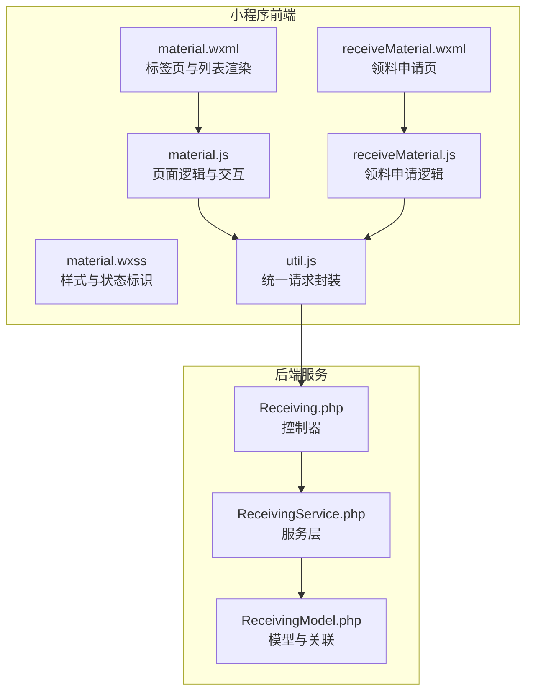
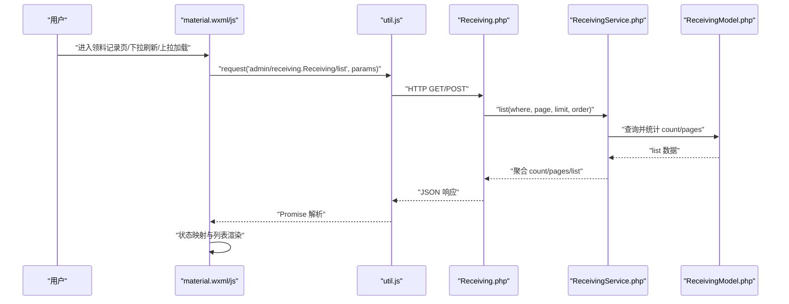
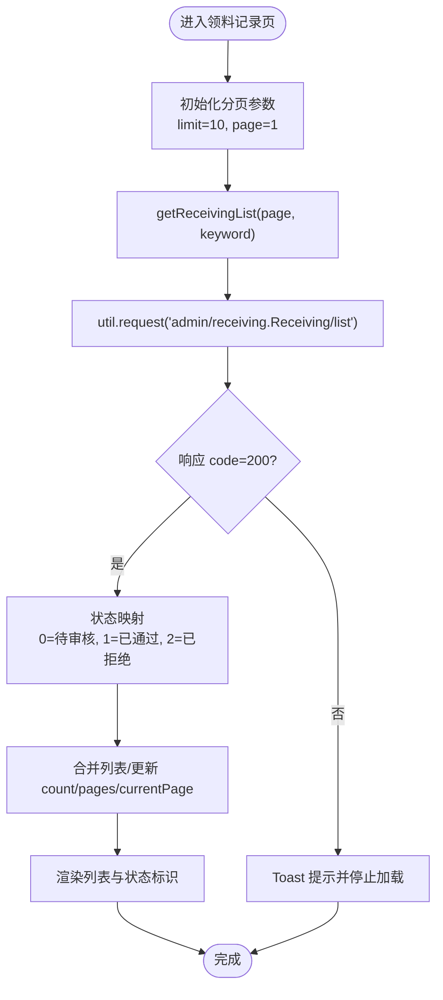
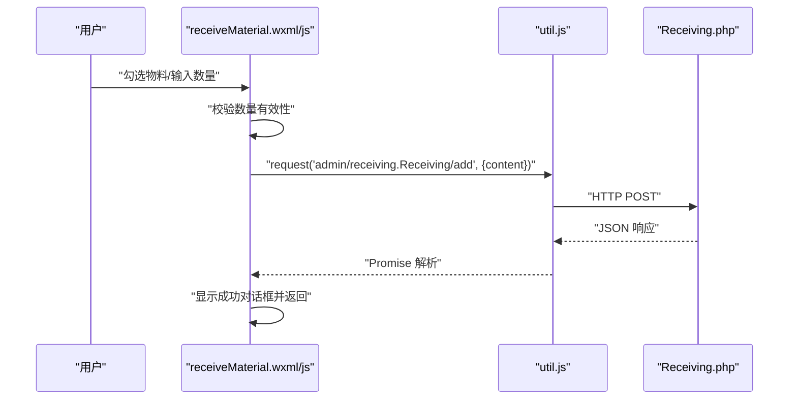
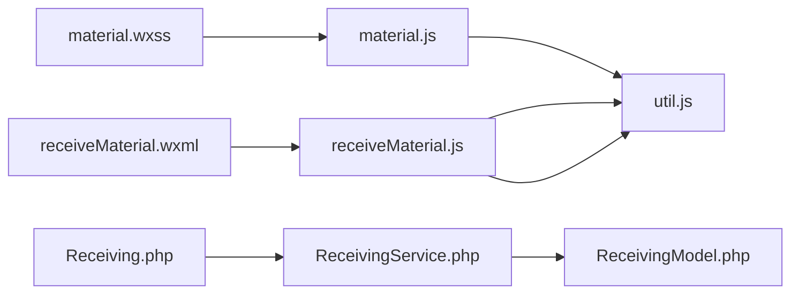

# 物料领料记录页面

<cite>
**本文引用的文件**
- [material.js](file://gccd_mini/pages/material/material.js)
- [material.wxml](file://gccd_mini/pages/material/material.wxml)
- [material.wxss](file://gccd_mini/pages/material/material.wxss)
- [receiveMaterial.js](file://gccd_mini/pageMaterial/pages/receiveMaterial/receiveMaterial.js)
- [receiveMaterial.json](file://gccd_mini/pageMaterial/pages/receiveMaterial/receiveMaterial.json)
- [receiveMaterial.wxml](file://gccd_mini/pageMaterial/pages/receiveMaterial/receiveMaterial.wxml)
- [util.js](file://gccd_mini/utils/util.js)
- [Receiving.php](file://gccd_server/app/admin/controller/receiving/Receiving.php)
- [ReceivingService.php](file://gccd_server/app/common/service/admin/ReceivingService.php)
- [ReceivingModel.php](file://gccd_server/app/common/model/admin/ReceivingModel.php)
</cite>

## 目录
1. [简介](#简介)
2. [项目结构](#项目结构)
3. [核心组件](#核心组件)
4. [架构总览](#架构总览)
5. [详细组件分析](#详细组件分析)
6. [依赖关系分析](#依赖关系分析)
7. [性能考量](#性能考量)
8. [故障排查指南](#故障排查指南)
9. [结论](#结论)
10. [附录](#附录)

## 简介
本开发文档围绕“物料领料记录页面”展开，系统性介绍其整体设计与功能实现，涵盖以下方面：
- 领料申请记录展示与状态管理
- 搜索过滤与分页加载机制
- 数据获取与展示流程（API 调用、数据格式化、状态标识）
- 交互设计（下拉刷新、上拉加载更多、状态切换）
- 搜索功能实现（关键词、状态筛选、时间范围）
- 与审批流程的集成（状态流转、权限控制、通知提醒）
- 开发最佳实践与用户体验优化建议

## 项目结构
该页面位于小程序前端目录 gccd_mini 中，采用分页标签页布局，包含“物料列表”和“领料记录”两个子页。领料记录页通过 util.js 的统一请求封装访问后端接口，后端控制器与服务层负责数据查询与权限校验。

图表来源
- [material.wxml:73-221](file://gccd_mini/pages/material/material.wxml#L73-L221)
- [material.js:96-159](file://gccd_mini/pages/material/material.js#L96-L159)
- [receiveMaterial.wxml:1-74](file://gccd_mini/pageMaterial/pages/receiveMaterial/receiveMaterial.wxml#L1-L74)
- [receiveMaterial.js:61-115](file://gccd_mini/pageMaterial/pages/receiveMaterial/receiveMaterial.js#L61-L115)
- [util.js:22-94](file://gccd_mini/utils/util.js#L22-L94)
- [Receiving.php:38-63](file://gccd_server/app/admin/controller/receiving/Receiving.php#L38-L63)
- [ReceivingService.php:54-69](file://gccd_server/app/common/service/admin/ReceivingService.php#L54-L69)
- [ReceivingModel.php:12-20](file://gccd_server/app/common/model/admin/ReceivingModel.php#L12-L20)

章节来源
- [material.wxml:73-221](file://gccd_mini/pages/material/material.wxml#L73-L221)
- [material.js:96-159](file://gccd_mini/pages/material/material.js#L96-L159)
- [receiveMaterial.wxml:1-74](file://gccd_mini/pageMaterial/pages/receiveMaterial/receiveMaterial.wxml#L1-L74)
- [receiveMaterial.js:61-115](file://gccd_mini/pageMaterial/pages/receiveMaterial/receiveMaterial.js#L61-L115)
- [util.js:22-94](file://gccd_mini/utils/util.js#L22-L94)
- [Receiving.php:38-63](file://gccd_server/app/admin/controller/receiving/Receiving.php#L38-L63)
- [ReceivingService.php:54-69](file://gccd_server/app/common/service/admin/ReceivingService.php#L54-L69)
- [ReceivingModel.php:12-20](file://gccd_server/app/common/model/admin/ReceivingModel.php#L12-L20)

## 核心组件
- 领料记录列表页（material.js + material.wxml + material.wxss）
  - 负责标签页切换、下拉刷新、上拉加载更多、关键词搜索、状态标识渲染
- 领料申请页（receiveMaterial.js + receiveMaterial.wxml + receiveMaterial.json）
  - 负责物料选择、数量输入、提交领料、成功提示与返回
- 请求封装（util.js）
  - 统一处理请求头、鉴权、错误提示与登录态失效跳转
- 后端接口（Receiving.php + ReceivingService.php + ReceivingModel.php）
  - 提供领料记录列表、详情、新增等接口，并进行权限控制与数据组装

章节来源
- [material.js:96-159](file://gccd_mini/pages/material/material.js#L96-L159)
- [material.wxml:181-220](file://gccd_mini/pages/material/material.wxml#L181-L220)
- [material.wxss:247-261](file://gccd_mini/pages/material/material.wxss#L247-L261)
- [receiveMaterial.js:61-115](file://gccd_mini/pageMaterial/pages/receiveMaterial/receiveMaterial.js#L61-L115)
- [receiveMaterial.wxml:1-74](file://gccd_mini/pageMaterial/pages/receiveMaterial/receiveMaterial.wxml#L1-L74)
- [util.js:22-94](file://gccd_mini/utils/util.js#L22-L94)
- [Receiving.php:38-63](file://gccd_server/app/admin/controller/receiving/Receiving.php#L38-L63)
- [ReceivingService.php:54-69](file://gccd_server/app/common/service/admin/ReceivingService.php#L54-L69)
- [ReceivingModel.php:12-20](file://gccd_server/app/common/model/admin/ReceivingModel.php#L12-L20)

## 架构总览
从前端到后端的数据流如下：
- 领料记录页通过 getReceivingList 发起请求，携带分页与关键词参数
- 后端控制器根据是否超级管理员设置查询条件，调用服务层获取列表
- 服务层按分页查询并返回 count/pages/list
- 前端将 status 数值映射为文本与样式类，渲染状态标识

图表来源
- [material.js:96-159](file://gccd_mini/pages/material/material.js#L96-L159)
- [util.js:22-94](file://gccd_mini/utils/util.js#L22-L94)
- [Receiving.php:38-63](file://gccd_server/app/admin/controller/receiving/Receiving.php#L38-L63)
- [ReceivingService.php:54-69](file://gccd_server/app/common/service/admin/ReceivingService.php#L54-L69)
- [ReceivingModel.php:12-20](file://gccd_server/app/common/model/admin/ReceivingModel.php#L12-L20)

## 详细组件分析

### 领料记录页（material.js + material.wxml + material.wxss）
- 标签页与路由
  - 通过 van-tabs 切换“物料列表”和“领料记录”，切换时分别调用 getList 与 getReceivingList
- 数据获取与分页
  - getReceivingList 构造分页参数 limit/page/keyword，调用 util.request
  - 成功后对 status 数值映射为状态文本与样式类，合并列表并更新 count/pages/currentPage
- 搜索与筛选
  - onReceivingSearchChange 更新关键词，onReceivingSearch 重置页码并重新请求
  - 本页未实现时间范围筛选，但后端接口已预留接收起止日期参数
- 交互与加载
  - onPullDownRefresh 在当前标签页触发刷新
  - onReachBottom 根据当前标签页判断是否加载更多
  - material.wxss 定义了状态标识的颜色与背景样式
- 状态管理
  - status: 0 待审核、1 已通过、2 已拒绝，分别映射为不同样式类

图表来源
- [material.js:96-159](file://gccd_mini/pages/material/material.js#L96-L159)
- [material.wxss:247-261](file://gccd_mini/pages/material/material.wxss#L247-L261)

章节来源
- [material.js:96-159](file://gccd_mini/pages/material/material.js#L96-L159)
- [material.wxml:181-220](file://gccd_mini/pages/material/material.wxml#L181-L220)
- [material.wxss:247-261](file://gccd_mini/pages/material/material.wxss#L247-L261)

### 领料申请页（receiveMaterial.js + receiveMaterial.wxml + receiveMaterial.json）
- 功能概述
  - 展示可选物料列表，支持搜索与分页加载
  - 多选物料并设置领料数量，提交后弹出确认对话框
- 数据流
  - getMaterialList 获取物料列表，支持 keyword 搜索
  - onMaterialSelect 记录选中物料 ID 与详情
  - onQuantityChange 动态更新数量
  - submitReceiving 校验数量并调用 util.request 提交 content
- 交互细节
  - 使用 van-popup 弹出数量输入与步进器
  - 提交成功后关闭弹窗并返回上一页，清空选中状态

图表来源
- [receiveMaterial.js:220-282](file://gccd_mini/pageMaterial/pages/receiveMaterial/receiveMaterial.js#L220-L282)
- [receiveMaterial.wxml:43-74](file://gccd_mini/pageMaterial/pages/receiveMaterial/receiveMaterial.wxml#L43-L74)
- [util.js:22-94](file://gccd_mini/utils/util.js#L22-L94)
- [Receiving.php:81-88](file://gccd_server/app/admin/controller/receiving/Receiving.php#L81-L88)

章节来源
- [receiveMaterial.js:61-115](file://gccd_mini/pageMaterial/pages/receiveMaterial/receiveMaterial.js#L61-L115)
- [receiveMaterial.js:220-282](file://gccd_mini/pageMaterial/pages/receiveMaterial/receiveMaterial.js#L220-L282)
- [receiveMaterial.wxml:1-74](file://gccd_mini/pageMaterial/pages/receiveMaterial/receiveMaterial.wxml#L1-L74)
- [receiveMaterial.json:1-16](file://gccd_mini/pageMaterial/pages/receiveMaterial/receiveMaterial.json#L1-L16)

### 请求封装与权限控制（util.js + Receiving.php）
- 请求封装
  - request 统一设置 AdminToken 头部，处理 401 跳转登录、400/404 错误提示、通用失败提示
- 权限控制
  - Receiving.php 在非超级管理员情况下自动追加 user_id 条件，确保只能看到本人数据
  - 支持按领料单号、关联单号等字段模糊查询

章节来源
- [util.js:22-94](file://gccd_mini/utils/util.js#L22-L94)
- [Receiving.php:42-44](file://gccd_server/app/admin/controller/receiving/Receiving.php#L42-L44)
- [Receiving.php:48-53](file://gccd_server/app/admin/controller/receiving/Receiving.php#L48-L53)

## 依赖关系分析
- 前端依赖
  - material.js 依赖 util.js 进行网络请求
  - receiveMaterial.js 同样依赖 util.js
  - 样式依赖 material.wxss 的状态标识类名
- 后端依赖
  - Receiving.php 依赖 ReceivingService.php
  - ReceivingService.php 依赖 ReceivingModel.php 并进行分页统计

图表来源
- [material.js:1-5](file://gccd_mini/pages/material/material.js#L1-L5)
- [receiveMaterial.js:1-3](file://gccd_mini/pageMaterial/pages/receiveMaterial/receiveMaterial.js#L1-L3)
- [util.js:1-2](file://gccd_mini/utils/util.js#L1-L2)
- [Receiving.php:1-2](file://gccd_server/app/admin/controller/receiving/Receiving.php#L1-L2)
- [ReceivingService.php:1-3](file://gccd_server/app/common/service/admin/ReceivingService.php#L1-L3)
- [ReceivingModel.php:1-3](file://gccd_server/app/common/model/admin/ReceivingModel.php#L1-L3)

章节来源
- [material.js:1-5](file://gccd_mini/pages/material/material.js#L1-L5)
- [receiveMaterial.js:1-3](file://gccd_mini/pageMaterial/pages/receiveMaterial/receiveMaterial.js#L1-L3)
- [util.js:1-2](file://gccd_mini/utils/util.js#L1-L2)
- [Receiving.php:1-2](file://gccd_server/app/admin/controller/receiving/Receiving.php#L1-L2)
- [ReceivingService.php:1-3](file://gccd_server/app/common/service/admin/ReceivingService.php#L1-L3)
- [ReceivingModel.php:1-3](file://gccd_server/app/common/model/admin/ReceivingModel.php#L1-L3)

## 性能考量
- 防抖搜索
  - 领料记录页对关键词变更设置了防抖，减少频繁请求
- 分页加载
  - 两页均采用分页加载，避免一次性传输大量数据
- 状态映射
  - 前端在渲染前完成状态映射，降低模板计算复杂度
- 网络与缓存
  - 建议在列表页增加本地缓存策略，结合下拉刷新与上拉加载提升体验

## 故障排查指南
- 登录态失效
  - 401 时 util.js 会清除本地 token 并跳转登录页，需检查 AdminToken 是否正确存储与传递
- 接口失败
  - 400/404 或网络异常会提示具体信息，检查请求参数与服务端日志
- 列表为空
  - 检查关键词、权限条件（非超级管理员仅能看到本人数据），以及分页参数
- 提交领料
  - 若出现“网络不稳定可能已提交成功”，建议到领料记录页核对是否已有记录

章节来源
- [util.js:57-68](file://gccd_mini/utils/util.js#L57-L68)
- [util.js:85-91](file://gccd_mini/utils/util.js#L85-L91)
- [Receiving.php:42-44](file://gccd_server/app/admin/controller/receiving/Receiving.php#L42-L44)

## 结论
物料领料记录页面通过清晰的前后端职责划分，实现了稳定的列表展示、分页加载与状态标识。前端以标签页组织功能，后端以控制器+服务层+模型层提供数据支撑，并内置权限控制与错误处理。后续可在搜索维度（如时间范围）、状态筛选与通知提醒等方面进一步完善，以提升用户体验与业务闭环。

## 附录
- 开发最佳实践
  - 使用防抖优化搜索体验
  - 在提交流程中增加幂等校验与本地缓存
  - 对状态枚举进行集中管理，便于维护与扩展
- 用户体验优化建议
  - 增加“加载中”占位与骨架屏
  - 提供“无数据”场景的引导与重试
  - 在领料记录页增加状态筛选与时间范围选择