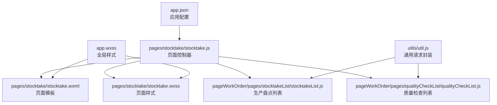
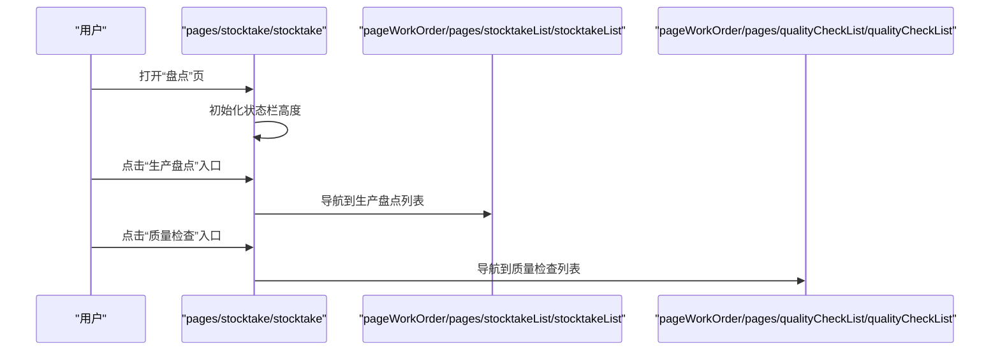
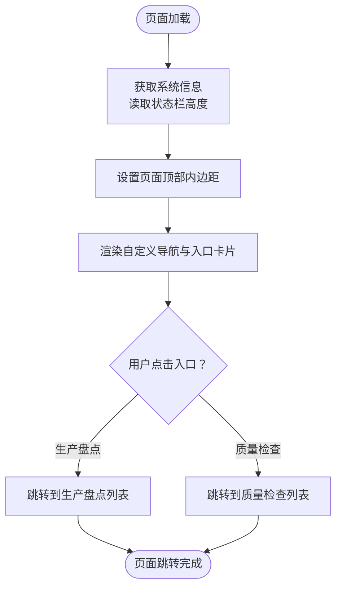
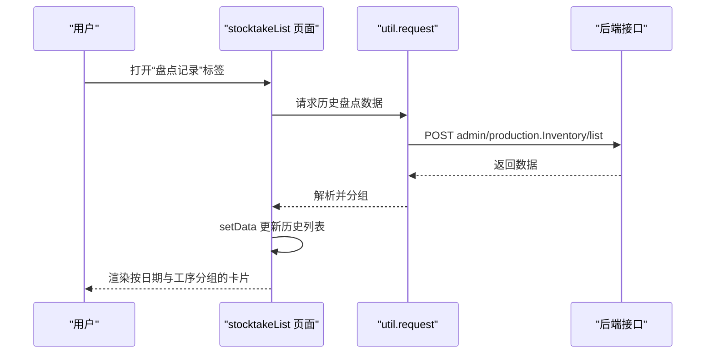
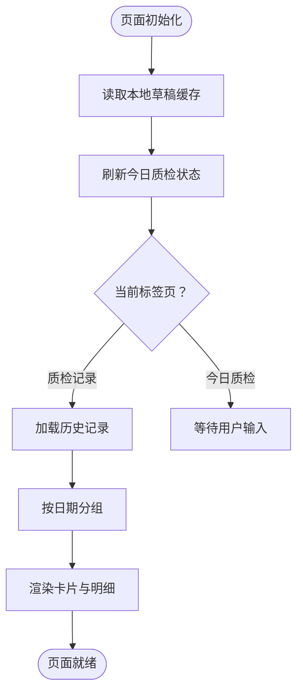
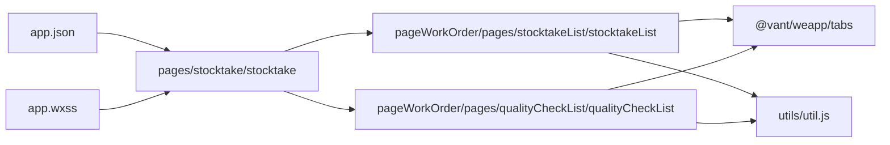

# 盘点主页面

<cite>
**本文引用的文件**
- [pages/stocktake/stocktake.js](file://gccd_mini/pages/stocktake/stocktake.js)
- [pages/stocktake/stocktake.json](file://gccd_mini/pages/stocktake/stocktake.json)
- [pages/stocktake/stocktake.wxml](file://gccd_mini/pages/stocktake/stocktake.wxml)
- [pages/stocktake/stocktake.wxss](file://gccd_mini/pages/stocktake/stocktake.wxss)
- [pageWorkOrder/pages/stocktakeList/stocktakeList.js](file://gccd_mini/pageWorkOrder/pages/stocktakeList/stocktakeList.js)
- [pageWorkOrder/pages/stocktakeList/stocktakeList.json](file://gccd_mini/pageWorkOrder/pages/stocktakeList/stocktakeList.json)
- [pageWorkOrder/pages/stocktakeList/stocktakeList.wxml](file://gccd_mini/pageWorkOrder/pages/stocktakeList/stocktakeList.wxml)
- [pageWorkOrder/pages/stocktakeList/stocktakeList.wxss](file://gccd_mini/pageWorkOrder/pages/stocktakeList/stocktakeList.wxss)
- [pageWorkOrder/pages/qualityCheckList/qualityCheckList.js](file://gccd_mini/pageWorkOrder/pages/qualityCheckList/qualityCheckList.js)
- [utils/util.js](file://gccd_mini/utils/util.js)
- [app.json](file://gccd_mini/app.json)
- [app.wxss](file://gccd_mini/app.wxss)
- [pages/components/main-tab-bar/main-tab-bar.js](file://gccd_mini/pages/components/main-tab-bar/main-tab-bar.js)
- [pages/components/main-tab-bar/main-tab-bar.wxml](file://gccd_mini/pages/components/main-tab-bar/main-tab-bar.wxml)
- [pages/components/main-tab-bar/main-tab-bar.wxss](file://gccd_mini/pages/components/main-tab-bar/main-tab-bar.wxss)
</cite>

## 目录
1. [简介](#简介)
2. [项目结构](#项目结构)
3. [核心组件](#核心组件)
4. [架构总览](#架构总览)
5. [详细组件分析](#详细组件分析)
6. [依赖关系分析](#依赖关系分析)
7. [性能考量](#性能考量)
8. [故障排查指南](#故障排查指南)
9. [结论](#结论)
10. [附录](#附录)

## 简介
本文件面向“盘点主页面”的开发与维护，围绕页面整体设计、布局与导航、初始化流程、页面跳转逻辑、样式与响应式适配、与小程序框架的集成与生命周期管理进行系统化说明，并提供最佳实践与性能优化建议。目标读者既包括一线开发者，也包括对技术细节有一定了解但非深度编程的业务与产品人员。

## 项目结构
- 盘点主页面位于 pages/stocktake，作为小程序一级页面直接注册，供用户从 Tab 栏进入。
- 盘点主页面通过功能入口跳转到子页面：生产盘点列表与质量检查列表。
- 生产盘点列表与质量检查列表位于 pageWorkOrder 子包中，采用分包策略以降低首屏体积。
- 全局样式与自定义导航栏样式集中于 app.wxss，统一主题色与交互风格。
- 应用级配置 app.json 定义了页面注册、Tab 栏、分包等关键信息。

图表来源
- [pages/stocktake/stocktake.js:1-22](file://gccd_mini/pages/stocktake/stocktake.js#L1-L22)
- [pageWorkOrder/pages/stocktakeList/stocktakeList.js:1-194](file://gccd_mini/pageWorkOrder/pages/stocktakeList/stocktakeList.js#L1-L194)
- [pageWorkOrder/pages/qualityCheckList/qualityCheckList.js:1-174](file://gccd_mini/pageWorkOrder/pages/qualityCheckList/qualityCheckList.js#L1-L174)
- [utils/util.js:1-98](file://gccd_mini/utils/util.js#L1-L98)
- [app.json:1-99](file://gccd_mini/app.json#L1-L99)
- [app.wxss:1-135](file://gccd_mini/app.wxss#L1-L135)

章节来源
- [app.json:1-99](file://gccd_mini/app.json#L1-L99)
- [app.wxss:1-135](file://gccd_mini/app.wxss#L1-L135)

## 核心组件
- 盘点主页面控制器：负责状态栏高度初始化、页面跳转至“生产盘点”和“质量检查”。
- 生产盘点列表页面：包含“今日填报”和“盘点记录”两个标签页，支持按日期与工序展开/折叠查看明细。
- 质量检查列表页面：包含“今日质检”和“质检记录”两个标签页，支持按日期与工序展开/折叠查看明细。
- 通用工具模块：封装网络请求与鉴权处理，统一错误提示与重定向逻辑。
- 全局样式与自定义导航：统一主题色、阴影、圆角等设计令牌，自定义导航栏适配状态栏高度。

章节来源
- [pages/stocktake/stocktake.js:1-22](file://gccd_mini/pages/stocktake/stocktake.js#L1-L22)
- [pageWorkOrder/pages/stocktakeList/stocktakeList.js:1-194](file://gccd_mini/pageWorkOrder/pages/stocktakeList/stocktakeList.js#L1-L194)
- [pageWorkOrder/pages/qualityCheckList/qualityCheckList.js:1-174](file://gccd_mini/pageWorkOrder/pages/qualityCheckList/qualityCheckList.js#L1-L174)
- [utils/util.js:1-98](file://gccd_mini/utils/util.js#L1-L98)
- [app.wxss:1-135](file://gccd_mini/app.wxss#L1-L135)

## 架构总览
- 页面入口：通过 app.json 中的 tabBar 将“盘点”项指向 pages/stocktake/stocktake。
- 主页面承载两大功能入口卡片，分别跳转至生产盘点列表与质量检查列表。
- 列表页面使用 vant weapp 的 Tabs 组件组织双标签页，支持滚动与展开/折叠。
- 数据加载通过 util.request 统一封装，自动处理鉴权、错误与空数据场景。

图表来源
- [pages/stocktake/stocktake.js:14-21](file://gccd_mini/pages/stocktake/stocktake.js#L14-L21)
- [pageWorkOrder/pages/stocktakeList/stocktakeList.js:52-57](file://gccd_mini/pageWorkOrder/pages/stocktakeList/stocktakeList.js#L52-L57)
- [pageWorkOrder/pages/qualityCheckList/qualityCheckList.js:47-52](file://gccd_mini/pageWorkOrder/pages/qualityCheckList/qualityCheckList.js#L47-L52)

## 详细组件分析

### 盘点主页面（pages/stocktake）
- 页面布局与导航
  - 使用自定义导航栏，顶部内边距包含状态栏高度，标题为“生产管理”。
  - 提供两个功能入口卡片：“生产盘点”和“质量检查”，点击后分别跳转至对应列表页。
- 初始化逻辑
  - 在页面 onLoad 生命周期中调用系统接口获取状态栏高度，并写入 data 以驱动 wxml 动态内边距。
- 页面跳转
  - goStocktake：跳转至生产盘点列表。
  - goQualityCheck：跳转至质量检查列表。
- 样式设计
  - 使用全局设计令牌，卡片采用圆角、阴影与渐变背景，突出主次入口。
  - 图标与文字排版统一，右侧箭头引导点击行为。
- 响应式适配
  - 通过动态计算顶部内边距适配不同机型的状态栏高度。
  - 卡片采用 flex 布局，保证在小屏与大屏下均具有良好可读性与间距。

图表来源
- [pages/stocktake/stocktake.js:6-12](file://gccd_mini/pages/stocktake/stocktake.js#L6-L12)
- [pages/stocktake/stocktake.wxml:1-34](file://gccd_mini/pages/stocktake/stocktake.wxml#L1-L34)
- [pages/stocktake/stocktake.wxss:1-85](file://gccd_mini/pages/stocktake/stocktake.wxss#L1-L85)

章节来源
- [pages/stocktake/stocktake.js:1-22](file://gccd_mini/pages/stocktake/stocktake.js#L1-L22)
- [pages/stocktake/stocktake.json:1-7](file://gccd_mini/pages/stocktake/stocktake.json#L1-L7)
- [pages/stocktake/stocktake.wxml:1-34](file://gccd_mini/pages/stocktake/stocktake.wxml#L1-L34)
- [pages/stocktake/stocktake.wxss:1-85](file://gccd_mini/pages/stocktake/stocktake.wxss#L1-L85)

### 生产盘点列表（pageWorkOrder/pages/stocktakeList）
- 页面布局与导航
  - 自定义导航栏，左侧返回按钮，标题为“生产盘点”。
  - 使用 vant weapp Tabs 组件承载两个标签页：今日填报、盘点记录。
- 初始化逻辑
  - onLoad 获取状态栏高度；同时计算“昨日 07:00 ~ 今日 07:00”统计周期的日期字符串。
  - onShow 刷新当日填报状态（从本地草稿缓存读取），并按当前激活标签页决定是否加载历史记录。
- 页面跳转
  - 点击工序卡片进入“生产盘点新增”页，携带工序与日期参数。
  - 支持返回按钮返回上一页。
- 数据加载与展示
  - 历史记录按日期分组，支持逐层展开/折叠：天卡片 -> 工序分组 -> 明细行。
  - 明细列包含物料名称、规格、断钢/成品规格以及白班/夜班数量。
- 样式设计
  - 使用全局设计令牌，卡片与分组采用统一圆角与阴影，区分白班/夜班颜色。
  - 详情表头与行采用 flex 布局，保证对齐与可读性。
- 响应式适配
  - Tabs 内容区域使用固定高度减去头部高度，配合 scroll-view 实现滚动。
  - 折叠展开图标位置与尺寸统一，便于移动端操作。

图表来源
- [pageWorkOrder/pages/stocktakeList/stocktakeList.js:33-38](file://gccd_mini/pageWorkOrder/pages/stocktakeList/stocktakeList.js#L33-L38)
- [pageWorkOrder/pages/stocktakeList/stocktakeList.js:108-186](file://gccd_mini/pageWorkOrder/pages/stocktakeList/stocktakeList.js#L108-L186)
- [utils/util.js:22-94](file://gccd_mini/utils/util.js#L22-L94)

章节来源
- [pageWorkOrder/pages/stocktakeList/stocktakeList.js:1-194](file://gccd_mini/pageWorkOrder/pages/stocktakeList/stocktakeList.js#L1-L194)
- [pageWorkOrder/pages/stocktakeList/stocktakeList.json:1-8](file://gccd_mini/pageWorkOrder/pages/stocktakeList/stocktakeList.json#L1-L8)
- [pageWorkOrder/pages/stocktakeList/stocktakeList.wxml:1-140](file://gccd_mini/pageWorkOrder/pages/stocktakeList/stocktakeList.wxml#L1-L140)
- [pageWorkOrder/pages/stocktakeList/stocktakeList.wxss:1-397](file://gccd_mini/pageWorkOrder/pages/stocktakeList/stocktakeList.wxss#L1-L397)

### 质量检查列表（pageWorkOrder/pages/qualityCheckList）
- 页面布局与导航
  - 自定义导航栏，左侧返回按钮，标题为“质量检查”。
  - 使用 vant weapp Tabs 组件承载两个标签页：今日质检、质检记录。
- 初始化逻辑
  - onLoad 获取状态栏高度；同时计算“昨日 07:00 ~ 今日 07:00”统计周期的日期字符串。
  - onShow 刷新当日质检状态（从本地草稿缓存读取），并按当前激活标签页决定是否加载历史记录。
- 页面跳转
  - 点击工序卡片进入“质量检查新增”页，携带工序与日期参数。
  - 支持返回按钮返回上一页。
- 数据加载与展示
  - 历史记录按日期分组，支持逐层展开/折叠：天卡片 -> 工序分组 -> 明细行。
  - 明细行包含物料名称、规格、断钢/成品规格以及各类缺陷的白班/夜班数量汇总。
- 样式设计
  - 使用全局设计令牌，卡片与分组采用统一圆角与阴影，颜色区分不同工序与缺陷类型。
  - 表格表头与行采用 flex 布局，保证对齐与可读性。
- 响应式适配
  - Tabs 内容区域使用固定高度减去头部高度，配合 scroll-view 实现滚动。
  - 折叠展开图标位置与尺寸统一，便于移动端操作。

图表来源
- [pageWorkOrder/pages/qualityCheckList/qualityCheckList.js:21-35](file://gccd_mini/pageWorkOrder/pages/qualityCheckList/qualityCheckList.js#L21-L35)
- [pageWorkOrder/pages/qualityCheckList/qualityCheckList.js:75-85](file://gccd_mini/pageWorkOrder/pages/qualityCheckList/qualityCheckList.js#L75-L85)
- [pageWorkOrder/pages/qualityCheckList/qualityCheckList.js:87-166](file://gccd_mini/pageWorkOrder/pages/qualityCheckList/qualityCheckList.js#L87-L166)

章节来源
- [pageWorkOrder/pages/qualityCheckList/qualityCheckList.js:1-174](file://gccd_mini/pageWorkOrder/pages/qualityCheckList/qualityCheckList.js#L1-L174)

### 通用工具模块（utils/util.js）
- 请求封装
  - 统一的 request 函数，支持传入 URL、数据、方法与额外成功码。
  - 自动注入 AdminToken，处理 401 重定向登录、400/404 错误提示、网络异常提示。
- 错误处理
  - 对不同业务码进行分支处理，确保 Promise 正常结束，避免页面“卡住”。
- 使用场景
  - 生产盘点列表与质量检查列表均通过 util.request 加载历史数据。

章节来源
- [utils/util.js:1-98](file://gccd_mini/utils/util.js#L1-L98)

### 全局样式与自定义导航（app.wxss）
- 设计令牌
  - 定义全局变量：背景色、表面色、文本色、主色、阴影、圆角等，贯穿所有页面与组件。
  - 与 vant weapp 主题变量对齐，保证组件视觉一致性。
- 自定义导航
  - 自定义导航栏容器类名，支持固定定位与阴影，顶部内边距结合状态栏高度实现无缝沉浸。
  - 标题居中、左右区域用于放置返回按钮与扩展控件。

章节来源
- [app.wxss:1-135](file://gccd_mini/app.wxss#L1-L135)

### 应用配置与分包（app.json）
- 页面注册
  - 盘点主页面 pages/stocktake/stocktake 注册为一级页面。
- Tab 栏
  - “盘点”项绑定到 pages/stocktake/stocktake，图标与选中态颜色统一。
- 分包策略
  - 生产盘点与质量检查相关页面位于 pageWorkOrder 子包，减少主包体积，提升首屏加载速度。
- 导航样式
  - navigationStyle 设置为 custom，启用自定义导航栏。

章节来源
- [app.json:1-99](file://gccd_mini/app.json#L1-L99)

## 依赖关系分析
- 盘点主页面依赖：
  - app.json：页面注册与 Tab 栏配置。
  - app.wxss：全局设计令牌与自定义导航样式。
  - 生产盘点列表与质量检查列表：通过 wx.navigateTo 进行页面跳转。
- 列表页面依赖：
  - vant weapp Tabs 组件：用于双标签页切换。
  - util.request：统一网络请求与鉴权处理。
  - 本地存储：草稿缓存用于刷新今日状态。
- 全局样式依赖：
  - app.wxss 中的设计令牌被页面样式与组件样式继承使用。

图表来源
- [app.json:1-99](file://gccd_mini/app.json#L1-L99)
- [app.wxss:1-135](file://gccd_mini/app.wxss#L1-L135)
- [pages/stocktake/stocktake.js:14-21](file://gccd_mini/pages/stocktake/stocktake.js#L14-L21)
- [pageWorkOrder/pages/stocktakeList/stocktakeList.json:1-8](file://gccd_mini/pageWorkOrder/pages/stocktakeList/stocktakeList.json#L1-L8)
- [pageWorkOrder/pages/qualityCheckList/qualityCheckList.js:1-2](file://gccd_mini/pageWorkOrder/pages/qualityCheckList/qualityCheckList.js#L1-L2)
- [utils/util.js:1-98](file://gccd_mini/utils/util.js#L1-L98)

章节来源
- [app.json:1-99](file://gccd_mini/app.json#L1-L99)
- [app.wxss:1-135](file://gccd_mini/app.wxss#L1-L135)
- [pages/stocktake/stocktake.js:14-21](file://gccd_mini/pages/stocktake/stocktake.js#L14-L21)
- [pageWorkOrder/pages/stocktakeList/stocktakeList.json:1-8](file://gccd_mini/pageWorkOrder/pages/stocktakeList/stocktakeList.json#L1-L8)
- [pageWorkOrder/pages/qualityCheckList/qualityCheckList.js:1-2](file://gccd_mini/pageWorkOrder/pages/qualityCheckList/qualityCheckList.js#L1-L2)
- [utils/util.js:1-98](file://gccd_mini/utils/util.js#L1-L98)

## 性能考量
- 分包加载
  - 将生产盘点与质量检查相关页面置于子包，降低主包体积，缩短首屏加载时间。
- 滚动优化
  - 列表页面使用 scroll-view 并限定内容高度，避免长列表全量渲染导致的卡顿。
- 数据缓存
  - 今日状态通过本地草稿缓存快速刷新，减少不必要的网络请求。
- 请求封装
  - 统一的请求封装与错误处理，避免重复判断与异常分支，提高稳定性。
- 样式复用
  - 全局设计令牌统一视觉风格，减少重复样式定义，提升构建效率。

## 故障排查指南
- 页面无法显示或导航异常
  - 检查 app.json 中页面注册与 Tab 栏路径是否正确。
  - 确认 navigationStyle 是否为 custom，自定义导航样式是否生效。
- 状态栏高度异常
  - 确认页面 onLoad 中已调用系统接口获取状态栏高度，并正确写入 data。
  - 检查自定义导航容器的顶部内边距是否包含状态栏高度。
- 列表数据为空或加载失败
  - 检查 util.request 的请求地址与鉴权头是否正确。
  - 查看控制台网络请求与后端返回码，确认 401 重定向登录流程是否触发。
- 折叠展开异常
  - 确认数据结构中的 expanded 字段更新逻辑是否正确。
  - 检查 setData 的键路径拼接是否与 wxml 中绑定一致。

章节来源
- [app.json:1-99](file://gccd_mini/app.json#L1-L99)
- [pages/stocktake/stocktake.js:6-12](file://gccd_mini/pages/stocktake/stocktake.js#L6-L12)
- [utils/util.js:22-94](file://gccd_mini/utils/util.js#L22-L94)
- [pageWorkOrder/pages/stocktakeList/stocktakeList.js:59-73](file://gccd_mini/pageWorkOrder/pages/stocktakeList/stocktakeList.js#L59-L73)
- [pageWorkOrder/pages/qualityCheckList/qualityCheckList.js:54-64](file://gccd_mini/pageWorkOrder/pages/qualityCheckList/qualityCheckList.js#L54-L64)

## 结论
盘点主页面通过清晰的功能入口、统一的自定义导航与全局样式、以及规范化的页面跳转与数据加载流程，实现了良好的用户体验与可维护性。结合分包策略与性能优化建议，可在多机型与复杂业务场景下保持稳定与流畅。

## 附录
- 最佳实践
  - 页面初始化务必在 onLoad 中完成，避免在 onShow 中做昂贵操作。
  - 使用统一的请求封装与错误处理，确保用户体验一致。
  - 合理使用分包与懒加载，控制主包体积。
  - 统一设计令牌与组件样式，减少视觉差异带来的维护成本。
- 性能优化建议
  - 列表页面优先使用虚拟滚动或分页加载，避免一次性渲染过多节点。
  - 对频繁更新的数据使用局部 setData，减少不必要的视图更新。
  - 图片与媒体资源按需压缩与懒加载，降低带宽与内存占用。