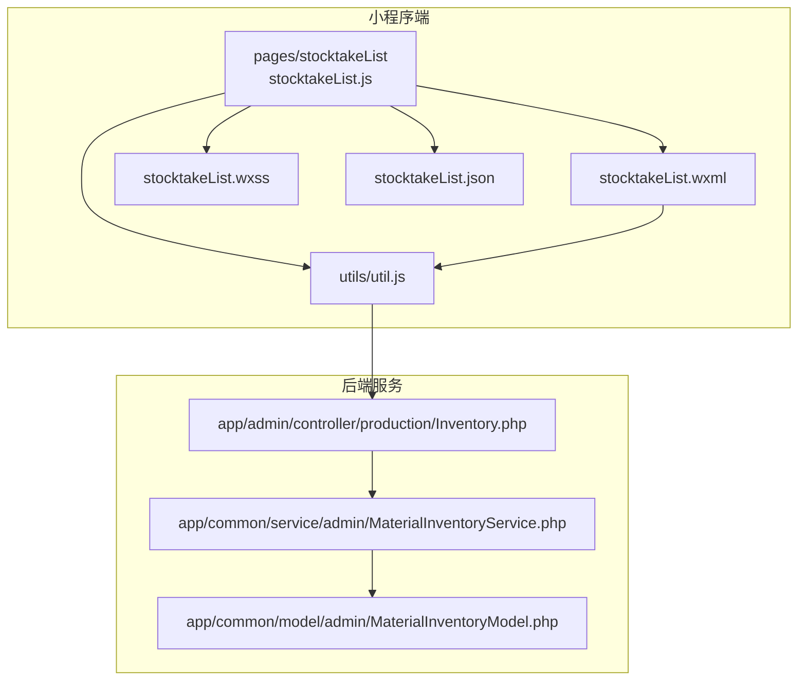
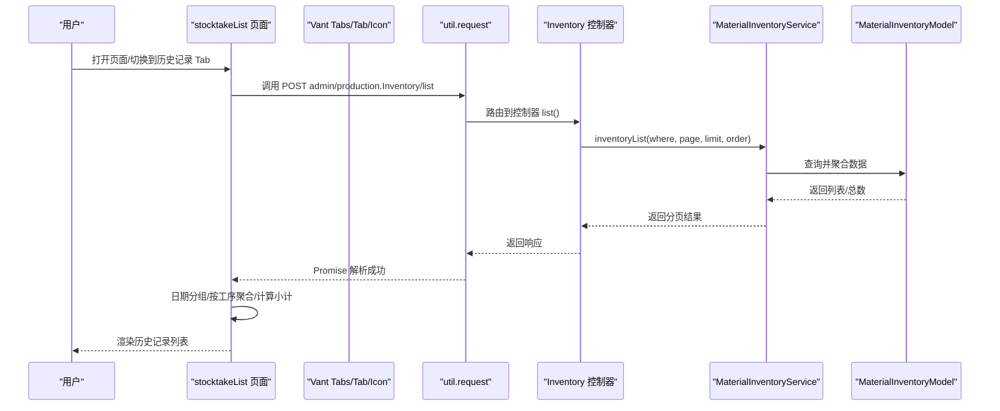
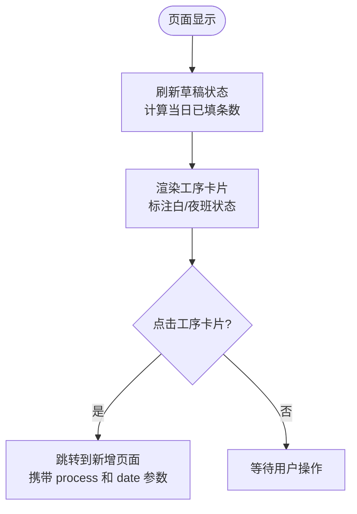
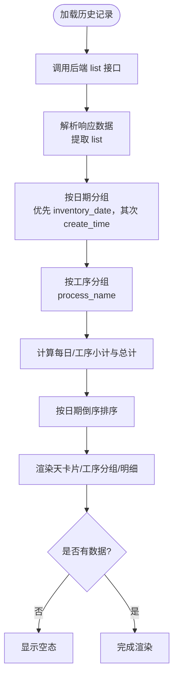
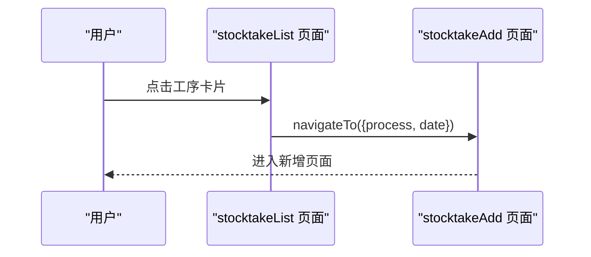
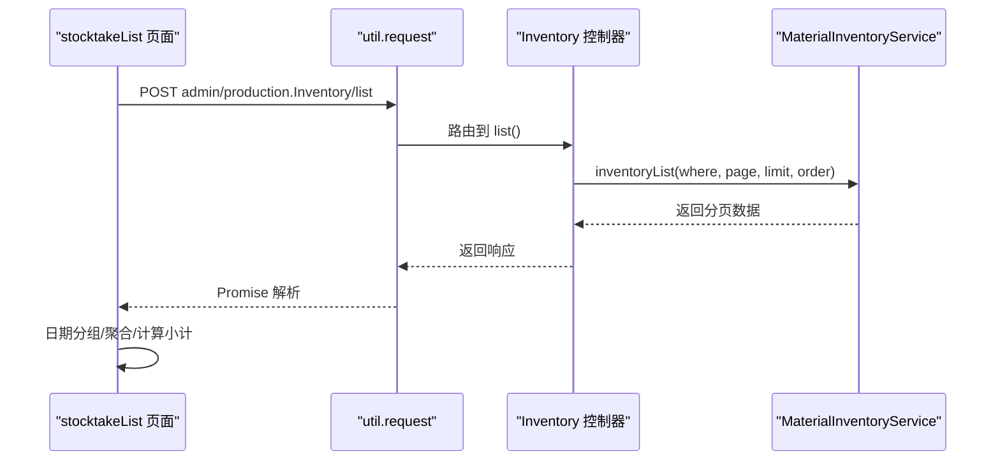
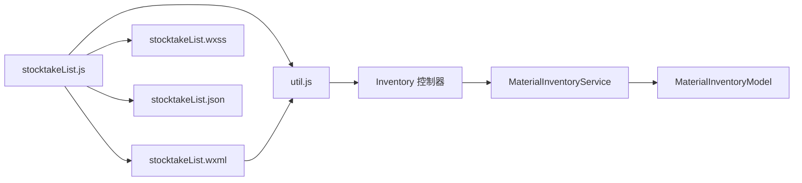

# 盘点列表页面

<cite>
**本文引用的文件**
- [stocktakeList.js](file://gccd_mini/pageWorkOrder/pages/stocktakeList/stocktakeList.js)
- [stocktakeList.wxml](file://gccd_mini/pageWorkOrder/pages/stocktakeList/stocktakeList.wxml)
- [stocktakeList.json](file://gccd_mini/pageWorkOrder/pages/stocktakeList/stocktakeList.json)
- [stocktakeList.wxss](file://gccd_mini/pageWorkOrder/pages/stocktakeList/stocktakeList.wxss)
- [util.js](file://gccd_mini/utils/util.js)
- [Inventory.php](file://gccd_server/app/admin/controller/production/Inventory.php)
- [MaterialInventoryService.php](file://gccd_server/app/common/service/admin/MaterialInventoryService.php)
- [MaterialInventoryModel.php](file://gccd_server/app/common/model/admin/MaterialInventoryModel.php)
- [stocktakeAdd.js](file://gccd_mini/pageWorkOrder/pages/stocktakeAdd/stocktakeAdd.js)
- [stocktakeAdd.wxml](file://gccd_mini/pageWorkOrder/pages/stocktakeAdd/stocktakeAdd.wxml)
- [stocktake.js](file://gccd_mini/pages/stocktake/stocktake.js)
- [workOrder.wxml](file://gccd_mini/pages/workOrder/workOrder.wxml)
</cite>

## 目录
1. [简介](#简介)
2. [项目结构](#项目结构)
3. [核心组件](#核心组件)
4. [架构总览](#架构总览)
5. [详细组件分析](#详细组件分析)
6. [依赖关系分析](#依赖关系分析)
7. [性能考虑](#性能考虑)
8. [故障排查指南](#故障排查指南)
9. [结论](#结论)
10. [附录](#附录)

## 简介
本文件面向“盘点列表页面”的设计与实现，覆盖以下关键主题：
- 盘点任务的展示与状态管理：今日填报与历史记录双 Tab 的数据组织与状态切换。
- 列表数据获取与渲染：按日期分组、工序聚合、明细展开、空态提示。
- 操作功能：跳转到新增页面、折叠/展开、草稿状态提示。
- 分页与无限滚动：当前实现为一次性加载，后续可扩展为分页或虚拟滚动。
- 数据交互与状态同步：前端通过统一工具函数发起请求，后端提供列表与详情接口，服务层负责查询与聚合。
- 用户体验与性能优化：布局、交互反馈、错误处理与加载状态。

## 项目结构
盘点列表页面位于小程序端的 pageWorkOrder 子目录中，采用标准的 wxml/wxss/js/json 组织方式；同时，后端提供对应的控制器与服务层接口，供前端调用。

**图表来源**
- [stocktakeList.js:1-194](file://gccd_mini/pageWorkOrder/pages/stocktakeList/stocktakeList.js#L1-L194)
- [stocktakeList.wxml:1-140](file://gccd_mini/pageWorkOrder/pages/stocktakeList/stocktakeList.wxml#L1-L140)
- [stocktakeList.json:1-8](file://gccd_mini/pageWorkOrder/pages/stocktakeList/stocktakeList.json#L1-L8)
- [stocktakeList.wxss:1-397](file://gccd_mini/pageWorkOrder/pages/stocktakeList/stocktakeList.wxss#L1-L397)
- [util.js:1-98](file://gccd_mini/utils/util.js#L1-L98)
- [Inventory.php:1-47](file://gccd_server/app/admin/controller/production/Inventory.php#L1-L47)
- [MaterialInventoryService.php:1-262](file://gccd_server/app/common/service/admin/MaterialInventoryService.php#L1-L262)
- [MaterialInventoryModel.php:1-24](file://gccd_server/app/common/model/admin/MaterialInventoryModel.php#L1-L24)

**章节来源**
- [stocktakeList.js:1-194](file://gccd_mini/pageWorkOrder/pages/stocktakeList/stocktakeList.js#L1-L194)
- [stocktakeList.wxml:1-140](file://gccd_mini/pageWorkOrder/pages/stocktakeList/stocktakeList.wxml#L1-L140)
- [stocktakeList.json:1-8](file://gccd_mini/pageWorkOrder/pages/stocktakeList/stocktakeList.json#L1-L8)
- [stocktakeList.wxss:1-397](file://gccd_mini/pageWorkOrder/pages/stocktakeList/stocktakeList.wxss#L1-L397)
- [util.js:1-98](file://gccd_mini/utils/util.js#L1-L98)
- [Inventory.php:1-47](file://gccd_server/app/admin/controller/production/Inventory.php#L1-L47)
- [MaterialInventoryService.php:1-262](file://gccd_server/app/common/service/admin/MaterialInventoryService.php#L1-L262)
- [MaterialInventoryModel.php:1-24](file://gccd_server/app/common/model/admin/MaterialInventoryModel.php#L1-L24)

## 核心组件
- 页面容器与状态
  - 页面状态包括：顶部状态栏高度、当前激活 Tab、今日填报的工序集合、历史记录的天级分组与加载状态。
  - 生命周期：onLoad 初始化状态栏高度与默认日期；onShow 在显示时刷新草稿状态，并在切换到历史记录 Tab 时触发加载。
- 数据结构
  - 今日填报：processes 数组，每项包含工序名称、索引、白班/夜班已填条目计数。
  - 历史记录：historyDays 数组，按 inventory_date 或 create_time 的日期进行分组，每个分组包含该日的工序分组（按 process_name），以及明细列表 items。
- 渲染与交互
  - 使用 Vant Weapp 的 Tabs、Tab、Icon 组件实现标签页与图标。
  - 历史记录支持“展开/收起”天卡片与工序分组，点击头部切换 expanded 状态。
  - 空态：当历史为空时显示提示与图标。
- API 调用
  - 通过 util.request 发起 POST 请求至后端接口 admin/production.Inventory/list，一次性获取历史记录（默认 limit=200）。
  - 成功后对数据进行日期分组与按工序聚合，计算每日/工序小计与总计。
- 草稿状态
  - 通过本地存储读取当日草稿，动态更新今日填报中各工序的“白班/夜班已填条数”，用于 UI 状态提示。

**章节来源**
- [stocktakeList.js:4-106](file://gccd_mini/pageWorkOrder/pages/stocktakeList/stocktakeList.js#L4-L106)
- [stocktakeList.js:108-186](file://gccd_mini/pageWorkOrder/pages/stocktakeList/stocktakeList.js#L108-L186)
- [stocktakeList.wxml:7-139](file://gccd_mini/pageWorkOrder/pages/stocktakeList/stocktakeList.wxml#L7-L139)
- [stocktakeList.wxss:153-397](file://gccd_mini/pageWorkOrder/pages/stocktakeList/stocktakeList.wxss#L153-L397)
- [util.js:22-94](file://gccd_mini/utils/util.js#L22-L94)

## 架构总览
前端页面通过工具函数与后端控制器交互，服务层负责查询与聚合，最终返回给前端进行渲染。

**图表来源**
- [stocktakeList.js:108-186](file://gccd_mini/pageWorkOrder/pages/stocktakeList/stocktakeList.js#L108-L186)
- [util.js:22-94](file://gccd_mini/utils/util.js#L22-L94)
- [Inventory.php:17-37](file://gccd_server/app/admin/controller/production/Inventory.php#L17-L37)
- [MaterialInventoryService.php:56-75](file://gccd_server/app/common/service/admin/MaterialInventoryService.php#L56-L75)
- [MaterialInventoryModel.php:1-24](file://gccd_server/app/common/model/admin/MaterialInventoryModel.php#L1-L24)

## 详细组件分析

### 组件一：今日填报（Tab1）
- 功能要点
  - 显示默认“昨日 07:00 ~ 今日 07:00”的统计周期。
  - 展示工序卡片，点击进入对应工序的新增页面。
  - 基于本地草稿状态，动态标注“白班/夜班已填条数”，用于 UI 状态提示。
- 数据流
  - 页面加载时计算昨日日期；显示时刷新草稿状态，更新 processes 中的 dayCount/nightCount。
  - 点击工序卡片时携带 process 与 date 参数跳转到新增页面。
- 交互细节
  - 卡片悬停效果与“去填报/已完成”图标切换。
  - 未填时显示“去填报”按钮，已填时显示绿色对勾图标。

**图表来源**
- [stocktakeList.js:90-106](file://gccd_mini/pageWorkOrder/pages/stocktakeList/stocktakeList.js#L90-L106)
- [stocktakeList.js:52-57](file://gccd_mini/pageWorkOrder/pages/stocktakeList/stocktakeList.js#L52-L57)
- [stocktakeList.wxml:11-54](file://gccd_mini/pageWorkOrder/pages/stocktakeList/stocktakeList.wxml#L11-L54)

**章节来源**
- [stocktakeList.js:4-106](file://gccd_mini/pageWorkOrder/pages/stocktakeList/stocktakeList.js#L4-L106)
- [stocktakeList.wxml:11-54](file://gccd_mini/pageWorkOrder/pages/stocktakeList/stocktakeList.wxml#L11-L54)

### 组件二：历史记录（Tab2）
- 功能要点
  - 加载历史记录，按日期分组，再按工序分组，最后渲染明细。
  - 支持“展开/收起”天卡片与工序分组，点击头部切换 expanded 状态。
  - 空态提示：无记录时显示图标与文案。
- 数据流
  - 调用后端接口获取列表，解析响应中的 list 字段。
  - 日期分组：优先使用 inventory_date，其次使用 create_time 的日期部分。
  - 工序分组：按 process_name 聚合，计算每日/工序的小计与总计。
  - 排序：按日期字符串倒序排列。
- 渲染细节
  - 天卡片头部显示日期、星期、工序数量与明细数量，右侧显示白/夜班合计。
  - 工序分组头部显示工序名与明细条数，右侧显示白/夜班小计。
  - 明细行包含物料名称、规格信息与白/夜班数量。

**图表来源**
- [stocktakeList.js:108-186](file://gccd_mini/pageWorkOrder/pages/stocktakeList/stocktakeList.js#L108-L186)
- [stocktakeList.wxml:56-139](file://gccd_mini/pageWorkOrder/pages/stocktakeList/stocktakeList.wxml#L56-L139)

**章节来源**
- [stocktakeList.js:108-186](file://gccd_mini/pageWorkOrder/pages/stocktakeList/stocktakeList.js#L108-L186)
- [stocktakeList.wxml:56-139](file://gccd_mini/pageWorkOrder/pages/stocktakeList/stocktakeList.wxml#L56-L139)
- [stocktakeList.wxss:153-397](file://gccd_mini/pageWorkOrder/pages/stocktakeList/stocktakeList.wxss#L153-L397)

### 组件三：操作功能
- 查看详情
  - 当前页面未直接提供“查看详情”入口；可在历史记录明细行点击后跳转到详情页（若存在）。
- 编辑任务
  - 当前页面未直接提供“编辑”入口；可在历史记录明细行点击后跳转到编辑页（若存在）。
- 删除任务
  - 当前页面未直接提供“删除”入口；可在历史记录明细行点击后跳转到删除流程（若存在）。
- 新增任务
  - 点击“今日填报”中的工序卡片，携带 process 与 date 参数跳转到新增页面。

**图表来源**
- [stocktakeList.js:52-57](file://gccd_mini/pageWorkOrder/pages/stocktakeList/stocktakeList.js#L52-L57)
- [stocktakeAdd.js:361-382](file://gccd_mini/pageWorkOrder/pages/stocktakeAdd/stocktakeAdd.js#L361-L382)

**章节来源**
- [stocktakeList.js:52-57](file://gccd_mini/pageWorkOrder/pages/stocktakeList/stocktakeList.js#L52-L57)
- [stocktakeAdd.js:361-382](file://gccd_mini/pageWorkOrder/pages/stocktakeAdd/stocktakeAdd.js#L361-L382)

### 组件四：分页加载与无限滚动
- 当前实现
  - 历史记录一次性加载（limit=200），未实现分页或无限滚动。
- 可扩展方案
  - 分页：在请求参数中增加 page/limit，监听滚动到底部触发下一页加载。
  - 无限滚动：结合 IntersectionObserver 或自定义滚动事件，按需追加数据。
  - 虚拟滚动：大数据量场景下，仅渲染可视区域内的节点，提升性能。

**章节来源**
- [stocktakeList.js:111-115](file://gccd_mini/pageWorkOrder/pages/stocktakeList/stocktakeList.js#L111-L115)

### 组件五：与后端 API 的数据交互与状态同步
- 前端请求
  - 使用 util.request 发起 POST 请求，携带 AdminToken 头部。
  - 对不同业务码进行统一处理：成功、未授权、参数错误、其他错误分别给出提示。
- 后端接口
  - 控制器提供 list 与 info 接口，支持按物料名称、工序名称、盘点日期范围筛选。
  - 服务层 inventoryList 默认按 inventory_date 与 create_time 倒序排序。
- 状态同步
  - 前端在加载完成后，将后端返回的 list 转换为前端所需的分组与小计结构，保证 UI 与数据一致。

**图表来源**
- [util.js:22-94](file://gccd_mini/utils/util.js#L22-L94)
- [Inventory.php:17-37](file://gccd_server/app/admin/controller/production/Inventory.php#L17-L37)
- [MaterialInventoryService.php:56-75](file://gccd_server/app/common/service/admin/MaterialInventoryService.php#L56-L75)

**章节来源**
- [util.js:22-94](file://gccd_mini/utils/util.js#L22-L94)
- [Inventory.php:17-37](file://gccd_server/app/admin/controller/production/Inventory.php#L17-L37)
- [MaterialInventoryService.php:56-75](file://gccd_server/app/common/service/admin/MaterialInventoryService.php#L56-L75)

## 依赖关系分析
- 组件依赖
  - stocktakeList 页面依赖 Vant Weapp 组件（tabs、tab、icon）。
  - 页面通过 util.request 与后端交互。
- 数据依赖
  - 历史记录依赖后端返回的 list 数据，服务层负责按日期与工序分组。
- 本地依赖
  - 今日填报依赖本地草稿存储，用于实时更新 UI 状态。

**图表来源**
- [stocktakeList.js:1-194](file://gccd_mini/pageWorkOrder/pages/stocktakeList/stocktakeList.js#L1-L194)
- [stocktakeList.wxml:1-140](file://gccd_mini/pageWorkOrder/pages/stocktakeList/stocktakeList.wxml#L1-L140)
- [stocktakeList.json:1-8](file://gccd_mini/pageWorkOrder/pages/stocktakeList/stocktakeList.json#L1-L8)
- [stocktakeList.wxss:1-397](file://gccd_mini/pageWorkOrder/pages/stocktakeList/stocktakeList.wxss#L1-L397)
- [util.js:1-98](file://gccd_mini/utils/util.js#L1-L98)
- [Inventory.php:1-47](file://gccd_server/app/admin/controller/production/Inventory.php#L1-L47)
- [MaterialInventoryService.php:1-262](file://gccd_server/app/common/service/admin/MaterialInventoryService.php#L1-L262)
- [MaterialInventoryModel.php:1-24](file://gccd_server/app/common/model/admin/MaterialInventoryModel.php#L1-L24)

**章节来源**
- [stocktakeList.js:1-194](file://gccd_mini/pageWorkOrder/pages/stocktakeList/stocktakeList.js#L1-L194)
- [stocktakeList.wxml:1-140](file://gccd_mini/pageWorkOrder/pages/stocktakeList/stocktakeList.wxml#L1-L140)
- [stocktakeList.json:1-8](file://gccd_mini/pageWorkOrder/pages/stocktakeList/stocktakeList.json#L1-L8)
- [stocktakeList.wxss:1-397](file://gccd_mini/pageWorkOrder/pages/stocktakeList/stocktakeList.wxss#L1-L397)
- [util.js:1-98](file://gccd_mini/utils/util.js#L1-L98)
- [Inventory.php:1-47](file://gccd_server/app/admin/controller/production/Inventory.php#L1-L47)
- [MaterialInventoryService.php:1-262](file://gccd_server/app/common/service/admin/MaterialInventoryService.php#L1-L262)
- [MaterialInventoryModel.php:1-24](file://gccd_server/app/common/model/admin/MaterialInventoryModel.php#L1-L24)

## 性能考虑
- 渲染性能
  - 历史记录采用多层 wx:for 渲染，建议在数据量较大时启用虚拟滚动或分页加载，减少一次性渲染节点数量。
- 网络性能
  - 当前一次性加载 limit=200，建议根据实际数据量调整默认值或改为分页加载。
- 交互反馈
  - 加载时设置 historyLoading 状态，避免重复请求；错误时统一提示，防止页面“卡死”。
- 本地缓存
  - 今日填报基于本地草稿存储，减少网络请求；注意清理过期草稿，避免占用存储空间。

[本节为通用建议，无需特定文件引用]

## 故障排查指南
- 网络请求失败
  - 检查 util.request 的错误分支：网络异常、请求失败、401 未授权（自动跳转登录）等。
  - 确认 AdminToken 是否存在且有效。
- 历史记录为空
  - 检查后端筛选条件：是否传入了 inventory_start_date/inventory_end_date 导致无数据。
  - 确认 inventory_date 或 create_time 字段是否存在。
- 数据格式异常
  - 确认后端返回的 data.data.list 结构是否正确，前端解析时需容错处理。
- 未找到详情/编辑/删除入口
  - 当前页面未直接提供相应入口，可在历史记录行点击后跳转到详情/编辑/删除流程（若已实现）。

**章节来源**
- [util.js:44-94](file://gccd_mini/utils/util.js#L44-L94)
- [stocktakeList.js:116-185](file://gccd_mini/pageWorkOrder/pages/stocktakeList/stocktakeList.js#L116-L185)

## 结论
盘点列表页面通过清晰的双 Tab 设计，实现了“今日填报”与“历史记录”的一体化管理。前端采用本地草稿与后端分页数据相结合的方式，提供了直观的状态提示与良好的交互体验。后续可在数据量增大时引入分页或虚拟滚动，进一步优化性能与用户体验。

## 附录
- 页面入口与导航
  - 从工作台页面的“盘点”入口进入 stocktake 页面，再跳转到 stocktakeList。
- 相关页面
  - 新增页面：stocktakeAdd，用于提交盘点数据与本地草稿管理。
  - 历史记录：stocktakeList，用于查看与管理历史盘点数据。

**章节来源**
- [stocktake.js:14-14](file://gccd_mini/pages/stocktake/stocktake.js#L14-L14)
- [workOrder.wxml:206-208](file://gccd_mini/pages/workOrder/workOrder.wxml#L206-L208)
- [stocktakeAdd.js:361-431](file://gccd_mini/pageWorkOrder/pages/stocktakeAdd/stocktakeAdd.js#L361-L431)