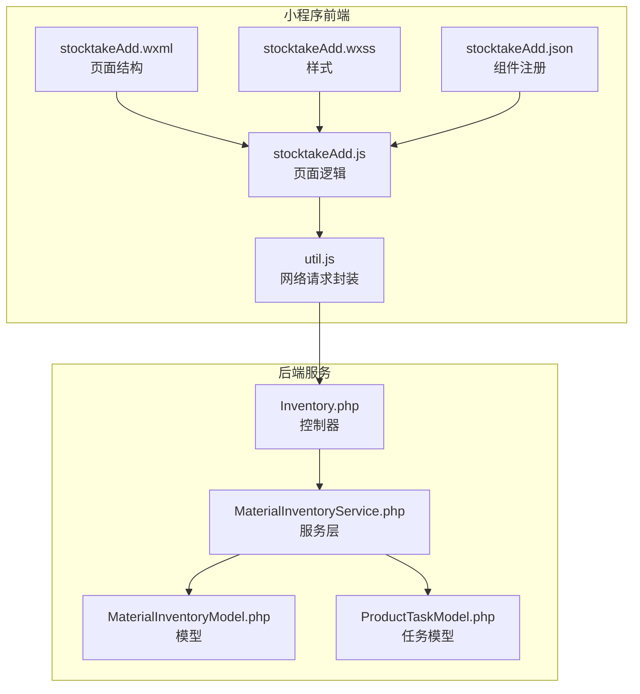
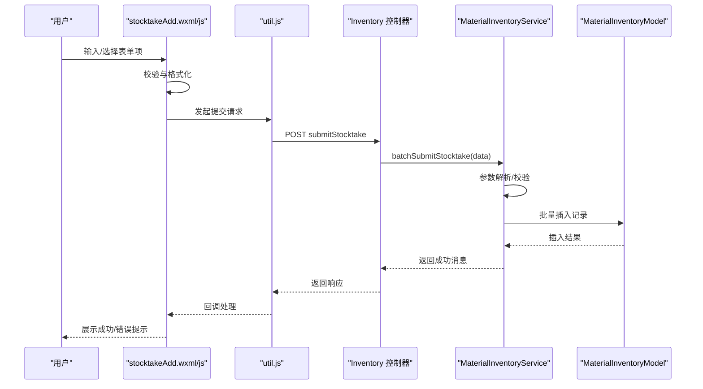
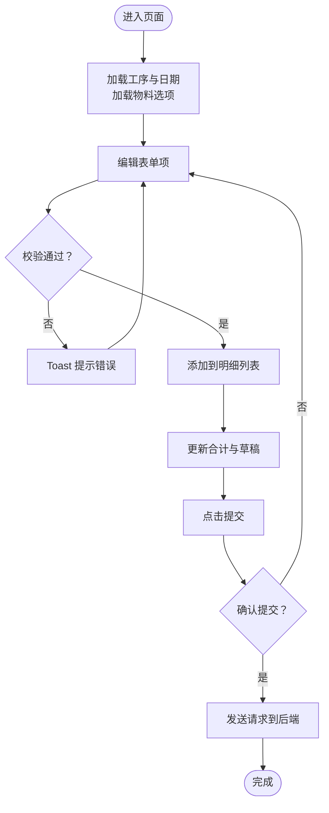
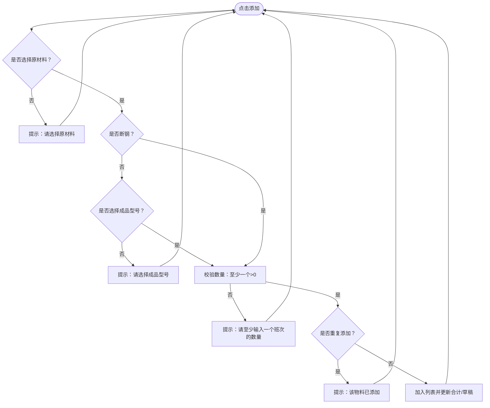
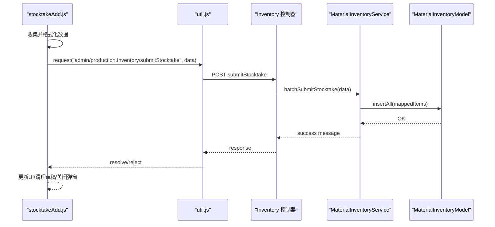
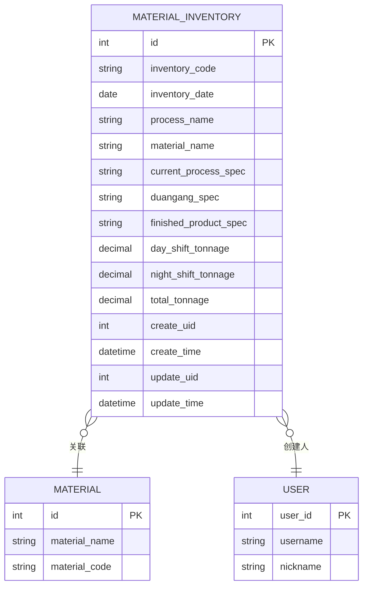
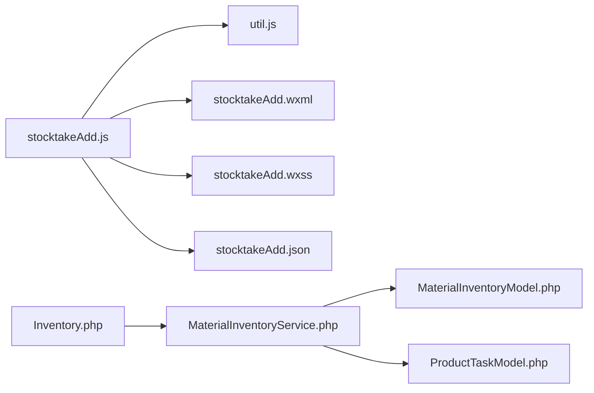

# 盘点添加页面

<cite>
**本文引用的文件**
- [stocktakeAdd.js](file://gccd_mini/pageWorkOrder/pages/stocktakeAdd/stocktakeAdd.js)
- [stocktakeAdd.json](file://gccd_mini/pageWorkOrder/pages/stocktakeAdd/stocktakeAdd.json)
- [stocktakeAdd.wxml](file://gccd_mini/pageWorkOrder/pages/stocktakeAdd/stocktakeAdd.wxml)
- [stocktakeAdd.wxss](file://gccd_mini/pageWorkOrder/pages/stocktakeAdd/stocktakeAdd.wxss)
- [util.js](file://gccd_mini/utils/util.js)
- [Inventory.php](file://gccd_server/app/admin/controller/production/Inventory.php)
- [MaterialInventoryService.php](file://gccd_server/app/common/service/admin/MaterialInventoryService.php)
- [MaterialInventoryModel.php](file://gccd_server/app/common/model/admin/MaterialInventoryModel.php)
- [ProductTaskModel.php](file://gccd_server/app/common/model/admin/ProductTaskModel.php)
</cite>

## 目录
1. [简介](#简介)
2. [项目结构](#项目结构)
3. [核心组件](#核心组件)
4. [架构总览](#架构总览)
5. [详细组件分析](#详细组件分析)
6. [依赖关系分析](#依赖关系分析)
7. [性能考虑](#性能考虑)
8. [故障排查指南](#故障排查指南)
9. [结论](#结论)
10. [附录](#附录)

## 简介
本文件面向“盘点添加页面”的开发与维护，系统性梳理从表单设计、数据验证、交互流程到与库存系统的数据对接与状态同步机制。重点覆盖以下方面：
- 盘点任务创建与参数配置：工序类型、盘点日期、参与人员等
- 表单字段设计与实现：原材料、成品型号、白班/夜班数量、备注等
- 表单验证逻辑：格式校验、业务规则、错误提示
- 表单提交流程：数据收集、格式化、API 调用、结果反馈
- 与库存系统的对接：批量提交、字段映射、事务与回滚
- 最佳实践与用户体验优化建议

## 项目结构
盘点添加页面位于小程序前端目录，采用标准的 WXML + WXSS + JS 构成；与之配套的后端接口位于 PHP 服务端，通过统一的请求封装模块进行网络通信。

**图表来源**
- [stocktakeAdd.js:1-432](file://gccd_mini/pageWorkOrder/pages/stocktakeAdd/stocktakeAdd.js#L1-L432)
- [stocktakeAdd.wxml:1-264](file://gccd_mini/pageWorkOrder/pages/stocktakeAdd/stocktakeAdd.wxml#L1-L264)
- [stocktakeAdd.wxss:1-474](file://gccd_mini/pageWorkOrder/pages/stocktakeAdd/stocktakeAdd.wxss#L1-L474)
- [stocktakeAdd.json:1-11](file://gccd_mini/pageWorkOrder/pages/stocktakeAdd/stocktakeAdd.json#L1-L11)
- [util.js:1-98](file://gccd_mini/utils/util.js#L1-L98)
- [Inventory.php:1-89](file://gccd_server/app/admin/controller/production/Inventory.php#L1-L89)
- [MaterialInventoryService.php:1-262](file://gccd_server/app/common/service/admin/MaterialInventoryService.php#L1-L262)
- [MaterialInventoryModel.php:1-24](file://gccd_server/app/common/model/admin/MaterialInventoryModel.php#L1-L24)
- [ProductTaskModel.php:1-67](file://gccd_server/app/common/model/admin/ProductTaskModel.php#L1-L67)

**章节来源**
- [stocktakeAdd.js:1-432](file://gccd_mini/pageWorkOrder/pages/stocktakeAdd/stocktakeAdd.js#L1-L432)
- [stocktakeAdd.wxml:1-264](file://gccd_mini/pageWorkOrder/pages/stocktakeAdd/stocktakeAdd.wxml#L1-L264)
- [stocktakeAdd.wxss:1-474](file://gccd_mini/pageWorkOrder/pages/stocktakeAdd/stocktakeAdd.wxss#L1-L474)
- [stocktakeAdd.json:1-11](file://gccd_mini/pageWorkOrder/pages/stocktakeAdd/stocktakeAdd.json#L1-L11)
- [util.js:1-98](file://gccd_mini/utils/util.js#L1-L98)
- [Inventory.php:1-89](file://gccd_server/app/admin/controller/production/Inventory.php#L1-L89)
- [MaterialInventoryService.php:1-262](file://gccd_server/app/common/service/admin/MaterialInventoryService.php#L1-L262)
- [MaterialInventoryModel.php:1-24](file://gccd_server/app/common/model/admin/MaterialInventoryModel.php#L1-L24)
- [ProductTaskModel.php:1-67](file://gccd_server/app/common/model/admin/ProductTaskModel.php#L1-L67)

## 核心组件
- 页面逻辑 stocktakeAdd.js：负责数据状态管理、表单交互、数据校验、草稿保存、提交流程控制与错误处理
- 页面结构 stocktakeAdd.wxml：定义表单布局、弹窗、对话框、明细表格与提交按钮
- 样式 stocktakeAdd.wxss：提供视觉风格、响应式与交互态
- 组件注册 stocktakeAdd.json：引入 Vant Weapp 组件（按钮、弹窗、选择器、对话框、提示）
- 请求封装 util.js：统一封装网络请求、鉴权头、错误处理与跳转逻辑
- 控制器 Inventory.php：暴露 submitStocktake 接口，接收小程序批量提交的数据
- 服务层 MaterialInventoryService.php：实现批量提交逻辑、字段映射、事务控制与异常处理
- 模型 MaterialInventoryModel.php：定义表与关联关系（物料、创建人）
- 任务模型 ProductTaskModel.php：提供任务与物料、工序、工艺路线等关联绑定

**章节来源**
- [stocktakeAdd.js:1-432](file://gccd_mini/pageWorkOrder/pages/stocktakeAdd/stocktakeAdd.js#L1-L432)
- [stocktakeAdd.wxml:1-264](file://gccd_mini/pageWorkOrder/pages/stocktakeAdd/stocktakeAdd.wxml#L1-L264)
- [stocktakeAdd.wxss:1-474](file://gccd_mini/pageWorkOrder/pages/stocktakeAdd/stocktakeAdd.wxss#L1-L474)
- [stocktakeAdd.json:1-11](file://gccd_mini/pageWorkOrder/pages/stocktakeAdd/stocktakeAdd.json#L1-L11)
- [util.js:1-98](file://gccd_mini/utils/util.js#L1-L98)
- [Inventory.php:80-87](file://gccd_server/app/admin/controller/production/Inventory.php#L80-L87)
- [MaterialInventoryService.php:140-200](file://gccd_server/app/common/service/admin/MaterialInventoryService.php#L140-L200)
- [MaterialInventoryModel.php:1-24](file://gccd_server/app/common/model/admin/MaterialInventoryModel.php#L1-L24)
- [ProductTaskModel.php:1-67](file://gccd_server/app/common/model/admin/ProductTaskModel.php#L1-L67)

## 架构总览
小程序端通过 util.js 的 request 方法向后端 Inventory 控制器发起提交请求，后端服务层对数据进行批量入库，并在事务中完成插入与计算，最终返回结果给小程序端。

**图表来源**
- [stocktakeAdd.js:340-382](file://gccd_mini/pageWorkOrder/pages/stocktakeAdd/stocktakeAdd.js#L340-L382)
- [util.js:22-94](file://gccd_mini/utils/util.js#L22-L94)
- [Inventory.php:82-87](file://gccd_server/app/admin/controller/production/Inventory.php#L82-L87)
- [MaterialInventoryService.php:142-200](file://gccd_server/app/common/service/admin/MaterialInventoryService.php#L142-L200)

## 详细组件分析

### 表单字段与设计
- 工序类型与日期：页面初始化时从路由参数读取，用于区分断钢与其他工序，并展示在页面顶部
- 原材料选择：支持搜索过滤，去重聚合，标签组合显示（名称/规格/断钢规格）
- 成品型号选择：断钢工序隐藏，其他工序启用；同样支持搜索过滤
- 白班/夜班数量：输入框限制为数字与小数点，保留三位小数；至少一个班次需大于零
- 已添加明细：表格展示物料与成品型号、白班/夜班数量，支持删除与自动合计
- 备注：可选文本域，最大长度限制
- 提交：二次确认对话框，展示明细与合计信息

**图表来源**
- [stocktakeAdd.js:45-61](file://gccd_mini/pageWorkOrder/pages/stocktakeAdd/stocktakeAdd.js#L45-L61)
- [stocktakeAdd.js:68-88](file://gccd_mini/pageWorkOrder/pages/stocktakeAdd/stocktakeAdd.js#L68-L88)
- [stocktakeAdd.js:238-294](file://gccd_mini/pageWorkOrder/pages/stocktakeAdd/stocktakeAdd.js#L238-L294)
- [stocktakeAdd.js:323-339](file://gccd_mini/pageWorkOrder/pages/stocktakeAdd/stocktakeAdd.js#L323-L339)
- [stocktakeAdd.js:340-382](file://gccd_mini/pageWorkOrder/pages/stocktakeAdd/stocktakeAdd.js#L340-L382)

**章节来源**
- [stocktakeAdd.wxml:10-142](file://gccd_mini/pageWorkOrder/pages/stocktakeAdd/stocktakeAdd.wxml#L10-L142)
- [stocktakeAdd.js:5-43](file://gccd_mini/pageWorkOrder/pages/stocktakeAdd/stocktakeAdd.js#L5-L43)

### 数据验证逻辑
- 原材料必选：未选择则提示
- 成品型号必选（非断钢）：断钢工序隐藏该字段，其他工序必填
- 数量校验：白班/夜班至少一个大于零
- 去重校验：相同物料+成品型号不可重复添加
- 明细为空：提交前必须至少有一条明细
- 输入清洗：吨位输入仅允许数字与小数点，最多保留三位小数

**图表来源**
- [stocktakeAdd.js:238-294](file://gccd_mini/pageWorkOrder/pages/stocktakeAdd/stocktakeAdd.js#L238-L294)
- [stocktakeAdd.js:229-235](file://gccd_mini/pageWorkOrder/pages/stocktakeAdd/stocktakeAdd.js#L229-L235)

**章节来源**
- [stocktakeAdd.js:238-294](file://gccd_mini/pageWorkOrder/pages/stocktakeAdd/stocktakeAdd.js#L238-L294)
- [stocktakeAdd.js:229-235](file://gccd_mini/pageWorkOrder/pages/stocktakeAdd/stocktakeAdd.js#L229-L235)

### 表单提交流程
- 数据收集：组装提交对象，包含日期、工序、用户ID、明细数组与备注
- 字段映射：将前端字段映射为后端入库字段（如成品型号、断钢规格、白班/夜班吨数）
- 二次确认：展示明细与合计，避免误提交
- 并发保护：提交锁与 loading 状态防止重复提交
- 错误处理：网络失败或业务失败均提示并释放锁

**图表来源**
- [stocktakeAdd.js:340-382](file://gccd_mini/pageWorkOrder/pages/stocktakeAdd/stocktakeAdd.js#L340-L382)
- [util.js:22-94](file://gccd_mini/utils/util.js#L22-L94)
- [Inventory.php:82-87](file://gccd_server/app/admin/controller/production/Inventory.php#L82-L87)
- [MaterialInventoryService.php:142-200](file://gccd_server/app/common/service/admin/MaterialInventoryService.php#L142-L200)

**章节来源**
- [stocktakeAdd.js:340-382](file://gccd_mini/pageWorkOrder/pages/stocktakeAdd/stocktakeAdd.js#L340-L382)
- [util.js:22-94](file://gccd_mini/utils/util.js#L22-L94)
- [Inventory.php:82-87](file://gccd_server/app/admin/controller/production/Inventory.php#L82-L87)
- [MaterialInventoryService.php:142-200](file://gccd_server/app/common/service/admin/MaterialInventoryService.php#L142-L200)

### 与库存系统的数据对接与状态同步
- 接口定义：submitStocktake 接收批量明细，服务层逐条映射入库
- 字段映射：前端 items 中的 y_material_name/c_material_spec/duangang_spec/c_material_model 对应后端 material_name/current_process_spec/duangang_spec/finished_product_spec
- 事务与回滚：服务层使用事务包裹，任一异常回滚，保证数据一致性
- 状态同步：提交成功后清空本地草稿，返回列表页，确保前后端状态一致

**图表来源**
- [MaterialInventoryModel.php:1-24](file://gccd_server/app/common/model/admin/MaterialInventoryModel.php#L1-L24)
- [MaterialInventoryService.php:142-200](file://gccd_server/app/common/service/admin/MaterialInventoryService.php#L142-L200)

**章节来源**
- [MaterialInventoryService.php:142-200](file://gccd_server/app/common/service/admin/MaterialInventoryService.php#L142-L200)
- [MaterialInventoryModel.php:1-24](file://gccd_server/app/common/model/admin/MaterialInventoryModel.php#L1-L24)

### 表单开发最佳实践与用户体验优化
- 输入体验
  - 使用数字键盘与小数点限制，减少误输入
  - 自动保留小数位数，统一展示与存储格式
- 交互反馈
  - 提交前二次确认，明确展示明细与合计
  - 成功后提供“返回列表”按钮，快速回到主流程
- 可靠性
  - 提交锁与 loading 状态，避免重复提交
  - 网络与业务异常统一提示，必要时引导重新登录
- 数据持久化
  - 本地草稿按日期+工序维度保存，提升断网/中断场景下的可用性

**章节来源**
- [stocktakeAdd.js:323-339](file://gccd_mini/pageWorkOrder/pages/stocktakeAdd/stocktakeAdd.js#L323-L339)
- [stocktakeAdd.js:340-382](file://gccd_mini/pageWorkOrder/pages/stocktakeAdd/stocktakeAdd.js#L340-L382)
- [util.js:57-68](file://gccd_mini/utils/util.js#L57-L68)

## 依赖关系分析
- 前端依赖
  - stocktakeAdd.js 依赖 util.js 进行网络请求
  - stocktakeAdd.json 注册 Vant Weapp 组件
  - stocktakeAdd.wxml/wxss 定义视图与样式
- 后端依赖
  - Inventory 控制器依赖 MaterialInventoryService 服务层
  - MaterialInventoryService 依赖 MaterialInventoryModel 与 ProductTaskModel 等模型
  - 通过 ThinkPHP ORM 完成数据库操作与关联查询

**图表来源**
- [stocktakeAdd.js:1-432](file://gccd_mini/pageWorkOrder/pages/stocktakeAdd/stocktakeAdd.js#L1-L432)
- [stocktakeAdd.json:1-11](file://gccd_mini/pageWorkOrder/pages/stocktakeAdd/stocktakeAdd.json#L1-L11)
- [util.js:1-98](file://gccd_mini/utils/util.js#L1-L98)
- [Inventory.php:1-89](file://gccd_server/app/admin/controller/production/Inventory.php#L1-L89)
- [MaterialInventoryService.php:1-262](file://gccd_server/app/common/service/admin/MaterialInventoryService.php#L1-L262)
- [MaterialInventoryModel.php:1-24](file://gccd_server/app/common/model/admin/MaterialInventoryModel.php#L1-L24)
- [ProductTaskModel.php:1-67](file://gccd_server/app/common/model/admin/ProductTaskModel.php#L1-L67)

**章节来源**
- [stocktakeAdd.js:1-432](file://gccd_mini/pageWorkOrder/pages/stocktakeAdd/stocktakeAdd.js#L1-L432)
- [util.js:1-98](file://gccd_mini/utils/util.js#L1-L98)
- [Inventory.php:1-89](file://gccd_server/app/admin/controller/production/Inventory.php#L1-L89)
- [MaterialInventoryService.php:1-262](file://gccd_server/app/common/service/admin/MaterialInventoryService.php#L1-L262)
- [MaterialInventoryModel.php:1-24](file://gccd_server/app/common/model/admin/MaterialInventoryModel.php#L1-L24)
- [ProductTaskModel.php:1-67](file://gccd_server/app/common/model/admin/ProductTaskModel.php#L1-L67)

## 性能考虑
- 列表加载与过滤
  - 前端对物料与成品型号进行内存过滤，建议在数据量较大时考虑分页或服务端筛选
- 网络请求
  - 统一使用带 AdminToken 的请求头，避免重复鉴权
  - 对批量提交采用一次性请求，减少往返次数
- 视图渲染
  - 明细表格使用虚拟滚动或分页，避免超长列表导致的渲染压力

## 故障排查指南
- 提交失败
  - 检查网络状态与后端接口可达性
  - 查看控制台输出与后端事务日志
- 登录失效
  - 401 码触发自动登出与跳转，需重新登录
- 数据不一致
  - 核对字段映射关系，确保前端 items 与后端入库字段一致
  - 检查事务是否正常提交或回滚

**章节来源**
- [util.js:57-68](file://gccd_mini/utils/util.js#L57-L68)
- [stocktakeAdd.js:363-377](file://gccd_mini/pageWorkOrder/pages/stocktakeAdd/stocktakeAdd.js#L363-L377)
- [MaterialInventoryService.php:196-199](file://gccd_server/app/common/service/admin/MaterialInventoryService.php#L196-L199)

## 结论
盘点添加页面以清晰的表单结构与严格的校验逻辑为基础，结合本地草稿与二次确认机制，提升了易用性与可靠性。后端通过服务层统一处理批量入库与事务控制，确保数据一致性。建议在后续迭代中进一步优化大数据量场景下的筛选与渲染性能，并完善更细粒度的错误提示与重试策略。

## 附录
- 关键字段映射
  - 原材料名称：y_material_name → material_name
  - 原材料规格：y_material_spec → current_process_spec
  - 断钢规格：c_material_spec → duangang_spec
  - 成品型号：c_material_model → finished_product_spec
  - 白班/夜班：day_shift_qty/night_shift_qty → day_shift_tonnage/night_shift_tonnage
  - 合计：total_tonnage = 白班 + 夜班（保留三位小数）

**章节来源**
- [MaterialInventoryService.php:163-189](file://gccd_server/app/common/service/admin/MaterialInventoryService.php#L163-L189)
- [stocktakeAdd.js:350-359](file://gccd_mini/pageWorkOrder/pages/stocktakeAdd/stocktakeAdd.js#L350-L359)