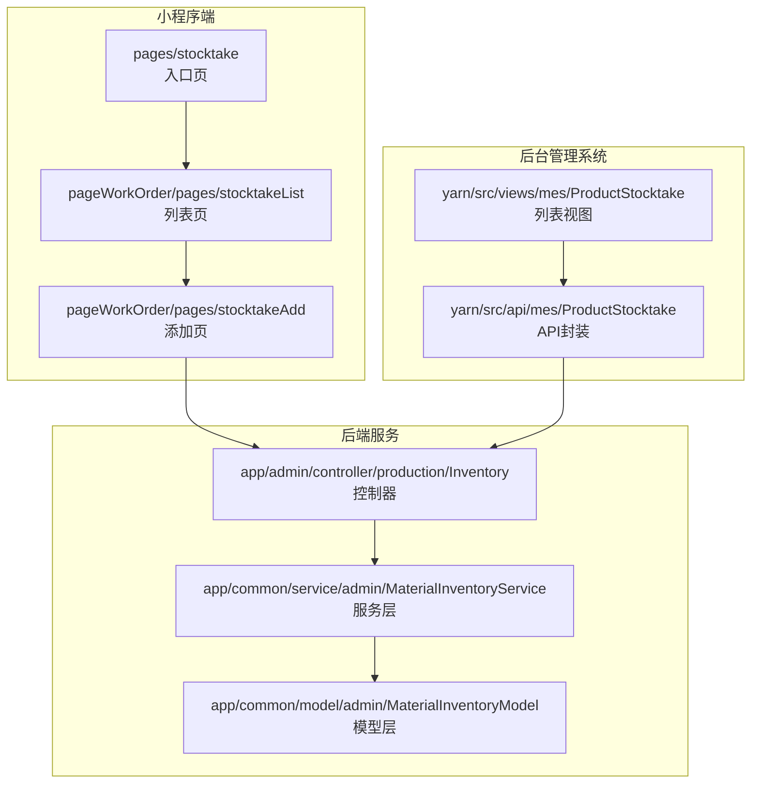
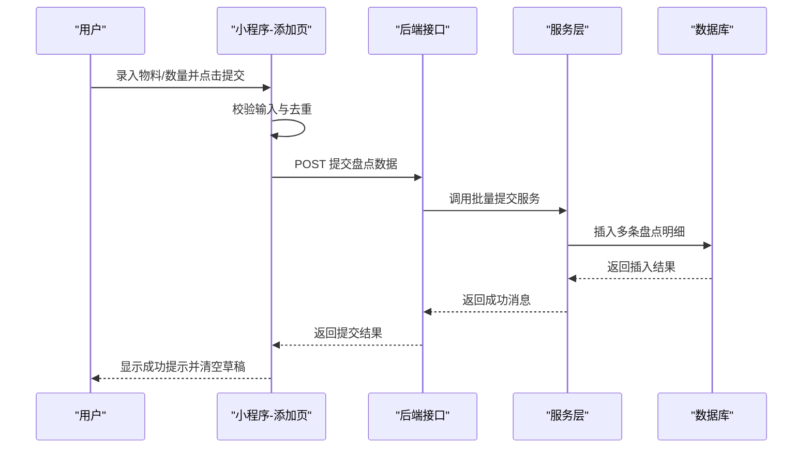
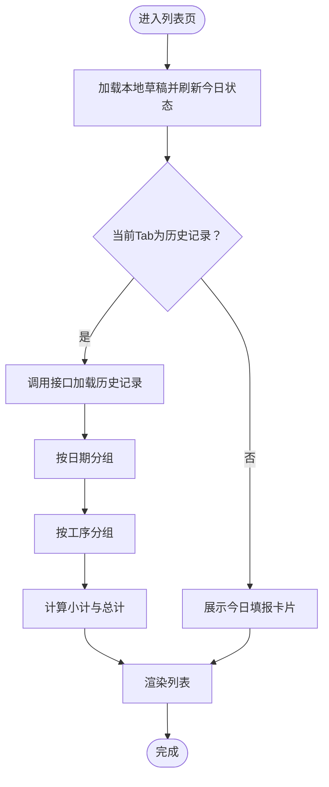
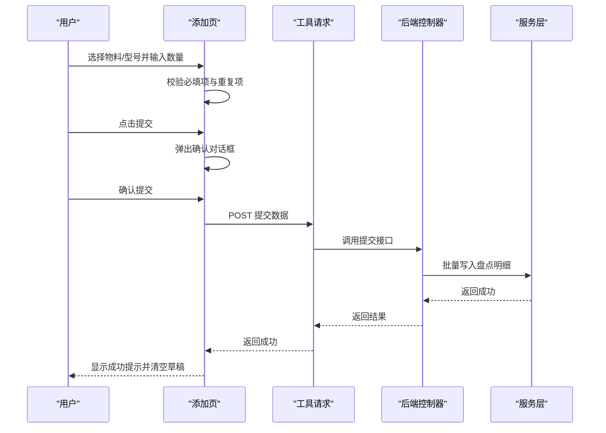
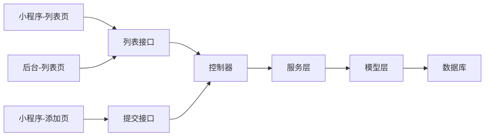

# 盘点管理页面

<cite>
**本文引用的文件**
- [gccd_mini/pages/stocktake/stocktake.js](file://gccd_mini/pages/stocktake/stocktake.js)
- [gccd_mini/pageWorkOrder/pages/stocktakeList/stocktakeList.js](file://gccd_mini/pageWorkOrder/pages/stocktakeList/stocktakeList.js)
- [gccd_mini/pageWorkOrder/pages/stocktakeList/stocktakeList.json](file://gccd_mini/pageWorkOrder/pages/stocktakeList/stocktakeList.json)
- [gccd_mini/pageWorkOrder/pages/stocktakeList/stocktakeList.wxml](file://gccd_mini/pageWorkOrder/pages/stocktakeList/stocktakeList.wxml)
- [gccd_mini/pageWorkOrder/pages/stocktakeAdd/stocktakeAdd.js](file://gccd_mini/pageWorkOrder/pages/stocktakeAdd/stocktakeAdd.js)
- [gccd_mini/pageWorkOrder/pages/stocktakeAdd/stocktakeAdd.json](file://gccd_mini/pageWorkOrder/pages/stocktakeAdd/stocktakeAdd.json)
- [gccd_mini/pageWorkOrder/pages/stocktakeAdd/stocktakeAdd.wxml](file://gccd_mini/pageWorkOrder/pages/stocktakeAdd/stocktakeAdd.wxml)
- [yarn/src/views/mes/ProductStocktake/ProductStocktake.vue](file://yarn/src/views/mes/ProductStocktake/ProductStocktake.vue)
- [yarn/src/api/mes/ProductStocktake/ProductStocktake.js](file://yarn/src/api/mes/ProductStocktake/ProductStocktake.js)
- [gccd_server/app/admin/controller/production/Inventory.php](file://gccd_server/app/admin/controller/production/Inventory.php)
- [gccd_server/app/common/service/admin/MaterialInventoryService.php](file://gccd_server/app/common/service/admin/MaterialInventoryService.php)
- [gccd_server/app/common/model/admin/MaterialInventoryModel.php](file://gccd_server/app/common/model/admin/MaterialInventoryModel.php)
</cite>

## 目录
1. [简介](#简介)
2. [项目结构](#项目结构)
3. [核心组件](#核心组件)
4. [架构总览](#架构总览)
5. [详细组件分析](#详细组件分析)
6. [依赖关系分析](#依赖关系分析)
7. [性能考虑](#性能考虑)
8. [故障排查指南](#故障排查指南)
9. [结论](#结论)
10. [附录](#附录)

## 简介
本开发文档围绕“盘点管理页面”展开，系统性梳理了从移动端（小程序）到后台管理系统（Vue + Element Plus）再到后端服务（ThinkPHP）的完整链路。重点覆盖以下方面：
- 盘点计划制定与任务分配：通过“今日填报”Tab引导各工序在指定日期内完成盘点任务。
- 盘点执行监控：通过“盘点记录”Tab汇总历史数据，支持按日期与工序分组查看。
- 盘点添加页面：支持选择原材料/成品型号、录入白班/夜班数量、本地草稿保存与提交。
- 盘点列表页面：展示各工序的填报状态、完成情况与历史明细。
- 盘点详情页面：在后台系统中提供查询、筛选、分页与导出能力。
- 数据同步与状态更新：小程序提交数据经后端接口入库，前端实时刷新或手动刷新查看最新结果。

## 项目结构
本项目采用多端分离架构：
- 小程序端（gccd_mini）：提供移动端交互入口与数据采集。
- 后台管理系统（yarn）：提供Web端查询、筛选与统计。
- 后端服务（gccd_server）：提供REST风格接口与业务逻辑。

图表来源
- [gccd_mini/pages/stocktake/stocktake.js:1-22](file://gccd_mini/pages/stocktake/stocktake.js#L1-L22)
- [gccd_mini/pageWorkOrder/pages/stocktakeList/stocktakeList.js:1-194](file://gccd_mini/pageWorkOrder/pages/stocktakeList/stocktakeList.js#L1-L194)
- [gccd_mini/pageWorkOrder/pages/stocktakeAdd/stocktakeAdd.js:1-432](file://gccd_mini/pageWorkOrder/pages/stocktakeAdd/stocktakeAdd.js#L1-L432)
- [yarn/src/views/mes/ProductStocktake/ProductStocktake.vue:1-139](file://yarn/src/views/mes/ProductStocktake/ProductStocktake.vue#L1-L139)
- [yarn/src/api/mes/ProductStocktake/ProductStocktake.js:1-64](file://yarn/src/api/mes/ProductStocktake/ProductStocktake.js#L1-L64)
- [gccd_server/app/admin/controller/production/Inventory.php:1-89](file://gccd_server/app/admin/controller/production/Inventory.php#L1-L89)
- [gccd_server/app/common/service/admin/MaterialInventoryService.php:139-262](file://gccd_server/app/common/service/admin/MaterialInventoryService.php#L139-L262)
- [gccd_server/app/common/model/admin/MaterialInventoryModel.php:1-24](file://gccd_server/app/common/model/admin/MaterialInventoryModel.php#L1-L24)

章节来源
- [gccd_mini/pages/stocktake/stocktake.js:1-22](file://gccd_mini/pages/stocktake/stocktake.js#L1-L22)
- [gccd_mini/pageWorkOrder/pages/stocktakeList/stocktakeList.js:1-194](file://gccd_mini/pageWorkOrder/pages/stocktakeList/stocktakeList.js#L1-L194)
- [gccd_mini/pageWorkOrder/pages/stocktakeAdd/stocktakeAdd.js:1-432](file://gccd_mini/pageWorkOrder/pages/stocktakeAdd/stocktakeAdd.js#L1-L432)
- [yarn/src/views/mes/ProductStocktake/ProductStocktake.vue:1-139](file://yarn/src/views/mes/ProductStocktake/ProductStocktake.vue#L1-L139)
- [yarn/src/api/mes/ProductStocktake/ProductStocktake.js:1-64](file://yarn/src/api/mes/ProductStocktake/ProductStocktake.js#L1-L64)
- [gccd_server/app/admin/controller/production/Inventory.php:1-89](file://gccd_server/app/admin/controller/production/Inventory.php#L1-L89)
- [gccd_server/app/common/service/admin/MaterialInventoryService.php:139-262](file://gccd_server/app/common/service/admin/MaterialInventoryService.php#L139-L262)
- [gccd_server/app/common/model/admin/MaterialInventoryModel.php:1-24](file://gccd_server/app/common/model/admin/MaterialInventoryModel.php#L1-L24)

## 核心组件
- 小程序入口页：跳转至盘点列表页。
- 盘点列表页：包含“今日填报”和“盘点记录”两个Tab，支持按日期与工序聚合展示。
- 盘点添加页：支持选择物料/型号、录入白班/夜班数量、本地草稿、提交确认与成功反馈。
- 后台列表页：提供搜索条件（原材料、工序、盘点日期区间）、表格展示与分页。
- 后端接口：提供列表、详情、新增、编辑、删除与批量提交接口。

章节来源
- [gccd_mini/pages/stocktake/stocktake.js:1-22](file://gccd_mini/pages/stocktake/stocktake.js#L1-L22)
- [gccd_mini/pageWorkOrder/pages/stocktakeList/stocktakeList.js:1-194](file://gccd_mini/pageWorkOrder/pages/stocktakeList/stocktakeList.js#L1-L194)
- [gccd_mini/pageWorkOrder/pages/stocktakeAdd/stocktakeAdd.js:1-432](file://gccd_mini/pageWorkOrder/pages/stocktakeAdd/stocktakeAdd.js#L1-L432)
- [yarn/src/views/mes/ProductStocktake/ProductStocktake.vue:1-139](file://yarn/src/views/mes/ProductStocktake/ProductStocktake.vue#L1-L139)
- [gccd_server/app/admin/controller/production/Inventory.php:1-89](file://gccd_server/app/admin/controller/production/Inventory.php#L1-L89)

## 架构总览
下图展示了从前端到后端的数据流与职责分工：

图表来源
- [gccd_mini/pageWorkOrder/pages/stocktakeAdd/stocktakeAdd.js:322-382](file://gccd_mini/pageWorkOrder/pages/stocktakeAdd/stocktakeAdd.js#L322-L382)
- [gccd_server/app/admin/controller/production/Inventory.php:82-87](file://gccd_server/app/admin/controller/production/Inventory.php#L82-L87)
- [gccd_server/app/common/service/admin/MaterialInventoryService.php:142-200](file://gccd_server/app/common/service/admin/MaterialInventoryService.php#L142-L200)

## 详细组件分析

### 组件一：小程序入口页（pages/stocktake）
- 功能：获取系统状态栏高度，提供跳转至“盘点列表”的入口。
- 关键点：导航跳转至列表页，便于统一入口管理。

章节来源
- [gccd_mini/pages/stocktake/stocktake.js:1-22](file://gccd_mini/pages/stocktake/stocktake.js#L1-L22)

### 组件二：盘点列表页（pageWorkOrder/pages/stocktakeList）
- 功能概览
  - Tab切换：“今日填报”与“盘点记录”。
  - 今日填报：按工序展示白班/夜班是否已填，支持直接跳转到添加页。
  - 盘点记录：按日期分组，再按工序分组，支持展开/折叠；显示当日白班/夜班小计与总条目数。
- 数据组织
  - 本地草稿：根据日期与工序维度缓存，用于刷新状态展示。
  - 历史加载：调用后端接口，按日期与工序归并，计算小计与总计。
- 交互细节
  - 日期格式化与昨天日期计算。
  - 周几映射与空状态提示。
  - 展开/收起控制与最终渲染。

图表来源
- [gccd_mini/pageWorkOrder/pages/stocktakeList/stocktakeList.js:90-194](file://gccd_mini/pageWorkOrder/pages/stocktakeList/stocktakeList.js#L90-L194)

章节来源
- [gccd_mini/pageWorkOrder/pages/stocktakeList/stocktakeList.js:1-194](file://gccd_mini/pageWorkOrder/pages/stocktakeList/stocktakeList.js#L1-L194)
- [gccd_mini/pageWorkOrder/pages/stocktakeList/stocktakeList.json:1-8](file://gccd_mini/pageWorkOrder/pages/stocktakeList/stocktakeList.json#L1-L8)
- [gccd_mini/pageWorkOrder/pages/stocktakeList/stocktakeList.wxml:1-140](file://gccd_mini/pageWorkOrder/pages/stocktakeList/stocktakeList.wxml#L1-L140)

### 组件三：盘点添加页（pageWorkOrder/pages/stocktakeAdd）
- 功能概览
  - 物料/型号选择：支持搜索过滤与去重校验。
  - 数量录入：白班/夜班，自动清洗输入（保留最多三位小数）。
  - 已添加列表：支持删除单项、实时合计。
  - 本地草稿：按日期+工序持久化，支持断点续填。
  - 提交流程：二次确认、网络请求、成功反馈与草稿清理。
- 关键流程

图表来源
- [gccd_mini/pageWorkOrder/pages/stocktakeAdd/stocktakeAdd.js:238-382](file://gccd_mini/pageWorkOrder/pages/stocktakeAdd/stocktakeAdd.js#L238-L382)
- [gccd_server/app/admin/controller/production/Inventory.php:82-87](file://gccd_server/app/admin/controller/production/Inventory.php#L82-L87)
- [gccd_server/app/common/service/admin/MaterialInventoryService.php:142-200](file://gccd_server/app/common/service/admin/MaterialInventoryService.php#L142-L200)

章节来源
- [gccd_mini/pageWorkOrder/pages/stocktakeAdd/stocktakeAdd.js:1-432](file://gccd_mini/pageWorkOrder/pages/stocktakeAdd/stocktakeAdd.js#L1-L432)
- [gccd_mini/pageWorkOrder/pages/stocktakeAdd/stocktakeAdd.json:1-11](file://gccd_mini/pageWorkOrder/pages/stocktakeAdd/stocktakeAdd.json#L1-L11)
- [gccd_mini/pageWorkOrder/pages/stocktakeAdd/stocktakeAdd.wxml:1-264](file://gccd_mini/pageWorkOrder/pages/stocktakeAdd/stocktakeAdd.wxml#L1-L264)

### 组件四：后台列表页（yarn/src/views/mes/ProductStocktake）
- 功能概览
  - 搜索条件：原材料、工序名称、盘点日期区间。
  - 表格列：日期、工序、盘点单号、物料、规格、成品型号、白班/夜班/总计、提交时间。
  - 分页：支持页码与每页条数切换。
- 数据流
  - 通过API封装调用后端列表接口，异步加载数据并更新表格与总数。

章节来源
- [yarn/src/views/mes/ProductStocktake/ProductStocktake.vue:1-139](file://yarn/src/views/mes/ProductStocktake/ProductStocktake.vue#L1-L139)
- [yarn/src/api/mes/ProductStocktake/ProductStocktake.js:1-64](file://yarn/src/api/mes/ProductStocktake/ProductStocktake.js#L1-L64)

### 组件五：后端接口与服务层
- 控制器（Inventory）
  - 提供列表、详情、新增、编辑、删除与批量提交接口。
- 服务层（MaterialInventoryService）
  - 批量提交：校验参数、生成单据号、组装明细、事务写入。
  - 编辑/删除：支持更新与软/硬删除。
- 模型层（MaterialInventoryModel）
  - 定义表名、主键及关联字段（可选）。

章节来源
- [gccd_server/app/admin/controller/production/Inventory.php:1-89](file://gccd_server/app/admin/controller/production/Inventory.php#L1-L89)
- [gccd_server/app/common/service/admin/MaterialInventoryService.php:139-262](file://gccd_server/app/common/service/admin/MaterialInventoryService.php#L139-L262)
- [gccd_server/app/common/model/admin/MaterialInventoryModel.php:1-24](file://gccd_server/app/common/model/admin/MaterialInventoryModel.php#L1-L24)

## 依赖关系分析
- 组件耦合
  - 小程序添加页依赖工具请求模块与后端提交接口。
  - 后台列表页依赖API封装与后端列表接口。
  - 控制器依赖服务层，服务层依赖模型层与数据库。
- 外部依赖
  - Vant Weapp组件库（小程序端）。
  - Element Plus（后台管理系统）。
  - ThinkPHP框架与数据库。

图表来源
- [gccd_mini/pageWorkOrder/pages/stocktakeAdd/stocktakeAdd.js:363-363](file://gccd_mini/pageWorkOrder/pages/stocktakeAdd/stocktakeAdd.js#L363-L363)
- [gccd_mini/pageWorkOrder/pages/stocktakeList/stocktakeList.js:111-115](file://gccd_mini/pageWorkOrder/pages/stocktakeList/stocktakeList.js#L111-L115)
- [yarn/src/api/mes/ProductStocktake/ProductStocktake.js:9-15](file://yarn/src/api/mes/ProductStocktake/ProductStocktake.js#L9-L15)
- [gccd_server/app/admin/controller/production/Inventory.php:17-37](file://gccd_server/app/admin/controller/production/Inventory.php#L17-L37)
- [gccd_server/app/common/service/admin/MaterialInventoryService.php:142-200](file://gccd_server/app/common/service/admin/MaterialInventoryService.php#L142-L200)
- [gccd_server/app/common/model/admin/MaterialInventoryModel.php:6-23](file://gccd_server/app/common/model/admin/MaterialInventoryModel.php#L6-L23)

章节来源
- [gccd_mini/pageWorkOrder/pages/stocktakeAdd/stocktakeAdd.js:363-363](file://gccd_mini/pageWorkOrder/pages/stocktakeAdd/stocktakeAdd.js#L363-L363)
- [gccd_mini/pageWorkOrder/pages/stocktakeList/stocktakeList.js:111-115](file://gccd_mini/pageWorkOrder/pages/stocktakeList/stocktakeList.js#L111-L115)
- [yarn/src/api/mes/ProductStocktake/ProductStocktake.js:9-15](file://yarn/src/api/mes/ProductStocktake/ProductStocktake.js#L9-L15)
- [gccd_server/app/admin/controller/production/Inventory.php:17-37](file://gccd_server/app/admin/controller/production/Inventory.php#L17-L37)

## 性能考虑
- 小程序端
  - 本地草稿使用本地存储，避免频繁网络请求；注意存储大小限制与清理策略。
  - 列表页按日期与工序聚合时，建议限制加载条数与分页策略，避免一次性渲染过多节点。
- 后端服务
  - 批量插入使用事务，确保一致性；建议对大批次提交进行拆分与限流。
  - 接口查询增加索引（如日期、工序、物料名称），提升检索效率。
- 前后端联调
  - 对长列表采用虚拟滚动或分页加载，减少首屏压力。
  - 对日期区间查询设置最大跨度，防止超大数据集导致性能问题。

## 故障排查指南
- 提交失败
  - 现象：提交后提示失败或网络请求失败。
  - 排查：检查网络状态、接口返回码、后端异常日志；确认必填项与重复项校验是否通过。
- 历史记录为空
  - 现象：历史记录Tab为空。
  - 排查：确认查询日期区间是否正确、接口返回数据结构是否符合预期、是否存在空数据。
- 本地草稿未生效
  - 现象：刷新后草稿丢失或未显示。
  - 排查：确认本地存储键值是否正确、日期与工序维度是否匹配、是否被清理。
- 后台列表无数据
  - 现象：后台列表为空。
  - 排查：确认查询条件（原材料、工序、日期区间）是否过严；检查数据库中是否存在对应记录。

章节来源
- [gccd_mini/pageWorkOrder/pages/stocktakeAdd/stocktakeAdd.js:373-377](file://gccd_mini/pageWorkOrder/pages/stocktakeAdd/stocktakeAdd.js#L373-L377)
- [gccd_mini/pageWorkOrder/pages/stocktakeList/stocktakeList.js:179-182](file://gccd_mini/pageWorkOrder/pages/stocktakeList/stocktakeList.js#L179-L182)
- [gccd_server/app/common/service/admin/MaterialInventoryService.php:196-199](file://gccd_server/app/common/service/admin/MaterialInventoryService.php#L196-L199)

## 结论
本盘点管理页面以“小程序采集 + 后台查询 + 后端服务”为核心，实现了从计划制定、任务分配、执行监控到数据同步的闭环。通过本地草稿、分组聚合与批量提交等设计，兼顾了移动端易用性与后台管理的可视化需求。后续可在性能优化、异常处理与权限控制等方面持续改进。

## 附录
- 开发最佳实践
  - 输入校验：前后端双重校验，避免脏数据入库。
  - 事务与幂等：批量提交使用事务，接口具备幂等性保障。
  - 日志与追踪：关键路径埋点日志，便于定位问题。
  - 用户体验：合理分页、空状态提示、加载状态反馈。
- 库存管理优化建议
  - 引入库存预警阈值与自动提醒机制。
  - 支持差异分析与调整流程，形成闭环管理。
  - 增加盘点报表与趋势分析，辅助决策。