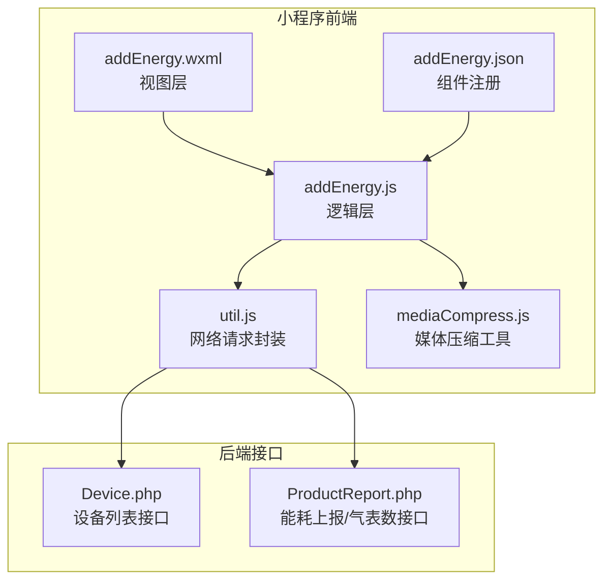
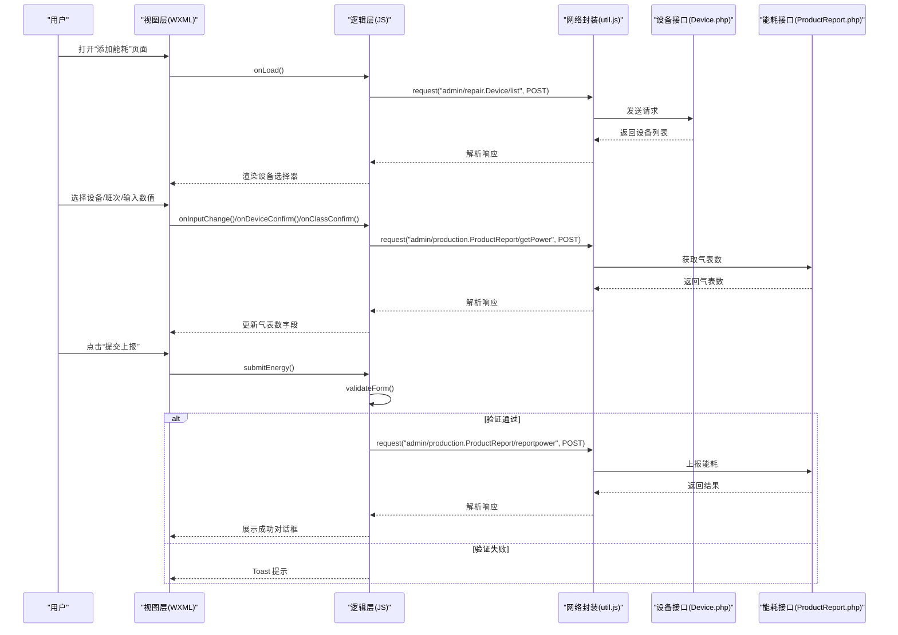
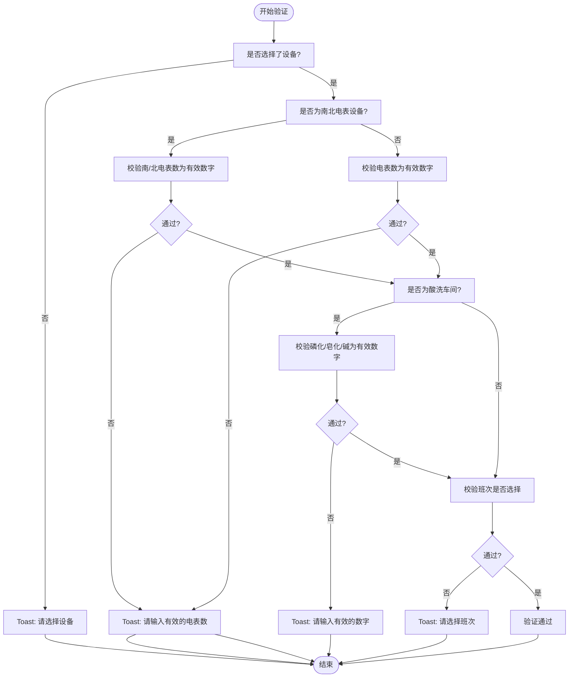
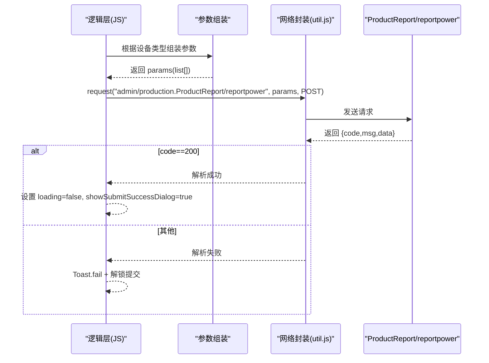
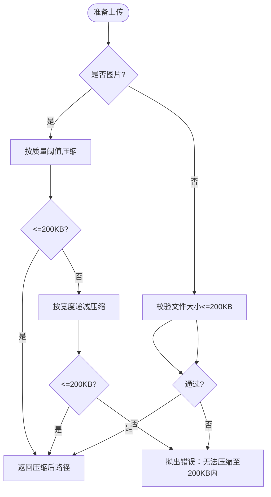
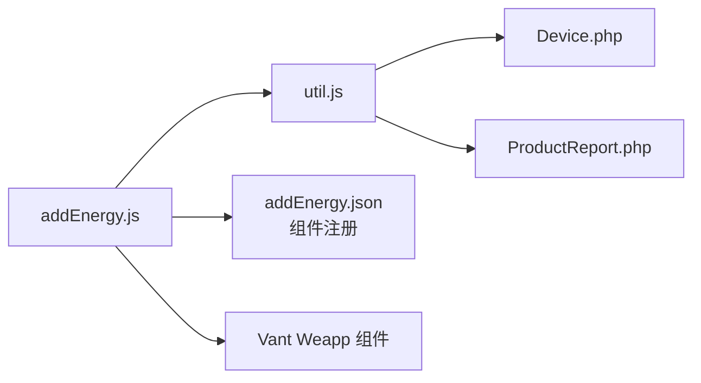

# 添加能耗页面

<cite>
**本文引用的文件**
- [addEnergy.js](file://gccd_mini/pageEnergy/pages/addEnergy/addEnergy.js)
- [addEnergy.json](file://gccd_mini/pageEnergy/pages/addEnergy/addEnergy.json)
- [addEnergy.wxml](file://gccd_mini/pageEnergy/pages/addEnergy/addEnergy.wxml)
- [util.js](file://gccd_mini/utils/util.js)
- [mediaCompress.js](file://gccd_mini/utils/mediaCompress.js)
- [ProductReport.php](file://gccd_server/app/admin/controller/production/ProductReport.php)
- [Device.php](file://gccd_server/app/admin/controller/repair/Device.php)
</cite>

## 目录
1. [简介](#简介)
2. [项目结构](#项目结构)
3. [核心组件](#核心组件)
4. [架构概览](#架构概览)
5. [详细组件分析](#详细组件分析)
6. [依赖关系分析](#依赖关系分析)
7. [性能考虑](#性能考虑)
8. [故障排查指南](#故障排查指南)
9. [结论](#结论)
10. [附录](#附录)

## 简介
本文件面向“添加能耗页面”的开发与维护，系统性梳理能耗录入页面的设计与实现，涵盖以下方面：
- 页面整体布局与交互：设备选择、电表数录入、气表数获取、班次选择、备注输入等
- 表单验证机制：必填项、数据类型、范围限制
- 图片上传能力：拍照、相册选择、压缩处理、预览与删除（如涉及）
- 数据提交流程：参数组装、API 调用、成功反馈与错误处理
- 与后端接口对接：接口路径、请求方法、数据格式与响应约定
- 表单设计最佳实践与用户体验优化建议

## 项目结构
添加能耗页面位于小程序前端目录，采用标准的 WXML + JS + WXSS 结构，并通过工具模块封装网络请求与媒体处理。

**图表来源**
- [addEnergy.wxml:1-63](file://gccd_mini/pageEnergy/pages/addEnergy/addEnergy.wxml#L1-L63)
- [addEnergy.js:1-397](file://gccd_mini/pageEnergy/pages/addEnergy/addEnergy.js#L1-L397)
- [addEnergy.json:1-17](file://gccd_mini/pageEnergy/pages/addEnergy/addEnergy.json#L1-L17)
- [util.js:1-98](file://gccd_mini/utils/util.js#L1-L98)
- [mediaCompress.js:1-104](file://gccd_mini/utils/mediaCompress.js#L1-L104)
- [Device.php:47-74](file://gccd_server/app/admin/controller/repair/Device.php#L47-L74)
- [ProductReport.php:340-356](file://gccd_server/app/admin/controller/production/ProductReport.php#L340-L356)

**章节来源**
- [addEnergy.wxml:1-63](file://gccd_mini/pageEnergy/pages/addEnergy/addEnergy.wxml#L1-L63)
- [addEnergy.js:1-397](file://gccd_mini/pageEnergy/pages/addEnergy/addEnergy.js#L1-L397)
- [addEnergy.json:1-17](file://gccd_mini/pageEnergy/pages/addEnergy/addEnergy.json#L1-L17)
- [util.js:1-98](file://gccd_mini/utils/util.js#L1-L98)
- [mediaCompress.js:1-104](file://gccd_mini/utils/mediaCompress.js#L1-L104)
- [Device.php:47-74](file://gccd_server/app/admin/controller/repair/Device.php#L47-L74)
- [ProductReport.php:340-356](file://gccd_server/app/admin/controller/production/ProductReport.php#L340-L356)

## 核心组件
- 视图层（WXML）：负责渲染页面结构、绑定事件与双向数据绑定
- 逻辑层（JS）：负责页面生命周期、设备与班次选择、表单输入处理、表单验证、参数组装与提交、成功/失败反馈
- 组件注册（JSON）：声明使用的 Vant Weapp 组件
- 网络请求封装（util.js）：统一封装 wx.request，处理鉴权头、业务码判断、错误提示与跳转
- 媒体压缩工具（mediaCompress.js）：提供图片压缩与体积校验能力（适用于上传场景）

**章节来源**
- [addEnergy.wxml:1-63](file://gccd_mini/pageEnergy/pages/addEnergy/addEnergy.wxml#L1-L63)
- [addEnergy.js:1-397](file://gccd_mini/pageEnergy/pages/addEnergy/addEnergy.js#L1-L397)
- [addEnergy.json:1-17](file://gccd_mini/pageEnergy/pages/addEnergy/addEnergy.json#L1-L17)
- [util.js:1-98](file://gccd_mini/utils/util.js#L1-L98)
- [mediaCompress.js:1-104](file://gccd_mini/utils/mediaCompress.js#L1-L104)

## 架构概览
页面从前端发起请求，经由 util.js 统一处理，调用后端接口完成设备列表获取、气表数获取与能耗上报。

**图表来源**
- [addEnergy.js:52-101](file://gccd_mini/pageEnergy/pages/addEnergy/addEnergy.js#L52-L101)
- [addEnergy.js:146-185](file://gccd_mini/pageEnergy/pages/addEnergy/addEnergy.js#L146-L185)
- [addEnergy.js:300-395](file://gccd_mini/pageEnergy/pages/addEnergy/addEnergy.js#L300-L395)
- [util.js:22-94](file://gccd_mini/utils/util.js#L22-L94)
- [Device.php:47-74](file://gccd_server/app/admin/controller/repair/Device.php#L47-L74)
- [ProductReport.php:340-356](file://gccd_server/app/admin/controller/production/ProductReport.php#L340-L356)

## 详细组件分析

### 页面布局与交互
- 导航栏：自定义返回图标与标题
- 设备选择：只读 Field + 弹出 Picker，支持按设备名称筛选
- 能耗表单：
  - 普通设备：输入电表数
  - 南北电表设备：分别输入北电表数与南电表数
  - 气表数：系统自动获取，部分设备只读
  - 酸洗车间：额外输入磷化、皂化、碱的吨数
  - 班次：白班/夜班
  - 备注：文本域
- 提交按钮：防重复点击、加载态

**章节来源**
- [addEnergy.wxml:1-63](file://gccd_mini/pageEnergy/pages/addEnergy/addEnergy.wxml#L1-L63)

### 表单验证机制
- 必填项检查：设备、班次必须选择
- 数值有效性：
  - 南北电表设备：南/北电表数必须为有效数字
  - 普通设备：电表数必须为有效数字
- 特殊字段：
  - 酸洗车间的磷化/皂化/碱：仅允许数字与小数点
- 提示策略：使用 Toast 实时反馈

**图表来源**
- [addEnergy.js:242-278](file://gccd_mini/pageEnergy/pages/addEnergy/addEnergy.js#L242-L278)
- [addEnergy.js:224-235](file://gccd_mini/pageEnergy/pages/addEnergy/addEnergy.js#L224-L235)

**章节来源**
- [addEnergy.js:242-278](file://gccd_mini/pageEnergy/pages/addEnergy/addEnergy.js#L242-L278)
- [addEnergy.js:224-235](file://gccd_mini/pageEnergy/pages/addEnergy/addEnergy.js#L224-L235)

### 参数组装与提交流程
- 参数结构：
  - 普通设备：list 数组包含一个对象，字段包括 device_code、power_num、gas_num、class、remark、routing_code、processes_code
  - 南北电表设备：list 数组包含两个对象，分别代表“南”和“北”，并设置 direction 与 remark 后缀
  - 酸洗车间：额外携带 phosphating、saponification、alkali
- 提交接口：admin/production.ProductReport/reportpower（POST）
- 成功/失败反馈：成功弹出确认对话框；失败显示 Toast 并解锁提交状态

**图表来源**
- [addEnergy.js:318-360](file://gccd_mini/pageEnergy/pages/addEnergy/addEnergy.js#L318-L360)
- [addEnergy.js:364-395](file://gccd_mini/pageEnergy/pages/addEnergy/addEnergy.js#L364-L395)
- [util.js:22-94](file://gccd_mini/utils/util.js#L22-L94)
- [ProductReport.php:340-345](file://gccd_server/app/admin/controller/production/ProductReport.php#L340-L345)

**章节来源**
- [addEnergy.js:318-360](file://gccd_mini/pageEnergy/pages/addEnergy/addEnergy.js#L318-L360)
- [addEnergy.js:364-395](file://gccd_mini/pageEnergy/pages/addEnergy/addEnergy.js#L364-L395)
- [util.js:22-94](file://gccd_mini/utils/util.js#L22-L94)
- [ProductReport.php:340-345](file://gccd_server/app/admin/controller/production/ProductReport.php#L340-L345)

### 图片上传能力（如涉及）
- 压缩策略：优先按质量阈值递减压缩，再尝试按宽度递减压缩，最终校验体积上限
- 体积上限：200KB
- 适用场景：若页面后续接入图片上传（例如能耗异常照片），可复用 mediaCompress.js 进行预处理

**图表来源**
- [mediaCompress.js:48-98](file://gccd_mini/utils/mediaCompress.js#L48-L98)

**章节来源**
- [mediaCompress.js:1-104](file://gccd_mini/utils/mediaCompress.js#L1-L104)

### 与后端接口对接
- 设备列表接口
  - 路径：admin/repair.Device/list
  - 方法：POST
  - 请求参数：limit、page
  - 响应：code=200 时返回 list
- 气表数接口
  - 路径：admin/production.ProductReport/getPower
  - 方法：POST
  - 请求参数：device_name
  - 响应：code=200 时返回 gas_num
- 能耗上报接口
  - 路径：admin/production.ProductReport/reportpower
  - 方法：POST
  - 请求参数：见“参数组装与提交流程”
  - 响应：code=200 时成功

**章节来源**
- [Device.php:47-74](file://gccd_server/app/admin/controller/repair/Device.php#L47-L74)
- [ProductReport.php:340-356](file://gccd_server/app/admin/controller/production/ProductReport.php#L340-L356)

## 依赖关系分析
- addEnergy.js 依赖：
  - util.js：统一网络请求与鉴权头
  - Vant Weapp 组件：field、cell、popup、picker、button、toast、dialog
- 页面与后端接口：
  - 设备列表 → Device.php
  - 气表数 → ProductReport.php
  - 能耗上报 → ProductReport.php

**图表来源**
- [addEnergy.js:1-397](file://gccd_mini/pageEnergy/pages/addEnergy/addEnergy.js#L1-L397)
- [addEnergy.json:1-17](file://gccd_mini/pageEnergy/pages/addEnergy/addEnergy.json#L1-L17)
- [util.js:1-98](file://gccd_mini/utils/util.js#L1-L98)
- [Device.php:47-74](file://gccd_server/app/admin/controller/repair/Device.php#L47-L74)
- [ProductReport.php:340-356](file://gccd_server/app/admin/controller/production/ProductReport.php#L340-L356)

**章节来源**
- [addEnergy.js:1-397](file://gccd_mini/pageEnergy/pages/addEnergy/addEnergy.js#L1-L397)
- [addEnergy.json:1-17](file://gccd_mini/pageEnergy/pages/addEnergy/addEnergy.json#L1-L17)
- [util.js:1-98](file://gccd_mini/utils/util.js#L1-L98)
- [Device.php:47-74](file://gccd_server/app/admin/controller/repair/Device.php#L47-L74)
- [ProductReport.php:340-356](file://gccd_server/app/admin/controller/production/ProductReport.php#L340-L356)

## 性能考虑
- 网络请求
  - 使用统一请求封装，减少重复代码与错误处理遗漏
  - 对于高频请求（如设备列表），建议增加本地缓存与下拉刷新
- 表单输入
  - 数字输入使用 type="number"，避免非数字字符进入
  - 对酸洗车间吨数进行即时正则校验，降低无效提交
- 图片上传
  - 若启用图片上传，务必在上传前进行体积压缩，避免超限导致失败

## 故障排查指南
- 设备列表为空
  - 现象：打开页面即提示“暂无设备数据”
  - 排查：确认接口返回与业务码；检查网络状态
- 气表数获取失败
  - 现象：Toast 提示失败且清空气表数
  - 排查：确认 device_name 是否正确；检查后端接口可用性
- 提交失败
  - 现象：Toast 提示失败或接口请求失败
  - 排查：查看控制台错误日志；确认参数结构与必填项；网络不稳定时提示用户稍后核对列表
- 重复提交
  - 现象：用户多次点击导致重复记录
  - 排查：页面已内置提交锁与禁用按钮，确保逻辑层未被绕过

**章节来源**
- [addEnergy.js:65-101](file://gccd_mini/pageEnergy/pages/addEnergy/addEnergy.js#L65-L101)
- [addEnergy.js:146-185](file://gccd_mini/pageEnergy/pages/addEnergy/addEnergy.js#L146-L185)
- [addEnergy.js:300-395](file://gccd_mini/pageEnergy/pages/addEnergy/addEnergy.js#L300-L395)
- [util.js:22-94](file://gccd_mini/utils/util.js#L22-L94)

## 结论
“添加能耗页面”通过清晰的表单结构、完善的表单验证与统一的网络封装，实现了设备选择、能耗录入、班次与备注输入、以及能耗上报的完整闭环。结合后端提供的设备列表、气表数与能耗上报接口，页面具备良好的可维护性与扩展性。若后续引入图片上传，可直接复用媒体压缩工具以提升上传成功率与用户体验。

## 附录
- 最佳实践与用户体验建议
  - 输入体验：数字输入使用键盘类型与即时校验；对酸洗车间吨数进行实时格式提示
  - 交互反馈：加载态与禁用按钮避免重复提交；成功对话框明确告知用户核对列表
  - 错误处理：统一 Toast 提示与错误码分支；网络异常引导检查网络
  - 可访问性：标签与占位符清晰；颜色对比度满足可读性要求