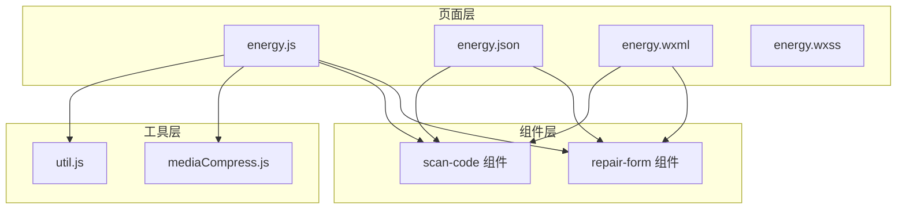
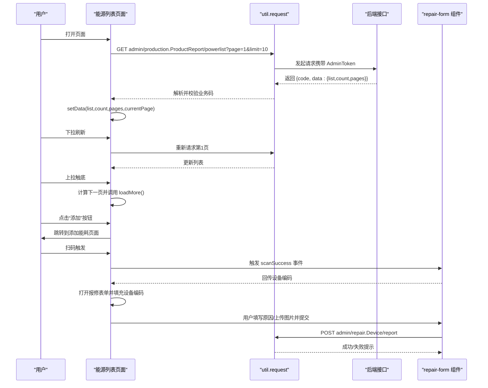
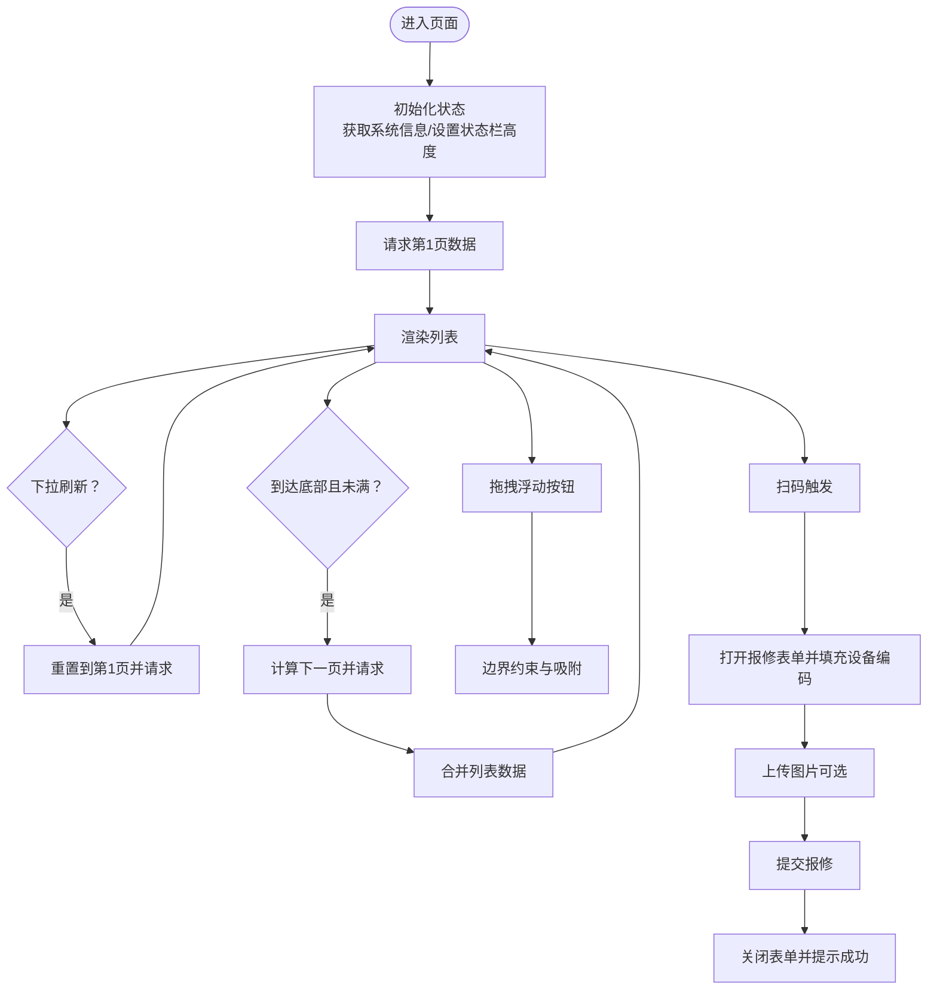
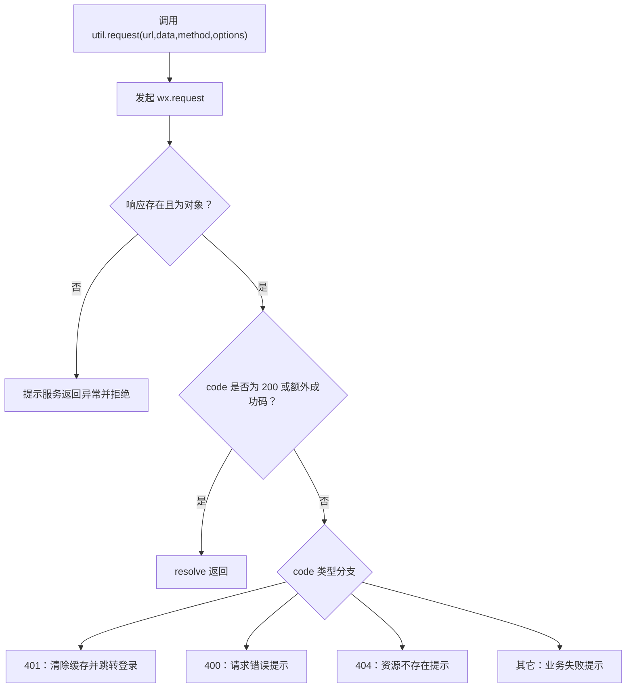
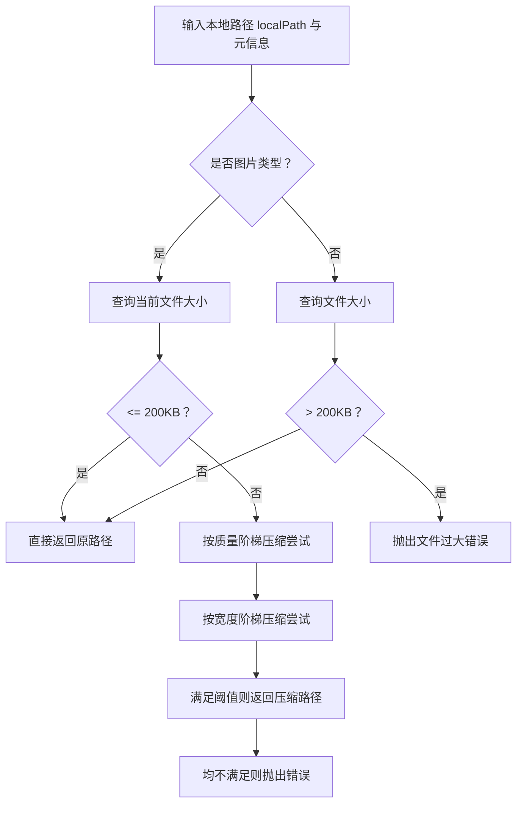
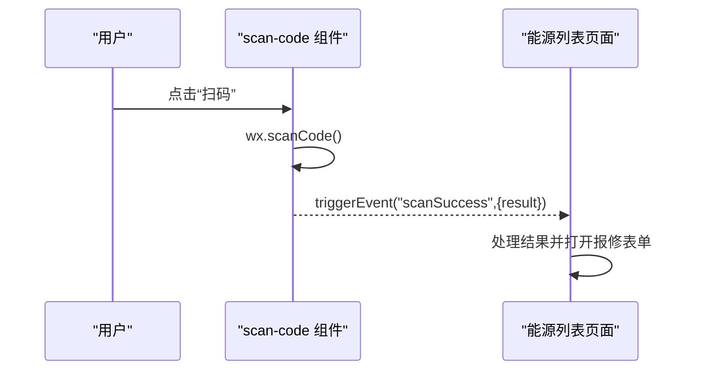
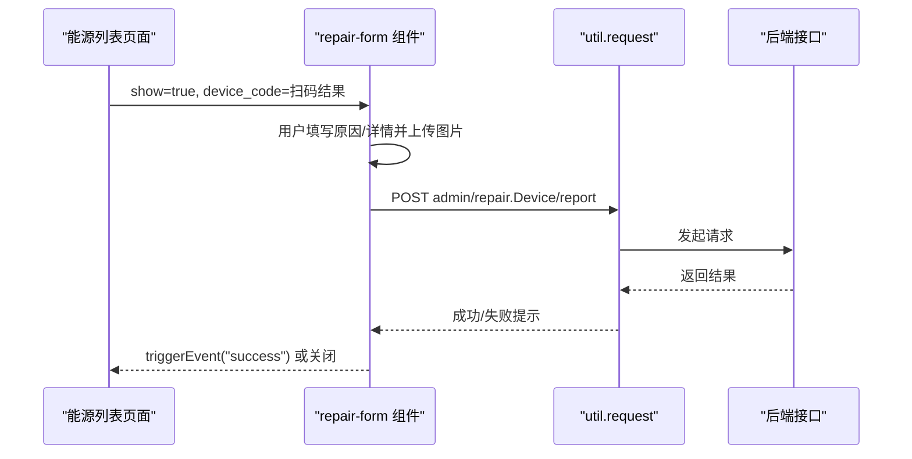
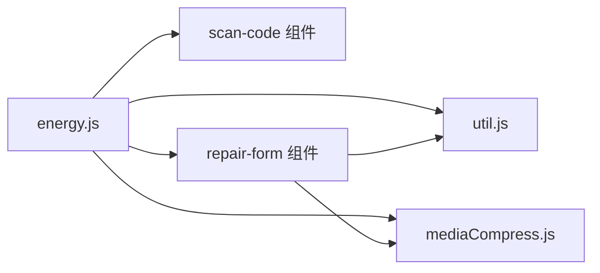

# 能源列表页面

<cite>
**本文引用的文件**
- [energy.js](file://gccd_mini/pages/energy/energy.js)
- [energy.json](file://gccd_mini/pages/energy/energy.json)
- [energy.wxml](file://gccd_mini/pages/energy/energy.wxml)
- [energy.wxss](file://gccd_mini/pages/energy/energy.wxss)
- [util.js](file://gccd_mini/utils/util.js)
- [mediaCompress.js](file://gccd_mini/utils/mediaCompress.js)
- [scan-code.js](file://gccd_mini/pages/components/scan-code/scan-code.js)
- [scan-code.json](file://gccd_mini/pages/components/scan-code/scan-code.json)
- [scan-code.wxml](file://gccd_mini/pages/components/scan-code/scan-code.wxml)
- [scan-code.wxss](file://gccd_mini/pages/components/scan-code/scan-code.wxss)
- [repair-form.js](file://gccd_mini/pages/components/repair-form/repair-form.js)
- [repair-form.json](file://gccd_mini/pages/components/repair-form/repair-form.json)
- [repair-form.wxml](file://gccd_mini/pages/components/repair-form/repair-form.wxml)
- [repair-form.wxss](file://gccd_mini/pages/components/repair-form/repair-form.wxss)
</cite>

## 目录
1. [简介](#简介)
2. [项目结构](#项目结构)
3. [核心组件](#核心组件)
4. [架构总览](#架构总览)
5. [详细组件分析](#详细组件分析)
6. [依赖分析](#依赖分析)
7. [性能考虑](#性能考虑)
8. [故障排查指南](#故障排查指南)
9. [结论](#结论)
10. [附录](#附录)

## 简介
本文件面向“能源列表页面”的开发与维护，系统性阐述页面的整体设计与功能实现，包括能耗数据的展示、分页加载、下拉刷新、扫码报修、图片上传与压缩、浮动拖拽按钮等交互体验。文档同时覆盖数据获取机制（API 接口调用、数据格式化、错误处理）、样式设计与响应式布局、与其他页面的导航关系与数据流转，以及性能优化建议与最佳实践。

## 项目结构
能源列表页面位于小程序前端工程 gccd_mini 中，采用页面级目录组织，配合通用工具与自定义组件协同工作：
- 页面层：pages/energy（包含 JS、JSON、WXML、WXSS）
- 工具层：utils（封装通用请求与媒体压缩）
- 组件层：pages/components（scan-code 扫码组件、repair-form 报修表单组件）
- 主题与 UI：@vant/weapp（按需引入）

图表来源
- [energy.js:1-480](file://gccd_mini/pages/energy/energy.js#L1-L480)
- [energy.json:1-14](file://gccd_mini/pages/energy/energy.json#L1-L14)
- [util.js:1-98](file://gccd_mini/utils/util.js#L1-L98)
- [mediaCompress.js:1-104](file://gccd_mini/utils/mediaCompress.js#L1-L104)
- [scan-code.js:1-63](file://gccd_mini/pages/components/scan-code/scan-code.js#L1-L63)
- [repair-form.js:1-261](file://gccd_mini/pages/components/repair-form/repair-form.js#L1-L261)

章节来源
- [energy.js:1-480](file://gccd_mini/pages/energy/energy.js#L1-L480)
- [energy.json:1-14](file://gccd_mini/pages/energy/energy.json#L1-L14)
- [energy.wxml:1-117](file://gccd_mini/pages/energy/energy.wxml#L1-L117)
- [energy.wxss:1-254](file://gccd_mini/pages/energy/energy.wxss#L1-L254)

## 核心组件
- 能源列表页面（energy）
  - 数据获取与分页：getList/loadMore
  - 下拉刷新：onPullDownRefresh
  - 上拉加载：onReachBottom
  - 扫码报修：handleScan/processScanResult/onScanSuccess/openRepairForm/closeRepairForm
  - 图片上传与压缩：afterRead/deleteImage
  - 浮动拖拽按钮：touchStart/touchMove/touchEnd/initButtonPosition
  - 导航跳转：showAddMaterialForm
- 通用工具
  - 请求封装：util.request（统一鉴权头、业务码判定、错误提示）
  - 媒体压缩：mediaCompress.prepareLocalPathForUpload（图片质量/尺寸阶梯压缩，上限200KB）
- 自定义组件
  - 扫码组件：scan-code（触发扫码、事件向上抛出）
  - 报修表单组件：repair-form（原因选择、图片上传、提交报修）

章节来源
- [energy.js:46-82](file://gccd_mini/pages/energy/energy.js#L46-L82)
- [energy.js:84-95](file://gccd_mini/pages/energy/energy.js#L84-L95)
- [energy.js:365-377](file://gccd_mini/pages/energy/energy.js#L365-L377)
- [energy.js:106-195](file://gccd_mini/pages/energy/energy.js#L106-L195)
- [energy.js:223-300](file://gccd_mini/pages/energy/energy.js#L223-L300)
- [energy.js:379-444](file://gccd_mini/pages/energy/energy.js#L379-L444)
- [util.js:22-94](file://gccd_mini/utils/util.js#L22-L94)
- [mediaCompress.js:48-98](file://gccd_mini/utils/mediaCompress.js#L48-L98)
- [scan-code.js:6-27](file://gccd_mini/pages/components/scan-code/scan-code.js#L6-L27)
- [repair-form.js:44-67](file://gccd_mini/pages/components/repair-form/repair-form.js#L44-L67)

## 架构总览
页面通过 util.request 统一访问后端接口，返回的业务数据在前端进行格式化与分页合并，列表渲染采用 scroll-view 实现上下滚动与上拉加载。扫码与报修流程通过自定义组件解耦，图片上传前经 mediaCompress 压缩，保证传输效率与稳定性。

图表来源
- [energy.js:46-82](file://gccd_mini/pages/energy/energy.js#L46-L82)
- [energy.js:84-95](file://gccd_mini/pages/energy/energy.js#L84-L95)
- [energy.js:365-377](file://gccd_mini/pages/energy/energy.js#L365-L377)
- [energy.js:446-451](file://gccd_mini/pages/energy/energy.js#L446-L451)
- [energy.js:106-195](file://gccd_mini/pages/energy/energy.js#L106-L195)
- [repair-form.js:221-259](file://gccd_mini/pages/components/repair-form/repair-form.js#L221-L259)
- [util.js:22-94](file://gccd_mini/utils/util.js#L22-L94)

## 详细组件分析

### 能源列表页面（energy）
- 数据模型与状态
  - 列表数据：list、count、pages、currentPage
  - 分页控制：pageSize、loadingMore、loading
  - 上传图片：fileList、uploadImgUrls
  - 拖拽按钮：btnPosition、startX/startY、btnStartX/btnStartY
  - 报修弹窗：show、device_code、reason、showRepairForm、repairData
- 关键流程
  - 数据获取：getList(page,isLoadMore) → 合并新旧列表
  - 分页加载：loadMore() → 计算下一页并请求
  - 下拉刷新：onPullDownRefresh() → 重置到第1页并停止刷新
  - 上拉加载：onReachBottom() → 条件判断后触发 loadMore
  - 扫码报修：handleScan() 与 scan-code 组件通信，processScanResult() 填充表单
  - 图片上传：afterRead() 压缩并上传，deleteImage() 删除
  - 拖拽按钮：touchStart/Move/End 控制位置边界约束
  - 导航跳转：showAddMaterialForm() 跳转到添加能耗页面

图表来源
- [energy.js:349-377](file://gccd_mini/pages/energy/energy.js#L349-L377)
- [energy.js:46-95](file://gccd_mini/pages/energy/energy.js#L46-L95)
- [energy.js:379-444](file://gccd_mini/pages/energy/energy.js#L379-L444)
- [energy.js:106-195](file://gccd_mini/pages/energy/energy.js#L106-L195)
- [energy.js:223-300](file://gccd_mini/pages/energy/energy.js#L223-L300)

章节来源
- [energy.js:6-44](file://gccd_mini/pages/energy/energy.js#L6-L44)
- [energy.js:46-95](file://gccd_mini/pages/energy/energy.js#L46-L95)
- [energy.js:349-377](file://gccd_mini/pages/energy/energy.js#L349-L377)
- [energy.js:379-444](file://gccd_mini/pages/energy/energy.js#L379-L444)
- [energy.js:446-451](file://gccd_mini/pages/energy/energy.js#L446-L451)

### 通用工具（util/request）
- 功能要点
  - 统一请求入口，自动注入 AdminToken
  - 业务码判定：200 成功；401 引导登录；400/404 错误提示
  - 失败兜底：网络异常提示
- 性能与可靠性
  - 通过 Promise 化简化调用链
  - 对非对象响应进行保护性处理

图表来源
- [util.js:22-94](file://gccd_mini/utils/util.js#L22-L94)

章节来源
- [util.js:22-94](file://gccd_mini/utils/util.js#L22-L94)

### 媒体压缩工具（mediaCompress.prepareLocalPathForUpload）
- 功能要点
  - 图片：按质量阈值与尺寸阶梯压缩，目标不超过 200KB
  - 音频/文件：直接校验大小，超限则报错
- 性能与可靠性
  - 多轮压缩策略，优先质量再尺寸，最后兜底失败提示
  - 保证上传成功率与网络传输效率

图表来源
- [mediaCompress.js:48-98](file://gccd_mini/utils/mediaCompress.js#L48-L98)

章节来源
- [mediaCompress.js:1-104](file://gccd_mini/utils/mediaCompress.js#L1-L104)

### 扫码组件（scan-code）
- 功能要点
  - 调用微信扫码能力，支持二维码/条形码
  - 成功后通过 scanSuccess 事件向父组件回传结果
- 与页面协作
  - 在能源列表页面通过自定义组件引入，绑定 scanSuccess 事件
  - 页面收到结果后打开报修表单并填充设备编码

图表来源
- [scan-code.js:6-27](file://gccd_mini/pages/components/scan-code/scan-code.js#L6-L27)
- [energy.wxml:6](file://gccd_mini/pages/energy/energy.wxml#L6)
- [energy.js:454-462](file://gccd_mini/pages/energy/energy.js#L454-L462)

章节来源
- [scan-code.js:1-63](file://gccd_mini/pages/components/scan-code/scan-code.js#L1-L63)
- [scan-code.json:1-6](file://gccd_mini/pages/components/scan-code/scan-code.json#L1-L6)
- [scan-code.wxml:1-6](file://gccd_mini/pages/components/scan-code/scan-code.wxml#L1-L6)
- [scan-code.wxss:1-13](file://gccd_mini/pages/components/scan-code/scan-code.wxss#L1-L13)

### 报修表单组件（repair-form）
- 功能要点
  - 设备编码展示（只读）
  - 报修原因选择（多选，使用 van-picker）
  - 详情文本输入（可选）
  - 图片上传（支持多图、删除）
  - 提交报修（携带设备编码、原因ID数组、图片URL数组）
- 与页面协作
  - 能源列表页面通过 repair-form 组件承载报修流程
  - 组件内部同样使用 util.request 与 mediaCompress

图表来源
- [repair-form.js:44-67](file://gccd_mini/pages/components/repair-form/repair-form.js#L44-L67)
- [repair-form.js:221-259](file://gccd_mini/pages/components/repair-form/repair-form.js#L221-L259)
- [energy.js:464-479](file://gccd_mini/pages/energy/energy.js#L464-L479)

章节来源
- [repair-form.js:1-261](file://gccd_mini/pages/components/repair-form/repair-form.js#L1-L261)
- [repair-form.json:1-11](file://gccd_mini/pages/components/repair-form/repair-form.json#L1-L11)
- [repair-form.wxml:1-39](file://gccd_mini/pages/components/repair-form/repair-form.wxml#L1-L39)
- [repair-form.wxss:1-36](file://gccd_mini/pages/components/repair-form/repair-form.wxss#L1-L36)

## 依赖分析
- 页面对工具与组件的依赖
  - energy.js 依赖 util.request 与 mediaCompress
  - energy.js 依赖 scan-code 与 repair-form 组件
  - 组件内部同样依赖 util.request 与 mediaCompress
- 外部依赖
  - @vant/weapp 组件库（toast、popup、uploader、field、button、dialog 等）

图表来源
- [energy.js:1-5](file://gccd_mini/pages/energy/energy.js#L1-L5)
- [util.js:1](file://gccd_mini/utils/util.js#L1)
- [mediaCompress.js:1](file://gccd_mini/utils/mediaCompress.js#L1)
- [scan-code.js:1](file://gccd_mini/pages/components/scan-code/scan-code.js#L1)
- [repair-form.js:1-3](file://gccd_mini/pages/components/repair-form/repair-form.js#L1-L3)

章节来源
- [energy.json:3-13](file://gccd_mini/pages/energy/energy.json#L3-L13)
- [repair-form.json:3-10](file://gccd_mini/pages/components/repair-form/repair-form.json#L3-L10)

## 性能考虑
- 列表渲染与滚动
  - 使用 scroll-view + enhanced 与 show-scrollbar 提升滚动体验
  - 列表项采用卡片样式，减少复杂嵌套，降低重绘成本
- 分页与懒加载
  - 仅在 currentPage < pages 且非 loadingMore 时触发 loadMore，避免重复请求
  - 合并新旧列表时注意去重与顺序一致性
- 图片上传与压缩
  - 上传前统一压缩至 200KB 内，显著降低带宽与服务器压力
  - Promise.all 并行上传多个文件，提升整体效率
- 交互反馈
  - Toast.loading/Toast.clear 与 loading 字段配合，避免重复提交
  - 下拉刷新与上拉加载均有明确的状态标识，防止并发冲突

## 故障排查指南
- 接口请求失败
  - 检查 AdminToken 是否有效，401 时应引导重新登录
  - 网络异常时提示“网络异常，请检查网络”，确认设备网络状态
- 业务码异常
  - 400/404 等业务错误需根据 msg 提示用户
  - 非对象响应时会提示“服务返回异常”
- 扫码失败
  - 用户取消时不提示错误；其他失败场景提示“扫码失败”
  - 图片识别失败时尝试 wx.scanQRCode 或提示“图片中未识别到二维码”
- 图片上传失败
  - 压缩失败或上传接口失败时，提示具体错误信息
  - 文件过大（音频/文件）或图片无法压缩至阈值内时，给出明确提示
- 拖拽按钮越界
  - 边界检查确保按钮不超出屏幕范围，避免视觉错位

章节来源
- [util.js:49-83](file://gccd_mini/utils/util.js#L49-L83)
- [energy.js:106-195](file://gccd_mini/pages/energy/energy.js#L106-L195)
- [energy.js:223-300](file://gccd_mini/pages/energy/energy.js#L223-L300)
- [mediaCompress.js:89-96](file://gccd_mini/utils/mediaCompress.js#L89-L96)
- [energy.js:407-430](file://gccd_mini/pages/energy/energy.js#L407-L430)

## 结论
能源列表页面通过清晰的模块划分与组件化设计，实现了能耗数据的高效展示与交互优化。借助统一封装的请求与媒体压缩工具，页面在性能与稳定性方面具备良好基础。后续可在以下方向持续优化：进一步细化分页策略、增强空态与加载态的可访问性、完善扫码与报修流程的容错与提示，以及探索更多响应式布局细节。

## 附录
- 数据字段说明（来自列表渲染）
  - 设备名称：item.device_name
  - 班次：item.class（0 白班，1 夜班）
  - 电力消耗：item.power_consume（单位：kWh），电表读数：item.power_num
  - 气体消耗：item.gas_consume（单位：m³），气表读数：item.gas_num
  - 备注：item.remark
  - 记录人与时间：item.create_name、item.create_time
- 导航关系
  - 能源列表 → 添加能耗：navigateTo 跳转到 pageEnergy/pages/addEnergy/addEnergy
  - 能源列表 → 报修表单：通过 repair-form 组件承载，提交成功后可刷新相关数据

章节来源
- [energy.wxml:51-88](file://gccd_mini/pages/energy/energy.wxml#L51-L88)
- [energy.js:446-451](file://gccd_mini/pages/energy/energy.js#L446-L451)