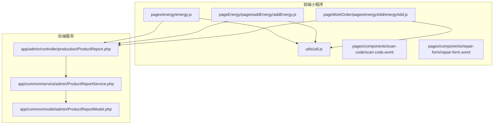
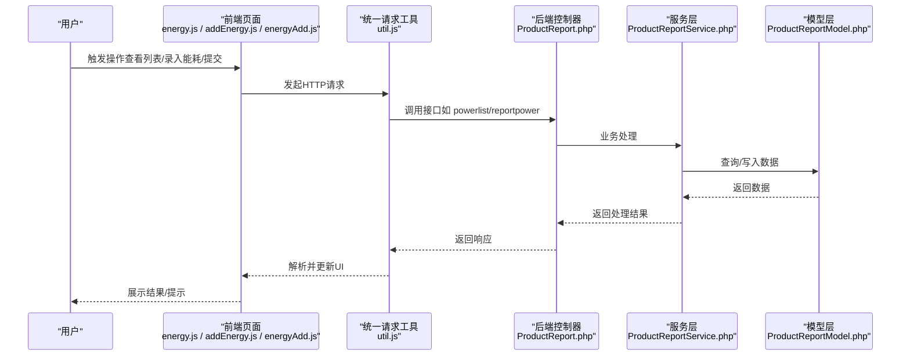
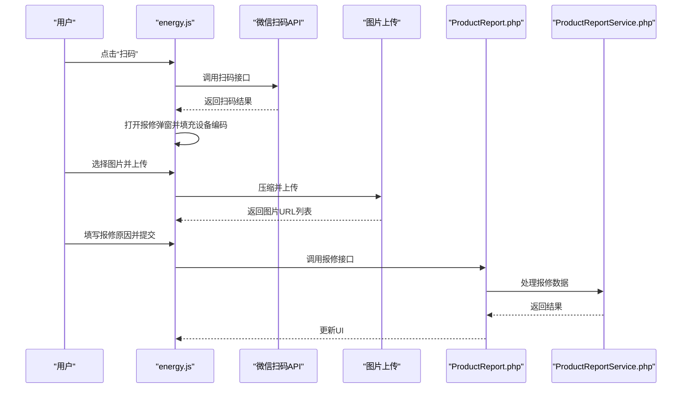
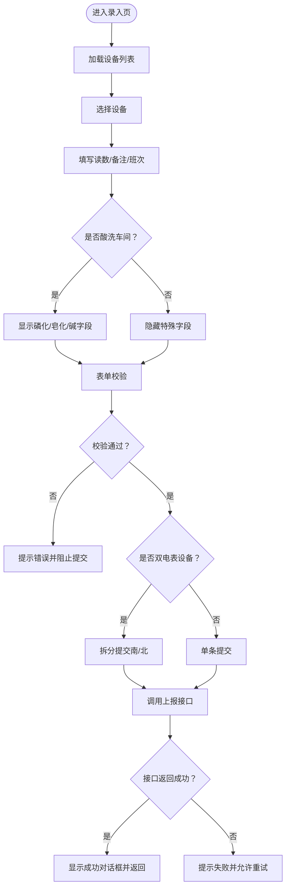
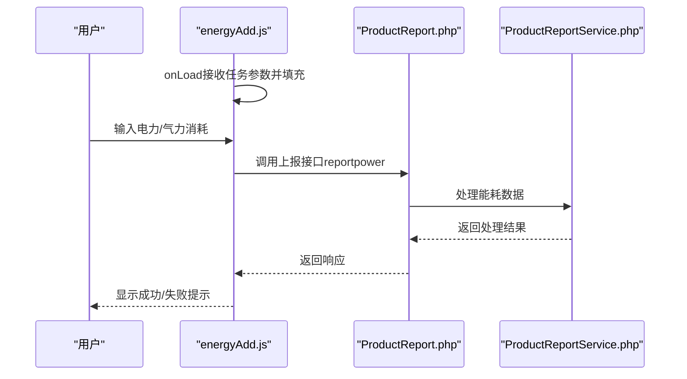
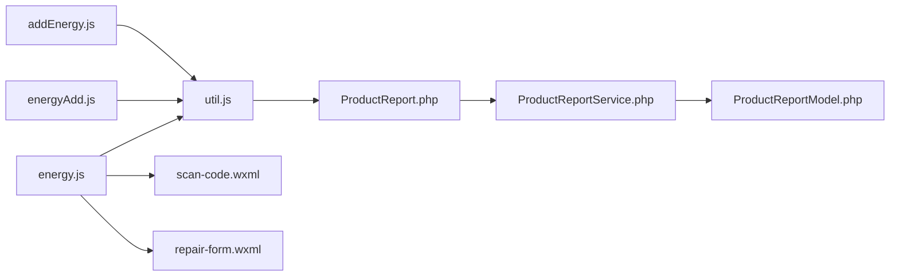

# 能源管理页面

<cite>
**本文引用的文件**
- [energy.js](file://gccd_mini/pages/energy/energy.js)
- [energy.json](file://gccd_mini/pages/energy/energy.json)
- [addEnergy.js](file://gccd_mini/pageEnergy/pages/addEnergy/addEnergy.js)
- [energyAdd.js](file://gccd_mini/pageWorkOrder/pages/energyAdd/energyAdd.js)
- [util.js](file://gccd_mini/utils/util.js)
- [ProductReport.php](file://gccd_server/app/admin/controller/production/ProductReport.php)
- [ProductReportService.php](file://gccd_server/app/common/service/admin/ProductReportService.php)
- [ProductReportModel.php](file://gccd_server/app/common/model/admin/ProductReportModel.php)
- [scan-code.wxml](file://gccd_mini/pages/components/scan-code/scan-code.wxml)
- [repair-form.wxml](file://gccd_mini/pages/components/repair-form/repair-form.wxml)
</cite>

## 目录
1. [简介](#简介)
2. [项目结构](#项目结构)
3. [核心组件](#核心组件)
4. [架构概览](#架构概览)
5. [详细组件分析](#详细组件分析)
6. [依赖关系分析](#依赖关系分析)
7. [性能考虑](#性能考虑)
8. [故障排查指南](#故障排查指南)
9. [结论](#结论)
10. [附录](#附录)

## 简介
本开发文档围绕能源管理页面展开，系统性梳理前端页面与后端接口的协作关系，涵盖能耗统计、用电监控、数据分析、能源录入、报表生成与导出、图表展示以及与计量系统的数据对接与实时监控机制。文档面向不同技术背景的读者，既提供高层架构说明，也给出代码级的可视化图示与最佳实践建议。

## 项目结构
能源管理相关模块主要分布在以下位置：
- 前端小程序页面：pages/energy（能耗列表）、pageEnergy/pages/addEnergy（能耗录入）、pageWorkOrder/pages/energyAdd（工单能耗录入）
- 前端通用工具：utils/util.js（统一请求封装）
- 前端组件：pages/components/scan-code、pages/components/repair-form
- 后端控制器：app/admin/controller/production/ProductReport.php（接口定义）
- 后端服务层：app/common/service/admin/ProductReportService.php（业务逻辑）
- 后端模型层：app/common/model/admin/ProductReportModel.php（数据映射）

**图表来源**
- [energy.js:1-480](file://gccd_mini/pages/energy/energy.js#L1-L480)
- [addEnergy.js:1-397](file://gccd_mini/pageEnergy/pages/addEnergy/addEnergy.js#L1-L397)
- [energyAdd.js:1-187](file://gccd_mini/pageWorkOrder/pages/energyAdd/energyAdd.js#L1-L187)
- [util.js:1-98](file://gccd_mini/utils/util.js#L1-L98)
- [ProductReport.php:1-416](file://gccd_server/app/admin/controller/production/ProductReport.php#L1-L416)
- [ProductReportService.php:1-200](file://gccd_server/app/common/service/admin/ProductReportService.php#L1-L200)
- [ProductReportModel.php:1-76](file://gccd_server/app/common/model/admin/ProductReportModel.php#L1-L76)

**章节来源**
- [energy.js:1-480](file://gccd_mini/pages/energy/energy.js#L1-L480)
- [energy.json:1-14](file://gccd_mini/pages/energy/energy.json#L1-L14)
- [addEnergy.js:1-397](file://gccd_mini/pageEnergy/pages/addEnergy/addEnergy.js#L1-L397)
- [energyAdd.js:1-187](file://gccd_mini/pageWorkOrder/pages/energyAdd/energyAdd.js#L1-L187)
- [util.js:1-98](file://gccd_mini/utils/util.js#L1-L98)
- [ProductReport.php:1-416](file://gccd_server/app/admin/controller/production/ProductReport.php#L1-L416)
- [ProductReportService.php:1-200](file://gccd_server/app/common/service/admin/ProductReportService.php#L1-L200)
- [ProductReportModel.php:1-76](file://gccd_server/app/common/model/admin/ProductReportModel.php#L1-L76)

## 核心组件
- 能源列表页（pages/energy/energy.js）
  - 负责能耗记录分页列表展示、扫码报修、图片上传与报修提交、下拉刷新与上拉加载。
  - 使用统一请求封装进行接口调用，支持设备二维码扫码识别与图片上传。
- 能源录入页（pageEnergy/pages/addEnergy/addEnergy.js）
  - 支持设备选择、班次选择、电表/气表读数录入、酸洗车间特殊字段（磷化/皂化/碱）录入。
  - 对双电表设备（南北方向）进行拆分提交，普通设备单条提交；提交前进行表单校验。
- 工单能耗录入页（pageWorkOrder/pages/energyAdd/energyAdd.js）
  - 面向工单场景的能耗录入，接收任务信息并提交电力/气力消耗。
- 统一请求工具（utils/util.js）
  - 封装 wx.request，统一处理状态码、鉴权、错误提示与网络异常。
- 后端控制器（app/admin/controller/production/ProductReport.php）
  - 定义能耗相关接口：能耗列表、能耗统计、能耗上报、设备气表数获取、能耗吨数统计等。
- 后端服务层（app/common/service/admin/ProductReportService.php）
  - 实现能耗统计、能耗上报、设备能耗自动获取（对接外部计量系统）、能耗吨数统计等业务逻辑。
- 数据模型（app/common/model/admin/ProductReportModel.php）
  - 映射产品报工记录与关联设备、工序、工单、物料等信息。

**章节来源**
- [energy.js:46-82](file://gccd_mini/pages/energy/energy.js#L46-L82)
- [addEnergy.js:64-101](file://gccd_mini/pageEnergy/pages/addEnergy/addEnergy.js#L64-L101)
- [energyAdd.js:132-162](file://gccd_mini/pageWorkOrder/pages/energyAdd/energyAdd.js#L132-L162)
- [util.js:22-94](file://gccd_mini/utils/util.js#L22-L94)
- [ProductReport.php:184-251](file://gccd_server/app/admin/controller/production/ProductReport.php#L184-L251)
- [ProductReportService.php:189-200](file://gccd_server/app/common/service/admin/ProductReportService.php#L189-L200)

## 架构概览
前端通过统一请求工具调用后端控制器接口，控制器将请求委派给服务层，服务层执行业务逻辑并访问数据模型完成数据持久化或查询。能耗统计与报表生成由服务层聚合数据并通过控制器返回前端展示。

**图表来源**
- [energy.js:52-81](file://gccd_mini/pages/energy/energy.js#L52-L81)
- [addEnergy.js:364-391](file://gccd_mini/pageEnergy/pages/addEnergy/addEnergy.js#L364-L391)
- [energyAdd.js:104-129](file://gccd_mini/pageWorkOrder/pages/energyAdd/energyAdd.js#L104-L129)
- [util.js:22-94](file://gccd_mini/utils/util.js#L22-L94)
- [ProductReport.php:340-345](file://gccd_server/app/admin/controller/production/ProductReport.php#L340-L345)
- [ProductReportService.php:189-200](file://gccd_server/app/common/service/admin/ProductReportService.php#L189-L200)
- [ProductReportModel.php:1-76](file://gccd_server/app/common/model/admin/ProductReportModel.php#L1-L76)

## 详细组件分析

### 能源列表页（能耗统计与监控）
- 功能要点
  - 分页加载能耗记录，支持下拉刷新与上拉加载更多。
  - 扫码报修：支持二维码/条形码识别，打开报修表单并上传图片。
  - 图片上传：压缩本地图片后上传至指定地址，返回URL并保存到表单。
  - 报修提交：校验必填项后调用后端接口提交。
- 关键流程（扫码与报修）

**图表来源**
- [energy.js:106-126](file://gccd_mini/pages/energy/energy.js#L106-L126)
- [energy.js:188-195](file://gccd_mini/pages/energy/energy.js#L188-L195)
- [energy.js:223-285](file://gccd_mini/pages/energy/energy.js#L223-L285)
- [energy.js:305-346](file://gccd_mini/pages/energy/energy.js#L305-L346)
- [ProductReport.php:304-314](file://gccd_server/app/admin/controller/production/ProductReport.php#L304-L314)

**章节来源**
- [energy.js:46-82](file://gccd_mini/pages/energy/energy.js#L46-L82)
- [energy.js:106-195](file://gccd_mini/pages/energy/energy.js#L106-L195)
- [energy.js:223-346](file://gccd_mini/pages/energy/energy.js#L223-L346)
- [energy.json:1-14](file://gccd_mini/pages/energy/energy.json#L1-L14)
- [scan-code.wxml:1-6](file://gccd_mini/pages/components/scan-code/scan-code.wxml#L1-L6)
- [repair-form.wxml:1-39](file://gccd_mini/pages/components/repair-form/repair-form.wxml#L1-L39)

### 能源录入页面（电表读数录入与异常处理）
- 功能要点
  - 设备列表加载与选择，班次选择（白班/夜班），电表/气表读数录入。
  - 酸洗车间特殊字段（磷化/皂化/碱）按需显示与校验。
  - 双电表设备（穿孔40机/50机）拆分为南北两个方向分别提交。
  - 提交前表单校验：设备、电表数（含双电表）、班次等。
- 关键流程（能耗录入与提交）

**图表来源**
- [addEnergy.js:64-101](file://gccd_mini/pageEnergy/pages/addEnergy/addEnergy.js#L64-L101)
- [addEnergy.js:114-143](file://gccd_mini/pageEnergy/pages/addEnergy/addEnergy.js#L114-L143)
- [addEnergy.js:217-239](file://gccd_mini/pageEnergy/pages/addEnergy/addEnergy.js#L217-L239)
- [addEnergy.js:241-278](file://gccd_mini/pageEnergy/pages/addEnergy/addEnergy.js#L241-L278)
- [addEnergy.js:318-360](file://gccd_mini/pageEnergy/pages/addEnergy/addEnergy.js#L318-L360)
- [addEnergy.js:364-391](file://gccd_mini/pageEnergy/pages/addEnergy/addEnergy.js#L364-L391)

**章节来源**
- [addEnergy.js:1-397](file://gccd_mini/pageEnergy/pages/addEnergy/addEnergy.js#L1-L397)

### 工单能耗录入页面（与计量系统的对接）
- 功能要点
  - 从上一个页面传递任务信息，自动填充关联单号、工艺编码/名称、工序编码/名称。
  - 用户输入电力/气力消耗，提交到能耗上报接口。
- 关键流程（工单能耗录入）

**图表来源**
- [energyAdd.js:165-187](file://gccd_mini/pageWorkOrder/pages/energyAdd/energyAdd.js#L165-L187)
- [energyAdd.js:77-130](file://gccd_mini/pageWorkOrder/pages/energyAdd/energyAdd.js#L77-L130)
- [ProductReport.php:340-345](file://gccd_server/app/admin/controller/production/ProductReport.php#L340-L345)

**章节来源**
- [energyAdd.js:1-187](file://gccd_mini/pageWorkOrder/pages/energyAdd/energyAdd.js#L1-L187)

### 能源统计与报表（趋势/对比/导出）
- 能耗统计接口
  - 控制器提供能耗统计与能耗吨数统计接口，服务层实现按日期范围聚合。
- 数据展示建议
  - 日/月/年统计：基于接口返回的日期范围聚合结果，前端以折线图/柱状图展示趋势。
  - 对比分析：按设备/工序/班次维度对比能耗。
  - 报表导出：前端可将表格数据转换为CSV/Excel格式，结合后端接口生成完整报表。
- 关键接口
  - 能耗统计：powerStat
  - 能耗吨数统计：getPowerConsumptionStats

**章节来源**
- [ProductReport.php:319-323](file://gccd_server/app/admin/controller/production/ProductReport.php#L319-L323)
- [ProductReport.php:399-412](file://gccd_server/app/admin/controller/production/ProductReport.php#L399-L412)
- [ProductReportService.php:1204-1212](file://gccd_server/app/common/service/admin/ProductReportService.php#L1204-L1212)

### 与计量系统的数据对接与实时监控
- 自动获取能耗
  - 服务层通过外部计量系统API获取设备能耗，计算历史累计与当日其他记录之和，形成今日总能耗。
- 实时监控机制
  - 建议定时任务轮询计量系统API，将最新能耗写入数据库；前端通过列表接口实时展示。
- 异常处理
  - 外部API不可用时抛出异常并提示使用手动报工方式。

**章节来源**
- [ProductReportService.php:1113-1194](file://gccd_server/app/common/service/admin/ProductReportService.php#L1113-L1194)

## 依赖关系分析
- 前端依赖
  - 页面依赖统一请求工具进行网络通信。
  - 能源列表页依赖扫码组件与报修表单组件。
- 后端依赖
  - 控制器依赖服务层；服务层依赖模型层与外部API；模型层负责与数据库交互。

**图表来源**
- [energy.js:1-5](file://gccd_mini/pages/energy/energy.js#L1-L5)
- [addEnergy.js:1-2](file://gccd_mini/pageEnergy/pages/addEnergy/addEnergy.js#L1-L2)
- [energyAdd.js:1-2](file://gccd_mini/pageWorkOrder/pages/energyAdd/energyAdd.js#L1-L2)
- [util.js:1-2](file://gccd_mini/utils/util.js#L1-L2)
- [ProductReport.php:1-29](file://gccd_server/app/admin/controller/production/ProductReport.php#L1-L29)
- [ProductReportService.php:1-41](file://gccd_server/app/common/service/admin/ProductReportService.php#L1-L41)
- [ProductReportModel.php:1-12](file://gccd_server/app/common/model/admin/ProductReportModel.php#L1-L12)

**章节来源**
- [energy.js:1-5](file://gccd_mini/pages/energy/energy.js#L1-L5)
- [addEnergy.js:1-2](file://gccd_mini/pageEnergy/pages/addEnergy/addEnergy.js#L1-L2)
- [energyAdd.js:1-2](file://gccd_mini/pageWorkOrder/pages/energyAdd/energyAdd.js#L1-L2)
- [util.js:1-2](file://gccd_mini/utils/util.js#L1-L2)
- [ProductReport.php:1-29](file://gccd_server/app/admin/controller/production/ProductReport.php#L1-L29)
- [ProductReportService.php:1-41](file://gccd_server/app/common/service/admin/ProductReportService.php#L1-L41)
- [ProductReportModel.php:1-12](file://gccd_server/app/common/model/admin/ProductReportModel.php#L1-L12)

## 性能考虑
- 前端
  - 列表分页加载，避免一次性渲染大量数据；上拉加载时控制并发，防止重复请求。
  - 图片上传前进行压缩，减少带宽占用与上传时间。
  - 表单校验尽量在客户端完成，减少无效请求。
- 后端
  - 能耗统计接口按日期范围聚合，避免全表扫描；必要时建立索引。
  - 外部API调用增加超时与重试策略，提升稳定性。
- 缓存
  - 对常用配置（如设备列表、班次选项）进行缓存，降低数据库压力。

## 故障排查指南
- 常见问题
  - 登录失效：统一请求工具检测到401时清除本地令牌并跳转登录页。
  - 网络异常：统一请求工具提示网络异常并拒绝Promise，前端应捕获并提示。
  - 扫码失败：区分用户取消与失败场景，避免误提示。
  - 图片上传失败：检查上传URL与AdminToken，确保返回JSON可解析。
- 排查步骤
  - 检查AdminToken是否正确携带。
  - 查看接口返回状态码与消息，定位业务错误。
  - 对外部计量系统API调用失败时，提示使用手动报工方式。

**章节来源**
- [util.js:57-83](file://gccd_mini/utils/util.js#L57-L83)
- [energy.js:106-126](file://gccd_mini/pages/energy/energy.js#L106-L126)
- [energy.js:223-285](file://gccd_mini/pages/energy/energy.js#L223-L285)

## 结论
能源管理页面通过清晰的前后端职责划分与统一的请求封装，实现了能耗统计、用电监控、数据分析与报表展示的闭环。前端提供便捷的录入与监控入口，后端提供稳定的统计与对接能力。建议在现有基础上进一步完善图表展示与报表导出功能，并加强外部API的容错与缓存策略，以提升整体用户体验与系统稳定性。

## 附录
- 开发最佳实践
  - 表单校验前置，减少无效请求。
  - 图片上传采用异步与进度反馈，提升用户感知。
  - 列表分页与懒加载结合，优化首屏性能。
  - 对外部接口增加降级策略与手动报工兜底。
- 数据分析优化建议
  - 按日/月/年维度聚合能耗，结合趋势图与对比图呈现。
  - 支持按设备/工序/班次筛选，增强可钻取性。
  - 报表导出支持CSV/Excel，便于离线分析与分享。