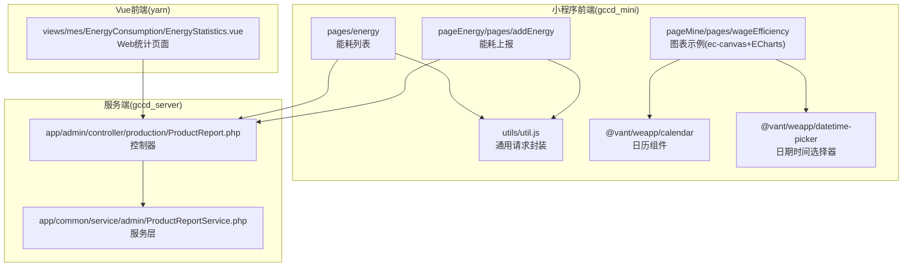
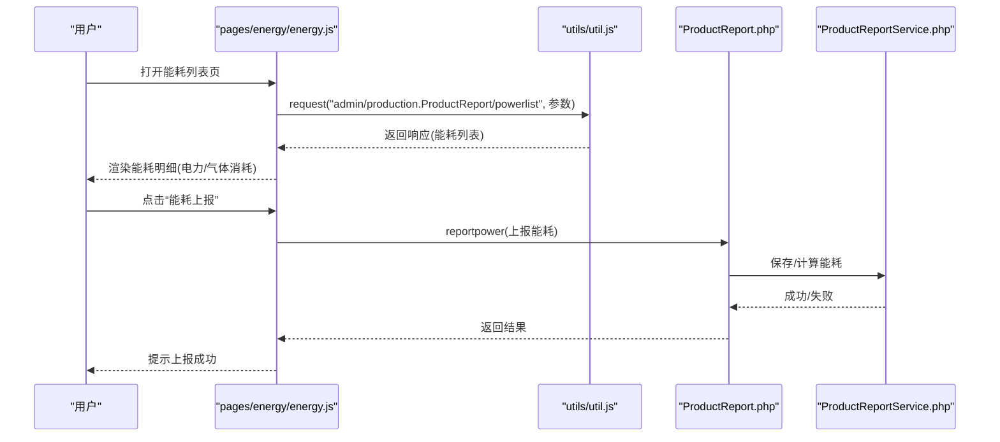
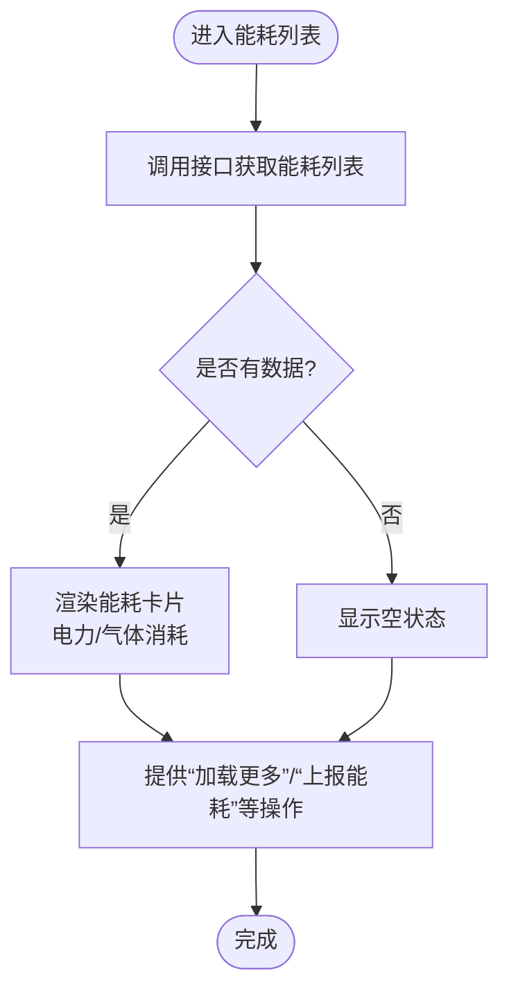
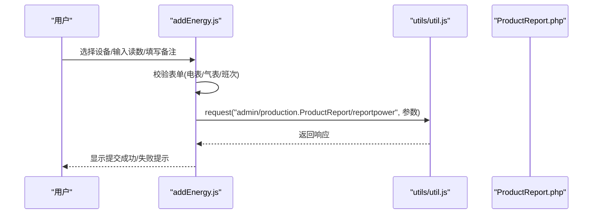
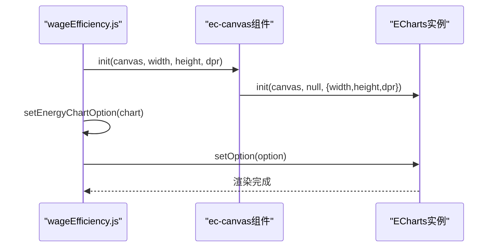
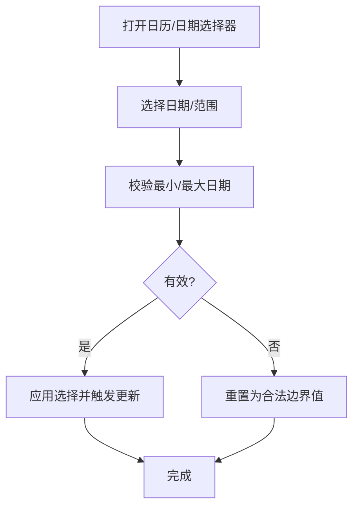
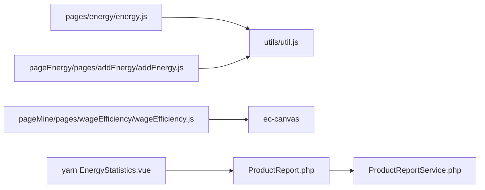

# 能源统计页面

<cite>
**本文引用的文件**
- [energy.js](file://gccd_mini/pages/energy/energy.js)
- [energy.json](file://gccd_mini/pages/energy/energy.json)
- [energy.wxml](file://gccd_mini/pages/energy/energy.wxml)
- [energy.wxss](file://gccd_mini/pages/energy/energy.wxss)
- [addEnergy.js](file://gccd_mini/pageEnergy/pages/addEnergy/addEnergy.js)
- [addEnergy.json](file://gccd_mini/pageEnergy/pages/addEnergy/addEnergy.json)
- [addEnergy.wxml](file://gccd_mini/pageEnergy/pages/addEnergy/addEnergy.wxml)
- [addEnergy.wxss](file://gccd_mini/pageEnergy/pages/addEnergy/addEnergy.wxss)
- [util.js](file://gccd_mini/utils/util.js)
- [wageEfficiency.js](file://gccd_mini/pageMine/pages/wageEfficiency/wageEfficiency.js)
- [wageEfficiency.wxml](file://gccd_mini/pageMine/pages/wageEfficiency/wageEfficiency.wxml)
- [ProductReport.php](file://gccd_server/app/admin/controller/production/ProductReport.php)
- [ProductReportService.php](file://gccd_server/app/common/service/admin/ProductReportService.php)
- [calendar/index.js](file://gccd_mini/miniprogram_npm/@vant/weapp/calendar/index.js)
- [datetime-picker/index.js](file://gccd_mini/miniprogram_npm/@vant/weapp/datetime-picker/index.js)
- [calendar/index.wxs](file://gccd_mini/miniprogram_npm/@vant/weapp/calendar/index.wxs)
- [EnergyStatistics.vue](file://yarn/src/views/mes/EnergyConsumption/EnergyStatistics.vue)
</cite>

## 目录
1. [简介](#简介)
2. [项目结构](#项目结构)
3. [核心组件](#核心组件)
4. [架构总览](#架构总览)
5. [详细组件分析](#详细组件分析)
6. [依赖关系分析](#依赖关系分析)
7. [性能考量](#性能考量)
8. [故障排查指南](#故障排查指南)
9. [结论](#结论)
10. [附录](#附录)

## 简介
本开发文档围绕“能源统计页面”的整体设计与功能实现展开，重点覆盖以下方面：
- 日/月/年统计：基于后端接口按日期范围聚合能耗数据，前端以图表与表格形式呈现。
- 趋势分析：通过折线图/柱状图展示能耗随时间的变化趋势。
- 对比分析：支持按设备、班次、车间等维度进行对比。
- 数据统计：能耗总量、平均值、峰值、谷值等指标的计算与展示。
- 图表展示：集成 ECharts（小程序 via ec-canvas），实现高性能可视化。
- 时间筛选：基于 Vant Weapp 的日历/日期时间选择器，支持日期范围与动态更新。
- 数据导出与格式化：提供图表导出能力与数据格式化展示。
- 性能优化：分页加载、缓存策略、图表渲染优化等。

## 项目结构
该仓库包含三部分与能源统计密切相关的子系统：
- 小程序前端（gccd_mini）：负责能耗数据展示、图表渲染、表单上报与交互。
- 服务端（gccd_server）：提供能耗统计接口与数据聚合服务。
- Vue 前端（yarn）：提供 Web 端的统计页面与报表能力。

**图表来源**
- [energy.js:1-480](file://gccd_mini/pages/energy/energy.js#L1-L480)
- [addEnergy.js:1-397](file://gccd_mini/pageEnergy/pages/addEnergy/addEnergy.js#L1-L397)
- [util.js:1-98](file://gccd_mini/utils/util.js#L1-L98)
- [ProductReport.php:397-415](file://gccd_server/app/admin/controller/production/ProductReport.php#L397-L415)
- [ProductReportService.php:1176-1212](file://gccd_server/app/common/service/admin/ProductReportService.php#L1176-L1212)
- [wageEfficiency.js:1-275](file://gccd_mini/pageMine/pages/wageEfficiency/wageEfficiency.js#L1-L275)
- [calendar/index.js:181-211](file://gccd_mini/miniprogram_npm/@vant/weapp/calendar/index.js#L181-L211)
- [datetime-picker/index.js:177-247](file://gccd_mini/miniprogram_npm/@vant/weapp/datetime-picker/index.js#L177-L247)
- [EnergyStatistics.vue:1-146](file://yarn/src/views/mes/EnergyConsumption/EnergyStatistics.vue#L1-L146)

**章节来源**
- [energy.js:1-480](file://gccd_mini/pages/energy/energy.js#L1-L480)
- [addEnergy.js:1-397](file://gccd_mini/pageEnergy/pages/addEnergy/addEnergy.js#L1-L397)
- [util.js:1-98](file://gccd_mini/utils/util.js#L1-L98)
- [ProductReport.php:397-415](file://gccd_server/app/admin/controller/production/ProductReport.php#L397-L415)
- [ProductReportService.php:1176-1212](file://gccd_server/app/common/service/admin/ProductReportService.php#L1176-L1212)
- [wageEfficiency.js:1-275](file://gccd_mini/pageMine/pages/wageEfficiency/wageEfficiency.js#L1-L275)
- [calendar/index.js:181-211](file://gccd_mini/miniprogram_npm/@vant/weapp/calendar/index.js#L181-L211)
- [datetime-picker/index.js:177-247](file://gccd_mini/miniprogram_npm/@vant/weapp/datetime-picker/index.js#L177-L247)
- [EnergyStatistics.vue:1-146](file://yarn/src/views/mes/EnergyConsumption/EnergyStatistics.vue#L1-L146)

## 核心组件
- 能耗列表页（pages/energy）：展示每日能耗明细（电力/气体消耗），支持分页加载与空状态。
- 能耗上报页（pageEnergy/pages/addEnergy）：设备选择、表单输入、提交上报。
- 图表示例（pageMine/pages/wageEfficiency）：演示 ec-canvas + ECharts 的集成方式与配置。
- 请求工具（utils/util.js）：统一封装网络请求与鉴权头。
- 控制器与服务（ProductReport.php / ProductReportService.php）：提供能耗统计接口与数据聚合。
- Web 统计页（yarn EnergyStatistics.vue）：提供日/月统计与表格展示。

**章节来源**
- [energy.js:47-82](file://gccd_mini/pages/energy/energy.js#L47-L82)
- [addEnergy.js:65-101](file://gccd_mini/pageEnergy/pages/addEnergy/addEnergy.js#L65-L101)
- [wageEfficiency.js:243-262](file://gccd_mini/pageMine/pages/wageEfficiency/wageEfficiency.js#L243-L262)
- [util.js:22-94](file://gccd_mini/utils/util.js#L22-L94)
- [ProductReport.php:397-415](file://gccd_server/app/admin/controller/production/ProductReport.php#L397-L415)
- [EnergyStatistics.vue:100-146](file://yarn/src/views/mes/EnergyConsumption/EnergyStatistics.vue#L100-L146)

## 架构总览
整体采用“小程序/服务端/Web”三层架构：
- 小程序前端负责数据展示与交互，调用服务端接口获取能耗统计与明细。
- 服务端提供控制器与服务层，完成数据聚合、计算与对外输出。
- Web 前端提供更丰富的统计与报表能力，便于管理人员进行深度分析。

**图表来源**
- [energy.js:47-82](file://gccd_mini/pages/energy/energy.js#L47-L82)
- [util.js:22-94](file://gccd_mini/utils/util.js#L22-L94)
- [ProductReport.php:397-415](file://gccd_server/app/admin/controller/production/ProductReport.php#L397-L415)
- [ProductReportService.php:1176-1194](file://gccd_server/app/common/service/admin/ProductReportService.php#L1176-L1194)

## 详细组件分析

### 能耗列表页（pages/energy）
- 功能要点
  - 分页加载能耗明细，支持“加载更多”与下拉刷新。
  - 展示每条记录的电力消耗与气体消耗，以及电表/气表读数。
  - 提供浮动按钮跳转至能耗上报页。
- 数据来源
  - 通过工具函数调用后端接口获取能耗列表。
- 交互细节
  - 空状态与加载状态的 UI 展示。
  - 拖动浮动按钮的边界约束与动画反馈。

**图表来源**
- [energy.js:47-82](file://gccd_mini/pages/energy/energy.js#L47-L82)
- [energy.wxml:51-88](file://gccd_mini/pages/energy/energy.wxml#L51-L88)
- [energy.wxss:46-122](file://gccd_mini/pages/energy/energy.wxss#L46-L122)

**章节来源**
- [energy.js:47-82](file://gccd_mini/pages/energy/energy.js#L47-L82)
- [energy.wxml:51-88](file://gccd_mini/pages/energy/energy.wxml#L51-L88)
- [energy.wxss:46-122](file://gccd_mini/pages/energy/energy.wxss#L46-L122)

### 能耗上报页（pageEnergy/pages/addEnergy）
- 功能要点
  - 设备选择（含酸洗车间特殊字段：磷化/皂化/碱）。
  - 电表/气表读数录入（支持双电表设备拆分为南北方向）。
  - 班次选择与备注。
  - 表单校验与提交。
- 数据流程
  - 选择设备后自动获取气表数（部分设备只读）。
  - 提交时根据设备类型构造参数并调用上报接口。

**图表来源**
- [addEnergy.js:217-278](file://gccd_mini/pageEnergy/pages/addEnergy/addEnergy.js#L217-L278)
- [addEnergy.js:300-395](file://gccd_mini/pageEnergy/pages/addEnergy/addEnergy.js#L300-L395)
- [util.js:22-94](file://gccd_mini/utils/util.js#L22-L94)
- [ProductReport.php:397-415](file://gccd_server/app/admin/controller/production/ProductReport.php#L397-L415)

**章节来源**
- [addEnergy.js:65-101](file://gccd_mini/pageEnergy/pages/addEnergy/addEnergy.js#L65-L101)
- [addEnergy.js:217-278](file://gccd_mini/pageEnergy/pages/addEnergy/addEnergy.js#L217-L278)
- [addEnergy.js:300-395](file://gccd_mini/pageEnergy/pages/addEnergy/addEnergy.js#L300-L395)
- [addEnergy.wxml:10-33](file://gccd_mini/pageEnergy/pages/addEnergy/addEnergy.wxml#L10-L33)

### 图表集成与趋势分析（pageMine/pages/wageEfficiency）
- 功能要点
  - 使用 ec-canvas 初始化 ECharts 实例。
  - 配置能耗趋势图表（柱状图）与产能趋势图表（折线图）。
  - 响应式尺寸与设备像素比适配。
- 数据组织
  - 通过组件初始化回调传入 canvas、宽度、高度与设备像素比。
  - 设置图表 Option（tooltip、legend、grid、xAxis、yAxis、series）。

**图表来源**
- [wageEfficiency.js:5-23](file://gccd_mini/pageMine/pages/wageEfficiency/wageEfficiency.js#L5-L23)
- [wageEfficiency.js:243-262](file://gccd_mini/pageMine/pages/wageEfficiency/wageEfficiency.js#L243-L262)
- [wageEfficiency.wxml:93-101](file://gccd_mini/pageMine/pages/wageEfficiency/wageEfficiency.wxml#L93-L101)

**章节来源**
- [wageEfficiency.js:5-23](file://gccd_mini/pageMine/pages/wageEfficiency/wageEfficiency.js#L5-L23)
- [wageEfficiency.js:80-130](file://gccd_mini/pageMine/pages/wageEfficiency/wageEfficiency.js#L80-L130)
- [wageEfficiency.js:243-262](file://gccd_mini/pageMine/pages/wageEfficiency/wageEfficiency.js#L243-L262)
- [wageEfficiency.wxml:93-101](file://gccd_mini/pageMine/pages/wageEfficiency/wageEfficiency.wxml#L93-L101)

### 时间筛选与动态更新（Vant Weapp）
- 日历组件（calendar）
  - 限制最小/最大日期范围，支持范围选择与多选。
  - WXS 工具函数生成月份序列与按钮禁用判断。
- 日期时间选择器（datetime-picker）
  - 根据类型裁剪列（仅日期/年月），并对非法值进行修正。

**图表来源**
- [calendar/index.js:184-211](file://gccd_mini/miniprogram_npm/@vant/weapp/calendar/index.js#L184-L211)
- [calendar/index.wxs:4-37](file://gccd_mini/miniprogram_npm/@vant/weapp/calendar/index.wxs#L4-L37)
- [datetime-picker/index.js:177-247](file://gccd_mini/miniprogram_npm/@vant/weapp/datetime-picker/index.js#L177-L247)

**章节来源**
- [calendar/index.js:184-211](file://gccd_mini/miniprogram_npm/@vant/weapp/calendar/index.js#L184-L211)
- [calendar/index.wxs:4-37](file://gccd_mini/miniprogram_npm/@vant/weapp/calendar/index.wxs#L4-L37)
- [datetime-picker/index.js:177-247](file://gccd_mini/miniprogram_npm/@vant/weapp/datetime-picker/index.js#L177-L247)

### Web 端统计页面（yarn EnergyStatistics.vue）
- 功能要点
  - 展示当日/当月的气体与电力消耗统计。
  - 提供表格展示当日与当月数据，并支持分页。
  - 激活时触发统计接口调用。
- 接口调用
  - 通过 API 方法调用后端统计接口，获取统计数据并渲染。

**章节来源**
- [EnergyStatistics.vue:100-146](file://yarn/src/views/mes/EnergyConsumption/EnergyStatistics.vue#L100-L146)

## 依赖关系分析
- 前端依赖
  - 小程序端：pages/energy 与 pageEnergy/pages/addEnergy 依赖 utils/util.js 发起请求；wageEfficiency 依赖 ec-canvas 与 ECharts。
  - Web 端：EnergyStatistics.vue 依赖 MES 能耗 API。
- 后端依赖
  - ProductReport.php 作为控制器，调用 ProductReportService.php 完成统计与聚合。

**图表来源**
- [energy.js:1-5](file://gccd_mini/pages/energy/energy.js#L1-L5)
- [addEnergy.js:1-3](file://gccd_mini/pageEnergy/pages/addEnergy/addEnergy.js#L1-L3)
- [util.js:1-98](file://gccd_mini/utils/util.js#L1-L98)
- [wageEfficiency.js:1-23](file://gccd_mini/pageMine/pages/wageEfficiency/wageEfficiency.js#L1-L23)
- [EnergyStatistics.vue:101-101](file://yarn/src/views/mes/EnergyConsumption/EnergyStatistics.vue#L101-L101)
- [ProductReport.php:397-415](file://gccd_server/app/admin/controller/production/ProductReport.php#L397-L415)
- [ProductReportService.php:1176-1212](file://gccd_server/app/common/service/admin/ProductReportService.php#L1176-L1212)

**章节来源**
- [energy.js:1-5](file://gccd_mini/pages/energy/energy.js#L1-L5)
- [addEnergy.js:1-3](file://gccd_mini/pageEnergy/pages/addEnergy/addEnergy.js#L1-L3)
- [util.js:1-98](file://gccd_mini/utils/util.js#L1-L98)
- [wageEfficiency.js:1-23](file://gccd_mini/pageMine/pages/wageEfficiency/wageEfficiency.js#L1-L23)
- [EnergyStatistics.vue:101-101](file://yarn/src/views/mes/EnergyConsumption/EnergyStatistics.vue#L101-L101)
- [ProductReport.php:397-415](file://gccd_server/app/admin/controller/production/ProductReport.php#L397-L415)
- [ProductReportService.php:1176-1212](file://gccd_server/app/common/service/admin/ProductReportService.php#L1176-L1212)

## 性能考量
- 分页与懒加载
  - 小程序端能耗列表采用分页加载与“加载更多”，避免一次性渲染大量数据。
- 图表渲染优化
  - ec-canvas 初始化时传入设备像素比，减少模糊；仅在数据变更时 setOption，避免频繁重绘。
- 请求与鉴权
  - 统一通过工具函数发起请求并携带 AdminToken，减少重复代码与错误处理遗漏。
- 缓存与去抖
  - Web 端统计页在 activated 生命周期触发统计，避免重复请求；可结合路由级缓存进一步优化。
- 体积与按需引入
  - ECharts 按需引入组件与渲染器，减小包体。

[本节为通用性能建议，无需特定文件引用]

## 故障排查指南
- 网络异常
  - 现象：请求失败或提示网络异常。
  - 排查：检查网络状态与域名配置；确认 AdminToken 是否存在且未过期。
- 权限问题
  - 现象：返回 401 并被重定向至登录页。
  - 排查：清除本地存储的 AdminToken 与昵称，重新登录。
- 数据为空
  - 现象：能耗列表为空。
  - 排查：确认后端是否存在对应日期范围的数据；检查设备是否正确上报。
- 图表不显示
  - 现象：图表空白或渲染失败。
  - 排查：确认 ec-canvas 初始化回调参数（canvas、width、height、dpr）正确；检查 setOption 数据结构与 series 配置。
- 时间选择异常
  - 现象：日期范围超出限制或无法选择。
  - 排查：检查 minDate/maxDate 设置；确认 WXS 工具函数与组件属性一致。

**章节来源**
- [util.js:57-83](file://gccd_mini/utils/util.js#L57-L83)
- [wageEfficiency.js:5-23](file://gccd_mini/pageMine/pages/wageEfficiency/wageEfficiency.js#L5-L23)
- [calendar/index.js:184-211](file://gccd_mini/miniprogram_npm/@vant/weapp/calendar/index.js#L184-L211)
- [datetime-picker/index.js:177-247](file://gccd_mini/miniprogram_npm/@vant/weapp/datetime-picker/index.js#L177-L247)

## 结论
本能源统计页面通过小程序、Web 与服务端的协同，实现了从“能耗上报—数据采集—统计分析—可视化展示”的完整闭环。前端采用分页与图表优化策略，后端提供灵活的时间范围统计接口，满足日/月/年多维度分析需求。后续可在 Web 端增强对比分析与导出能力，并完善移动端的时间筛选体验。

[本节为总结性内容，无需特定文件引用]

## 附录

### 统计指标与计算逻辑
- 能耗总量
  - 按日期范围聚合电力与气体消耗之和。
- 平均值
  - 总量 ÷ 天数（日均）或月工作日（月均）。
- 峰值/谷值
  - 在时间序列中取最大/最小值；支持按班次/设备细分。
- 计算位置
  - Web 端统计页展示当日/当月指标；服务端提供按日期范围聚合接口。

**章节来源**
- [EnergyStatistics.vue:1-36](file://yarn/src/views/mes/EnergyConsumption/EnergyStatistics.vue#L1-L36)
- [ProductReport.php:397-415](file://gccd_server/app/admin/controller/production/ProductReport.php#L397-L415)
- [ProductReportService.php:1204-1212](file://gccd_server/app/common/service/admin/ProductReportService.php#L1204-L1212)

### 图表展示与交互
- 图表类型
  - 趋势分析：柱状图（能耗）+ 折线图（产能）。
  - 交互：tooltip、legend、grid、x/y 轴标签旋转。
- 集成方式
  - 小程序端通过 ec-canvas 初始化 ECharts；Web 端通过 ECharts 官方库。
- 导出能力
  - Web 端可通过 ECharts 的工具箱导出图片；小程序端可截图或通过第三方方案实现。

**章节来源**
- [wageEfficiency.js:80-130](file://gccd_mini/pageMine/pages/wageEfficiency/wageEfficiency.js#L80-L130)
- [wageEfficiency.wxml:93-101](file://gccd_mini/pageMine/pages/wageEfficiency/wageEfficiency.wxml#L93-L101)
- [EnergyStatistics.vue:262-282](file://yarn/src/views/mes/EnergyConsumption/EnergyStatistics.vue#L262-L282)

### 时间筛选与动态更新
- 组件
  - 日历（range/multiple）、日期时间选择器（date/year-month/time）。
- 动态更新
  - 选择日期后触发统计接口重新请求，刷新图表与表格。

**章节来源**
- [calendar/index.js:184-211](file://gccd_mini/miniprogram_npm/@vant/weapp/calendar/index.js#L184-L211)
- [datetime-picker/index.js:177-247](file://gccd_mini/miniprogram_npm/@vant/weapp/datetime-picker/index.js#L177-L247)
- [EnergyStatistics.vue:127-146](file://yarn/src/views/mes/EnergyConsumption/EnergyStatistics.vue#L127-L146)