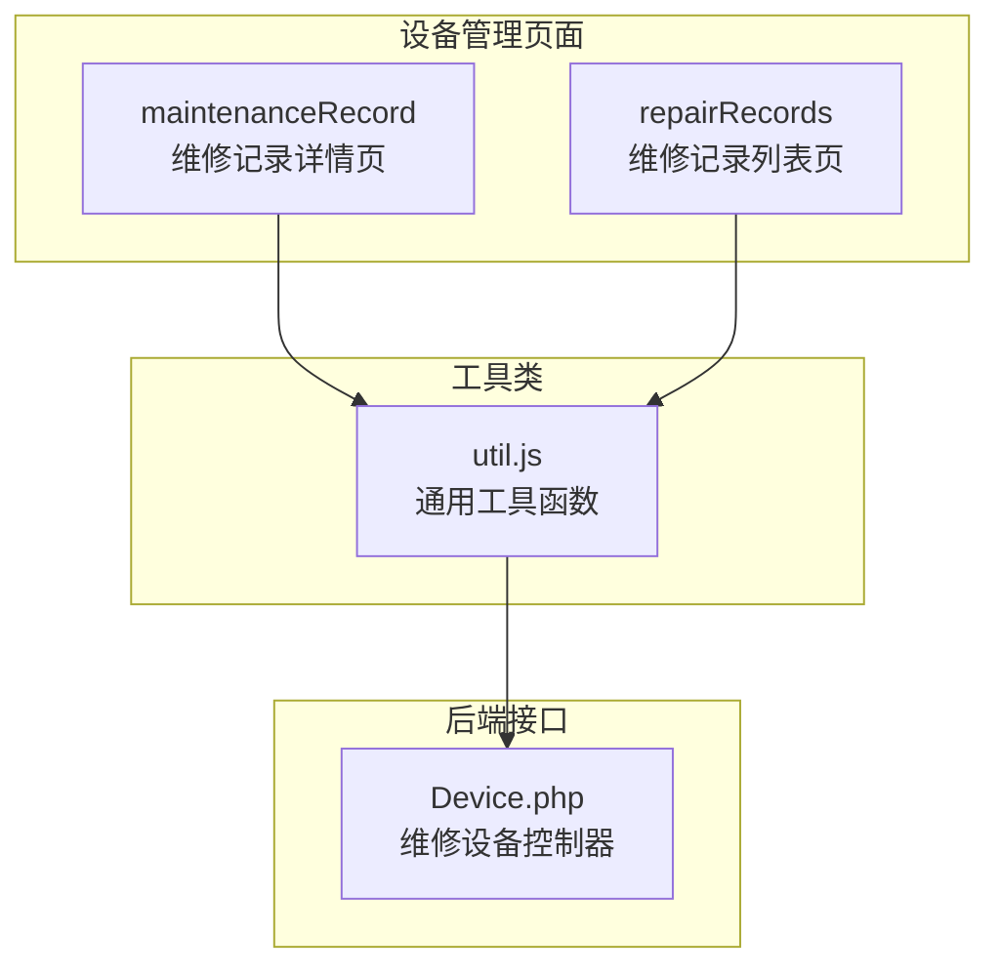
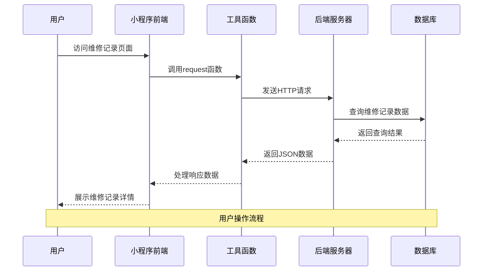
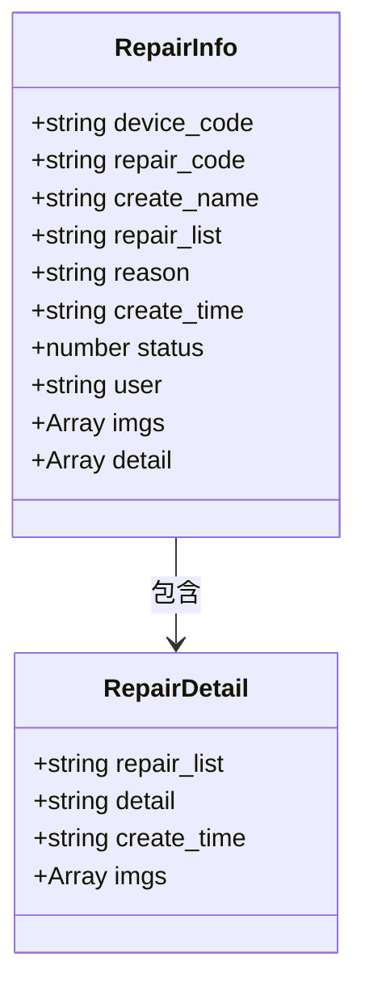
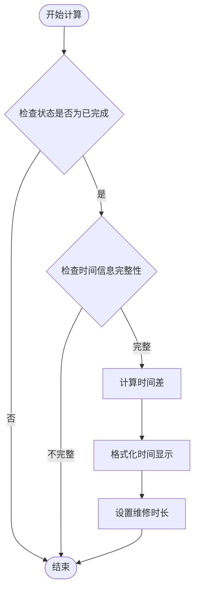
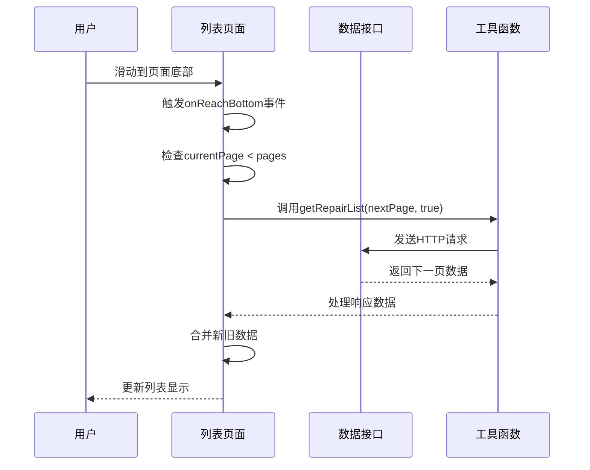
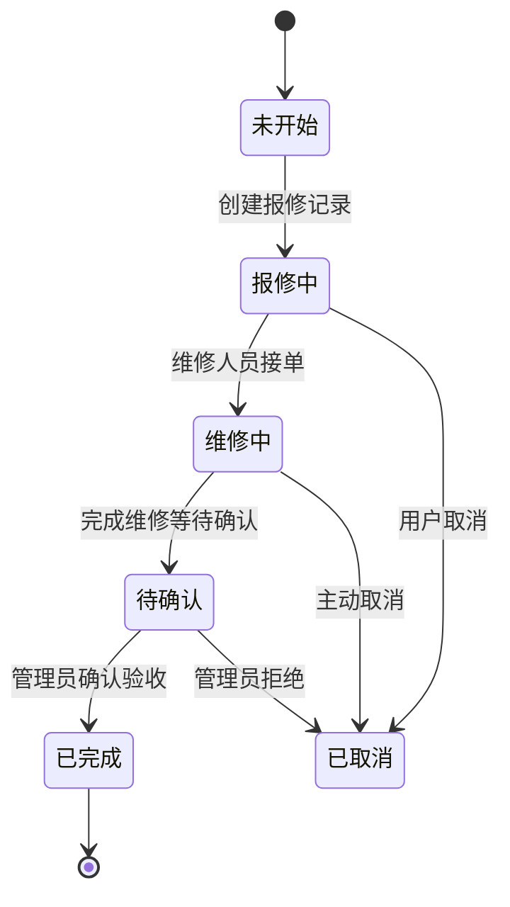
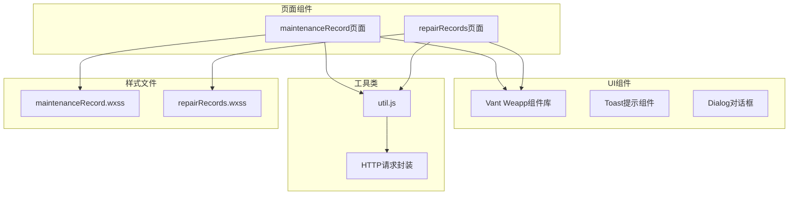
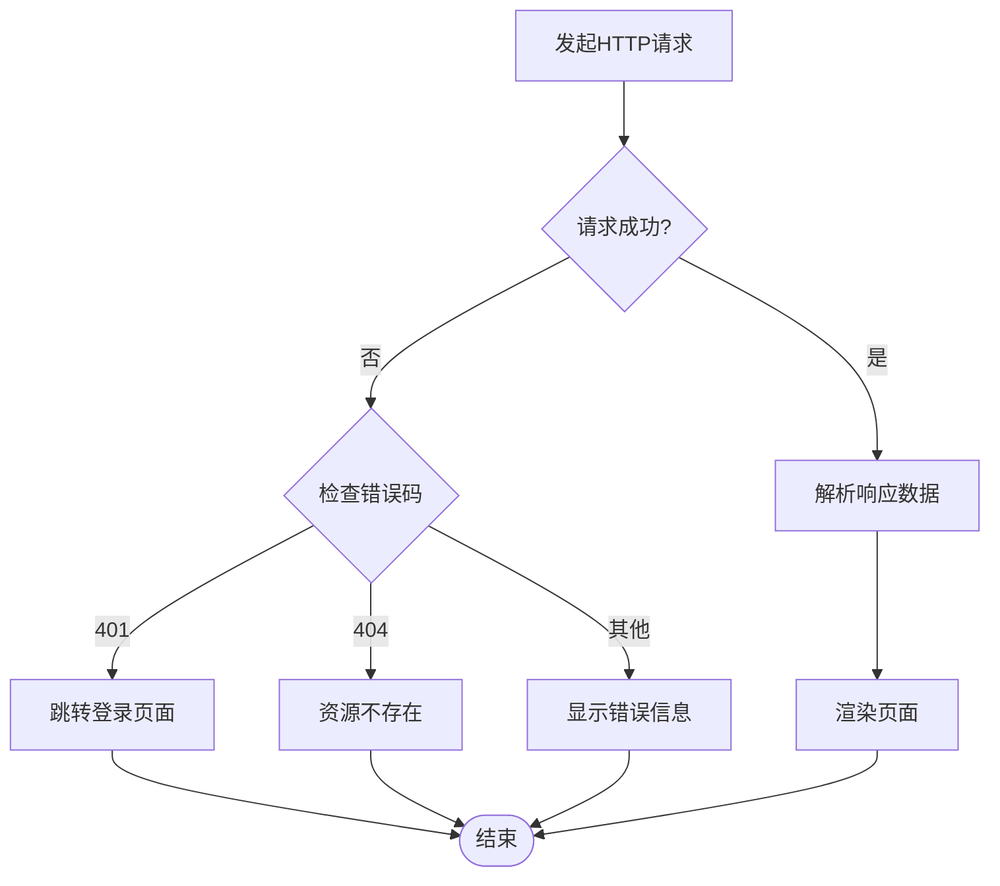

# 维修记录页面

<cite>
**本文档引用的文件**
- [maintenanceRecord.js](file://gccd_mini/pageEquipment/pages/maintenanceRecord/maintenanceRecord.js)
- [maintenanceRecord.json](file://gccd_mini/pageEquipment/pages/maintenanceRecord/maintenanceRecord.json)
- [maintenanceRecord.wxml](file://gccd_mini/pageEquipment/pages/maintenanceRecord/maintenanceRecord.wxml)
- [maintenanceRecord.wxss](file://gccd_mini/pageEquipment/pages/maintenanceRecord/maintenanceRecord.wxss)
- [repairRecords.js](file://gccd_mini/pageEquipment/pages/repairRecords/repairRecords.js)
- [repairRecords.json](file://gccd_mini/pageEquipment/pages/repairRecords/repairRecords.json)
- [repairRecords.wxml](file://gccd_mini/pageEquipment/pages/repairRecords/repairRecords.wxml)
- [repairRecords.wxss](file://gccd_mini/pageEquipment/pages/repairRecords/repairRecords.wxss)
- [util.js](file://gccd_mini/utils/util.js)
- [Device.php](file://gccd_server/app/admin/controller/repair/Device.php)
</cite>

## 目录
1. [简介](#简介)
2. [项目结构](#项目结构)
3. [核心组件](#核心组件)
4. [架构概览](#架构概览)
5. [详细组件分析](#详细组件分析)
6. [依赖关系分析](#依赖关系分析)
7. [性能考虑](#性能考虑)
8. [故障排除指南](#故障排除指南)
9. [结论](#结论)

## 简介

维修记录页面是高齿传动项目中设备管理系统的重要组成部分，负责展示和管理设备的维修历史记录。该页面实现了完整的维修记录生命周期管理，包括设备报修、维修处理、维修完成等全流程管理。

本页面采用微信小程序框架开发，使用Vant Weapp组件库构建用户界面，通过HTTP接口与后端服务器进行数据交互。页面支持维修记录的查看、筛选、分页加载等功能，为设备维护管理提供了直观的操作界面。

## 项目结构

维修记录页面位于项目的设备管理模块中，主要包含两个核心页面：

**图表来源**
- [maintenanceRecord.js:1-154](file://gccd_mini/pageEquipment/pages/maintenanceRecord/maintenanceRecord.js#L1-L154)
- [repairRecords.js:1-119](file://gccd_mini/pageEquipment/pages/repairRecords/repairRecords.js#L1-L119)
- [util.js:1-98](file://gccd_mini/utils/util.js#L1-L98)
- [Device.php:1-281](file://gccd_server/app/admin/controller/repair/Device.php#L1-L281)

**章节来源**
- [maintenanceRecord.js:1-154](file://gccd_mini/pageEquipment/pages/maintenanceRecord/maintenanceRecord.js#L1-L154)
- [repairRecords.js:1-119](file://gccd_mini/pageEquipment/pages/repairRecords/repairRecords.js#L1-L119)

## 核心组件

### 维修记录详情组件

维修记录详情页面提供了设备维修记录的完整信息展示，包括设备基本信息、报修信息、维修信息等关键数据。

**核心功能特性：**
- 设备信息展示：设备编码、维修单号等基本信息
- 报修信息展示：报修人、报修项、报修详情、报修时间
- 维修信息展示：维修人、维修项、维修详情、维修时间
- 状态标识：根据维修状态显示不同的颜色标识
- 图片预览：支持报修图片和维修图片的预览功能
- 维修时长计算：自动计算已完成维修的时长

### 维修记录列表组件

维修记录列表页面展示了特定设备的所有维修历史记录，支持分页加载和数据筛选。

**核心功能特性：**
- 设备信息展示：显示当前设备的基本信息
- 维修记录列表：按时间顺序展示所有维修记录
- 状态标识：维修中、已完结状态的可视化展示
- 图片缩略图：支持维修记录图片的横向滚动查看
- 分页加载：支持大数据量的分页加载功能

**章节来源**
- [maintenanceRecord.wxml:1-108](file://gccd_mini/pageEquipment/pages/maintenanceRecord/maintenanceRecord.wxml#L1-L108)
- [repairRecords.wxml:1-73](file://gccd_mini/pageEquipment/pages/repairRecords/repairRecords.wxml#L1-L73)

## 架构概览

维修记录页面采用前后端分离的架构设计，前端负责用户界面展示和交互，后端提供RESTful API接口。

**图表来源**
- [util.js:22-94](file://gccd_mini/utils/util.js#L22-L94)
- [maintenanceRecord.js:44-82](file://gccd_mini/pageEquipment/pages/maintenanceRecord/maintenanceRecord.js#L44-L82)
- [repairRecords.js:50-86](file://gccd_mini/pageEquipment/pages/repairRecords/repairRecords.js#L50-L86)

**章节来源**
- [util.js:1-98](file://gccd_mini/utils/util.js#L1-L98)

## 详细组件分析

### 维修记录详情页面

#### 数据结构设计

维修记录详情页面的数据结构采用了层次化的组织方式：

**图表来源**
- [maintenanceRecord.js:5-11](file://gccd_mini/pageEquipment/pages/maintenanceRecord/maintenanceRecord.js#L5-L11)
- [maintenanceRecord.wxml:29-94](file://gccd_mini/pageEquipment/pages/maintenanceRecord/maintenanceRecord.wxml#L29-L94)

#### 核心功能实现

**维修时长计算逻辑：**
页面实现了智能的维修时长计算功能，只有在维修状态为已完成且具备完整时间信息时才会进行计算。

**图表来源**
- [maintenanceRecord.js:85-118](file://gccd_mini/pageEquipment/pages/maintenanceRecord/maintenanceRecord.js#L85-L118)

**章节来源**
- [maintenanceRecord.js:1-154](file://gccd_mini/pageEquipment/pages/maintenanceRecord/maintenanceRecord.js#L1-L154)

### 维修记录列表页面

#### 列表渲染机制

维修记录列表页面采用了高效的列表渲染机制，支持大数据量的展示需求：

**分页加载实现：**
页面支持无限滚动加载，当用户滑动到页面底部时自动加载下一页数据。

**图表来源**
- [repairRecords.js:112-118](file://gccd_mini/pageEquipment/pages/repairRecords/repairRecords.js#L112-L118)

**章节来源**
- [repairRecords.js:1-119](file://gccd_mini/pageEquipment/pages/repairRecords/repairRecords.js#L1-L119)

### 数据同步机制

#### 状态更新流程

维修记录页面与后端服务器保持实时的数据同步，确保用户看到的都是最新的维修状态。

**图表来源**
- [Device.php:273-277](file://gccd_server/app/admin/controller/repair/Device.php#L273-L277)

**章节来源**
- [Device.php:1-281](file://gccd_server/app/admin/controller/repair/Device.php#L1-L281)

## 依赖关系分析

### 前端依赖关系

维修记录页面的前端依赖关系清晰明确，各组件职责分工明确：

**图表来源**
- [maintenanceRecord.json:1-13](file://gccd_mini/pageEquipment/pages/maintenanceRecord/maintenanceRecord.json#L1-L13)
- [repairRecords.json:1-13](file://gccd_mini/pageEquipment/pages/repairRecords/repairRecords.json#L1-L13)
- [util.js:1-98](file://gccd_mini/utils/util.js#L1-L98)

### 后端接口依赖

后端服务器提供了完整的维修记录管理API接口：

**核心接口列表：**
- `admin/repair.Device/repairinfo` - 获取维修记录详情
- `admin/repair.Device/repairlist` - 获取维修记录列表
- `admin/repair.Device/report` - 创建报修记录
- `admin/repair.Device/addrecords` - 新增维修记录
- `admin/repair.Device/editStatus` - 更新维修状态

**章节来源**
- [Device.php:87-240](file://gccd_server/app/admin/controller/repair/Device.php#L87-L240)

## 性能考虑

### 前端性能优化

维修记录页面在设计时充分考虑了性能优化：

**图片处理优化：**
- 自动处理图片路径格式，统一使用正斜杠
- 支持图片预览功能，避免重复加载
- 图片容器采用横向滚动布局，提升用户体验

**数据加载优化：**
- 支持分页加载，避免一次性加载大量数据
- 下拉刷新功能提供手动刷新机制
- 加载状态提示，改善用户等待体验

### 后端性能优化

后端服务器采用高效的数据查询和缓存策略：

**查询优化：**
- 支持多条件组合查询
- 关联表查询优化
- 分页查询减少数据库压力

**缓存策略：**
- 接口响应数据缓存
- 配置信息缓存
- 用户权限信息缓存

## 故障排除指南

### 常见问题及解决方案

**网络请求失败：**
- 检查网络连接状态
- 验证服务器地址配置
- 查看接口返回的错误码

**数据加载异常：**
- 确认设备编码参数正确
- 检查用户权限是否足够
- 验证数据库连接状态

**图片显示问题：**
- 检查图片URL格式
- 确认图片文件存在
- 验证图片访问权限

**章节来源**
- [util.js:85-94](file://gccd_mini/utils/util.js#L85-L94)

### 错误处理机制

维修记录页面建立了完善的错误处理机制：

**图表来源**
- [util.js:44-83](file://gccd_mini/utils/util.js#L44-L83)

## 结论

维修记录页面作为设备管理系统的核心功能模块，成功实现了设备维修记录的全生命周期管理。页面采用现代化的前端技术栈，结合后端RESTful API接口，为用户提供了流畅、直观的操作体验。

**主要优势：**
- 完整的功能覆盖：从报修到维修完成的全流程管理
- 良好的用户体验：响应式设计、图片预览、状态标识等功能
- 高效的数据处理：分页加载、图片优化、状态同步等机制
- 稳定的系统架构：前后端分离、错误处理、权限控制等设计

**改进建议：**
- 增加更多的筛选条件选项
- 优化移动端的交互体验
- 添加数据导出功能
- 实现维修进度的实时推送

通过持续的优化和完善，维修记录页面将成为设备管理系统的亮点功能，为企业设备维护管理提供强有力的技术支撑。