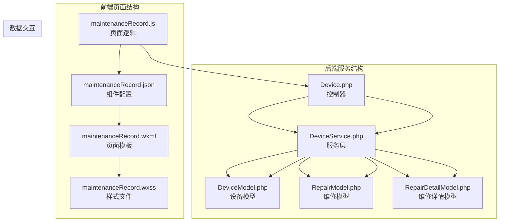
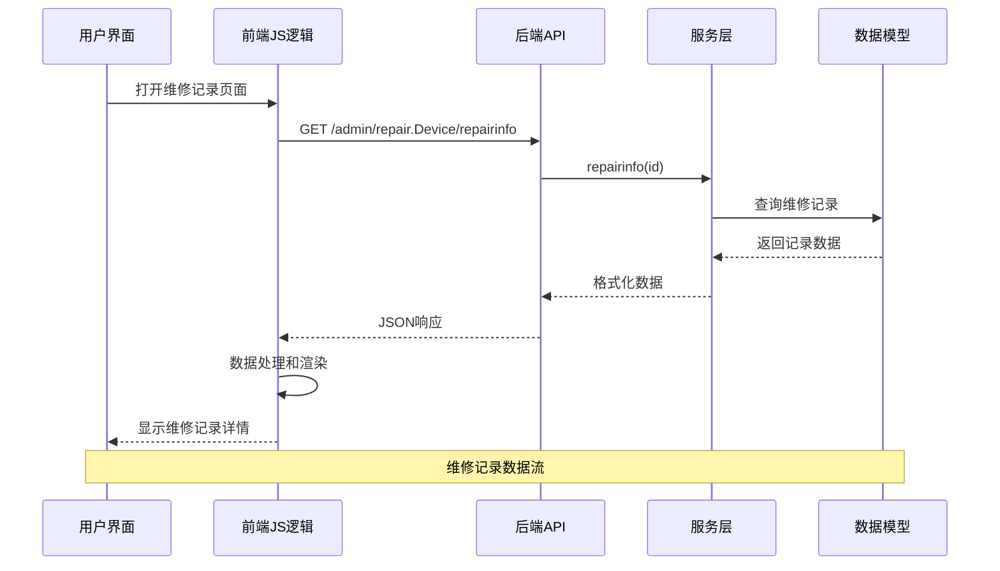
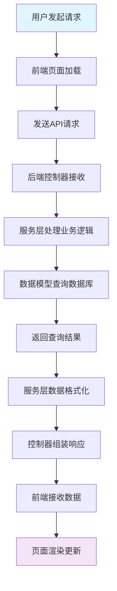
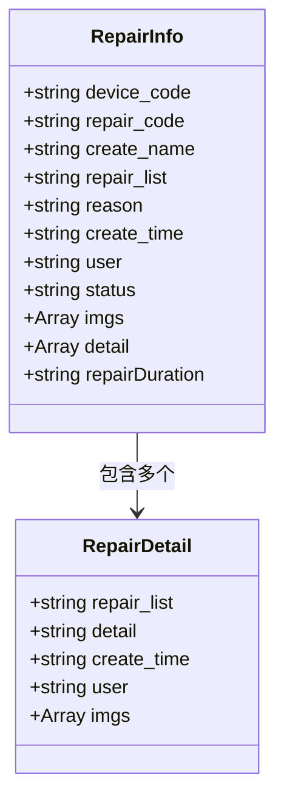
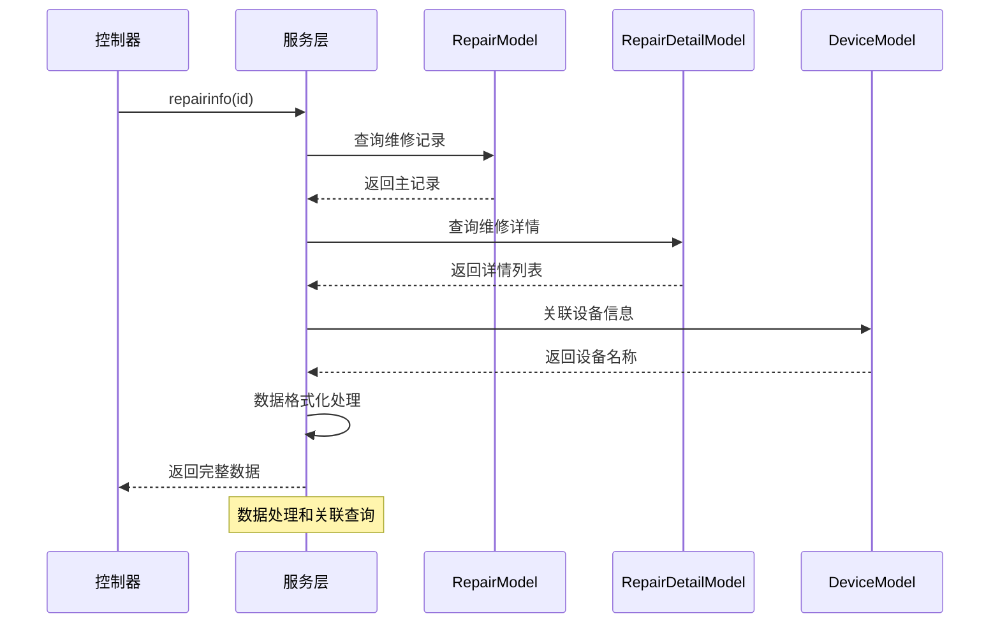
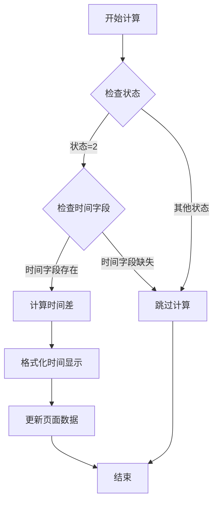
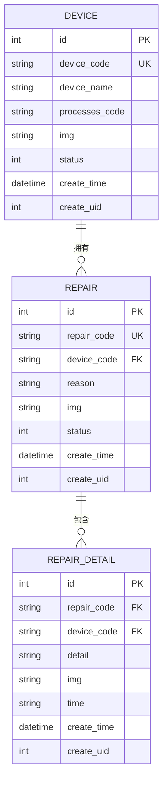
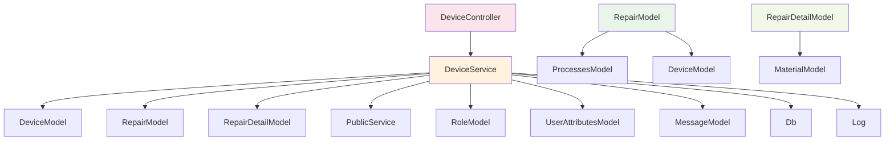

# 维修记录页面

<cite>
**本文档引用的文件**
- [maintenanceRecord.js](file://gccd_mini/pageEquipment/pages/maintenanceRecord/maintenanceRecord.js)
- [maintenanceRecord.json](file://gccd_mini/pageEquipment/pages/maintenanceRecord/maintenanceRecord.json)
- [maintenanceRecord.wxml](file://gccd_mini/pageEquipment/pages/maintenanceRecord/maintenanceRecord.wxml)
- [maintenanceRecord.wxss](file://gccd_mini/pageEquipment/pages/maintenanceRecord/maintenanceRecord.wxss)
- [Device.php](file://gccd_server/app/admin/controller/repair/Device.php)
- [DeviceService.php](file://gccd_server/app/common/service/admin/DeviceService.php)
- [DeviceModel.php](file://gccd_server/app/common/model/admin/DeviceModel.php)
- [RepairModel.php](file://gccd_server/app/common/model/admin/RepairModel.php)
- [RepairDetailModel.php](file://gccd_server/app/common/model/admin/RepairDetailModel.php)
</cite>

## 目录
1. [简介](#简介)
2. [项目结构](#项目结构)
3. [核心组件](#核心组件)
4. [架构概览](#架构概览)
5. [详细组件分析](#详细组件分析)
6. [依赖关系分析](#依赖关系分析)
7. [性能考虑](#性能考虑)
8. [故障排除指南](#故障排除指南)
9. [结论](#结论)

## 简介

维修记录页面是高齿传动项目中的重要功能模块，负责展示和管理设备的维修维护记录。该页面实现了完整的维修记录生命周期管理，包括维修记录的创建、执行记录的管理、维修历史的查询等功能。

本页面采用前后端分离架构，前端使用微信小程序框架，后端基于ThinkPHP 8.0开发，通过RESTful API进行数据交互。页面提供了直观的用户界面，支持维修记录的查看、图片预览、状态跟踪等功能。

## 项目结构

维修记录页面位于项目结构中的特定位置，包含完整的前端页面文件和后端服务逻辑：



**图表来源**
- [maintenanceRecord.js:1-154](file://gccd_mini/pageEquipment/pages/maintenanceRecord/maintenanceRecord.js#L1-L154)
- [Device.php:1-281](file://gccd_server/app/admin/controller/repair/Device.php#L1-L281)

**章节来源**
- [maintenanceRecord.js:1-154](file://gccd_mini/pageEquipment/pages/maintenanceRecord/maintenanceRecord.js#L1-L154)
- [maintenanceRecord.json:1-13](file://gccd_mini/pageEquipment/pages/maintenanceRecord/maintenanceRecord.json#L1-L13)
- [maintenanceRecord.wxml:1-108](file://gccd_mini/pageEquipment/pages/maintenanceRecord/maintenanceRecord.wxml#L1-L108)
- [maintenanceRecord.wxss:1-169](file://gccd_mini/pageEquipment/pages/maintenanceRecord/maintenanceRecord.wxss#L1-L169)

## 核心组件

### 前端组件架构

维修记录页面由四个主要前端文件组成，每个文件承担不同的职责：

#### 页面逻辑组件 (maintenanceRecord.js)
负责处理页面的业务逻辑，包括数据获取、状态管理和用户交互响应。

#### 组件配置 (maintenanceRecord.json)
定义页面使用的Vant Weapp组件，提供丰富的UI组件支持。

#### 页面模板 (maintenanceRecord.wxml)
构建页面的HTML结构，包含设备信息、维修信息和图片展示区域。

#### 样式文件 (maintenanceRecord.wxss)
提供页面的视觉样式，包括卡片布局、状态标识和图片展示样式。

### 后端服务架构

后端服务采用分层架构设计，包含控制器、服务层和数据模型：

#### 控制器层 (Device.php)
处理HTTP请求，调用服务层方法，返回标准化的响应数据。

#### 服务层 (DeviceService.php)
实现核心业务逻辑，包括数据处理、事务管理和业务规则验证。

#### 数据模型层
- **DeviceModel**: 设备信息模型，管理设备的基本属性和关联关系
- **RepairModel**: 维修记录主表模型，存储维修记录的主信息
- **RepairDetailModel**: 维修记录详情模型，存储具体的维修执行信息

**章节来源**
- [Device.php:33-281](file://gccd_server/app/admin/controller/repair/Device.php#L33-L281)
- [DeviceService.php:40-540](file://gccd_server/app/common/service/admin/DeviceService.php#L40-L540)
- [DeviceModel.php:7-32](file://gccd_server/app/common/model/admin/DeviceModel.php#L7-L32)
- [RepairModel.php:7-32](file://gccd_server/app/common/model/admin/RepairModel.php#L7-L32)
- [RepairDetailModel.php:7-21](file://gccd_server/app/common/model/admin/RepairDetailModel.php#L7-L21)

## 架构概览

维修记录页面采用经典的MVC架构模式，实现了清晰的职责分离：



**图表来源**
- [maintenanceRecord.js:34-83](file://gccd_mini/pageEquipment/pages/maintenanceRecord/maintenanceRecord.js#L34-L83)
- [Device.php:87-93](file://gccd_server/app/admin/controller/repair/Device.php#L87-L93)
- [DeviceService.php:133-187](file://gccd_server/app/common/service/admin/DeviceService.php#L133-L187)

### 数据流架构



**图表来源**
- [maintenanceRecord.js:44-82](file://gccd_mini/pageEquipment/pages/maintenanceRecord/maintenanceRecord.js#L44-L82)
- [DeviceService.php:133-187](file://gccd_server/app/common/service/admin/DeviceService.php#L133-L187)

## 详细组件分析

### 维修记录详情展示组件

#### 数据结构设计

维修记录页面的数据结构经过精心设计，支持完整的维修信息展示：



**图表来源**
- [DeviceService.php:133-187](file://gccd_server/app/common/service/admin/DeviceService.php#L133-L187)
- [DeviceService.php:424-455](file://gccd_server/app/common/service/admin/DeviceService.php#L424-L455)

#### 状态管理机制

页面实现了完善的维修状态管理，支持三种状态的可视化展示：

| 状态值 | 状态名称 | 颜色标识 | 描述 |
|--------|----------|----------|------|
| 0 | 进行中 | 红色 | 维修正在进行中 |
| 1 | 待确认 | 橙色 | 维修完成等待确认 |
| 2 | 已完成 | 绿色 | 维修完全结束 |

#### 图片处理功能

页面支持维修相关的图片预览功能，包括报修图片和维修图片的独立展示：


**图表来源**
- [maintenanceRecord.js:120-141](file://gccd_mini/pageEquipment/pages/maintenanceRecord/maintenanceRecord.js#L120-L141)
- [DeviceService.php:146-179](file://gccd_server/app/common/service/admin/DeviceService.php#L146-L179)

**章节来源**
- [maintenanceRecord.js:5-11](file://gccd_mini/pageEquipment/pages/maintenanceRecord/maintenanceRecord.js#L5-L11)
- [maintenanceRecord.wxml:16-94](file://gccd_mini/pageEquipment/pages/maintenanceRecord/maintenanceRecord.wxml#L16-L94)
- [DeviceService.php:133-187](file://gccd_server/app/common/service/admin/DeviceService.php#L133-L187)

### 后端服务实现

#### 维修记录查询服务

服务层实现了复杂的维修记录查询逻辑，支持多维度的搜索和过滤：



**图表来源**
- [Device.php:87-93](file://gccd_server/app/admin/controller/repair/Device.php#L87-L93)
- [DeviceService.php:133-187](file://gccd_server/app/common/service/admin/DeviceService.php#L133-L187)

#### 维修时长计算逻辑

页面实现了智能的维修时长计算功能，仅在特定条件下进行计算：



**图表来源**
- [maintenanceRecord.js:85-102](file://gccd_mini/pageEquipment/pages/maintenanceRecord/maintenanceRecord.js#L85-L102)
- [maintenanceRecord.js:104-118](file://gccd_mini/pageEquipment/pages/maintenanceRecord/maintenanceRecord.js#L104-L118)

**章节来源**
- [DeviceService.php:133-187](file://gccd_server/app/common/service/admin/DeviceService.php#L133-L187)
- [DeviceService.php:464-522](file://gccd_server/app/common/service/admin/DeviceService.php#L464-L522)

### 数据模型设计

#### 设备模型关联关系



**图表来源**
- [DeviceModel.php:7-32](file://gccd_server/app/common/model/admin/DeviceModel.php#L7-L32)
- [RepairModel.php:7-32](file://gccd_server/app/common/model/admin/RepairModel.php#L7-L32)
- [RepairDetailModel.php:7-21](file://gccd_server/app/common/model/admin/RepairDetailModel.php#L7-L21)

**章节来源**
- [DeviceModel.php:7-32](file://gccd_server/app/common/model/admin/DeviceModel.php#L7-L32)
- [RepairModel.php:7-32](file://gccd_server/app/common/model/admin/RepairModel.php#L7-L32)
- [RepairDetailModel.php:7-21](file://gccd_server/app/common/model/admin/RepairDetailModel.php#L7-L21)

## 依赖关系分析

### 前端组件依赖

维修记录页面的前端组件之间存在明确的依赖关系：

```mermaid
graph TD
A[maintenanceRecord.js] --> B[@vant/weapp/toast]
A --> C[util.request]
A --> D[wx.getSystemInfo]
A --> E[wx.previewImage]
F[maintenanceRecord.json] --> G[van-button]
F --> H[van-icon]
F --> I[van-toast]
F --> J[van-popup]
F --> K[van-field]
F --> L[van-dialog]
F --> M[van-tab]
F --> N[van-tabs]
F --> O[van-empty]
P[maintenanceRecord.wxml] --> Q[自定义导航栏]
P --> R[设备信息卡片]
P --> S[维修信息卡片]
P --> T[图片展示区域]
style A fill:#e3f2fd
style F fill:#f3e5f5
style P fill:#e8f5e8
```

**图表来源**
- [maintenanceRecord.js:1-3](file://gccd_mini/pageEquipment/pages/maintenanceRecord/maintenanceRecord.js#L1-L3)
- [maintenanceRecord.json:2-12](file://gccd_mini/pageEquipment/pages/maintenanceRecord/maintenanceRecord.json#L2-L12)

### 后端服务依赖

后端服务层依赖于多个数据模型和工具类：



**图表来源**
- [DeviceService.php:10-35](file://gccd_server/app/common/service/admin/DeviceService.php#L10-L35)
- [Device.php:12-26](file://gccd_server/app/admin/controller/repair/Device.php#L12-L26)

**章节来源**
- [DeviceService.php:10-35](file://gccd_server/app/common/service/admin/DeviceService.php#L10-L35)
- [Device.php:12-26](file://gccd_server/app/admin/controller/repair/Device.php#L12-L26)

## 性能考虑

### 前端性能优化

维修记录页面在设计时充分考虑了性能优化：

#### 图片加载优化
- 采用懒加载策略，仅在需要时加载图片资源
- 图片路径统一格式化，避免重复请求
- 支持图片缓存机制，减少网络传输

#### 数据处理优化
- 使用分页查询，避免一次性加载大量数据
- 实现数据缓存机制，提升页面响应速度
- 优化DOM操作，减少不必要的重绘和回流

### 后端性能优化

#### 数据库查询优化
- 使用索引优化关键查询字段
- 实现关联查询的批量处理
- 采用延迟加载策略，按需加载关联数据

#### 缓存策略
- 实现多级缓存机制
- 使用Redis缓存热点数据
- 优化查询结果的序列化和反序列化

## 故障排除指南

### 常见问题及解决方案

#### 维修记录无法加载
**问题症状**: 页面显示空状态或加载失败
**可能原因**:
- 网络请求超时
- 维修记录ID无效
- 服务器响应错误

**解决步骤**:
1. 检查网络连接状态
2. 验证维修记录ID的有效性
3. 查看服务器日志获取详细错误信息

#### 图片显示异常
**问题症状**: 图片无法正常显示或显示错误
**可能原因**:
- 图片URL格式不正确
- 图片资源不存在
- 网络权限问题

**解决步骤**:
1. 检查图片URL格式是否正确
2. 验证图片资源是否存在
3. 确认网络访问权限

#### 状态显示错误
**问题症状**: 维修状态显示不正确
**可能原因**:
- 状态字段值异常
- 前端状态映射错误
- 数据同步问题

**解决步骤**:
1. 检查数据库中的状态值
2. 验证前端状态映射逻辑
3. 确认数据同步机制正常工作

**章节来源**
- [maintenanceRecord.js:34-83](file://gccd_mini/pageEquipment/pages/maintenanceRecord/maintenanceRecord.js#L34-L83)
- [DeviceService.php:133-187](file://gccd_server/app/common/service/admin/DeviceService.php#L133-L187)

## 结论

维修记录页面作为高齿传动项目的重要组成部分，实现了完整的设备维修管理功能。通过前后端分离的架构设计，页面具备了良好的可维护性和扩展性。

### 主要优势

1. **完整的功能覆盖**: 支持维修记录的创建、查询、状态管理等全流程
2. **优秀的用户体验**: 直观的界面设计和流畅的交互体验
3. **可靠的系统架构**: 清晰的分层设计和完善的错误处理机制
4. **高效的性能表现**: 优化的数据处理和缓存策略

### 技术特点

- 采用现代化的微信小程序开发技术栈
- 实现了前后端分离的架构模式
- 具备完善的错误处理和异常恢复机制
- 支持图片预览和状态可视化展示

### 发展建议

1. **功能扩展**: 可以考虑添加维修统计分析功能
2. **移动端优化**: 进一步优化移动端的用户体验
3. **性能监控**: 建立完善的性能监控和告警机制
4. **安全加固**: 加强数据安全和访问控制机制

该维修记录页面为设备管理提供了强有力的技术支撑，为企业的设备维护管理工作带来了显著的效率提升。