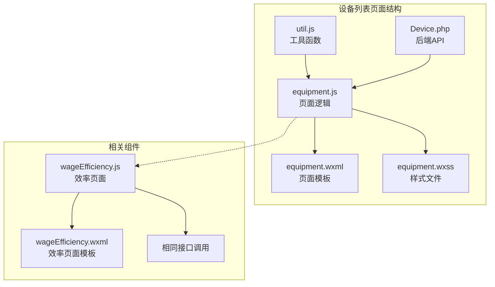
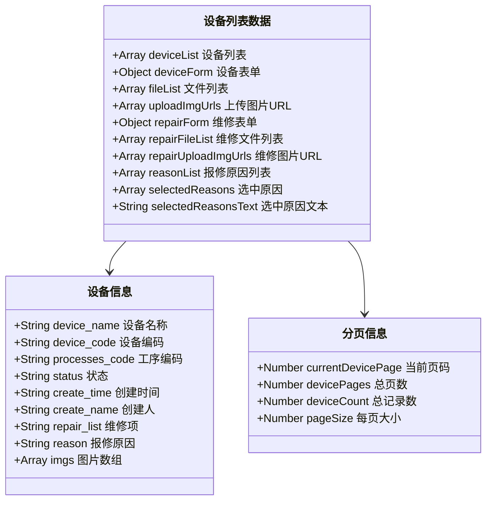
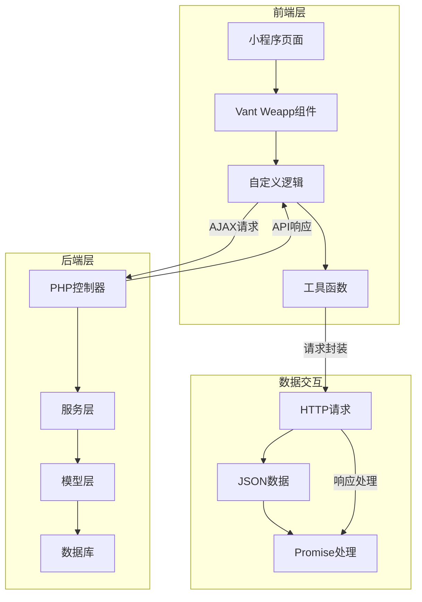
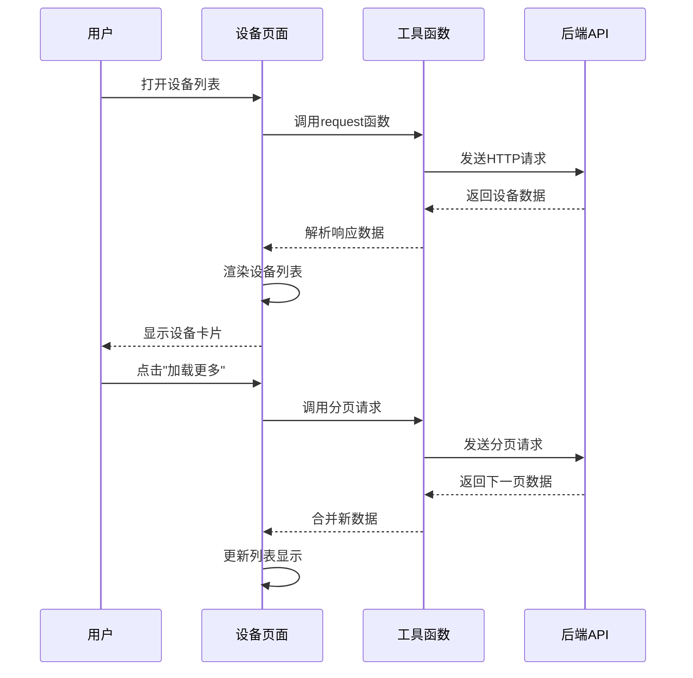
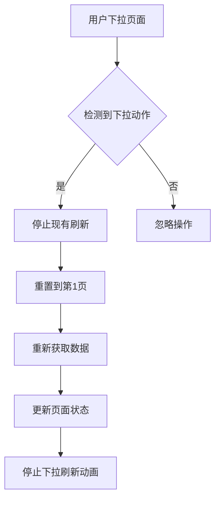
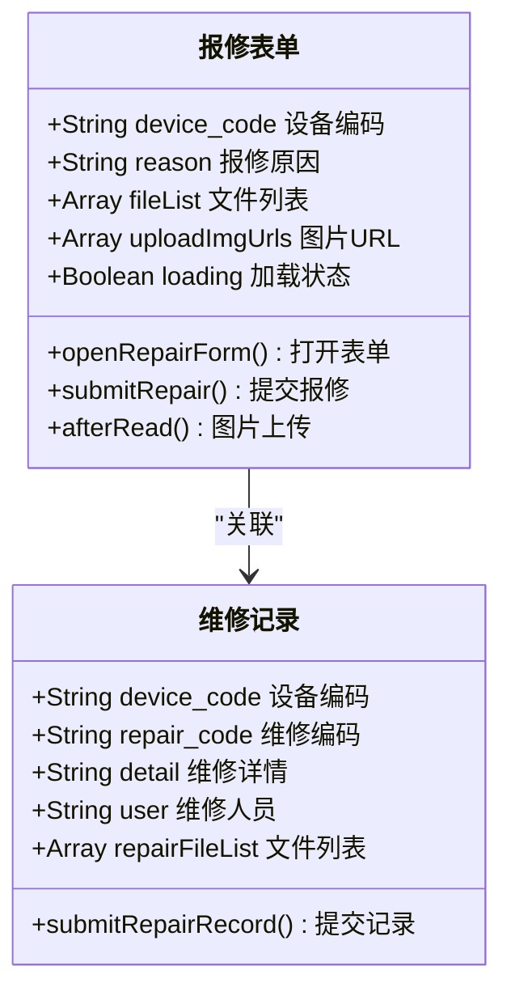
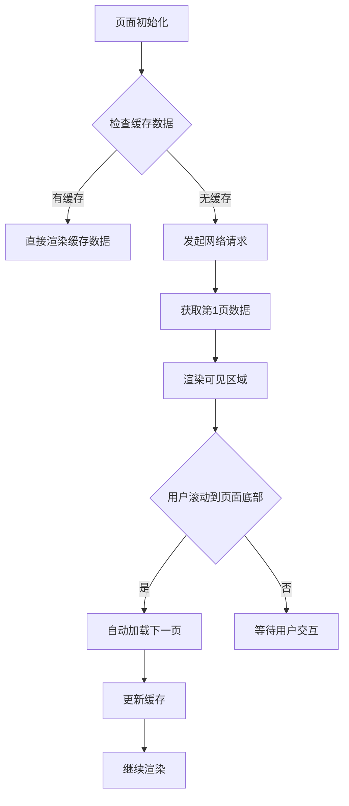
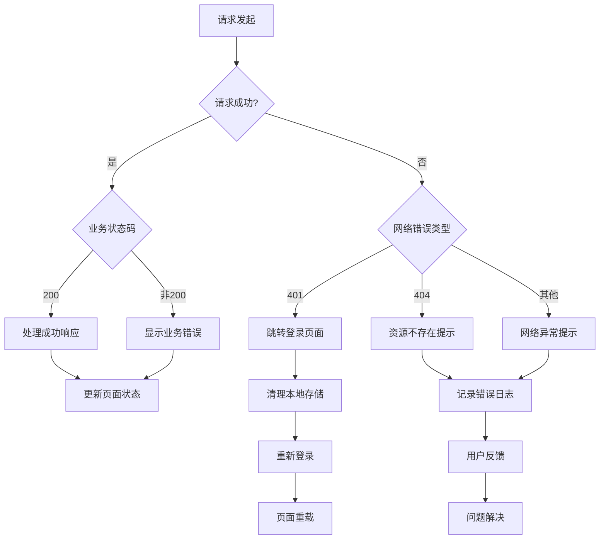

# 设备列表页面

<cite>
**本文档引用的文件**
- [equipment.js](file://gccd_mini/pages/equipment/equipment.js)
- [equipment.wxml](file://gccd_mini/pages/equipment/equipment.wxml)
- [equipment.wxss](file://gccd_mini/pages/equipment/equipment.wxss)
- [util.js](file://gccd_mini/utils/util.js)
- [Device.php](file://gccd_server/app/admin/controller/repair/Device.php)
- [wageEfficiency.js](file://gccd_mini/pageMine/pages/wageEfficiency/wageEfficiency.js)
- [wageEfficiency.wxml](file://gccd_mini/pageMine/pages/wageEfficiency/wageEfficiency.wxml)
</cite>

## 目录
1. [简介](#简介)
2. [项目结构](#项目结构)
3. [核心组件](#核心组件)
4. [架构概览](#架构概览)
5. [详细组件分析](#详细组件分析)
6. [依赖关系分析](#依赖关系分析)
7. [性能考虑](#性能考虑)
8. [故障排除指南](#故障排除指南)
9. [结论](#结论)

## 简介

设备列表页面是高齿传动项目中的核心功能模块，负责展示和管理设备信息。该页面实现了完整的设备数据获取、展示、分页加载、搜索过滤、下拉刷新、上拉加载等交互功能。

本页面采用小程序框架开发，结合Vant Weapp组件库，提供了现代化的用户体验。页面包含两个主要标签页：设备列表和任务列表，分别展示设备信息和维修任务状态。

## 项目结构

设备列表页面位于小程序项目的 `pages/equipment` 目录下，包含以下核心文件：



**图表来源**
- [equipment.js:1-1202](file://gccd_mini/pages/equipment/equipment.js#L1-L1202)
- [equipment.wxml:1-345](file://gccd_mini/pages/equipment/equipment.wxml#L1-L345)
- [util.js:1-98](file://gccd_mini/utils/util.js#L1-L98)

**章节来源**
- [equipment.js:1-1202](file://gccd_mini/pages/equipment/equipment.js#L1-L1202)
- [equipment.wxml:1-345](file://gccd_mini/pages/equipment/equipment.wxml#L1-L345)
- [equipment.wxss:1-232](file://gccd_mini/pages/equipment/equipment.wxss#L1-L232)

## 核心组件

### 数据结构设计

设备列表页面采用统一的数据结构来管理设备信息：



**图表来源**
- [equipment.js:6-79](file://gccd_mini/pages/equipment/equipment.js#L6-L79)

### 状态标识系统

页面使用颜色编码来表示设备的不同状态：

| 状态 | 颜色 | 描述 |
|------|------|------|
| 正常 | 绿色 | 设备运行正常 |
| 维修中 | 红色 | 设备正在维修 |
| 待确认 | 橙色 | 维修任务待确认 |

**章节来源**
- [equipment.wxml:85-109](file://gccd_mini/pages/equipment/equipment.wxml#L85-L109)
- [equipment.wxss:54-67](file://gccd_mini/pages/equipment/equipment.wxss#L54-L67)

## 架构概览

设备列表页面采用前后端分离的架构模式：



**图表来源**
- [equipment.js:119-155](file://gccd_mini/pages/equipment/equipment.js#L119-L155)
- [util.js:22-94](file://gccd_mini/utils/util.js#L22-L94)
- [Device.php:144-180](file://gccd_server/app/admin/controller/repair/Device.php#L144-L180)

## 详细组件分析

### 设备列表渲染组件

设备列表采用卡片式布局，每个设备项包含完整的设备信息：



**图表来源**
- [equipment.js:119-155](file://gccd_mini/pages/equipment/equipment.js#L119-L155)
- [equipment.js:170-181](file://gccd_mini/pages/equipment/equipment.js#L170-L181)

### 交互设计组件

页面实现了多种用户交互功能：

#### 下拉刷新机制


**图表来源**
- [equipment.js:1077-1088](file://gccd_mini/pages/equipment/equipment.js#L1077-L1088)

#### 上拉加载机制
```mermaid
flowchart TD
A[用户上拉页面] --> B{检测到上拉动作}
B --> |是| C{检查是否还有更多页}
C --> |有| D[设置加载状态]
D --> E[计算下一页页码]
E --> F[发起数据请求]
F --> G[合并新数据]
G --> H[更新页面状态]
C --> |无| I[显示"没有更多数据"]
B --> |否| J[忽略操作]
```

**图表来源**
- [equipment.js:1090-1101](file://gccd_mini/pages/equipment/equipment.js#L1090-L1101)

### 报修功能组件

设备列表集成了完整的报修功能：



**图表来源**
- [equipment.js:438-710](file://gccd_mini/pages/equipment/equipment.js#L438-L710)
- [equipment.js:826-1023](file://gccd_mini/pages/equipment/equipment.js#L826-L1023)

**章节来源**
- [equipment.wxml:103-110](file://gccd_mini/pages/equipment/equipment.wxml#L103-L110)
- [equipment.js:438-710](file://gccd_mini/pages/equipment/equipment.js#L438-L710)

## 依赖关系分析

### 前端依赖关系

```mermaid
graph LR
subgraph "核心依赖"
A[equipment.js] --> B[@vant/weapp/toast]
A --> C[@vant/weapp/dialog]
A --> D[util.js]
end
subgraph "工具函数"
D --> E[request函数]
E --> F[HTTP请求处理]
E --> G[错误处理]
end
subgraph "样式依赖"
H[equipment.wxss] --> I[组件样式]
H --> J[响应式设计]
end
A -.-> K[wageEfficiency.js]
K -.-> L[相同API接口]
```

**图表来源**
- [equipment.js:1-5](file://gccd_mini/pages/equipment/equipment.js#L1-L5)
- [util.js:1-98](file://gccd_mini/utils/util.js#L1-L98)

### 后端API依赖

设备列表页面依赖以下后端API：

| API名称 | 端点 | 方法 | 功能描述 |
|---------|------|------|----------|
| 设备列表 | `admin/repair.Device/list` | POST | 获取设备列表数据 |
| 任务列表 | `admin/repair.Device/repairlist` | POST | 获取维修任务列表 |
| 报修提交 | `admin/repair.Device/report` | POST | 提交设备报修申请 |
| 维修记录 | `admin/repair.Device/addrecords` | POST | 添加维修记录 |
| 确认维修 | `admin/repair.Device/editStatus` | POST | 确认维修状态 |

**章节来源**
- [Device.php:144-180](file://gccd_server/app/admin/controller/repair/Device.php#L144-L180)
- [equipment.js:685-709](file://gccd_mini/pages/equipment/equipment.js#L685-L709)

## 性能考虑

### 数据缓存策略

设备列表页面采用了多层次的数据缓存机制：

1. **内存缓存**：设备数据在内存中缓存，避免重复请求
2. **分页缓存**：已加载的页面数据保持在内存中
3. **状态缓存**：用户界面状态（如展开/折叠状态）被持久化

### 懒加载优化



### 虚拟滚动实现

对于大量设备数据的情况，建议采用虚拟滚动技术：

- **可视区域渲染**：只渲染用户可见的设备项
- **动态高度计算**：根据设备信息动态计算行高
- **滚动事件优化**：节流处理滚动事件，避免频繁重绘

### 图片处理优化


**章节来源**
- [equipment.js:458-520](file://gccd_mini/pages/equipment/equipment.js#L458-L520)
- [util.js:22-94](file://gccd_mini/utils/util.js#L22-L94)

## 故障排除指南

### 常见问题及解决方案

#### 1. 数据加载失败

**问题现象**：设备列表显示空白或加载失败

**解决方案**：
- 检查网络连接状态
- 验证后端API接口可用性
- 确认AdminToken有效性
- 查看控制台错误日志

#### 2. 分页加载异常

**问题现象**：上拉加载无效或重复加载

**解决方案**：
- 检查分页参数传递
- 验证后端返回的页码信息
- 确认loading状态管理
- 检查页面边界条件

#### 3. 图片上传失败

**问题现象**：报修图片无法上传或显示异常

**解决方案**：
- 验证图片格式和大小限制
- 检查CDN配置
- 确认上传权限
- 查看上传进度反馈

### 错误处理机制

设备列表页面实现了完善的错误处理机制：



**图表来源**
- [util.js:49-83](file://gccd_mini/utils/util.js#L49-L83)

**章节来源**
- [util.js:49-83](file://gccd_mini/utils/util.js#L49-L83)
- [equipment.js:102-116](file://gccd_mini/pages/equipment/equipment.js#L102-L116)

## 结论

设备列表页面是一个功能完整、架构清晰的小程序组件。它成功实现了设备数据的获取、展示、分页加载、搜索过滤等核心功能，同时提供了良好的用户体验和完善的错误处理机制。

### 主要优势

1. **模块化设计**：清晰的代码结构和职责分离
2. **用户体验**：流畅的交互体验和响应式设计
3. **性能优化**：合理的数据缓存和懒加载策略
4. **错误处理**：完善的异常处理和用户反馈机制

### 改进建议

1. **搜索功能增强**：添加设备名称、设备编码的实时搜索功能
2. **筛选功能**：增加按状态、时间等条件的筛选选项
3. **数据同步**：实现实时数据更新和推送通知
4. **离线支持**：添加离线数据缓存和同步机制

该页面为后续的功能扩展奠定了良好的基础，可以根据业务需求进一步完善和优化。