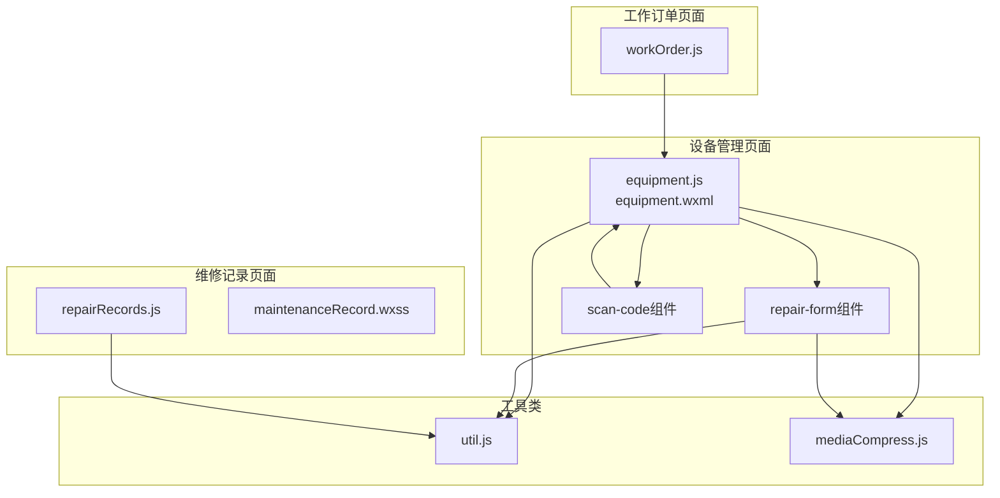
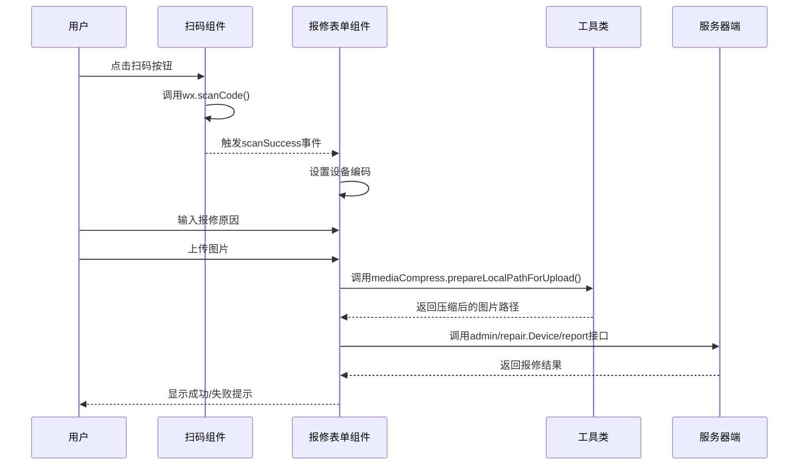
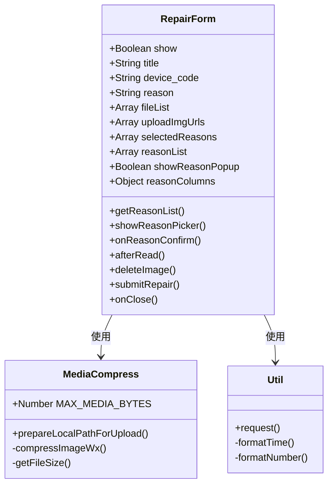
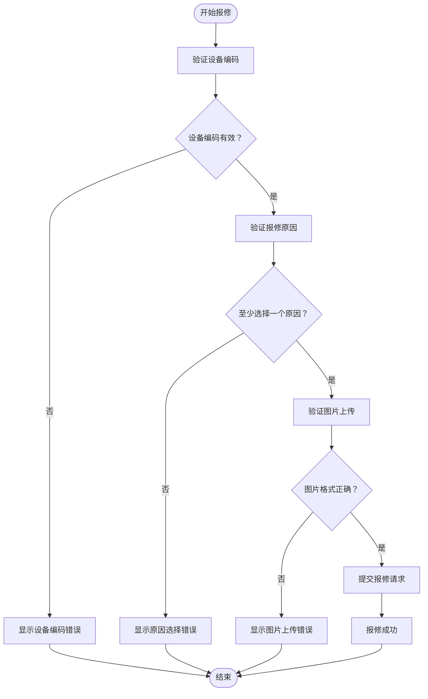
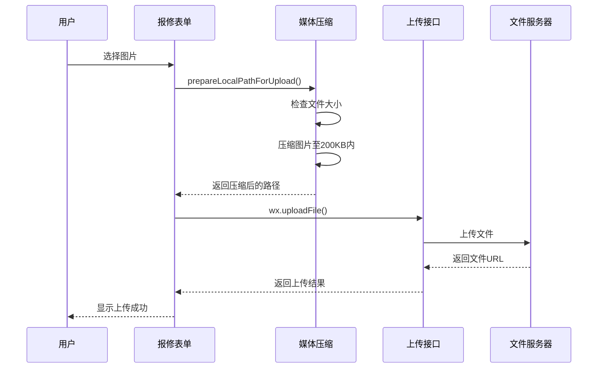
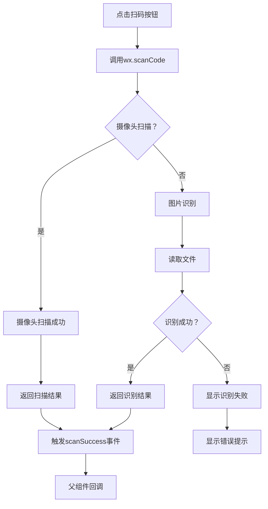
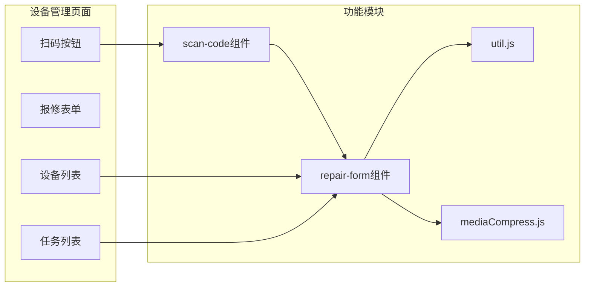
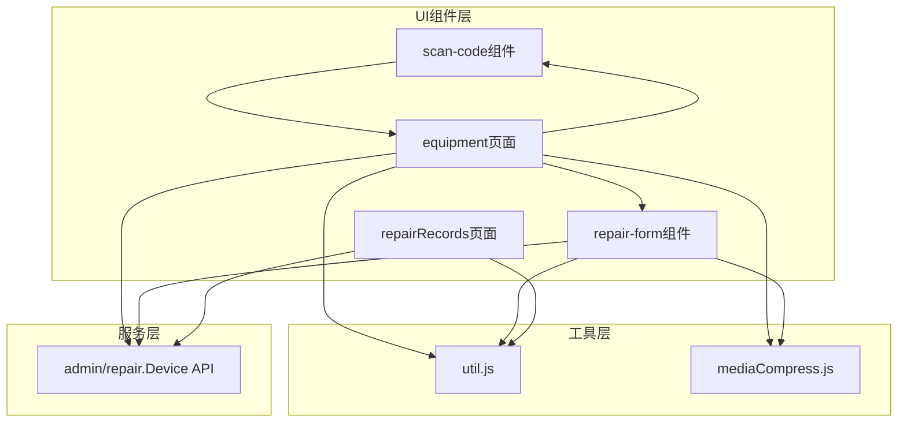

# 设备报修功能

<cite>
**本文档引用的文件**
- [repair-form.js](file://gccd_mini/pages/components/repair-form/repair-form.js)
- [repair-form.wxml](file://gccd_mini/pages/components/repair-form/repair-form.wxml)
- [scan-code.js](file://gccd_mini/pages/components/scan-code/scan-code.js)
- [scan-code.wxml](file://gccd_mini/pages/components/scan-code/scan-code.wxml)
- [equipment.js](file://gccd_mini/pages/equipment/equipment.js)
- [equipment.wxml](file://gccd_mini/pages/equipment/equipment.wxml)
- [util.js](file://gccd_mini/utils/util.js)
- [mediaCompress.js](file://gccd_mini/utils/mediaCompress.js)
- [repairRecords.js](file://gccd_mini/pageEquipment/pages/repairRecords/repairRecords.js)
- [repairRecords.wxml](file://gccd_mini/pageEquipment/pages/repairRecords/repairRecords.wxml)
- [repairRecords.wxss](file://gccd_mini/pageEquipment/pages/repairRecords/repairRecords.wxss)
- [maintenanceRecord.wxss](file://gccd_mini/pageEquipment/pages/maintenanceRecord/maintenanceRecord.wxss)
- [workOrder.js](file://gccd_mini/pages/workOrder/workOrder.js)
</cite>

## 目录
1. [简介](#简介)
2. [项目结构](#项目结构)
3. [核心组件](#核心组件)
4. [架构概览](#架构概览)
5. [详细组件分析](#详细组件分析)
6. [依赖关系分析](#依赖关系分析)
7. [性能考虑](#性能考虑)
8. [故障排除指南](#故障排除指南)
9. [结论](#结论)
10. [附录](#附录)

## 简介
本项目实现了完整的设备报修功能，包括扫码报修、手动输入设备编码、报修原因选择、图片上传等核心功能。系统采用微信小程序框架，结合Vant Weapp组件库，提供了用户友好的设备报修体验。

## 项目结构
设备报修功能主要分布在以下目录结构中：

**图表来源**
- [equipment.js:1-200](file://gccd_mini/pages/equipment/equipment.js#L1-L200)
- [repair-form.js:1-261](file://gccd_mini/pages/components/repair-form/repair-form.js#L1-L261)
- [scan-code.js:1-63](file://gccd_mini/pages/components/scan-code/scan-code.js#L1-L63)

**章节来源**
- [equipment.js:1-200](file://gccd_mini/pages/equipment/equipment.js#L1-L200)
- [repair-form.js:1-261](file://gccd_mini/pages/components/repair-form/repair-form.js#L1-L261)
- [scan-code.js:1-63](file://gccd_mini/pages/components/scan-code/scan-code.js#L1-L63)

## 核心组件
设备报修功能由多个核心组件协同工作：

### 报修表单组件
- **repair-form组件**：提供完整的报修表单界面，包含设备编码显示、报修原因选择、报修详情输入、图片上传等功能
- **表单验证**：确保设备编码和报修原因必填，支持多选报修原因
- **图片上传**：支持最多9张图片上传，自动压缩至200KB以内

### 扫码组件
- **scan-code组件**：提供二维码和条形码扫描功能
- **多源识别**：支持摄像头实时扫描和图片中二维码识别
- **事件传递**：通过自定义事件向父组件传递扫描结果

### 主页面集成
- **equipment页面**：主设备管理页面，集成了扫码报修功能
- **维修记录页面**：展示设备的维修历史记录
- **工作订单页面**：支持从工作订单页面直接扫码报修

**章节来源**
- [repair-form.js:1-261](file://gccd_mini/pages/components/repair-form/repair-form.js#L1-L261)
- [scan-code.js:1-63](file://gccd_mini/pages/components/scan-code/scan-code.js#L1-L63)
- [equipment.js:1-200](file://gccd_mini/pages/equipment/equipment.js#L1-L200)

## 架构概览
设备报修功能采用分层架构设计：

**图表来源**
- [scan-code.js:1-63](file://gccd_mini/pages/components/scan-code/scan-code.js#L1-L63)
- [repair-form.js:145-206](file://gccd_mini/pages/components/repair-form/repair-form.js#L145-L206)
- [util.js:22-94](file://gccd_mini/utils/util.js#L22-L94)

## 详细组件分析

### 报修表单组件分析

#### 组件结构

**图表来源**
- [repair-form.js:5-35](file://gccd_mini/pages/components/repair-form/repair-form.js#L5-L35)
- [mediaCompress.js:48-98](file://gccd_mini/utils/mediaCompress.js#L48-L98)
- [util.js:22-94](file://gccd_mini/utils/util.js#L22-L94)

#### 表单验证机制
报修表单实现了多层次的验证机制：

**图表来源**
- [repair-form.js:221-259](file://gccd_mini/pages/components/repair-form/repair-form.js#L221-L259)

#### 图片上传流程
图片上传采用异步处理和批量上传策略：

**图表来源**
- [repair-form.js:145-206](file://gccd_mini/pages/components/repair-form/repair-form.js#L145-L206)
- [mediaCompress.js:48-98](file://gccd_mini/utils/mediaCompress.js#L48-L98)

**章节来源**
- [repair-form.js:1-261](file://gccd_mini/pages/components/repair-form/repair-form.js#L1-L261)
- [repair-form.wxml:1-39](file://gccd_mini/pages/components/repair-form/repair-form.wxml#L1-L39)

### 扫码组件分析

#### 扫码功能实现
扫码组件提供了灵活的二维码识别方案：

**图表来源**
- [scan-code.js:7-27](file://gccd_mini/pages/components/scan-code/scan-code.js#L7-L27)
- [scan-code.js:29-61](file://gccd_mini/pages/components/scan-code/scan-code.js#L29-L61)

#### 多源识别机制
组件支持两种识别模式：
- **实时扫描**：直接调用摄像头进行二维码扫描
- **图片识别**：从相册选择图片，识别其中的二维码

**章节来源**
- [scan-code.js:1-63](file://gccd_mini/pages/components/scan-code/scan-code.js#L1-L63)
- [scan-code.wxml:1-6](file://gccd_mini/pages/components/scan-code/scan-code.wxml#L1-L6)

### 主页面集成分析

#### 设备管理页面集成
主设备管理页面集成了完整的报修流程：

**图表来源**
- [equipment.wxml:1-44](file://gccd_mini/pages/equipment/equipment.wxml#L1-L44)
- [equipment.js:1-200](file://gccd_mini/pages/equipment/equipment.js#L1-L200)

#### 维修记录页面
维修记录页面提供了设备历史维修信息的查看功能：

**章节来源**
- [equipment.js:1-200](file://gccd_mini/pages/equipment/equipment.js#L1-L200)
- [repairRecords.js:1-53](file://gccd_mini/pageEquipment/pages/repairRecords/repairRecords.js#L1-L53)

## 依赖关系分析

### 组件间依赖关系

**图表来源**
- [equipment.js:1-200](file://gccd_mini/pages/equipment/equipment.js#L1-L200)
- [repair-form.js:1-261](file://gccd_mini/pages/components/repair-form/repair-form.js#L1-L261)
- [util.js:22-94](file://gccd_mini/utils/util.js#L22-L94)

### 数据流分析
报修功能的数据流遵循以下模式：

1. **扫码阶段**：用户扫码 → 组件识别 → 事件传递 → 页面接收
2. **表单阶段**：用户输入 → 表单验证 → 数据收集
3. **上传阶段**：图片压缩 → 文件上传 → URL获取
4. **提交阶段**：数据验证 → API调用 → 结果处理

**章节来源**
- [equipment.js:1-200](file://gccd_mini/pages/equipment/equipment.js#L1-L200)
- [repair-form.js:145-206](file://gccd_mini/pages/components/repair-form/repair-form.js#L145-L206)

## 性能考虑

### 图片处理优化
- **压缩策略**：采用多级压缩策略，优先质量压缩，再尝试尺寸压缩
- **体积限制**：统一限制为200KB以内，确保上传效率
- **并发处理**：支持多图片并发上传，提升用户体验

### 网络请求优化
- **统一拦截器**：通过util.js封装所有API请求
- **错误处理**：完善的错误分类和用户提示
- **缓存策略**：合理利用微信小程序的缓存机制

### 内存管理
- **及时清理**：表单关闭时自动清理上传的临时文件
- **状态管理**：合理的数据状态管理，避免内存泄漏

## 故障排除指南

### 常见问题及解决方案

#### 扫码失败
**问题描述**：扫码组件无法识别二维码
**可能原因**：
- 设备摄像头权限未开启
- 网络环境不佳
- 二维码质量过低

**解决方法**：
1. 检查设备摄像头权限设置
2. 确保网络连接稳定
3. 重新拍摄高质量的二维码

#### 图片上传失败
**问题描述**：图片上传过程中出现错误
**可能原因**：
- 图片文件过大
- 网络连接异常
- 服务器端限制

**解决方法**：
1. 确认图片大小不超过200KB
2. 检查网络连接状态
3. 重新尝试上传

#### 表单验证错误
**问题描述**：报修表单提交时报错
**可能原因**：
- 必填字段未填写
- 设备编码不存在
- 报修原因未选择

**解决方法**：
1. 检查所有必填字段是否已填写
2. 确认设备编码的有效性
3. 至少选择一个报修原因

### 调试技巧
- 使用微信开发者工具的调试功能
- 检查网络面板中的API请求
- 查看控制台输出的错误信息
- 利用Toast组件进行用户反馈

**章节来源**
- [util.js:22-94](file://gccd_mini/utils/util.js#L22-L94)
- [mediaCompress.js:48-98](file://gccd_mini/utils/mediaCompress.js#L48-L98)

## 结论
设备报修功能通过模块化的设计和完善的错误处理机制，为用户提供了流畅的报修体验。系统具有以下特点：

1. **功能完整性**：涵盖了扫码报修、手动输入、原因选择、图片上传等核心功能
2. **用户体验友好**：简洁直观的操作界面，及时的反馈提示
3. **技术实现稳健**：合理的架构设计，完善的错误处理
4. **扩展性强**：模块化组件设计，便于后续功能扩展

## 附录

### API接口说明
- **设备列表**：`admin/repair.Device/list`
- **维修记录**：`admin/repair.Device/repairlist`
- **报修提交**：`admin/repair.Device/report`
- **设备添加**：`admin/repair.Device/add`

### 开发规范
- 组件命名采用kebab-case格式
- 数据绑定使用双花括号语法
- 事件处理函数命名采用驼峰命名
- 错误处理统一使用Toast组件

### 测试建议
- 单元测试：针对核心业务逻辑编写测试用例
- 集成测试：模拟完整的报修流程
- 性能测试：测试大量图片上传场景
- 兼容性测试：在不同设备和版本上验证功能