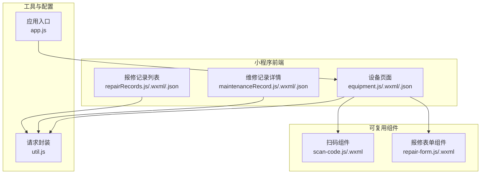
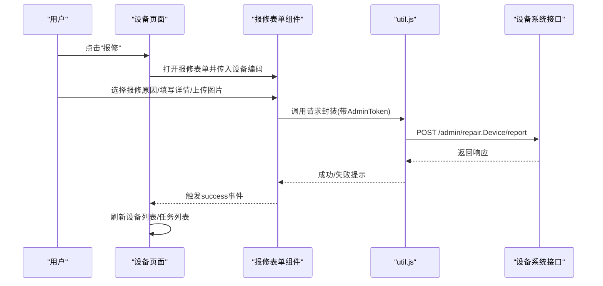
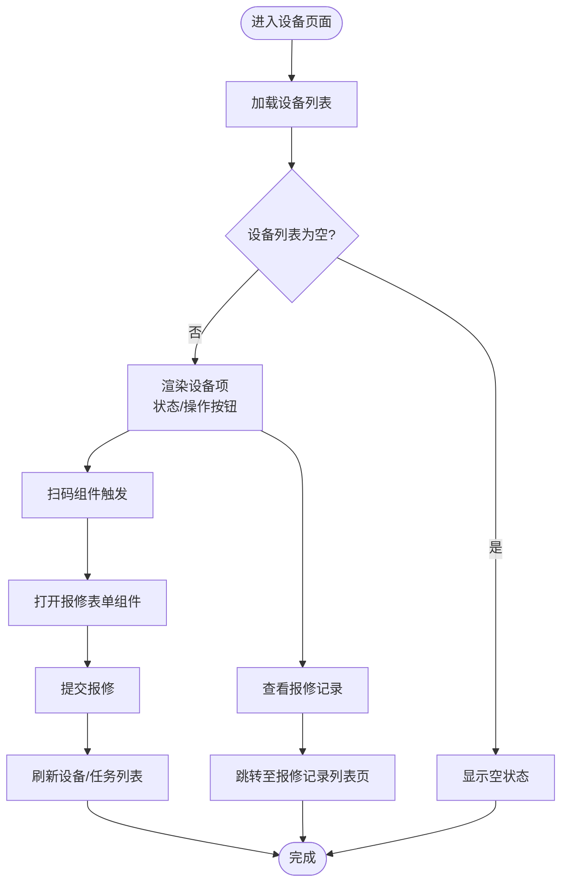
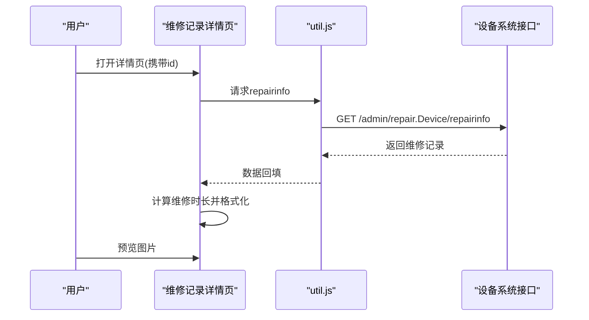
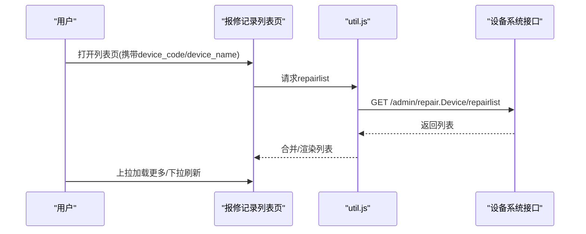
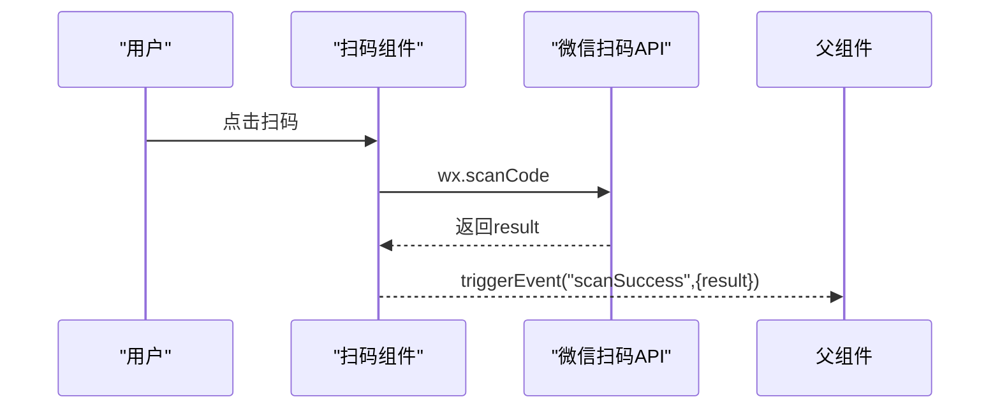
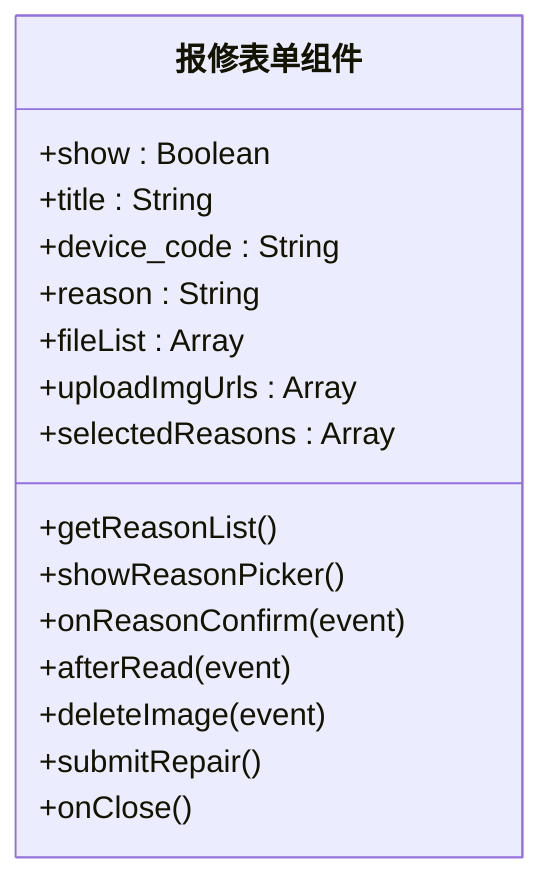
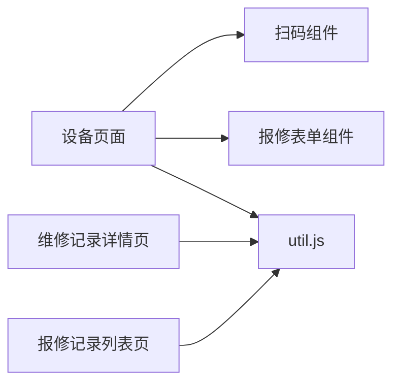

# 设备管理页面

<cite>
**本文引用的文件**
- [equipment.js](file://gccd_mini/pages/equipment/equipment.js)
- [equipment.json](file://gccd_mini/pages/equipment/equipment.json)
- [equipment.wxml](file://gccd_mini/pages/equipment/equipment.wxml)
- [maintenanceRecord.js](file://gccd_mini/pageEquipment/pages/maintenanceRecord/maintenanceRecord.js)
- [maintenanceRecord.json](file://gccd_mini/pageEquipment/pages/maintenanceRecord/maintenanceRecord.json)
- [maintenanceRecord.wxml](file://gccd_mini/pageEquipment/pages/maintenanceRecord/maintenanceRecord.wxml)
- [repairRecords.js](file://gccd_mini/pageEquipment/pages/repairRecords/repairRecords.js)
- [repairRecords.json](file://gccd_mini/pageEquipment/pages/repairRecords/repairRecords.json)
- [repairRecords.wxml](file://gccd_mini/pageEquipment/pages/repairRecords/repairRecords.wxml)
- [util.js](file://gccd_mini/utils/util.js)
- [scan-code.js](file://gccd_mini/pages/components/scan-code/scan-code.js)
- [repair-form.js](file://gccd_mini/pages/components/repair-form/repair-form.js)
- [repair-form.wxml](file://gccd_mini/pages/components/repair-form/repair-form.wxml)
- [scan-code.wxml](file://gccd_mini/pages/components/scan-code/scan-code.wxml)
- [app.js](file://gccd_mini/app.js)
</cite>

## 目录
1. [简介](#简介)
2. [项目结构](#项目结构)
3. [核心组件](#核心组件)
4. [架构总览](#架构总览)
5. [详细组件分析](#详细组件分析)
6. [依赖关系分析](#依赖关系分析)
7. [性能考量](#性能考量)
8. [故障排查指南](#故障排查指南)
9. [结论](#结论)
10. [附录](#附录)

## 简介
本文件面向“设备管理页面”的开发与维护，系统性梳理设备列表展示、设备详情查看、设备状态监控、设备台账、维护记录、维修记录以及与设备系统的数据交互与状态同步机制。文档同时提供最佳实践与优化建议，帮助开发者快速理解与迭代该模块。

## 项目结构
设备管理页面由三部分组成：
- 小程序前端页面：设备列表与任务列表、维修记录详情、报修记录列表
- 可复用组件：扫码组件、报修表单组件
- 工具与配置：通用请求封装、页面组件注册

**图表来源**
- [equipment.js:1-1202](file://gccd_mini/pages/equipment/equipment.js#L1-L1202)
- [equipment.wxml:1-345](file://gccd_mini/pages/equipment/equipment.wxml#L1-L345)
- [maintenanceRecord.js:1-154](file://gccd_mini/pageEquipment/pages/maintenanceRecord/maintenanceRecord.js#L1-L154)
- [maintenanceRecord.wxml:1-108](file://gccd_mini/pageEquipment/pages/maintenanceRecord/maintenanceRecord.wxml#L1-L108)
- [repairRecords.js:1-119](file://gccd_mini/pageEquipment/pages/repairRecords/repairRecords.js#L1-L119)
- [repairRecords.wxml:1-73](file://gccd_mini/pageEquipment/pages/repairRecords/repairRecords.wxml#L1-L73)
- [util.js:1-98](file://gccd_mini/utils/util.js#L1-L98)
- [scan-code.js:1-63](file://gccd_mini/pages/components/scan-code/scan-code.js#L1-L63)
- [repair-form.js:1-261](file://gccd_mini/pages/components/repair-form/repair-form.js#L1-L261)
- [app.js:1-33](file://gccd_mini/app.js#L1-L33)

**章节来源**
- [equipment.js:1-1202](file://gccd_mini/pages/equipment/equipment.js#L1-L1202)
- [equipment.wxml:1-345](file://gccd_mini/pages/equipment/equipment.wxml#L1-L345)
- [equipment.json:1-18](file://gccd_mini/pages/equipment/equipment.json#L1-L18)
- [util.js:1-98](file://gccd_mini/utils/util.js#L1-L98)
- [scan-code.js:1-63](file://gccd_mini/pages/components/scan-code/scan-code.js#L1-L63)
- [repair-form.js:1-261](file://gccd_mini/pages/components/repair-form/repair-form.js#L1-L261)

## 核心组件
- 设备页面（设备列表/任务列表）
  - 功能：设备列表展示、任务列表展示、扫码报修、图片上传、分页加载、状态切换
  - 关键方法：设备列表/任务列表加载、加载更多、扫码处理、报修提交、图片上传
- 维修记录详情页
  - 功能：维修记录详情展示、维修时长计算、图片预览、下拉刷新
  - 关键方法：详情加载、时长计算、图片预览、返回
- 报修记录列表页
  - 功能：按设备维度展示报修历史、图片预览、分页加载、下拉刷新
  - 关键方法：列表加载、图片预览、返回、上拉加载更多
- 可复用组件
  - 扫码组件：统一扫码入口，触发事件回传结果
  - 报修表单组件：多选报修原因、图片上传、提交报修、事件回调

**章节来源**
- [equipment.js:81-181](file://gccd_mini/pages/equipment/equipment.js#L81-L181)
- [maintenanceRecord.js:33-118](file://gccd_mini/pageEquipment/pages/maintenanceRecord/maintenanceRecord.js#L33-L118)
- [repairRecords.js:39-118](file://gccd_mini/pageEquipment/pages/repairRecords/repairRecords.js#L39-L118)
- [scan-code.js:6-27](file://gccd_mini/pages/components/scan-code/scan-code.js#L6-L27)
- [repair-form.js:44-118](file://gccd_mini/pages/components/repair-form/repair-form.js#L44-L118)

## 架构总览
设备管理页面采用“页面+组件+工具函数”的分层设计：
- 页面负责数据流控制、状态管理与UI渲染
- 组件负责可复用能力（扫码、报修表单）
- 工具函数封装网络请求与鉴权头注入

**图表来源**
- [equipment.js:438-441](file://gccd_mini/pages/equipment/equipment.js#L438-L441)
- [repair-form.js:221-259](file://gccd_mini/pages/components/repair-form/repair-form.js#L221-L259)
- [util.js:22-94](file://gccd_mini/utils/util.js#L22-L94)

## 详细组件分析

### 设备页面（设备列表/任务列表）
- 设备列表
  - 数据源：admin/repair.Device/list
  - 分页：currentDevicePage/devicePages/deviceCount
  - 状态展示：status=0 正常，非0 维修中
  - 操作：报修、查看报修记录
- 任务列表
  - 数据源：admin/repair.Device/repairlist
  - 分页：currentPage/pages/count
  - 状态：0 进行中，1 待确认，2 已完成
  - 操作：维修、确认维修、维修记录
- 扫码报修
  - 通过扫码组件触发扫码事件，回填设备编码
  - 打开报修表单组件，提交报修
- 图片上传
  - 使用媒体压缩与上传接口，支持多图
  - 上传成功后合并URL数组，便于后续提交

**图表来源**
- [equipment.js:119-155](file://gccd_mini/pages/equipment/equipment.js#L119-L155)
- [equipment.wxml:80-128](file://gccd_mini/pages/equipment/equipment.wxml#L80-L128)
- [scan-code.js:6-27](file://gccd_mini/pages/components/scan-code/scan-code.js#L6-L27)
- [repair-form.js:221-259](file://gccd_mini/pages/components/repair-form/repair-form.js#L221-L259)

**章节来源**
- [equipment.js:81-181](file://gccd_mini/pages/equipment/equipment.js#L81-L181)
- [equipment.wxml:80-128](file://gccd_mini/pages/equipment/equipment.wxml#L80-L128)

### 维修记录详情页
- 数据加载
  - 接口：admin/repair.Device/repairinfo
  - 图片路径统一处理（替换反斜杠）
- 维修时长计算
  - 仅在状态为已完成且存在报修时间与维修完成时间时计算
  - 格式化输出：天/小时/分钟
- 图片预览
  - 支持报修图片与维修图片分别预览

**图表来源**
- [maintenanceRecord.js:33-118](file://gccd_mini/pageEquipment/pages/maintenanceRecord/maintenanceRecord.js#L33-L118)
- [util.js:22-94](file://gccd_mini/utils/util.js#L22-L94)

**章节来源**
- [maintenanceRecord.js:33-118](file://gccd_mini/pageEquipment/pages/maintenanceRecord/maintenanceRecord.js#L33-L118)
- [maintenanceRecord.wxml:14-94](file://gccd_mini/pageEquipment/pages/maintenanceRecord/maintenanceRecord.wxml#L14-L94)

### 报修记录列表页
- 数据加载
  - 接口：admin/repair.Device/repairlist（带device_code）
  - 图片路径统一处理
- 分页与刷新
  - 支持上拉加载更多与下拉刷新
- 图片预览
  - 支持逐条预览

**图表来源**
- [repairRecords.js:39-86](file://gccd_mini/pageEquipment/pages/repairRecords/repairRecords.js#L39-L86)
- [util.js:22-94](file://gccd_mini/utils/util.js#L22-L94)

**章节来源**
- [repairRecords.js:39-118](file://gccd_mini/pageEquipment/pages/repairRecords/repairRecords.js#L39-L118)
- [repairRecords.wxml:33-70](file://gccd_mini/pageEquipment/pages/repairRecords/repairRecords.wxml#L33-L70)

### 可复用组件

#### 扫码组件
- 能力：支持二维码/条形码扫码，失败提示
- 事件：scanSuccess(result) 回传扫码结果

**图表来源**
- [scan-code.js:6-27](file://gccd_mini/pages/components/scan-code/scan-code.js#L6-L27)

**章节来源**
- [scan-code.js:1-63](file://gccd_mini/pages/components/scan-code/scan-code.js#L1-L63)
- [scan-code.wxml:1-6](file://gccd_mini/pages/components/scan-code/scan-code.wxml#L1-L6)

#### 报修表单组件
- 能力：多选报修原因、图片上传、提交报修
- 事件：close、success（用于父页面刷新）

**图表来源**
- [repair-form.js:1-261](file://gccd_mini/pages/components/repair-form/repair-form.js#L1-L261)

**章节来源**
- [repair-form.js:44-118](file://gccd_mini/pages/components/repair-form/repair-form.js#L44-L118)
- [repair-form.wxml:1-39](file://gccd_mini/pages/components/repair-form/repair-form.wxml#L1-L39)

## 依赖关系分析
- 页面依赖
  - 设备页面依赖：扫码组件、报修表单组件、util.js
  - 维修记录详情页依赖：util.js
  - 报修记录列表页依赖：util.js
- 组件间关系
  - 设备页面通过事件与报修表单组件通信
  - 扫码组件向父组件回传结果
- 工具依赖
  - 所有页面与组件通过util.js发起请求，自动注入AdminToken

**图表来源**
- [equipment.js:1-1202](file://gccd_mini/pages/equipment/equipment.js#L1-L1202)
- [maintenanceRecord.js:1-154](file://gccd_mini/pageEquipment/pages/maintenanceRecord/maintenanceRecord.js#L1-L154)
- [repairRecords.js:1-119](file://gccd_mini/pageEquipment/pages/repairRecords/repairRecords.js#L1-L119)
- [util.js:1-98](file://gccd_mini/utils/util.js#L1-L98)

**章节来源**
- [equipment.json:1-18](file://gccd_mini/pages/equipment/equipment.json#L1-L18)
- [maintenanceRecord.json:1-13](file://gccd_mini/pageEquipment/pages/maintenanceRecord/maintenanceRecord.json#L1-L13)
- [repairRecords.json:1-13](file://gccd_mini/pageEquipment/pages/repairRecords/repairRecords.json#L1-L13)

## 性能考量
- 列表分页
  - 设备列表与任务列表均支持分页加载，避免一次性渲染大量数据
- 图片处理
  - 上传前进行媒体压缩，减少带宽与服务器压力
- 状态管理
  - 使用loading/loaded状态避免重复请求与闪烁
- 事件解耦
  - 组件通过事件向上通信，降低耦合度，提升可维护性

[本节为通用指导，无需特定文件引用]

## 故障排查指南
- 登录态失效
  - 当接口返回401时，自动清除AdminToken并跳转登录页
- 网络异常
  - 请求失败时提示“网络异常，请检查网络”
- 业务错误
  - 根据接口返回的code进行Toast提示，如“资源不存在”、“请求错误”等
- 图片上传失败
  - 解析返回数据失败或上传接口请求失败时，给出明确错误提示
- 扫码失败
  - 用户取消时不提示错误；其他失败场景提示“扫码失败”

**章节来源**
- [util.js:49-91](file://gccd_mini/utils/util.js#L49-L91)
- [repair-form.js:158-206](file://gccd_mini/pages/components/repair-form/repair-form.js#L158-L206)
- [scan-code.js:17-26](file://gccd_mini/pages/components/scan-code/scan-code.js#L17-L26)

## 结论
设备管理页面通过清晰的页面/组件/工具分层，实现了设备列表、任务列表、维修记录详情与报修记录列表的完整闭环。结合扫码与报修表单组件，形成可复用、可扩展的设备运维能力。建议在后续迭代中进一步完善设备台账与维护计划模块，并持续优化图片上传与状态同步策略。

[本节为总结性内容，无需特定文件引用]

## 附录

### 开发最佳实践
- 统一使用util.js发起请求，集中处理鉴权与错误
- 组件化思维：将扫码、报修、图片上传等能力沉淀为组件
- 分页与懒加载：优先采用分页加载，避免全量渲染
- 状态管理：合理使用loading/loaded状态，提升用户体验
- 错误处理：针对不同code进行差异化提示，必要时引导用户重试或重新登录

### 设备管理优化建议
- 设备台账页面
  - 建议增加设备基本信息、技术参数、位置信息的编辑与查询能力
  - 引入筛选器（按设备名称、编码、状态等）提升检索效率
- 维护记录页面
  - 增加维护计划制定与执行记录追踪
  - 支持维护工单流转与负责人分配
- 维修记录页面
  - 增强维修流程可视化（进行中/待确认/已完成）
  - 支持维修时长统计与报表导出
- 数据交互与状态同步
  - 增加轮询或WebSocket监听设备状态变化
  - 对关键操作（报修、维修、确认）增加本地缓存与离线重试

[本节为通用指导，无需特定文件引用]