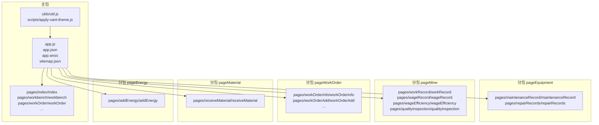
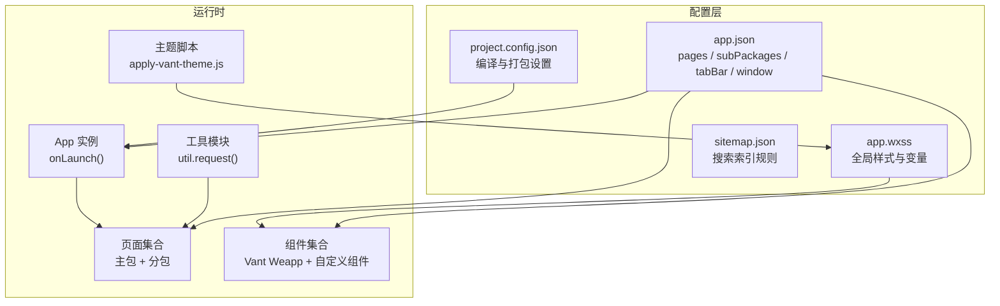
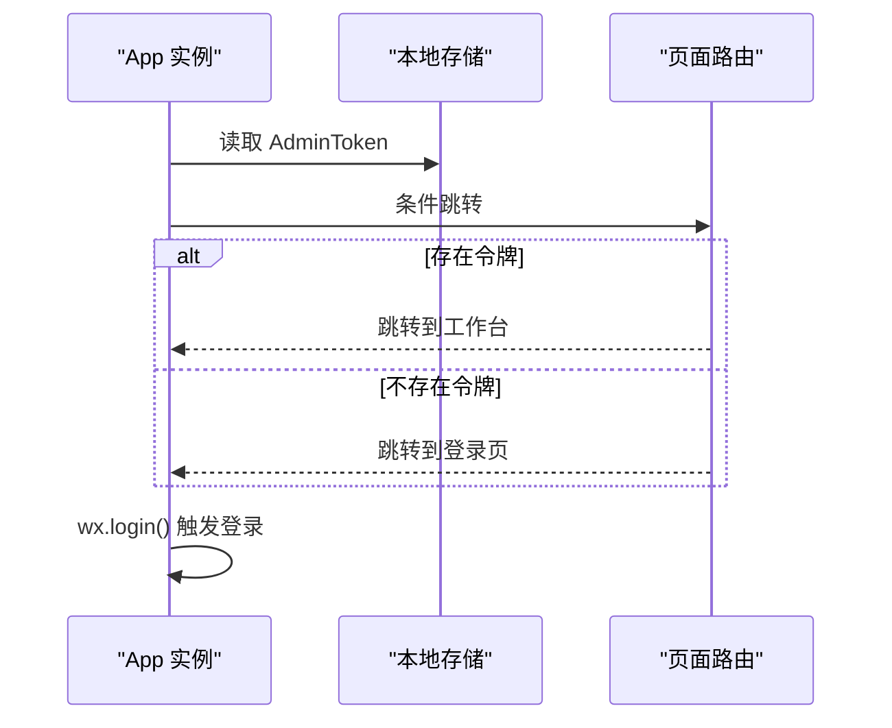
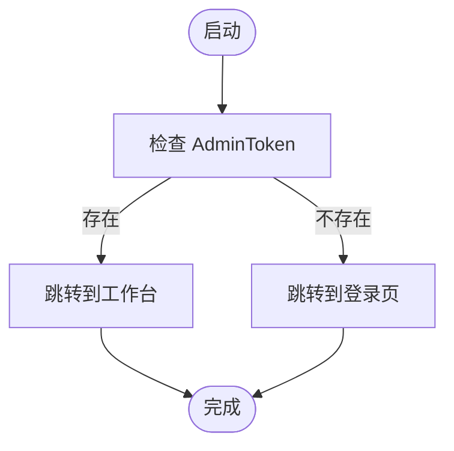
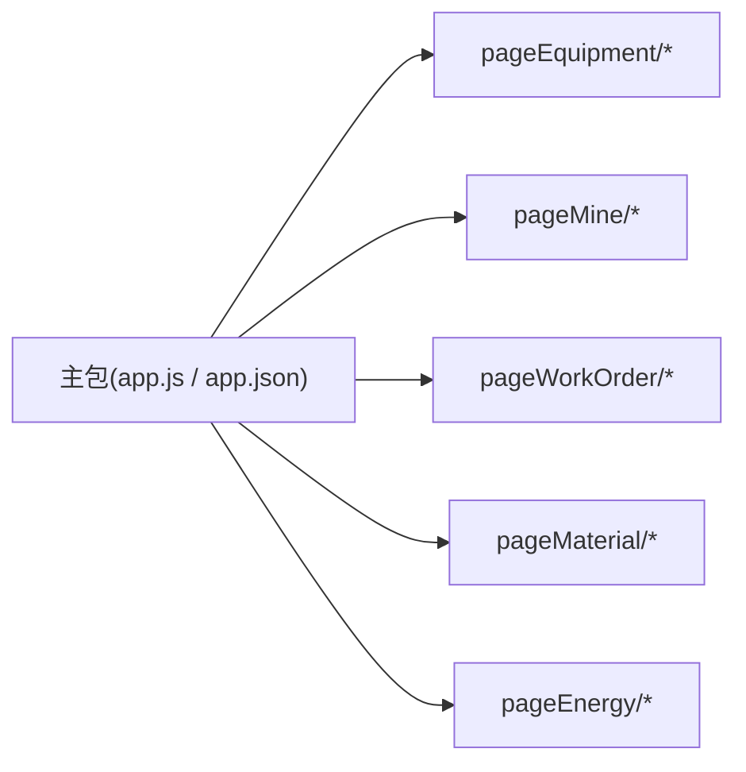
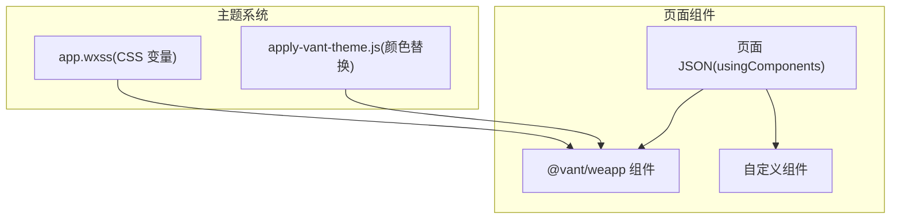
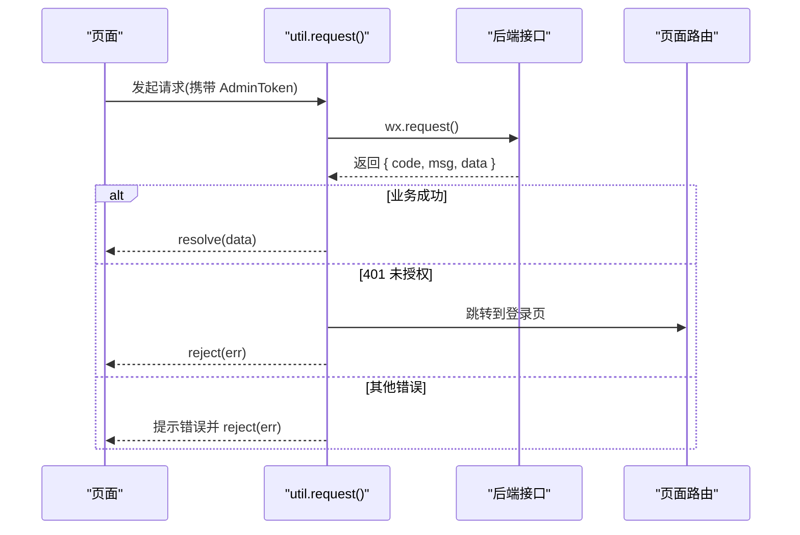
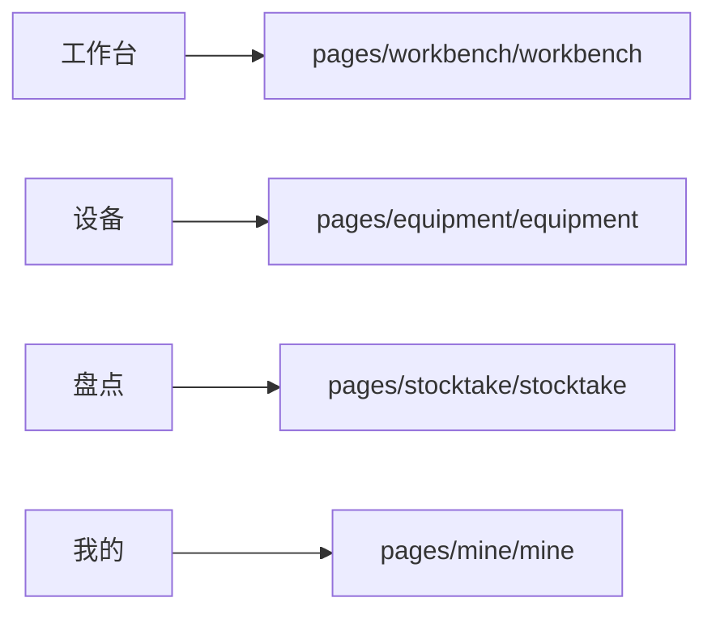
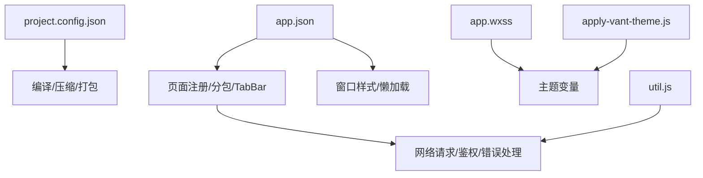

# 小程序架构设计

<cite>
**本文档引用的文件**
- [app.json](file://gccd_mini/app.json)
- [app.js](file://gccd_mini/app.js)
- [project.config.json](file://gccd_mini/project.config.json)
- [package.json](file://gccd_mini/package.json)
- [util.js](file://gccd_mini/utils/util.js)
- [apply-vant-theme.js](file://gccd_mini/scripts/apply-vant-theme.js)
- [app.wxss](file://gccd_mini/app.wxss)
- [workOrderAdd.json](file://gccd_mini/pageWorkOrder/pages/workOrderAdd/workOrderAdd.json)
- [index.json](file://gccd_mini/pages/index/index.json)
- [main-tab-bar.json](file://gccd_mini/pages/components/main-tab-bar/main-tab-bar.json)
- [workbench.json](file://gccd_mini/pages/workbench/workbench.json)
- [maintenanceRecord.json](file://gccd_mini/pageEquipment/pages/maintenanceRecord/maintenanceRecord.json)
- [workRecord.json](file://gccd_mini/pageMine/pages/workRecord/workRecord.json)
- [sitemap.json](file://gccd_mini/sitemap.json)
</cite>

## 目录
1. [引言](#引言)
2. [项目结构](#项目结构)
3. [核心组件](#核心组件)
4. [架构总览](#架构总览)
5. [详细组件分析](#详细组件分析)
6. [依赖关系分析](#依赖关系分析)
7. [性能考虑](#性能考虑)
8. [故障排查指南](#故障排查指南)
9. [结论](#结论)
10. [附录](#附录)

## 引言
本文件面向高齿传动微信小程序的架构设计与实现，围绕页面结构、路由管理、分包策略、配置参数、生命周期、组件系统、数据流、性能优化、调试与开发环境等方面进行系统性梳理。通过结合实际代码文件，帮助开发者快速理解并高效迭代小程序功能。

## 项目结构
小程序采用典型的“分包 + 主包”组织方式，主包包含基础页面与全局配置，业务页面按功能拆分为多个子包，以降低首屏体积、提升加载速度。同时引入 Vant Weapp 组件库并定制主题色，统一交互与视觉风格。

**图表来源**
- [app.json:1-99](file://gccd_mini/app.json#L1-L99)
- [app.js:1-33](file://gccd_mini/app.js#L1-L33)

**章节来源**
- [app.json:1-99](file://gccd_mini/app.json#L1-L99)
- [project.config.json:1-78](file://gccd_mini/project.config.json#L1-L78)

## 核心组件
- 应用入口与生命周期
  - 在应用启动时进行登录态检查与页面跳转，决定初始页面路径。
  - 初始化全局数据，便于页面共享使用。
- 页面与组件注册
  - 通过 app.json 注册页面与分包页面，声明 tabBar、窗口样式、懒加载策略等。
  - 页面级 usingComponents 声明按需使用的自定义组件或第三方组件。
- 数据与网络
  - 统一封装请求方法，集中处理鉴权头、业务码判断、错误提示与跳转逻辑。
- 主题与样式
  - 使用 CSS 变量统一主色与辅助色，配合脚本替换第三方组件库中的固定品牌色。

**章节来源**
- [app.js:1-33](file://gccd_mini/app.js#L1-L33)
- [app.json:1-99](file://gccd_mini/app.json#L1-L99)
- [util.js:1-98](file://gccd_mini/utils/util.js#L1-L98)
- [apply-vant-theme.js:1-95](file://gccd_mini/scripts/apply-vant-theme.js#L1-L95)
- [app.wxss:1-135](file://gccd_mini/app.wxss#L1-L135)

## 架构总览
小程序整体采用“主包承载基础页面与配置，业务页面按功能拆分至子包”的架构。路由层面通过 app.json 的 pages 与 subPackages 字段统一管理；组件层面通过 usingComponents 实现模块化复用；数据流通过全局 util.request 统一处理，确保一致的鉴权与错误处理。

**图表来源**
- [app.json:1-99](file://gccd_mini/app.json#L1-L99)
- [project.config.json:1-78](file://gccd_mini/project.config.json#L1-L78)
- [app.js:1-33](file://gccd_mini/app.js#L1-L33)
- [app.wxss:1-135](file://gccd_mini/app.wxss#L1-L135)
- [apply-vant-theme.js:1-95](file://gccd_mini/scripts/apply-vant-theme.js#L1-L95)
- [sitemap.json:1-7](file://gccd_mini/sitemap.json#L1-L7)

## 详细组件分析

### 应用生命周期与初始化流程
- 启动阶段
  - 读取本地日志时间戳，记录启动时间。
  - 检查登录态令牌，存在则直接跳转到工作台，否则跳转到登录页。
  - 触发登录流程，用于换取用户标识信息。
- 关键点
  - reLaunch 保证从根页面重启，避免历史页面栈导致的页面错乱。
  - 登录态与页面跳转逻辑紧密耦合，确保用户始终处于正确的访问入口。

**图表来源**
- [app.js:1-33](file://gccd_mini/app.js#L1-L33)

**章节来源**
- [app.js:1-33](file://gccd_mini/app.js#L1-L33)

### 页面与路由管理
- 页面注册
  - 主包页面在 app.json 的 pages 数组中声明，确保可直接访问。
  - 分包页面在 subPackages 中声明，仅在进入对应分包时按需加载。
- 路由策略
  - 首次进入根据登录态决定入口页，避免重复跳转。
  - 页面间跳转通过 wx.navigateTo、wx.redirectTo、wx.reLaunch 等 API 控制页面栈。
- 导航样式
  - 部分页面启用自定义导航样式，减少系统导航栏占用空间，提升内容可视面积。

**图表来源**
- [app.js:1-33](file://gccd_mini/app.js#L1-L33)

**章节来源**
- [app.json:1-99](file://gccd_mini/app.json#L1-L99)
- [workbench.json:1-5](file://gccd_mini/pages/workbench/workbench.json#L1-L5)

### 分包策略与加载机制
- 分包划分
  - 按业务域拆分：设备、我的、工单、物料、能源等子包，降低主包体积。
- 加载策略
  - 通过 subPackages 声明分包根目录与页面清单，小程序在首次访问对应页面时按需下载。
- 性能收益
  - 首屏加载更快，冷启动体验更佳；后续页面访问按需加载，节省流量与内存。

**图表来源**
- [app.json:56-98](file://gccd_mini/app.json#L56-L98)

**章节来源**
- [app.json:56-98](file://gccd_mini/app.json#L56-L98)

### 组件系统与主题定制
- 组件注册
  - 页面级 usingComponents 声明按需引入第三方组件（如 Vant Weapp），减少全局组件体积。
  - 自定义组件通过 components 目录组织，页面内以 component: true 声明。
- 主题定制
  - 通过脚本批量替换第三方组件库中的固定品牌色，与 app.wxss 中的 CSS 变量保持一致。
  - 项目构建时自动执行主题替换，保证主色一致性。

**图表来源**
- [workOrderAdd.json:1-17](file://gccd_mini/pageWorkOrder/pages/workOrderAdd/workOrderAdd.json#L1-L17)
- [index.json:1-5](file://gccd_mini/pages/index/index.json#L1-L5)
- [main-tab-bar.json:1-5](file://gccd_mini/pages/components/main-tab-bar/main-tab-bar.json#L1-L5)
- [app.wxss:1-135](file://gccd_mini/app.wxss#L1-L135)
- [apply-vant-theme.js:1-95](file://gccd_mini/scripts/apply-vant-theme.js#L1-L95)

**章节来源**
- [workOrderAdd.json:1-17](file://gccd_mini/pageWorkOrder/pages/workOrderAdd/workOrderAdd.json#L1-L17)
- [index.json:1-5](file://gccd_mini/pages/index/index.json#L1-L5)
- [main-tab-bar.json:1-5](file://gccd_mini/pages/components/main-tab-bar/main-tab-bar.json#L1-L5)
- [app.wxss:1-135](file://gccd_mini/app.wxss#L1-L135)
- [apply-vant-theme.js:1-95](file://gccd_mini/scripts/apply-vant-theme.js#L1-L95)

### 数据流与网络请求设计
- 请求封装
  - 统一使用 util.request，内置 AdminToken 注入、业务码校验、错误提示与 401 自动登出跳转。
  - 支持额外的成功码配置，满足不同接口的业务约定。
- 错误处理
  - 对 401、400、404 等常见业务码进行明确提示与页面跳转。
  - 网络异常统一提示，避免页面“卡死”。

**图表来源**
- [util.js:1-98](file://gccd_mini/utils/util.js#L1-L98)

**章节来源**
- [util.js:1-98](file://gccd_mini/utils/util.js#L1-L98)

### tabBar 与窗口配置
- tabBar
  - 四个常用功能入口，分别指向工作台、设备、盘点、我的页面，图标区分选中与非选中状态。
- 窗口样式
  - 导航栏文字颜色、背景色、标题文本、背景色等统一设置。
  - 自定义导航样式减少系统导航栏高度，提升内容可视区域。

**图表来源**
- [app.json:24-55](file://gccd_mini/app.json#L24-L55)

**章节来源**
- [app.json:24-55](file://gccd_mini/app.json#L24-L55)
- [workbench.json:1-5](file://gccd_mini/pages/workbench/workbench.json#L1-L5)

### 懒加载与按需组件
- 懒加载策略
  - 通过 lazyCodeLoading: "requiredComponents" 指定仅按需加载声明了的组件，减少初始包体。
- 组件按需注册
  - 页面 JSON 中 usingComponents 仅注册当前页面实际使用的组件，避免全局组件引入带来的体积膨胀。

**章节来源**
- [app.json:23-23](file://gccd_mini/app.json#L23-L23)
- [workOrderAdd.json:1-17](file://gccd_mini/pageWorkOrder/pages/workOrderAdd/workOrderAdd.json#L1-L17)
- [maintenanceRecord.json:1-13](file://gccd_mini/pageEquipment/pages/maintenanceRecord/maintenanceRecord.json#L1-L13)
- [workRecord.json:1-6](file://gccd_mini/pageMine/pages/workRecord/workRecord.json#L1-L6)

## 依赖关系分析
- 配置依赖
  - app.json 是页面与分包的唯一权威来源，决定页面注册、tabBar、窗口样式与分包加载。
  - project.config.json 控制编译、压缩、打包策略，影响最终产物体积与性能。
- 组件依赖
  - 页面 JSON 的 usingComponents 决定组件依赖图谱，需与实际 wxml 结构匹配。
  - Vant Weapp 组件版本与主题脚本共同决定 UI 一致性。
- 数据依赖
  - util.request 作为统一数据入口，所有页面请求均依赖其错误处理与鉴权注入。

**图表来源**
- [app.json:1-99](file://gccd_mini/app.json#L1-L99)
- [project.config.json:1-78](file://gccd_mini/project.config.json#L1-L78)
- [app.wxss:1-135](file://gccd_mini/app.wxss#L1-L135)
- [apply-vant-theme.js:1-95](file://gccd_mini/scripts/apply-vant-theme.js#L1-L95)
- [util.js:1-98](file://gccd_mini/utils/util.js#L1-L98)

**章节来源**
- [app.json:1-99](file://gccd_mini/app.json#L1-L99)
- [project.config.json:1-78](file://gccd_mini/project.config.json#L1-L78)
- [util.js:1-98](file://gccd_mini/utils/util.js#L1-L98)

## 性能考虑
- 分包与懒加载
  - 将高频访问页面置于主包，低频页面放入分包，显著降低首屏体积。
  - 使用懒加载策略，仅加载声明的组件，减少初始包体。
- 编译与压缩
  - 启用 WXML/WXSS 压缩、ES6 转 ES5、增强编译等设置，减小产物体积。
  - 上传时开启 SourceMap，便于线上问题定位。
- 资源优化
  - 图片与静态资源建议外部托管，小程序内仅保留必要图标与最小化资源。
  - 组件按需引入，避免全局引入大型组件库造成体积膨胀。
- 网络优化
  - 统一请求封装，减少重复逻辑与网络开销。
  - 对于频繁调用的接口，可在页面内做缓存与节流处理。

[本节为通用指导，无需列出具体文件来源]

## 故障排查指南
- 登录态失效
  - 现象：出现“请重新登录”提示并自动跳转登录页。
  - 排查：检查本地存储的 AdminToken 是否存在；确认后端返回 401 时前端是否正确清除并跳转。
- 网络异常
  - 现象：提示“网络异常，请检查网络”。
  - 排查：确认域名配置与网络连通性；检查请求地址与后端接口可用性。
- 页面无法打开或白屏
  - 现象：点击 tabBar 或跳转后页面空白。
  - 排查：确认 app.json 中页面路径与分包配置正确；检查页面 JSON 的 usingComponents 是否与实际组件匹配。
- 主题色不一致
  - 现象：组件主色与项目主色不一致。
  - 排查：确认脚本执行是否成功；检查 app.wxss 中 CSS 变量与第三方组件颜色替换是否生效。

**章节来源**
- [util.js:1-98](file://gccd_mini/utils/util.js#L1-L98)
- [app.json:1-99](file://gccd_mini/app.json#L1-L99)
- [apply-vant-theme.js:1-95](file://gccd_mini/scripts/apply-vant-theme.js#L1-L95)

## 结论
本架构以“主包 + 分包 + 懒加载 + 组件按需引入”为核心，结合统一的主题定制与网络请求封装，实现了良好的可维护性与性能表现。通过规范的配置与组件注册策略，能够有效降低首屏体积、提升用户体验，并为后续功能扩展提供稳定基座。

## 附录

### app.json 关键参数说明
- pages：主包页面注册列表，决定可直接访问的页面路径。
- window：窗口样式配置，包括导航栏文字颜色、标题文本、背景色、导航样式等。
- componentFramework：组件框架选择，使用 glass-easel。
- sitemapLocation：站点索引配置文件位置。
- lazyCodeLoading：按需加载策略，仅加载声明的组件。
- tabBar：底部标签栏配置，包含颜色、选中色、背景色、边框样式及各 tab 的页面路径与图标。
- subPackages：分包配置，按功能域划分页面，实现按需加载。

**章节来源**
- [app.json:1-99](file://gccd_mini/app.json#L1-L99)

### project.config.json 关键设置说明
- compileType：编译类型为小程序。
- libVersion：基础库版本。
- packOptions.ignore：打包时忽略的文件与目录，减少无关资源打包。
- setting：编译与压缩设置，包括 WXML/WXSS 压缩、ES6 转换、增强编译、上传 SourceMap 等。
- appid：小程序 AppID。

**章节来源**
- [project.config.json:1-78](file://gccd_mini/project.config.json#L1-L78)

### package.json 与依赖
- 依赖：@vant/weapp 版本。
- 脚本：postinstall 执行主题脚本，自动替换第三方组件库中的品牌色。

**章节来源**
- [package.json:1-12](file://gccd_mini/package.json#L1-L12)
- [apply-vant-theme.js:1-95](file://gccd_mini/scripts/apply-vant-theme.js#L1-L95)

### sitemap.json 说明
- 规则：允许所有页面被搜索引擎收录，便于小程序内容曝光。

**章节来源**
- [sitemap.json:1-7](file://gccd_mini/sitemap.json#L1-L7)