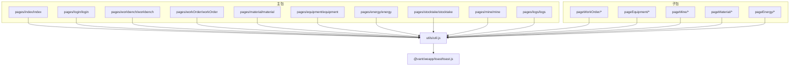
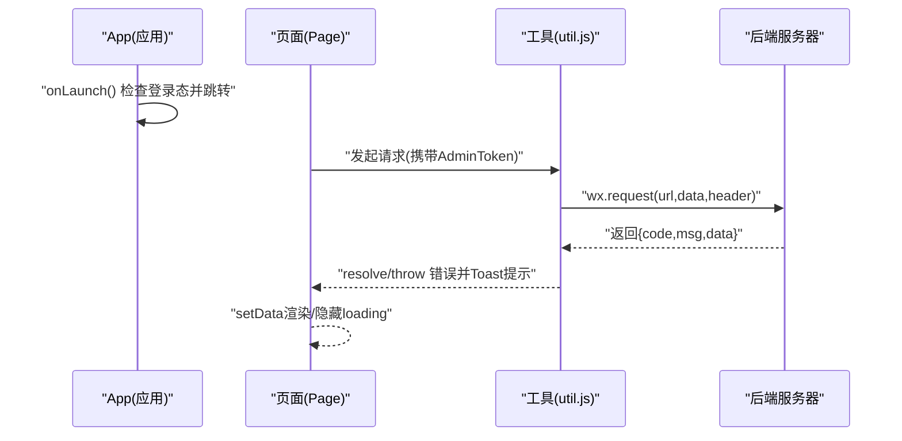
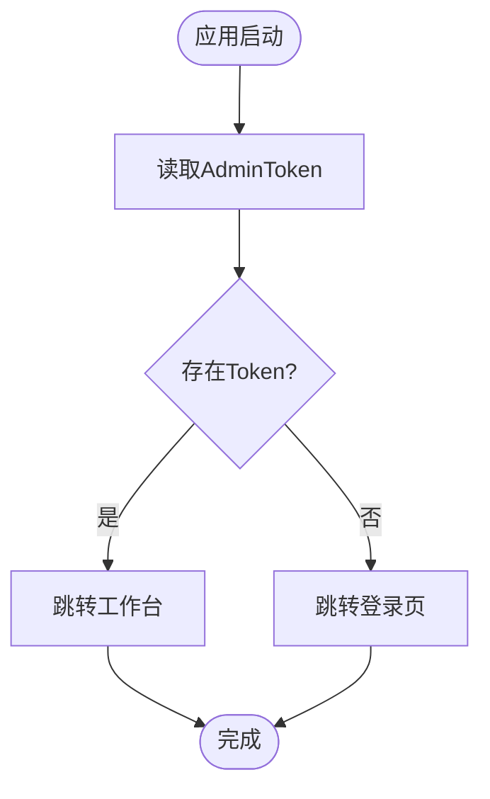
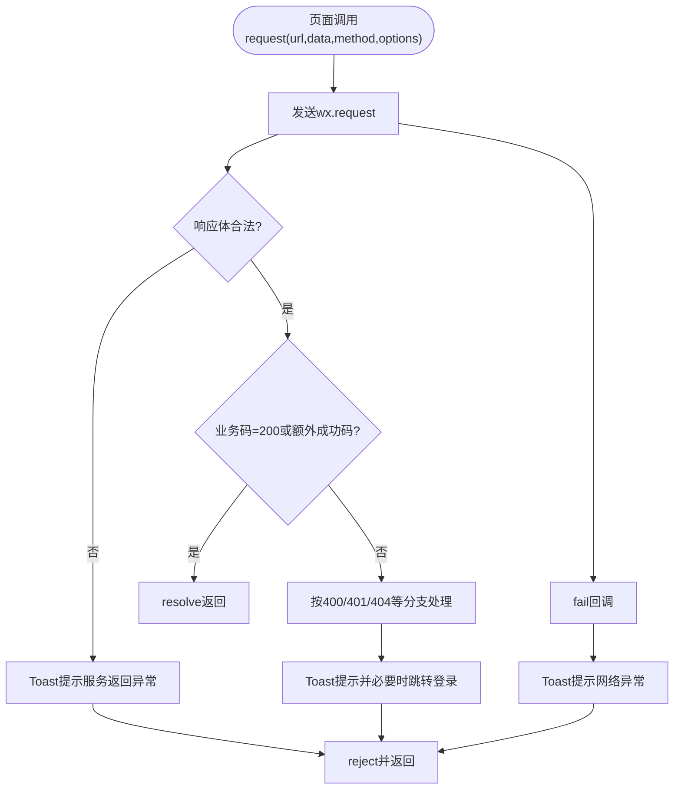
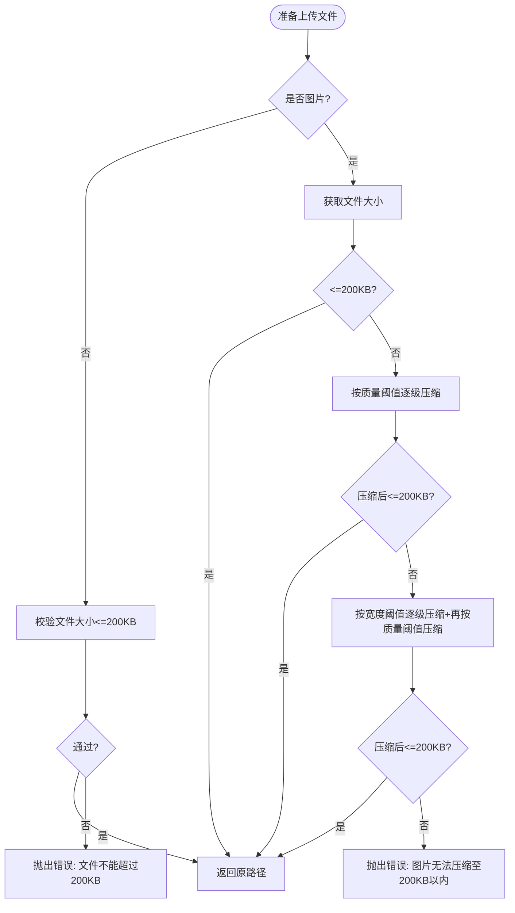
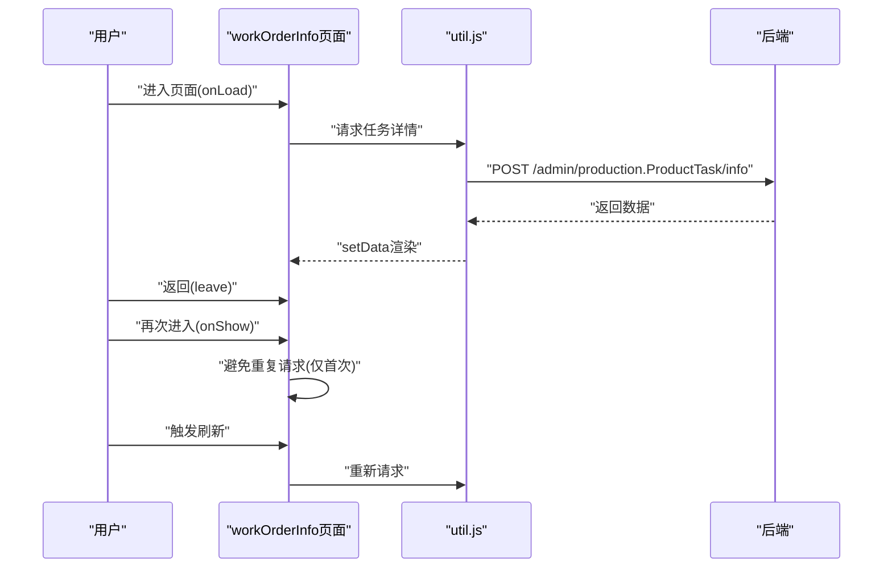
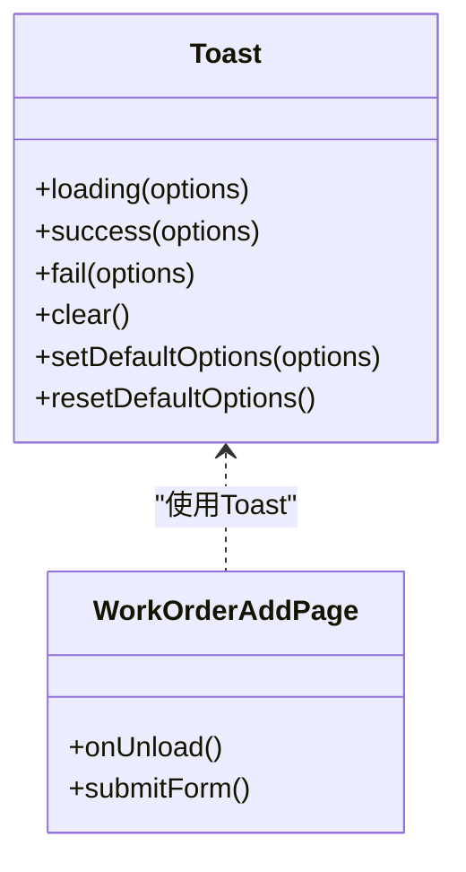
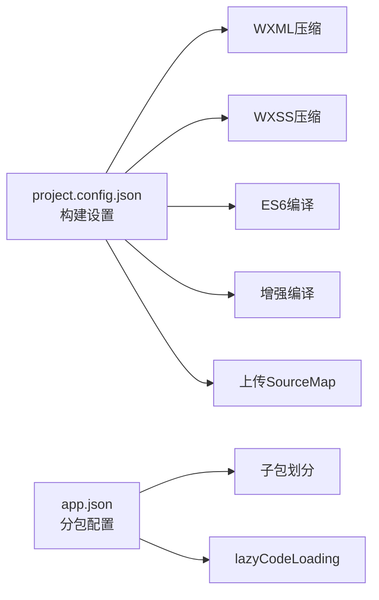

# 性能优化与调试

<cite>
**本文引用的文件**   
- [app.js](file://gccd_mini/app.js)
- [app.json](file://gccd_mini/app.json)
- [project.config.json](file://gccd_mini/project.config.json)
- [util.js](file://gccd_mini/utils/util.js)
- [mediaCompress.js](file://gccd_mini/utils/mediaCompress.js)
- [workOrderAdd.js](file://gccd_mini/pageWorkOrder/pages/workOrderAdd/workOrderAdd.js)
- [workOrderInfo.js](file://gccd_mini/pageWorkOrder/pages/workOrderInfo/workOrderInfo.js)
- [workOrderProcess.js](file://gccd_mini/pageWorkOrder/pages/workOrderProcess/workOrderProcess.js)
- [workbench.js](file://gccd_mini/pages/workbench/workbench.js)
- [index.js](file://gccd_mini/pages/index/index.js)
- [toast.js](file://gccd_mini/miniprogram_npm/@vant/weapp/toast/toast.js)
- [package.json](file://gccd_mini/package.json)
</cite>

## 目录
1. [简介](#简介)
2. [项目结构](#项目结构)
3. [核心组件](#核心组件)
4. [架构总览](#架构总览)
5. [详细组件分析](#详细组件分析)
6. [依赖分析](#依赖分析)
7. [性能考虑](#性能考虑)
8. [故障排查指南](#故障排查指南)
9. [结论](#结论)
10. [附录](#附录)

## 简介
本文件面向“高齿传动”小程序的性能优化与调试，围绕启动速度、页面加载、内存管理、网络请求、调试工具、监控与分析、兼容性处理、发布与更新策略等方面进行系统化梳理，并结合仓库现有实现给出可落地的优化建议与最佳实践。

## 项目结构
- 小程序主体位于 gccd_mini，采用分包策略组织页面，主包包含登录、工作台、工单、物料、设备、能源、库存盘点、我的等页面；子包按功能域拆分，减少首屏包体与冷启动压力。
- 构建配置启用多种压缩与优化开关，如 WXML/WXSS 压缩、ES6 编译、增强编译等，有助于减小包体与提升运行效率。
- 使用 Vant Weapp 组件库，统一交互体验，同时注意按需引入与主题定制以降低冗余。

**图表来源**
- [app.json:1-99](file://gccd_mini/app.json#L1-L99)
- [project.config.json:1-78](file://gccd_mini/project.config.json#L1-L78)

**章节来源**
- [app.json:1-99](file://gccd_mini/app.json#L1-L99)
- [project.config.json:1-78](file://gccd_mini/project.config.json#L1-L78)

## 核心组件
- 应用生命周期与启动流程：在应用启动时进行登录态检查与页面跳转，减少不必要的初始化开销。
- 网络层封装：统一封装 wx.request，集中处理鉴权头、业务码判断、错误提示与失败兜底。
- 媒体上传预处理：对图片进行体积检测与多级压缩，确保上传文件满足限制，避免失败重试带来的性能损耗。
- 页面交互组件：基于 Vant Weapp 的 Toast 组件，提供统一的消息提示与自动清理队列，避免重复渲染与内存泄漏风险。
- 分包与懒加载：通过分包与 lazyCodeLoading 配置，降低主包体积，提升首屏加载速度。

**章节来源**
- [app.js:1-33](file://gccd_mini/app.js#L1-L33)
- [util.js:1-98](file://gccd_mini/utils/util.js#L1-L98)
- [mediaCompress.js:1-104](file://gccd_mini/utils/mediaCompress.js#L1-L104)
- [toast.js:1-84](file://gccd_mini/miniprogram_npm/@vant/weapp/toast/toast.js#L1-L84)
- [app.json:21-23](file://gccd_mini/app.json#L21-L23)

## 架构总览
小程序前端与后端通过统一封装的请求函数通信，页面通过组件库提供一致的交互反馈。分包策略与构建优化共同服务于启动与加载性能。

**图表来源**
- [app.js:3-28](file://gccd_mini/app.js#L3-L28)
- [util.js:22-94](file://gccd_mini/utils/util.js#L22-L94)

## 详细组件分析

### 启动与登录流程优化
- 在应用启动阶段完成登录态判断与页面跳转，避免在多个页面重复判断。
- 首屏页面优先加载，非关键页面延后加载，结合分包策略降低冷启动时间。
- 构建设置开启压缩与增强编译，减少包体与解析时间。

**图表来源**
- [app.js:3-21](file://gccd_mini/app.js#L3-L21)

**章节来源**
- [app.js:1-33](file://gccd_mini/app.js#L1-L33)
- [app.json:56-99](file://gccd_mini/app.json#L56-L99)
- [project.config.json:45-70](file://gccd_mini/project.config.json#L45-L70)

### 网络请求与错误处理
- 统一请求封装：集中设置 AdminToken、处理非对象响应、业务码判断与错误提示。
- 失败兜底：网络异常统一提示并拒绝 Promise，避免页面“卡死”。
- 页面侧配合：在请求前后显隐 loading、Toast 提示，保证用户感知与交互一致性。

**图表来源**
- [util.js:22-94](file://gccd_mini/utils/util.js#L22-L94)

**章节来源**
- [util.js:1-98](file://gccd_mini/utils/util.js#L1-L98)
- [workOrderAdd.js:144-169](file://gccd_mini/pageWorkOrder/pages/workOrderAdd/workOrderAdd.js#L144-L169)
- [workOrderInfo.js:62-124](file://gccd_mini/pageWorkOrder/pages/workOrderInfo/workOrderInfo.js#L62-L124)

### 媒体上传体积控制
- 体积检测：先获取文件大小，若超限则进行压缩或降分辨率。
- 图片压缩策略：按质量阈值与宽度阈值进行多轮压缩，最终仍超限则抛出明确错误。
- 非图片文件：仅做体积校验，超限则报错。

**图表来源**
- [mediaCompress.js:48-98](file://gccd_mini/utils/mediaCompress.js#L48-L98)

**章节来源**
- [mediaCompress.js:1-104](file://gccd_mini/utils/mediaCompress.js#L1-L104)

### 页面加载与渲染优化
- 工单详情页：在 onShow 中避免重复请求，首次进入时才请求，返回时刷新，减少不必要的网络与渲染开销。
- 工序处理页：提供“重试加载”能力，网络不佳时可主动重试，提升稳定性。
- 工单新增页：在提交前进行表单校验，避免无效请求；提交过程中显隐 loading，防止重复提交。

**图表来源**
- [workOrderInfo.js:145-167](file://gccd_mini/pageWorkOrder/pages/workOrderInfo/workOrderInfo.js#L145-L167)

**章节来源**
- [workOrderInfo.js:1-235](file://gccd_mini/pageWorkOrder/pages/workOrderInfo/workOrderInfo.js#L1-L235)
- [workOrderProcess.js:1-116](file://gccd_mini/pageWorkOrder/pages/workOrderProcess/workOrderProcess.js#L1-L116)
- [workOrderAdd.js:752-858](file://gccd_mini/pageWorkOrder/pages/workOrderAdd/workOrderAdd.js#L752-L858)

### 交互反馈与内存管理
- Toast 组件：统一消息提示，内部维护队列与定时器，自动清理，避免重复渲染与内存泄漏。
- 页面卸载：在工单新增页中清理输入防抖计时器，防止页面销毁后仍执行回调造成异常。

**图表来源**
- [toast.js:15-84](file://gccd_mini/miniprogram_npm/@vant/weapp/toast/toast.js#L15-L84)
- [workOrderAdd.js:910-916](file://gccd_mini/pageWorkOrder/pages/workOrderAdd/workOrderAdd.js#L910-L916)

**章节来源**
- [toast.js:1-84](file://gccd_mini/miniprogram_npm/@vant/weapp/toast/toast.js#L1-L84)
- [workOrderAdd.js:910-916](file://gccd_mini/pageWorkOrder/pages/workOrderAdd/workOrderAdd.js#L910-L916)

### 主题与组件
- 通过脚本应用 Vant Weapp 主题，统一视觉风格，减少自定义样式成本。
- 组件按需使用，避免全量引入导致包体膨胀。

**章节来源**
- [package.json:1-12](file://gccd_mini/package.json#L1-L12)

## 依赖分析
- 构建配置：启用 WXML/WXSS 压缩、ES6 编译、增强编译、上传 SourceMap 等，有利于减小包体与定位问题。
- 运行框架：使用 glass-easel 组件框架与 lazyCodeLoading，提升组件按需加载能力。
- 分包策略：将设备、我的、工单、物料、能源等功能域独立为子包，降低主包体积与首屏加载时间。

**图表来源**
- [project.config.json:45-70](file://gccd_mini/project.config.json#L45-L70)
- [app.json:56-99](file://gccd_mini/app.json#L56-L99)

**章节来源**
- [project.config.json:1-78](file://gccd_mini/project.config.json#L1-L78)
- [app.json:1-99](file://gccd_mini/app.json#L1-L99)

## 性能考虑
- 启动速度
  - 减少主包入口逻辑，将非关键初始化移至页面级惰性执行。
  - 使用分包与懒加载，确保首屏只加载必要页面与组件。
  - 构建阶段开启压缩与增强编译，缩短下载与解析时间。
- 页面加载
  - 首屏数据采用“懒加载/按需加载”，避免一次性拉取过多数据。
  - 对于列表类页面，提供“重试加载”与“下拉刷新”能力，提升可用性。
- 内存管理
  - 页面卸载时清理计时器、事件监听与全局变量引用。
  - 使用 Toast 等组件时及时 clear，避免队列堆积。
- 网络请求
  - 统一封装请求与错误处理，避免重复请求与页面卡死。
  - 对上传文件进行体积控制与压缩，减少失败重试次数。
- 图像与媒体
  - 上传前进行体积检测与多级压缩，确保符合平台限制。
- 用户体验
  - 在关键操作（提交、查询）前后显隐 loading，提供明确反馈。
  - 对输入进行即时校验与提示，减少无效提交。

[本节为通用指导，无需列出具体文件来源]

## 故障排查指南
- 登录态失效
  - 现象：出现 401 提示并自动跳转登录。
  - 处理：清除本地 Token 与用户信息，引导重新登录。
- 网络异常
  - 现象：请求失败提示“网络异常，请检查网络”。
  - 处理：检查网络状态与域名白名单，确认请求头与鉴权信息。
- 上传失败
  - 现象：图片/音频过大或无法压缩至限制内。
  - 处理：更换更小的图片或音频，或使用更低分辨率的素材。
- 页面卡顿
  - 现象：页面渲染缓慢或交互无响应。
  - 处理：检查是否存在大量 setData 与重复请求，优化数据结构与渲染范围。
- 控制台告警
  - 现象：组件节点未找到或基础库版本过低。
  - 处理：确认组件选择器与上下文，升级微信基础库版本。

**章节来源**
- [util.js:49-68](file://gccd_mini/utils/util.js#L49-L68)
- [mediaCompress.js:89-96](file://gccd_mini/utils/mediaCompress.js#L89-L96)
- [toast.js:42-44](file://gccd_mini/miniprogram_npm/@vant/weapp/toast/toast.js#L42-L44)

## 结论
通过对启动流程、网络层、媒体上传、页面渲染与交互反馈的系统化优化，结合分包与构建配置，可显著提升“高齿传动”小程序的启动速度、加载性能与用户体验。建议持续关注运行时日志与用户反馈，配合调试与监控手段，形成闭环的性能治理流程。

[本节为总结性内容，无需列出具体文件来源]

## 附录

### 调试工具与方法
- 开发者工具
  - 使用“调试器”查看网络请求、Storage、本地缓存与控制台输出。
  - 使用“性能面板”观察帧率、布局与重绘情况，定位卡顿点。
  - 使用“Storage 面板”与“本地缓存”查看登录态与业务数据。
- 真机调试
  - 通过手机扫码连接开发者工具，实时查看日志与断点调试。
- 远程调试
  - 结合日志上报与错误捕获，定位线上问题；必要时开启远程断点（视工具支持）。

[本节为通用指导，无需列出具体文件来源]

### 监控与分析
- 性能监控
  - 上报关键指标（首屏时间、页面停留时长、接口耗时、失败率）。
- 错误收集
  - 捕获网络异常、业务异常与组件渲染异常，统一上报并分级处理。
- 用户行为分析
  - 关键路径埋点（登录、报工、查询、导出等），评估使用频率与转化。

[本节为通用指导，无需列出具体文件来源]

### 兼容性处理
- 微信客户端版本
  - 通过 libVersion 与基础库版本检查，对不兼容特性进行降级处理。
- iOS 与 Android
  - 注意系统导航栏高度差异与字体渲染差异，使用系统信息动态适配。
- 组件与 API
  - 对新 API 做能力检测与回退方案，确保在旧版本稳定运行。

**章节来源**
- [project.config.json](file://gccd_mini/project.config.json#L3)
- [workbench.js:6-12](file://gccd_mini/pages/workbench/workbench.js#L6-L12)
- [index.js:12-13](file://gccd_mini/pages/index/index.js#L12-L13)

### 发布与更新策略
- 版本管理
  - 严格遵循语义化版本，区分主版本、次版本与补丁版本。
- 灰度发布
  - 采用分批放量策略，先对部分用户开放新版本，观察指标与日志。
- 回滚机制
  - 快速回滚至稳定版本，保留灰度通道以便二次发布。

[本节为通用指导，无需列出具体文件来源]