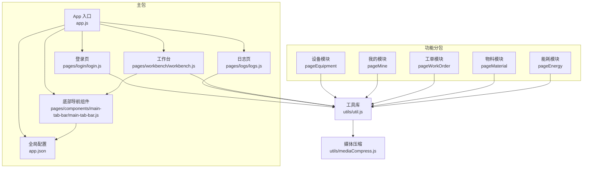
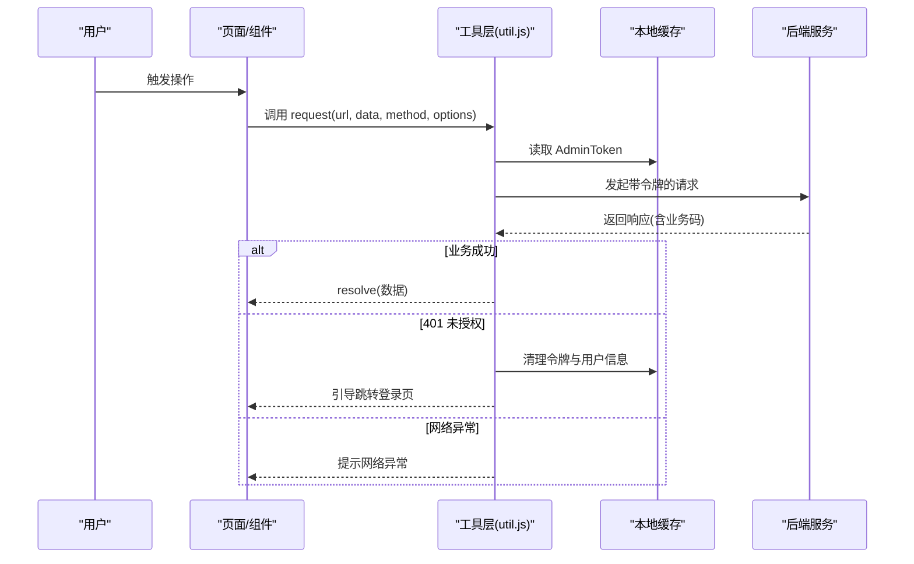
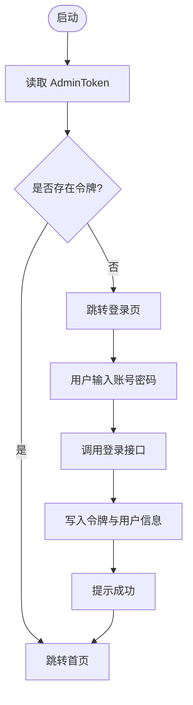
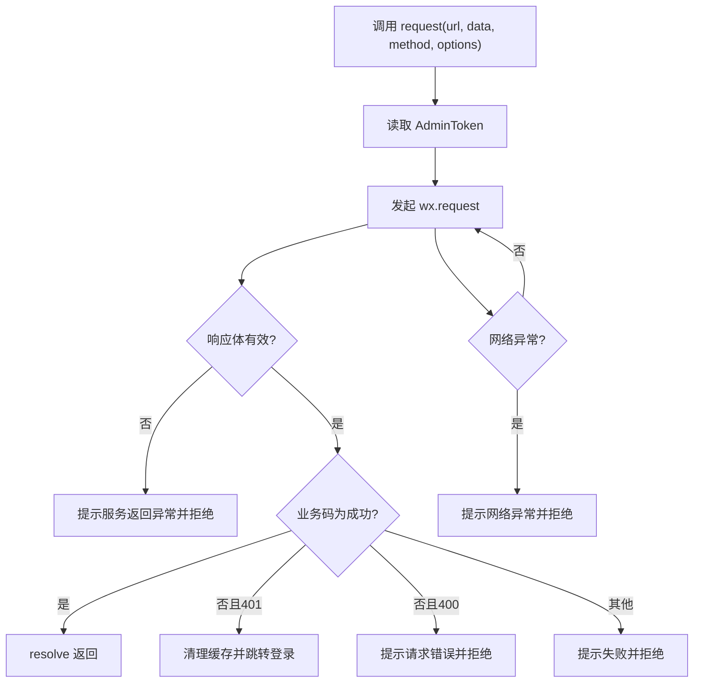
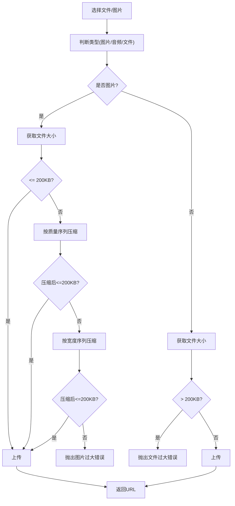
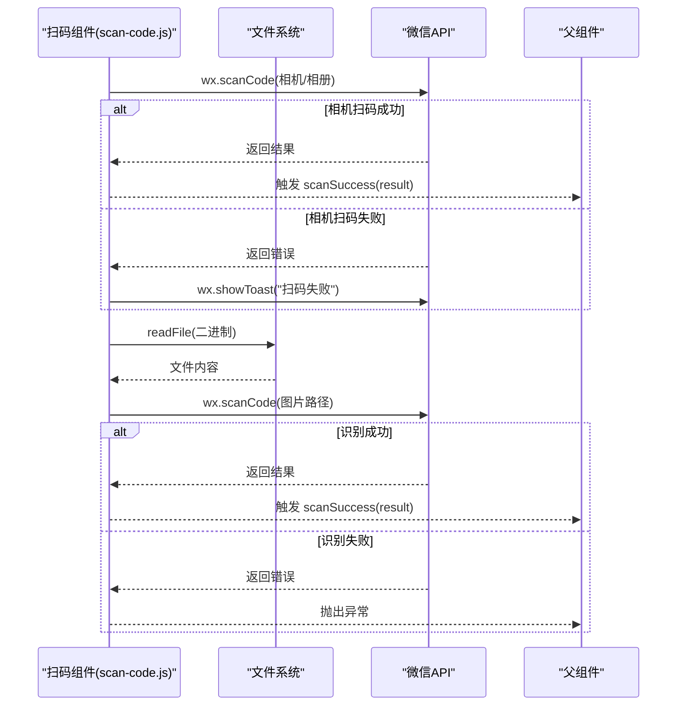
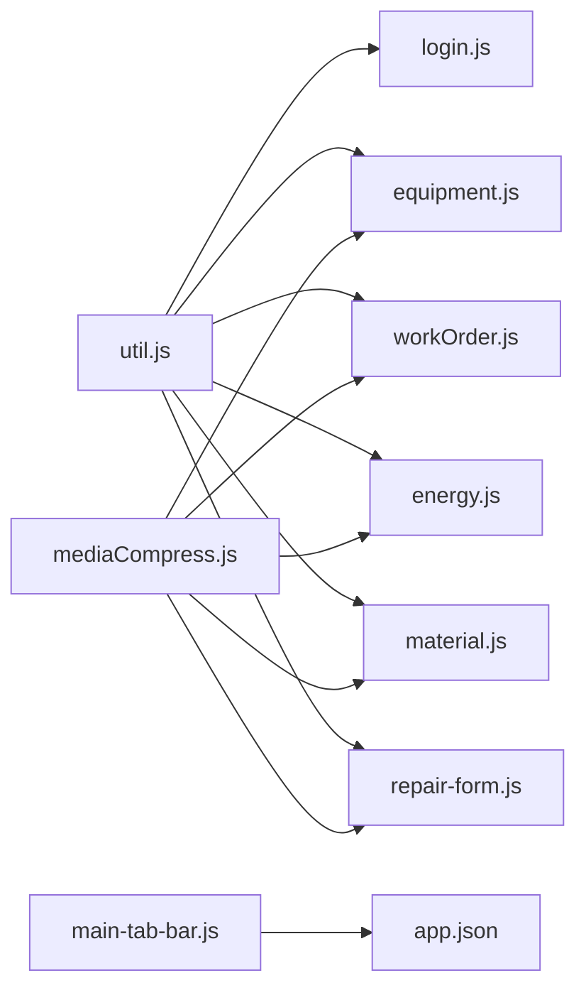

# 数据管理与存储

<cite>
**本文引用的文件**
- [app.js](file://gccd_mini/app.js)
- [app.json](file://gccd_mini/app.json)
- [util.js](file://gccd_mini/utils/util.js)
- [mediaCompress.js](file://gccd_mini/utils/mediaCompress.js)
- [login.js](file://gccd_mini/pages/login/login.js)
- [logs.js](file://gccd_mini/pages/logs/logs.js)
- [workbench.js](file://gccd_mini/pages/workbench/workbench.js)
- [equipment.js](file://gccd_mini/pages/equipment/equipment.js)
- [workOrder.js](file://gccd_mini/pages/workOrder/workOrder.js)
- [energy.js](file://gccd_mini/pages/energy/energy.js)
- [repair-form.js](file://gccd_mini/pages/components/repair-form/repair-form.js)
- [material.js](file://gccd_mini/pages/material/material.js)
- [scan-code.js](file://gccd_mini/pages/components/scan-code/scan-code.js)
- [main-tab-bar.js](file://gccd_mini/pages/components/main-tab-bar/main-tab-bar.js)
- [request.js](file://yarn/src/utils/request.js)
</cite>

## 目录
1. [简介](#简介)
2. [项目结构](#项目结构)
3. [核心组件](#核心组件)
4. [架构总览](#架构总览)
5. [详细组件分析](#详细组件分析)
6. [依赖关系分析](#依赖关系分析)
7. [性能考量](#性能考量)
8. [故障排查指南](#故障排查指南)
9. [结论](#结论)
10. [附录](#附录)

## 简介
本文件面向“高齿传动”小程序的数据管理与存储体系，系统性梳理本地数据存储、远程数据获取、多媒体处理与上传、数据同步策略、安全与隐私保护以及性能优化建议。文档以代码为依据，结合流程图与类图，帮助开发者快速理解并高效维护该小程序的数据层。

## 项目结构
小程序采用分包+组件化组织方式，主包包含应用入口、通用工具与页面；各功能域通过 subPackages 独立划分，便于按需加载与维护。全局配置集中于 app.json，定义页面路由、导航栏样式、TabBar 与分包结构。

图表来源
- [app.js:1-33](file://gccd_mini/app.js#L1-L33)
- [app.json:1-99](file://gccd_mini/app.json#L1-L99)
- [util.js:1-98](file://gccd_mini/utils/util.js#L1-L98)
- [mediaCompress.js:1-104](file://gccd_mini/utils/mediaCompress.js#L1-L104)
- [login.js:1-180](file://gccd_mini/pages/login/login.js#L1-L180)
- [logs.js:1-19](file://gccd_mini/pages/logs/logs.js#L1-L19)
- [workbench.js:1-15](file://gccd_mini/pages/workbench/workbench.js#L1-L15)
- [main-tab-bar.js:1-56](file://gccd_mini/pages/components/main-tab-bar/main-tab-bar.js#L1-L56)

章节来源
- [app.js:1-33](file://gccd_mini/app.js#L1-L33)
- [app.json:1-99](file://gccd_mini/app.json#L1-L99)

## 核心组件
- 应用启动与登录态管理：应用启动时读取本地登录态并决定跳转路径；登录页负责令牌下发与本地持久化。
- 远程请求封装：统一请求方法自动注入令牌、处理业务码与网络异常。
- 多媒体处理：图片压缩与体积校验，确保上传合规；上传流程统一封装。
- 本地存储：使用本地缓存记录登录态、用户信息与访问日志。
- 安全与隐私：令牌随请求头携带，异常时主动清理本地令牌并引导重登。

章节来源
- [app.js:1-33](file://gccd_mini/app.js#L1-L33)
- [util.js:18-94](file://gccd_mini/utils/util.js#L18-L94)
- [mediaCompress.js:1-104](file://gccd_mini/utils/mediaCompress.js#L1-L104)
- [login.js:76-118](file://gccd_mini/pages/login/login.js#L76-L118)
- [logs.js:8-17](file://gccd_mini/pages/logs/logs.js#L8-L17)

## 架构总览
小程序前端通过工具层发起请求，携带令牌访问后端接口；上传场景先进行媒体预处理，再调用上传接口。登录态由本地缓存维护，异常时自动清空并跳转登录。

图表来源
- [util.js:22-94](file://gccd_mini/utils/util.js#L22-L94)
- [login.js:96-113](file://gccd_mini/pages/login/login.js#L96-L113)

## 详细组件分析

### 登录与用户数据管理
- 登录流程：表单校验后调用登录接口，成功后写入令牌、昵称、部门/角色/是否超管等用户信息，并跳转首页。
- 登录态判定：应用启动时读取令牌，存在则直接进入首页，否则进入登录页。
- 访问日志：本地记录访问时间戳，页面展示格式化列表。

图表来源
- [app.js:9-21](file://gccd_mini/app.js#L9-L21)
- [login.js:76-118](file://gccd_mini/pages/login/login.js#L76-L118)
- [logs.js:8-17](file://gccd_mini/pages/logs/logs.js#L8-L17)

章节来源
- [app.js:3-21](file://gccd_mini/app.js#L3-L21)
- [login.js:76-118](file://gccd_mini/pages/login/login.js#L76-L118)
- [logs.js:8-17](file://gccd_mini/pages/logs/logs.js#L8-L17)

### 远程数据获取与请求封装
- 统一请求方法：自动拼接域名、注入令牌、根据业务码判断成功与否、处理 401 自动清退、网络异常提示。
- 成功码扩展：支持额外的成功业务码（如登录成功返回 1），避免误判。
- 错误处理：对不同业务码给出明确提示，必要时拒绝 Promise 避免页面“卡住”。

图表来源
- [util.js:22-94](file://gccd_mini/utils/util.js#L22-L94)

章节来源
- [util.js:22-94](file://gccd_mini/utils/util.js#L22-L94)

### 多媒体数据处理与上传
- 体积限制：上传前媒体体积限制为 200KB，超出则抛错或压缩。
- 图片压缩策略：优先降低质量，再尝试固定宽度压缩，最后再降质量，直至满足阈值。
- 非图片校验：仅做体积校验，超过阈值直接报错。
- 上传流程：统一走微信上传接口，携带令牌，解析返回并提取 URL。

图表来源
- [mediaCompress.js:48-98](file://gccd_mini/utils/mediaCompress.js#L48-L98)
- [equipment.js:471-502](file://gccd_mini/pages/equipment/equipment.js#L471-L502)
- [workOrder.js:517-548](file://gccd_mini/pages/workOrder/workOrder.js#L517-L548)
- [energy.js:236-267](file://gccd_mini/pages/energy/energy.js#L236-L267)
- [repair-form.js:158-189](file://gccd_mini/pages/components/repair-form/repair-form.js#L158-L189)
- [material.js:659-691](file://gccd_mini/pages/material/material.js#L659-L691)

章节来源
- [mediaCompress.js:1-104](file://gccd_mini/utils/mediaCompress.js#L1-L104)
- [equipment.js:471-502](file://gccd_mini/pages/equipment/equipment.js#L471-L502)
- [workOrder.js:517-548](file://gccd_mini/pages/workOrder/workOrder.js#L517-L548)
- [energy.js:236-267](file://gccd_mini/pages/energy/energy.js#L236-L267)
- [repair-form.js:158-189](file://gccd_mini/pages/components/repair-form/repair-form.js#L158-L189)
- [material.js:659-691](file://gccd_mini/pages/material/material.js#L659-L691)

### 数据同步策略与离线处理
- 同步策略：页面首次加载时通过请求获取最新数据；本地缓存仅存放登录态与少量轻量信息。
- 冲突与一致性：当前未见显式版本号或增量更新机制；建议后续引入本地版本号与服务端对比，按需合并。
- 离线处理：未见专门的离线队列或本地数据库；建议在需要离线提交的场景引入本地队列与重试策略。

章节来源
- [util.js:22-94](file://gccd_mini/utils/util.js#L22-L94)

### 安全与隐私保护
- 敏感数据：令牌通过请求头携带，避免明文出现在 URL；登录成功后写入本地缓存。
- 访问控制：后端返回 401 时前端主动清理令牌并跳转登录，防止二次使用。
- 数据脱敏：当前未见对返回数据的脱敏处理；建议在展示前对敏感字段进行脱敏。

章节来源
- [util.js:34-67](file://gccd_mini/utils/util.js#L34-L67)
- [login.js:101-106](file://gccd_mini/pages/login/login.js#L101-L106)

### 数据流与页面交互
- 底部导航：组件读取系统安全区域信息，切换 Tab 或首页时使用 reLaunch 避免栈顶页面问题。
- 扫码组件：支持扫码与图片二维码识别，识别结果通过事件向上抛出。

图表来源
- [scan-code.js:7-61](file://gccd_mini/pages/components/scan-code/scan-code.js#L7-L61)

章节来源
- [main-tab-bar.js:32-53](file://gccd_mini/pages/components/main-tab-bar/main-tab-bar.js#L32-L53)
- [scan-code.js:7-61](file://gccd_mini/pages/components/scan-code/scan-code.js#L7-L61)

## 依赖关系分析
- 工具层依赖：所有页面与组件通过工具层发起请求，统一处理令牌与错误。
- 媒体处理依赖：上传页面均依赖媒体压缩模块，确保上传合规。
- 组件依赖：底部导航组件被多个页面复用，保持一致的导航体验。

图表来源
- [util.js:22-94](file://gccd_mini/utils/util.js#L22-L94)
- [mediaCompress.js:48-98](file://gccd_mini/utils/mediaCompress.js#L48-L98)
- [login.js:1-2](file://gccd_mini/pages/login/login.js#L1-L2)
- [equipment.js:471-502](file://gccd_mini/pages/equipment/equipment.js#L471-L502)
- [workOrder.js:517-548](file://gccd_mini/pages/workOrder/workOrder.js#L517-L548)
- [energy.js:236-267](file://gccd_mini/pages/energy/energy.js#L236-L267)
- [material.js:659-691](file://gccd_mini/pages/material/material.js#L659-L691)
- [repair-form.js:158-189](file://gccd_mini/pages/components/repair-form/repair-form.js#L158-L189)
- [main-tab-bar.js:1-56](file://gccd_mini/pages/components/main-tab-bar/main-tab-bar.js#L1-L56)
- [app.json:1-99](file://gccd_mini/app.json#L1-L99)

章节来源
- [util.js:22-94](file://gccd_mini/utils/util.js#L22-L94)
- [mediaCompress.js:48-98](file://gccd_mini/utils/mediaCompress.js#L48-L98)
- [app.json:56-99](file://gccd_mini/app.json#L56-L99)

## 性能考量
- 请求合并与节流：对频繁触发的请求可考虑合并或节流，减少网络开销。
- 缓存策略：对只读列表数据增加本地缓存与过期控制，提升首屏速度。
- 上传并发：上传任务并发数建议限制，避免阻塞 UI 与占用过多带宽。
- 图片压缩：优先质量压缩，再宽度压缩，减少多次 IO；对大图建议引导用户裁剪。
- 网络异常重试：对弱网环境增加指数退避重试，提升成功率。

## 故障排查指南
- 登录失败/循环跳转
  - 检查登录接口返回的业务码是否在成功码扩展范围内。
  - 确认本地缓存是否正确写入令牌与用户信息。
- 401 未授权
  - 前端会自动清理缓存并跳转登录；确认后端令牌有效期与刷新策略。
- 上传失败
  - 确认文件类型与大小是否符合限制；检查上传接口返回的业务码与消息。
- 网络异常
  - 检查网络状态与域名白名单；对弱网环境增加重试与降级提示。

章节来源
- [util.js:49-83](file://gccd_mini/utils/util.js#L49-L83)
- [mediaCompress.js:92-98](file://gccd_mini/utils/mediaCompress.js#L92-L98)

## 结论
本项目在数据管理方面实现了清晰的登录态与请求封装、规范的媒体上传流程与体积控制。建议后续引入数据版本与增量同步、离线队列与重试、以及返回数据脱敏等机制，进一步完善数据一致性与用户体验。

## 附录
- 后端请求示例（Vue 项目）：参考前端请求拦截器，设置 Token 与语言参数，便于前后端一致化处理。

章节来源
- [request.js:16-45](file://yarn/src/utils/request.js#L16-L45)