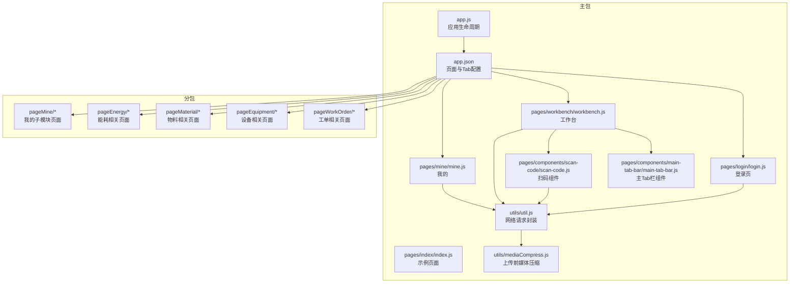
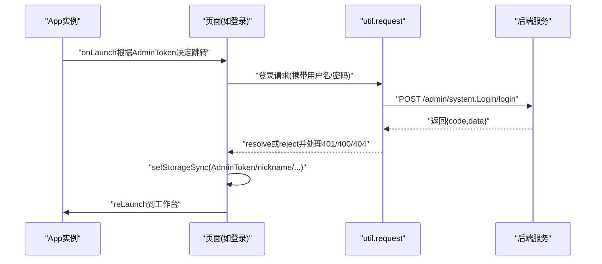
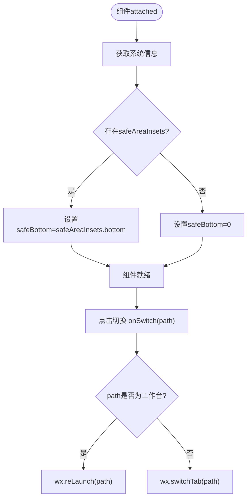
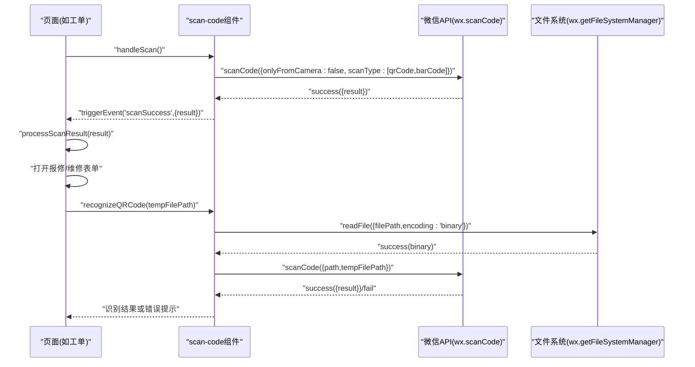
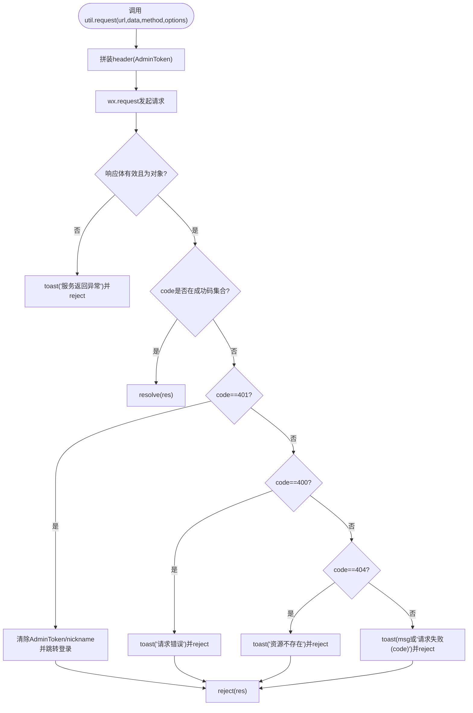
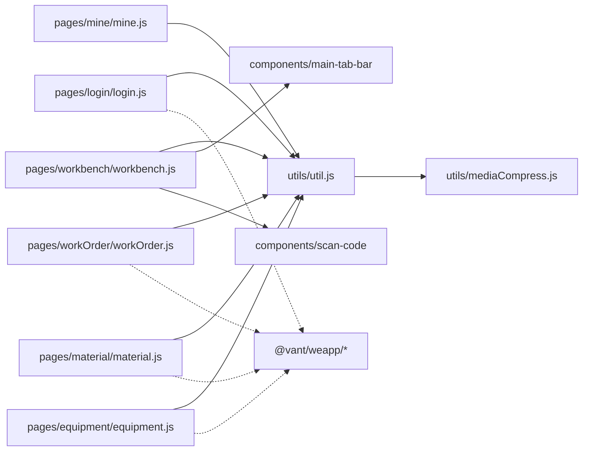

# 移动端开发

<cite>
**本文引用的文件**
- [app.js](file://gccd_mini/app.js)
- [app.json](file://gccd_mini/app.json)
- [index.js](file://gccd_mini/pages/index/index.js)
- [main-tab-bar.js](file://gccd_mini/pages/components/main-tab-bar/main-tab-bar.js)
- [scan-code.js](file://gccd_mini/pages/components/scan-code/scan-code.js)
- [util.js](file://gccd_mini/utils/util.js)
- [workbench.js](file://gccd_mini/pages/workbench/workbench.js)
- [login.js](file://gccd_mini/pages/login/login.js)
- [mine.js](file://gccd_mini/pages/mine/mine.js)
- [tabbar/index.js](file://gccd_mini/miniprogram_npm/@vant/weapp/tabbar/index.js)
- [tabbar-item/index.js](file://gccd_mini/miniprogram_npm/@vant/weapp/tabbar-item/index.js)
- [package.json](file://gccd_mini/package.json)
- [workOrder.js](file://gccd_mini/pages/workOrder/workOrder.js)
- [material.js](file://gccd_mini/pages/material/material.js)
- [equipment.js](file://gccd_mini/pages/equipment/equipment.js)
- [stocktake.js](file://gccd_mini/pages/stocktake/stocktake.js)
- [mediaCompress.js](file://gccd_mini/utils/mediaCompress.js)
</cite>

## 目录
1. [简介](#简介)
2. [项目结构](#项目结构)
3. [核心组件](#核心组件)
4. [架构总览](#架构总览)
5. [详细组件分析](#详细组件分析)
6. [依赖分析](#依赖分析)
7. [性能考虑](#性能考虑)
8. [故障排查指南](#故障排查指南)
9. [结论](#结论)
10. [附录](#附录)

## 简介
本技术文档面向“高齿传动”微信小程序的前端开发，围绕整体架构、页面与组件体系、数据绑定、主Tab栏组件、扫码功能、API调用、样式与交互、性能优化与兼容性、调试技巧以及最佳实践展开，帮助开发者快速理解并高效迭代。

## 项目结构
小程序采用分包+组件化的组织方式：
- 主包包含基础页面与通用组件，如登录、工作台、设备、盘点、我的等。
- 通过 subPackages 将设备管理、我的模块、工单相关、物料、能耗等拆分为独立分包，降低首屏包体与提升按需加载效率。
- 使用 Vant Weapp 组件库作为UI基础，统一交互风格与视觉规范。
- 工具层封装网络请求、图片上传前压缩、Toast/Dialog等通用能力。

图表来源
- [app.json:1-99](file://gccd_mini/app.json#L1-L99)
- [main-tab-bar.js:1-56](file://gccd_mini/pages/components/main-tab-bar/main-tab-bar.js#L1-L56)
- [scan-code.js:1-63](file://gccd_mini/pages/components/scan-code/scan-code.js#L1-L63)
- [util.js:1-98](file://gccd_mini/utils/util.js#L1-L98)
- [mediaCompress.js:1-104](file://gccd_mini/utils/mediaCompress.js#L1-L104)
- [login.js:1-180](file://gccd_mini/pages/login/login.js#L1-L180)
- [workbench.js:1-15](file://gccd_mini/pages/workbench/workbench.js#L1-L15)
- [mine.js:1-61](file://gccd_mini/pages/mine/mine.js#L1-L61)

章节来源
- [app.json:1-99](file://gccd_mini/app.json#L1-L99)
- [package.json:1-12](file://gccd_mini/package.json#L1-L12)

## 核心组件
- 主Tab栏组件：提供与 app.json 中 tabBar 对应的底部导航，支持安全区域适配与页面跳转策略（工作台首页使用 reLaunch，其余使用 switchTab）。
- 扫码组件：统一封装 wx.scanCode 调用，支持相机扫码与图片识别，触发自定义事件供父页面处理结果。
- 网络请求工具：封装 wx.request，自动注入 AdminToken，集中处理业务码、401登出、400/404/其他错误提示，统一 Promise 化。
- 上传前媒体压缩：针对图片进行多轮质量与尺寸压缩，确保不超过200KB，保障上传成功率与速度。

章节来源
- [main-tab-bar.js:1-56](file://gccd_mini/pages/components/main-tab-bar/main-tab-bar.js#L1-L56)
- [scan-code.js:1-63](file://gccd_mini/pages/components/scan-code/scan-code.js#L1-L63)
- [util.js:1-98](file://gccd_mini/utils/util.js#L1-L98)
- [mediaCompress.js:1-104](file://gccd_mini/utils/mediaCompress.js#L1-L104)

## 架构总览
小程序运行于微信客户端，生命周期由 App 实例控制。登录态通过本地存储 AdminToken 管理，网络请求统一走 util.request，扫码能力在多个页面复用，图片上传前统一压缩。

图表来源
- [app.js:1-33](file://gccd_mini/app.js#L1-L33)
- [login.js:76-118](file://gccd_mini/pages/login/login.js#L76-L118)
- [util.js:22-94](file://gccd_mini/utils/util.js#L22-L94)

## 详细组件分析

### 主Tab栏组件设计与使用
- 数据与生命周期：组件在 attached 生命周期中读取系统安全区域信息，计算安全底部内边距 safeBottom，保证胶囊形态或刘海屏适配。
- 事件处理：onSwitch 根据目标 path 决策跳转方式，工作台首页使用 reLaunch，其他使用 switchTab，避免返回栈停留在子页。
- 与 Vant Weapp Tabbar 的关系：项目同时引入了自研主Tab栏组件与 Vant Weapp 的 Tabbar 组件，前者用于与 app.json 对齐的底部导航，后者用于内部子页面的选项卡容器。

图表来源
- [main-tab-bar.js:32-54](file://gccd_mini/pages/components/main-tab-bar/main-tab-bar.js#L32-L54)

章节来源
- [main-tab-bar.js:1-56](file://gccd_mini/pages/components/main-tab-bar/main-tab-bar.js#L1-L56)
- [tabbar/index.js:1-69](file://gccd_mini/miniprogram_npm/@vant/weapp/tabbar/index.js#L1-L69)
- [tabbar-item/index.js:1-71](file://gccd_mini/miniprogram_npm/@vant/weapp/tabbar-item/index.js#L1-L71)

### 扫码功能实现原理
- 统一入口：扫码组件提供 handleScan，调用 wx.scanCode，支持二维码与条形码，成功后通过自定义事件 scanSuccess 通知父组件。
- 图片识别：recognizeQRCode 读取本地临时文件为二进制，再调用 wx.scanCode 识别；若失败尝试 wx.scanQRCode；失败时统一提示“未识别到二维码”。
- 页面集成：工作台、设备、物料等页面在需要时调用组件或直接使用 wx.scanCode，成功后弹窗或表单填写，最终提交到后端接口。

图表来源
- [scan-code.js:6-61](file://gccd_mini/pages/components/scan-code/scan-code.js#L6-L61)
- [workOrder.js:404-486](file://gccd_mini/pages/workOrder/workOrder.js#L404-L486)
- [material.js:540-629](file://gccd_mini/pages/material/material.js#L540-L629)
- [equipment.js:336-425](file://gccd_mini/pages/equipment/equipment.js#L336-L425)

章节来源
- [scan-code.js:1-63](file://gccd_mini/pages/components/scan-code/scan-code.js#L1-L63)
- [workOrder.js:404-486](file://gccd_mini/pages/workOrder/workOrder.js#L404-L486)
- [material.js:540-629](file://gccd_mini/pages/material/material.js#L540-L629)
- [equipment.js:336-425](file://gccd_mini/pages/equipment/equipment.js#L336-L425)

### API 接口调用方法
- 统一入口：util.request(url, data, method, options)。
- 请求头：自动注入 AdminToken，实现免重复登录。
- 成功码：默认仅 200，可通过 options.successCodes 扩展（如登录页允许 1/“1”）。
- 错误处理：401 自动清除本地 token 并跳转登录；400/404 统一提示；其他业务码统一 toast 并 reject。
- 上传图片：结合 mediaCompress.prepareLocalPathForUpload 压缩后调用 wx.uploadFile，统一处理返回数据与错误。

图表来源
- [util.js:22-94](file://gccd_mini/utils/util.js#L22-L94)

章节来源
- [util.js:1-98](file://gccd_mini/utils/util.js#L1-L98)
- [mediaCompress.js:48-98](file://gccd_mini/utils/mediaCompress.js#L48-L98)
- [login.js:84-114](file://gccd_mini/pages/login/login.js#L84-L114)

### 样式系统、动画与交互
- 样式框架：使用 Vant Weapp 组件库，统一图标、表单、弹窗、导航等组件风格。
- 导航栏：通过 app.json 的 navigationStyle: "custom" 自定义导航栏，页面通过 wx.getSystemInfo 获取 statusBarHeight，实现沉浸式顶部适配。
- TabBar：主Tab栏与 app.json 的 tabBar 对齐，支持颜色、图标、安全区适配。
- 动画与过渡：Vant Weapp 提供过渡与轻提示 Toast/Dialog，页面间跳转使用 redirectTo/switchTab/navigateTo 等策略控制返回栈。

章节来源
- [app.json:14-55](file://gccd_mini/app.json#L14-L55)
- [workbench.js:5-13](file://gccd_mini/pages/workbench/workbench.js#L5-L13)
- [tabbar/index.js:1-69](file://gccd_mini/miniprogram_npm/@vant/weapp/tabbar/index.js#L1-L69)
- [tabbar-item/index.js:1-71](file://gccd_mini/miniprogram_npm/@vant/weapp/tabbar-item/index.js#L1-L71)

### 数据绑定与页面交互
- 页面数据：Page({ data }) 定义视图所需字段，如用户信息、列表、分页、表单字段等。
- 事件绑定：通过组件属性与事件（如 scanSuccess）实现父子通信；通过 wx.navigateTo/switchTab 控制页面流转。
- 表单与校验：在登录页与物料/设备/工单等页面中，通过 setData 动态更新表单字段，结合 Toast 提示与后端接口联动。

章节来源
- [index.js:4-49](file://gccd_mini/pages/index/index.js#L4-L49)
- [login.js:19-32](file://gccd_mini/pages/login/login.js#L19-L32)
- [workOrder.js:64-93](file://gccd_mini/pages/workOrder/workOrder.js#L64-L93)

## 依赖分析
- 组件依赖：主包内页面依赖自研组件（主Tab栏、扫码），并通过 util/request 与后端交互。
- 第三方库：@vant/weapp 作为UI基础，提供 Tabbar、Toast、Dialog 等能力。
- 分包策略：通过 subPackages 将功能模块拆分，减少主包体积，提升冷启动与首屏加载性能。

图表来源
- [login.js:1-2](file://gccd_mini/pages/login/login.js#L1-L2)
- [workbench.js:1-1](file://gccd_mini/pages/workbench/workbench.js#L1-L1)
- [mine.js:1-3](file://gccd_mini/pages/mine/mine.js#L1-L3)
- [workOrder.js:1-4](file://gccd_mini/pages/workOrder/workOrder.js#L1-L4)
- [material.js:1-4](file://gccd_mini/pages/material/material.js#L1-L4)
- [equipment.js:1-4](file://gccd_mini/pages/equipment/equipment.js#L1-L4)
- [util.js:1-1](file://gccd_mini/utils/util.js#L1-L1)
- [mediaCompress.js:1-1](file://gccd_mini/utils/mediaCompress.js#L1-L1)
- [main-tab-bar.js:1-1](file://gccd_mini/pages/components/main-tab-bar/main-tab-bar.js#L1-L1)
- [scan-code.js:1-1](file://gccd_mini/pages/components/scan-code/scan-code.js#L1-L1)
- [package.json:8-10](file://gccd_mini/package.json#L8-L10)

章节来源
- [package.json:1-12](file://gccd_mini/package.json#L1-L12)

## 性能考虑
- 分包加载：合理拆分 subPackages，避免主包过大；在进入页面时再按需加载对应分包。
- 懒加载：开启 lazyCodeLoading: "requiredComponents"，仅在需要时加载组件代码。
- 图片上传优化：使用 mediaCompress 在前端将图片压缩至200KB以内，减少上传失败与带宽占用。
- 列表分页与下拉刷新：在工单/物料/设备等页面采用分页与下拉刷新，避免一次性加载大量数据。
- 事件节流/防抖：物料页面对搜索输入使用防抖，减少频繁请求。
- 状态栏适配：通过 statusBarHeight 与 safeAreaInsets 计算安全底部，避免布局遮挡。

章节来源
- [app.json:21-23](file://gccd_mini/app.json#L21-L23)
- [mediaCompress.js:1-104](file://gccd_mini/utils/mediaCompress.js#L1-L104)
- [material.js:292-311](file://gccd_mini/pages/material/material.js#L292-L311)
- [workOrder.js:624-637](file://gccd_mini/pages/workOrder/workOrder.js#L624-L637)
- [material.js:775-792](file://gccd_mini/pages/material/material.js#L775-L792)

## 故障排查指南
- 登录失败/频繁要求登录
  - 检查 AdminToken 是否正确写入与持久化；util.request 在 401 时会清除 token 并跳转登录。
  - 确认后端返回的登录成功码是否包含 options.successCodes 中的额外成功码。
- 网络异常/接口超时
  - 查看 util.request 的 fail 分支，统一提示“网络异常，请检查网络”，建议增加重试或离线提示。
- 扫码失败
  - 若 errMsg 含 “cancel”，为用户取消，无需提示；否则统一 toast 提示“扫码失败”。
  - 图片识别失败时，尝试 wx.scanQRCode 或提示“图片中未识别到二维码”。
- 图片上传失败
  - 检查 prepareLocalPathForUpload 是否抛出异常（如超过200KB或无法压缩），提示用户更换图片或减小尺寸。
- 页面跳转异常
  - 主Tab栏对工作台使用 reLaunch，其他使用 switchTab，避免返回栈停留在子页导致的页面错乱。

章节来源
- [util.js:85-94](file://gccd_mini/utils/util.js#L85-L94)
- [scan-code.js:17-26](file://gccd_mini/pages/components/scan-code/scan-code.js#L17-L26)
- [mediaCompress.js:92-98](file://gccd_mini/utils/mediaCompress.js#L92-L98)
- [main-tab-bar.js:44-53](file://gccd_mini/pages/components/main-tab-bar/main-tab-bar.js#L44-L53)

## 结论
本项目通过清晰的分包结构、统一的网络请求封装、可复用的扫码与主Tab栏组件，以及完善的上传前压缩策略，构建了稳定高效的微信小程序前端架构。遵循本文档的最佳实践与排障建议，可在保证用户体验的同时，持续提升开发效率与系统稳定性。

## 附录
- 开发最佳实践
  - 统一使用 util.request 发起网络请求，避免分散的 wx.request。
  - 扫码逻辑集中在组件中，页面仅负责接收结果与业务处理。
  - 图片上传前务必压缩，减少失败率与等待时间。
  - 合理使用分包与懒加载，控制主包体积。
  - 使用 Vant Weapp 统一交互风格，减少自定义样式成本。
- 常见问题速查
  - 登录后仍提示未登录：检查 AdminToken 写入与 401 处理逻辑。
  - 扫码无响应：确认权限与 onlyFromCamera/scanType 配置。
  - 上传失败：检查文件大小与压缩策略，必要时提示用户更换图片。