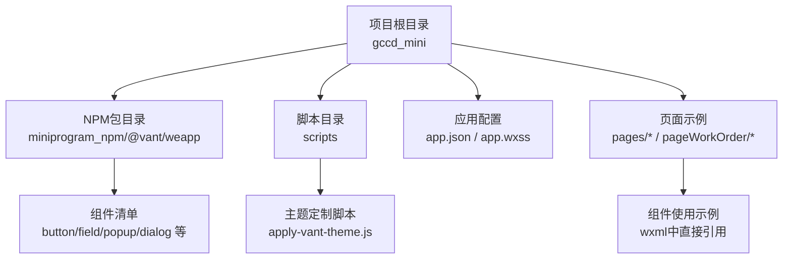
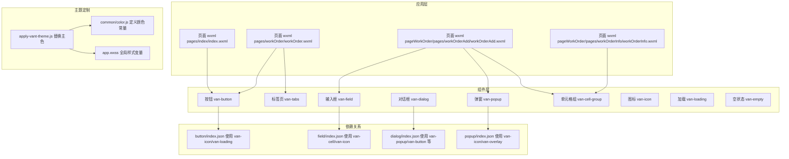
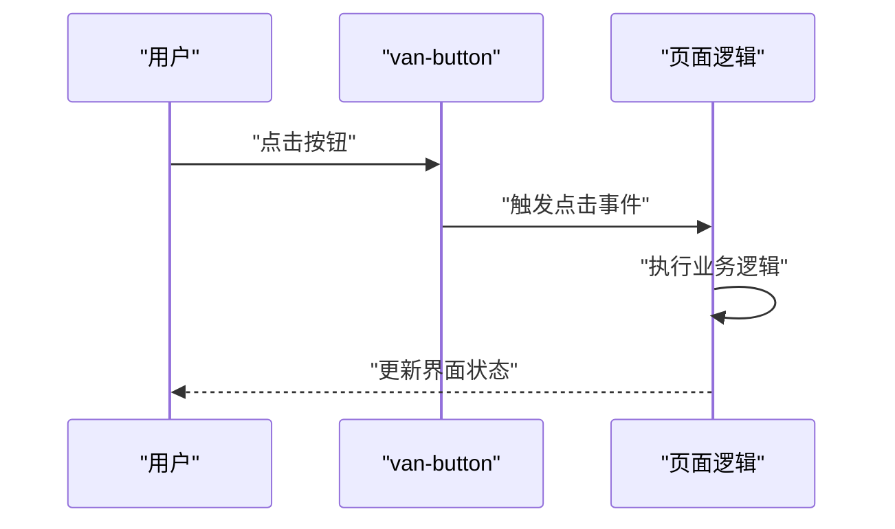
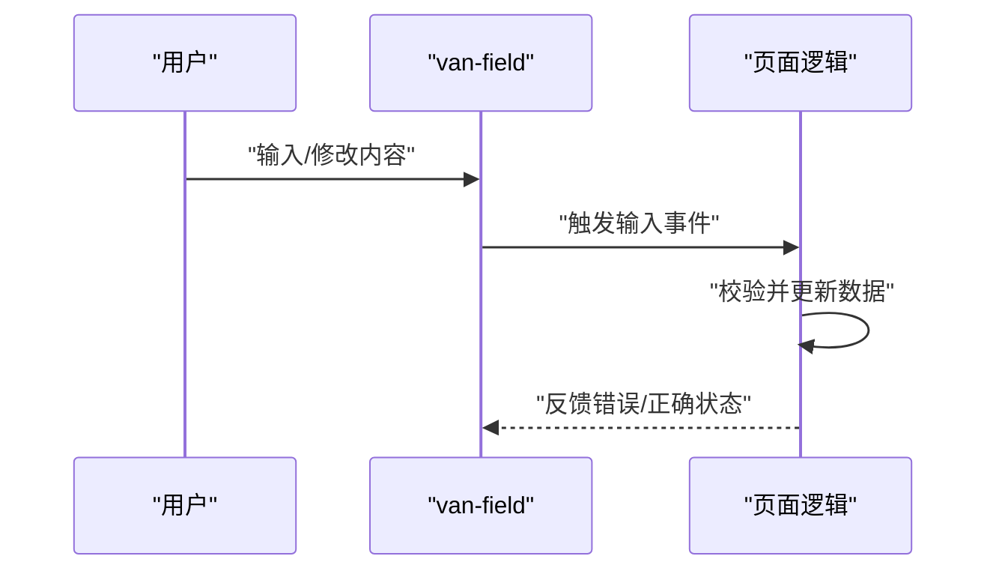
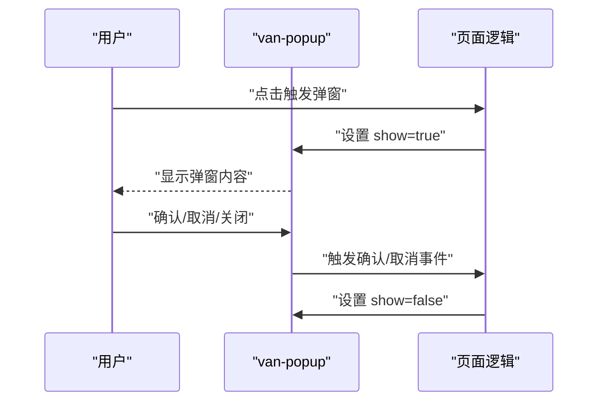
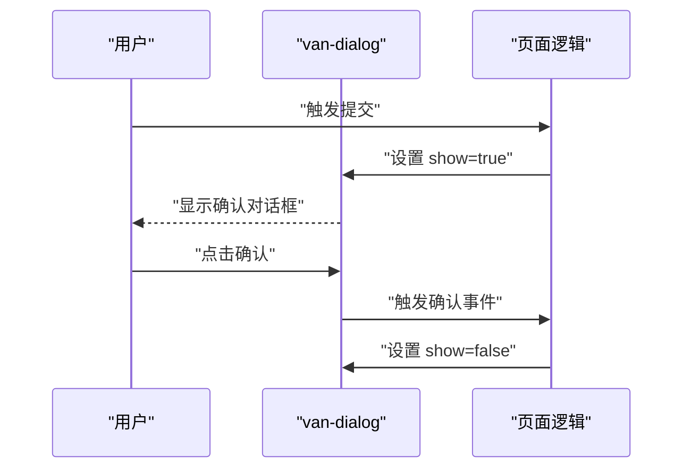
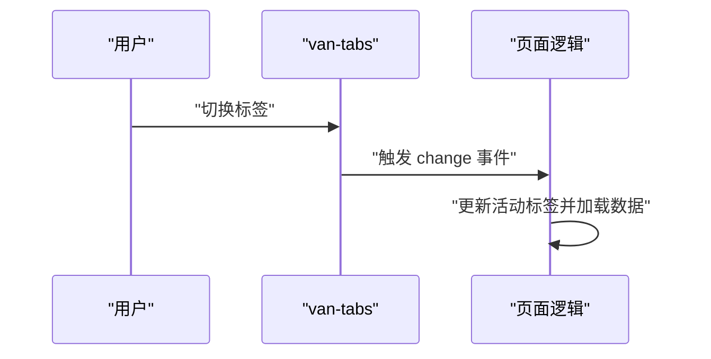
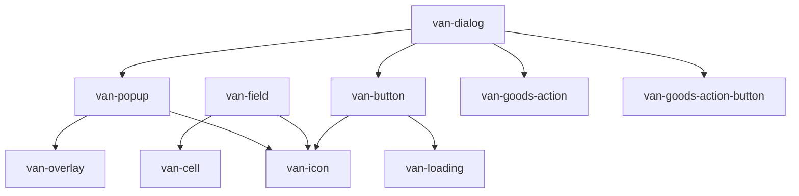

# Vant Weapp组件库集成

<cite>
**本文档引用的文件**
- [package.json](file://gccd_mini/package.json)
- [apply-vant-theme.js](file://gccd_mini/scripts/apply-vant-theme.js)
- [app.json](file://gccd_mini/app.json)
- [app.wxss](file://gccd_mini/app.wxss)
- [button/index.json](file://gccd_mini/miniprogram_npm/@vant/weapp/button/index.json)
- [field/index.json](file://gccd_mini/miniprogram_npm/@vant/weapp/field/index.json)
- [popup/index.json](file://gccd_mini/miniprogram_npm/@vant/weapp/popup/index.json)
- [dialog/index.json](file://gccd_mini/miniprogram_npm/@vant/weapp/dialog/index.json)
- [color.js](file://gccd_mini/miniprogram_npm/@vant/weapp/common/color.js)
- [component.js](file://gccd_mini/miniprogram_npm/@vant/weapp/common/component.js)
- [basic.js](file://gccd_mini/miniprogram_npm/@vant/weapp/mixins/basic.js)
- [index.wxml](file://gccd_mini/pages/index/index.wxml)
- [workOrder.wxml](file://gccd_mini/pages/workOrder/workOrder.wxml)
- [workOrderAdd.wxml](file://gccd_mini/pageWorkOrder/pages/workOrderAdd/workOrderAdd.wxml)
- [workOrderInfo.wxml](file://gccd_mini/pageWorkOrder/pages/workOrderInfo/workOrderInfo.wxml)
</cite>

## 目录
1. [简介](#简介)
2. [项目结构](#项目结构)
3. [核心组件](#核心组件)
4. [架构概览](#架构概览)
5. [详细组件分析](#详细组件分析)
6. [依赖关系分析](#依赖关系分析)
7. [性能考虑](#性能考虑)
8. [故障排除指南](#故障排除指南)
9. [结论](#结论)
10. [附录](#附录)

## 简介
本文件面向Vant Weapp组件库在本项目中的集成与使用，涵盖安装配置、构建优化、按需引入、常用组件用法、主题定制、事件处理机制以及最佳实践。通过并行分析项目中的关键文件，我们梳理出组件库的安装流程、主题定制脚本、组件依赖关系以及在实际页面中的使用方式。

## 项目结构
项目采用微信小程序标准目录结构，组件库以NPM包形式引入，并通过构建脚本实现主题定制。关键位置如下：
- 组件库源码：`miniprogram_npm/@vant/weapp/`
- 主题定制脚本：`scripts/apply-vant-theme.js`
- 项目配置：`app.json`、`app.wxss`
- 页面示例：`pages/index/index.wxml`、`pages/workOrder/workOrder.wxml`、`pageWorkOrder/pages/workOrderAdd/workOrderAdd.wxml`、`pageWorkOrder/pages/workOrderInfo/workOrderInfo.wxml`

**图表来源**
- [package.json:1-12](file://gccd_mini/package.json#L1-L12)
- [apply-vant-theme.js:1-95](file://gccd_mini/scripts/apply-vant-theme.js#L1-L95)
- [app.json:1-99](file://gccd_mini/app.json#L1-L99)

**章节来源**
- [package.json:1-12](file://gccd_mini/package.json#L1-L12)
- [app.json:1-99](file://gccd_mini/app.json#L1-L99)

## 核心组件
本项目中广泛使用以下Vant Weapp组件：
- 按钮：用于触发操作，支持主色、尺寸、禁用、加载态等属性
- 输入框：用于表单输入，支持只读、必填、错误提示等
- 弹窗：用于展示选择器、对话框等，支持底部弹出、圆角等
- 对话框：基于弹窗实现确认/取消交互
- 标签页：用于分组展示内容
- 单元格/单元格组：用于表单布局与信息展示
- 图标：用于按钮、导航等场景
- 加载：用于异步加载状态提示
- 空状态：用于空数据占位

这些组件在页面中以自定义标签形式直接使用，无需额外注册，体现了组件库的即插即用特性。

**章节来源**
- [button/index.json:1-8](file://gccd_mini/miniprogram_npm/@vant/weapp/button/index.json#L1-L8)
- [field/index.json:1-8](file://gccd_mini/miniprogram_npm/@vant/weapp/field/index.json#L1-L8)
- [popup/index.json:1-8](file://gccd_mini/miniprogram_npm/@vant/weapp/popup/index.json#L1-L8)
- [dialog/index.json:1-10](file://gccd_mini/miniprogram_npm/@vant/weapp/dialog/index.json#L1-L10)
- [index.wxml:26](file://gccd_mini/pages/index/index.wxml#L26)
- [workOrder.wxml:30](file://gccd_mini/pages/workOrder/workOrder.wxml#L30)
- [workOrderAdd.wxml:11](file://gccd_mini/pageWorkOrder/pages/workOrderAdd/workOrderAdd.wxml#L11)
- [workOrderInfo.wxml:11](file://gccd_mini/pageWorkOrder/pages/workOrderInfo/workOrderInfo.wxml#L11)

## 架构概览
组件库通过NPM安装并在构建阶段执行主题定制脚本，将默认品牌蓝替换为项目主色，同时配合全局样式变量形成统一主题。页面通过WXML直接引用组件，组件内部通过usingComponents声明依赖其他子组件。

**图表来源**
- [button/index.json:1-8](file://gccd_mini/miniprogram_npm/@vant/weapp/button/index.json#L1-L8)
- [field/index.json:1-8](file://gccd_mini/miniprogram_npm/@vant/weapp/field/index.json#L1-L8)
- [popup/index.json:1-8](file://gccd_mini/miniprogram_npm/@vant/weapp/popup/index.json#L1-L8)
- [dialog/index.json:1-10](file://gccd_mini/miniprogram_npm/@vant/weapp/dialog/index.json#L1-L10)
- [apply-vant-theme.js:1-95](file://gccd_mini/scripts/apply-vant-theme.js#L1-L95)
- [color.js:1-11](file://gccd_mini/miniprogram_npm/@vant/weapp/common/color.js#L1-L11)
- [app.wxss](file://gccd_mini/app.wxss)

## 详细组件分析

### 按钮组件（van-button）
- 功能概述：提供多种类型、尺寸、形状的按钮，支持加载态、禁用态、块级显示等。
- 关键依赖：通过`button/index.json`声明使用`van-icon`和`van-loading`。
- 使用示例：在首页页面中直接使用`<van-button type="primary">`。
- 事件处理：可通过`bindtap`或`catchtap`绑定点击事件，结合页面逻辑处理业务。

**图表来源**
- [button/index.json:1-8](file://gccd_mini/miniprogram_npm/@vant/weapp/button/index.json#L1-L8)
- [index.wxml:26](file://gccd_mini/pages/index/index.wxml#L26)

**章节来源**
- [button/index.json:1-8](file://gccd_mini/miniprogram_npm/@vant/weapp/button/index.json#L1-L8)
- [index.wxml:26](file://gccd_mini/pages/index/index.wxml#L26)

### 输入框组件（van-field）
- 功能概述：用于文本输入、只读、必填校验、错误提示等。
- 关键依赖：通过`field/index.json`声明使用`van-cell`和`van-icon`。
- 使用示例：在工单新增页面中使用`<van-field>`展示和编辑表单字段。

**图表来源**
- [field/index.json:1-8](file://gccd_mini/miniprogram_npm/@vant/weapp/field/index.json#L1-L8)
- [workOrderAdd.wxml:26](file://gccd_mini/pageWorkOrder/pages/workOrderAdd/workOrderAdd.wxml#L26)

**章节来源**
- [field/index.json:1-8](file://gccd_mini/miniprogram_npm/@vant/weapp/field/index.json#L1-L8)
- [workOrderAdd.wxml:11-127](file://gccd_mini/pageWorkOrder/pages/workOrderAdd/workOrderAdd.wxml#L11-L127)

### 弹窗组件（van-popup）
- 功能概述：支持顶部/底部/中部弹出，圆角、遮罩层等。
- 关键依赖：通过`popup/index.json`声明使用`van-icon`和`van-overlay`。
- 使用示例：在工单新增页面中使用`<van-popup>`展示型号选择、设备选择、人员选择等。

**图表来源**
- [popup/index.json:1-8](file://gccd_mini/miniprogram_npm/@vant/weapp/popup/index.json#L1-L8)
- [workOrderAdd.wxml:122-142](file://gccd_mini/pageWorkOrder/pages/workOrderAdd/workOrderAdd.wxml#L122-L142)

**章节来源**
- [popup/index.json:1-8](file://gccd_mini/miniprogram_npm/@vant/weapp/popup/index.json#L1-L8)
- [workOrderAdd.wxml:122-142](file://gccd_mini/pageWorkOrder/pages/workOrderAdd/workOrderAdd.wxml#L122-L142)

### 对话框组件（van-dialog）
- 功能概述：基于弹窗实现确认/取消交互，支持标题、消息、按钮文本等。
- 关键依赖：通过`dialog/index.json`声明使用`van-popup`、`van-button`等。
- 使用示例：在工单新增页面中使用`<van-dialog>`展示提交成功提示。

**图表来源**
- [dialog/index.json:1-10](file://gccd_mini/miniprogram_npm/@vant/weapp/dialog/index.json#L1-L10)
- [workOrderAdd.wxml:174-183](file://gccd_mini/pageWorkOrder/pages/workOrderAdd/workOrderAdd.wxml#L174-L183)

**章节来源**
- [dialog/index.json:1-10](file://gccd_mini/miniprogram_npm/@vant/weapp/dialog/index.json#L1-L10)
- [workOrderAdd.wxml:174-183](file://gccd_mini/pageWorkOrder/pages/workOrderAdd/workOrderAdd.wxml#L174-L183)

### 标签页组件（van-tabs）
- 功能概述：用于分组展示内容，支持切换、颜色定制等。
- 使用示例：在工单列表页面中使用`<van-tabs>`展示“进行中/已完成”两个标签页。

**图表来源**
- [workOrder.wxml:30](file://gccd_mini/pages/workOrder/workOrder.wxml#L30)

**章节来源**
- [workOrder.wxml:30](file://gccd_mini/pages/workOrder/workOrder.wxml#L30)

### 单元格/单元格组（van-cell/van-cell-group）
- 功能概述：用于表单布局与信息展示，支持标题、描述、右侧图标等。
- 使用示例：在多个页面中使用`<van-cell-group>`组织表单字段。

**章节来源**
- [workOrderAdd.wxml:11-127](file://gccd_mini/pageWorkOrder/pages/workOrderAdd/workOrderAdd.wxml#L11-L127)
- [workOrderInfo.wxml:11-34](file://gccd_mini/pageWorkOrder/pages/workOrderInfo/workOrderInfo.wxml#L11-L34)

### 图标/加载/空状态组件
- 图标（van-icon）：用于按钮、导航等场景。
- 加载（van-loading）：用于异步加载状态提示。
- 空状态（van-empty）：用于空数据占位。
- 使用示例：在工单页面中使用`<van-loading>`和`<van-empty>`提升用户体验。

**章节来源**
- [workOrder.wxml:105-109](file://gccd_mini/pages/workOrder/workOrder.wxml#L105-L109)
- [workOrder.wxml:112](file://gccd_mini/pages/workOrder/workOrder.wxml#L112)

## 依赖关系分析
组件库通过usingComponents声明内部依赖，形成清晰的依赖链路。下图展示了主要组件的依赖关系：

**图表来源**
- [button/index.json:1-8](file://gccd_mini/miniprogram_npm/@vant/weapp/button/index.json#L1-L8)
- [field/index.json:1-8](file://gccd_mini/miniprogram_npm/@vant/weapp/field/index.json#L1-L8)
- [popup/index.json:1-8](file://gccd_mini/miniprogram_npm/@vant/weapp/popup/index.json#L1-L8)
- [dialog/index.json:1-10](file://gccd_mini/miniprogram_npm/@vant/weapp/dialog/index.json#L1-L10)

**章节来源**
- [button/index.json:1-8](file://gccd_mini/miniprogram_npm/@vant/weapp/button/index.json#L1-L8)
- [field/index.json:1-8](file://gccd_mini/miniprogram_npm/@vant/weapp/field/index.json#L1-L8)
- [popup/index.json:1-8](file://gccd_mini/miniprogram_npm/@vant/weapp/popup/index.json#L1-L8)
- [dialog/index.json:1-10](file://gccd_mini/miniprogram_npm/@vant/weapp/dialog/index.json#L1-L10)

## 性能考虑
- 按需引入：组件库默认全量引入，建议结合项目实际使用情况，仅引入所需组件以减少包体积。
- 主题定制：通过脚本批量替换主色，避免手动修改导致的遗漏。
- 数据更新：使用组件提供的高性能setData封装，减少不必要的视图更新。
- 列表渲染：合理使用`wx:for`和`wx:key`，避免频繁重建节点。
- 异步加载：在长列表或复杂页面中，使用加载组件提升用户体验。

## 故障排除指南
- 主题色未生效：检查主题定制脚本是否执行，确认`apply-vant-theme.js`输出日志及目标文件是否被修改。
- 组件无法识别：确认页面WXML中是否正确使用组件标签，且未超出小程序组件层级限制。
- 事件未触发：检查事件绑定语法是否正确，确保事件名与页面逻辑一致。
- 样式冲突：检查全局样式与组件样式的优先级，必要时使用外部样式类覆盖。

**章节来源**
- [apply-vant-theme.js:1-95](file://gccd_mini/scripts/apply-vant-theme.js#L1-L95)
- [basic.js:1-31](file://gccd_mini/miniprogram_npm/@vant/weapp/mixins/basic.js#L1-L31)

## 结论
本项目通过NPM引入Vant Weapp组件库，并利用构建脚本实现主题定制，形成统一的品牌视觉风格。页面中通过WXML直接引用组件，简化了开发流程。建议在后续迭代中进一步优化按需引入策略，结合实际使用情况精简组件体积，同时保持主题一致性与良好的用户体验。

## 附录
- 安装与配置
  - 通过NPM安装组件库并配置构建脚本，在安装完成后自动执行主题定制。
  - 在应用配置中启用组件框架与懒加载策略，提升运行性能。
- 主题定制
  - 使用脚本批量替换默认品牌蓝为主色，配合全局样式变量实现主题统一。
  - 如需调整颜色体系，可在脚本中扩展替换规则或调整全局样式变量。
- 最佳实践
  - 按需引入组件，避免全量引入导致包体积过大。
  - 合理使用事件与数据绑定，确保交互流畅。
  - 在复杂页面中使用加载与空状态组件，提升用户体验。