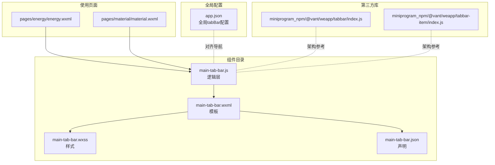
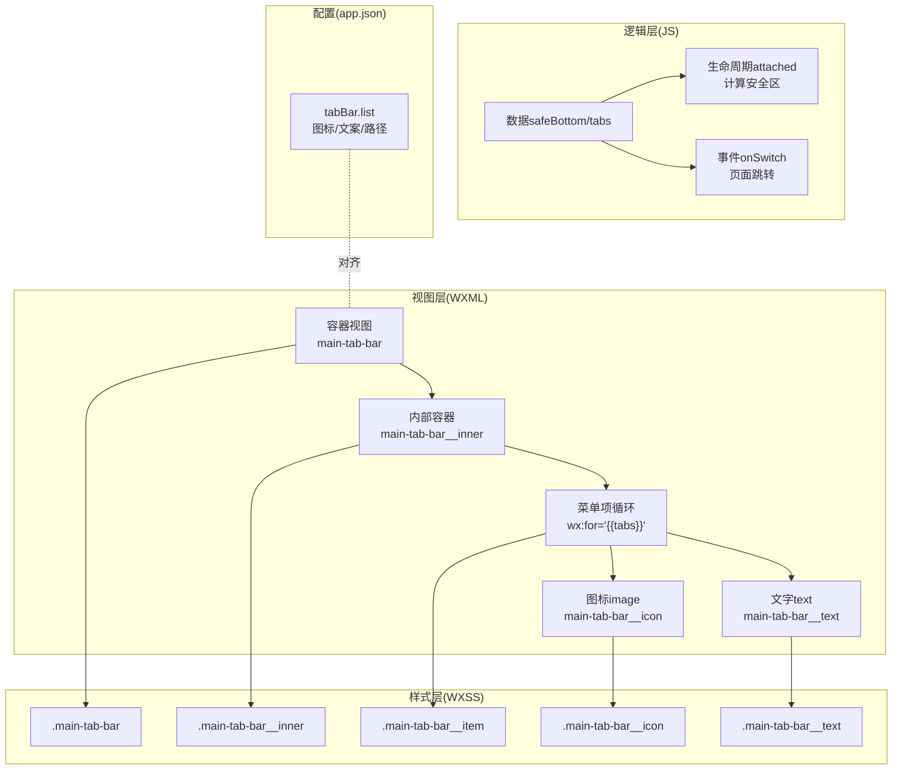
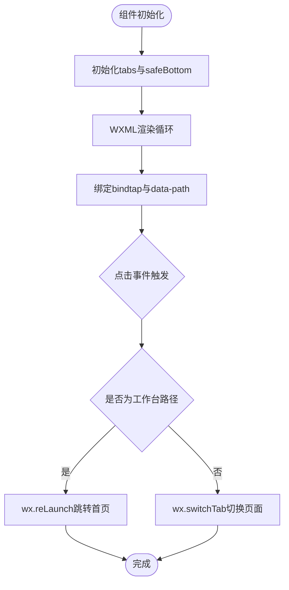
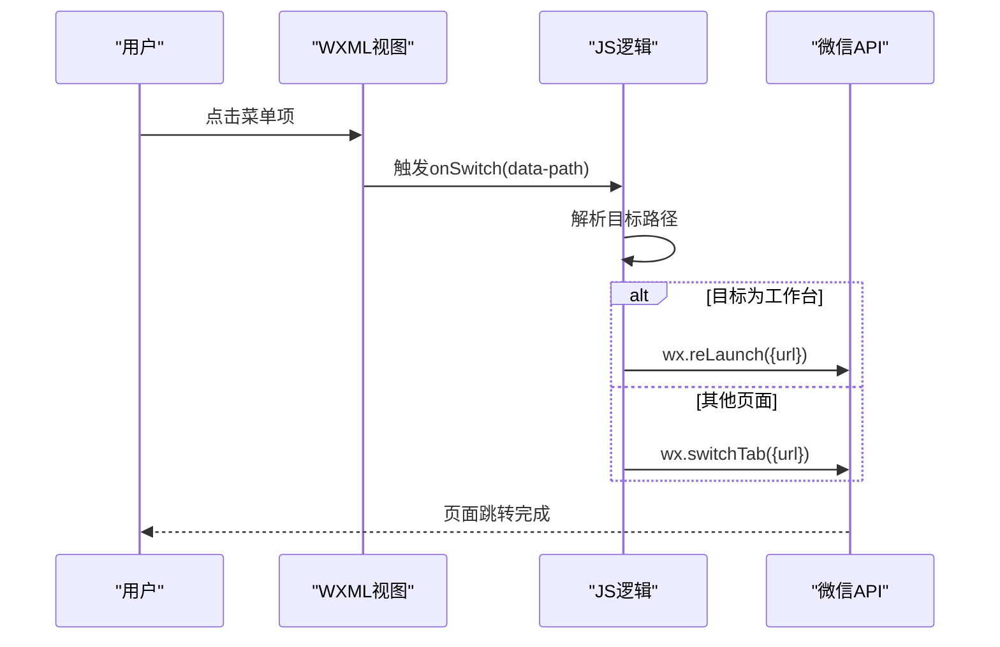
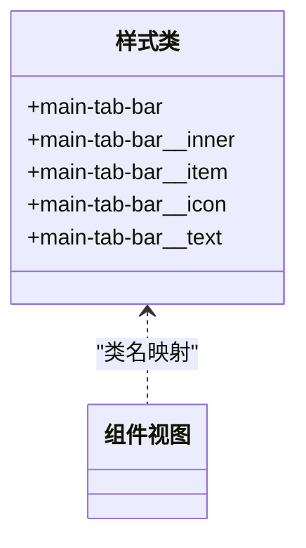
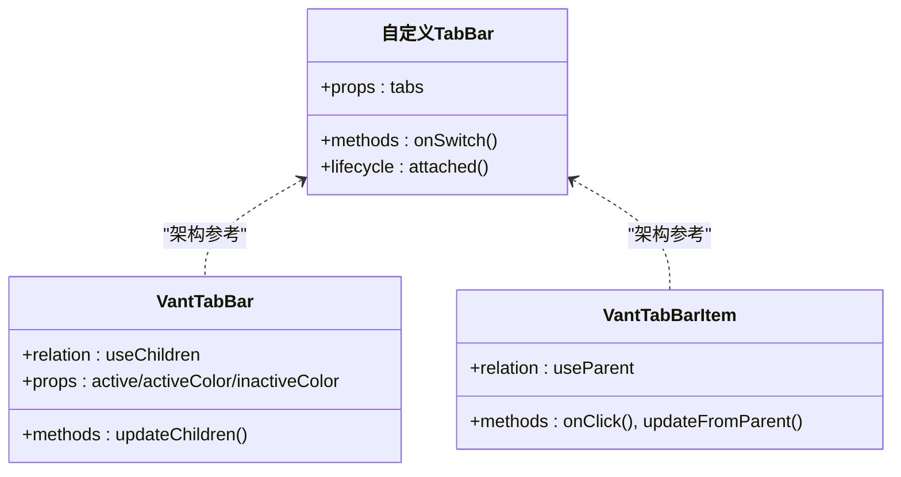
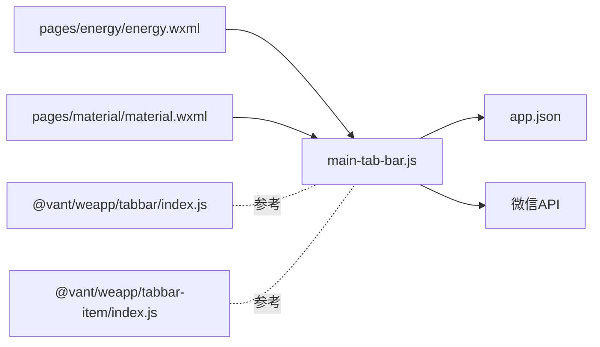

# 主Tab栏组件

<cite>
**本文引用的文件**
- [main-tab-bar.js](file://gccd_mini/pages/components/main-tab-bar/main-tab-bar.js)
- [main-tab-bar.wxml](file://gccd_mini/pages/components/main-tab-bar/main-tab-bar.wxml)
- [main-tab-bar.wxss](file://gccd_mini/pages/components/main-tab-bar/main-tab-bar.wxss)
- [main-tab-bar.json](file://gccd_mini/pages/components/main-tab-bar/main-tab-bar.json)
- [tabbar/index.js](file://gccd_mini/miniprogram_npm/@vant/weapp/tabbar/index.js)
- [tabbar-item/index.js](file://gccd_mini/miniprogram_npm/@vant/weapp/tabbar-item/index.js)
- [app.json](file://gccd_mini/app.json)
- [energy.wxml](file://gccd_mini/pages/energy/energy.wxml)
- [material.wxml](file://gccd_mini/pages/material/material.wxml)
- [util.js](file://gccd_mini/utils/util.js)
</cite>

## 目录
1. [简介](#简介)
2. [项目结构](#项目结构)
3. [核心组件](#核心组件)
4. [架构总览](#架构总览)
5. [详细组件分析](#详细组件分析)
6. [依赖关系分析](#依赖关系分析)
7. [性能考虑](#性能考虑)
8. [故障排查指南](#故障排查指南)
9. [结论](#结论)
10. [附录](#附录)

## 简介
本文件为“主Tab栏组件”的深度技术文档，聚焦于该组件在微信小程序中的实现架构与使用方式。组件用于承载应用底部导航，支持图标与文本展示、安全区适配、点击切换页面等能力，并与全局 tabBar 配置保持一致。文档将从 JavaScript 逻辑、WXML 模板、WXSS 样式三方面展开，深入解析数据绑定、事件处理、状态同步与页面跳转策略，并提供可扩展的配置与自定义建议。

## 项目结构
主Tab栏组件位于 pages/components/main-tab-bar 目录下，包含标准的四类文件：逻辑层 JS、视图层 WXML、样式 WXSS、声明 JSON。同时，项目中还集成了 Vant WeApp 的 TabBar 组件作为通用能力参考，二者在架构上存在差异：本组件采用自定义实现，而 Vant 组件通过父子关系与事件通信实现统一状态管理。

**图表来源**
- [main-tab-bar.js:1-56](file://gccd_mini/pages/components/main-tab-bar/main-tab-bar.js#L1-L56)
- [main-tab-bar.wxml:1-15](file://gccd_mini/pages/components/main-tab-bar/main-tab-bar.wxml#L1-L15)
- [main-tab-bar.wxss:1-41](file://gccd_mini/pages/components/main-tab-bar/main-tab-bar.wxss#L1-L41)
- [main-tab-bar.json:1-5](file://gccd_mini/pages/components/main-tab-bar/main-tab-bar.json#L1-L5)
- [energy.wxml:100-117](file://gccd_mini/pages/energy/energy.wxml#L100-L117)
- [material.wxml:230-240](file://gccd_mini/pages/material/material.wxml#L230-L240)
- [app.json:24-55](file://gccd_mini/app.json#L24-L55)
- [tabbar/index.js:1-69](file://gccd_mini/miniprogram_npm/@vant/weapp/tabbar/index.js#L1-L69)
- [tabbar-item/index.js:1-71](file://gccd_mini/miniprogram_npm/@vant/weapp/tabbar-item/index.js#L1-L71)

**章节来源**
- [main-tab-bar.js:1-56](file://gccd_mini/pages/components/main-tab-bar/main-tab-bar.js#L1-L56)
- [main-tab-bar.wxml:1-15](file://gccd_mini/pages/components/main-tab-bar/main-tab-bar.wxml#L1-L15)
- [main-tab-bar.wxss:1-41](file://gccd_mini/pages/components/main-tab-bar/main-tab-bar.wxss#L1-L41)
- [main-tab-bar.json:1-5](file://gccd_mini/pages/components/main-tab-bar/main-tab-bar.json#L1-L5)
- [app.json:24-55](file://gccd_mini/app.json#L24-L55)

## 核心组件
- 组件职责
  - 渲染底部导航条，包含四个菜单项（工作台、设备、盘点、我的）。
  - 响应用户点击，执行页面跳转；对工作台路径使用 reLaunch 以确保回到首页。
  - 自动适配安全区底部内边距，保证在刘海屏设备上的显示正确性。
- 数据绑定
  - 使用本地数组常量定义菜单项列表，包含路径、文本与图标资源。
  - 通过 WXML 的 wx:for 进行渲染，绑定到组件 data.tabs。
  - 通过 dataset 将目标路径传递给点击事件处理器。
- 事件处理
  - onSwitch 处理点击事件，根据路径选择 switchTab 或 reLaunch。
  - 生命周期 attached 中获取系统信息，计算并设置 safeBottom。
- 页面跳转逻辑
  - 非工作台：switchTab 切换到对应页面。
  - 工作台：reLaunch 强制回到首页，避免停留在子页面栈顶。
- 图标资源加载
  - 图标通过 image 标签 src 绑定，使用相对路径指向 images 目录。
  - 与全局 app.json 中的 tabBar 图标配置形成视觉一致性。

**章节来源**
- [main-tab-bar.js:1-56](file://gccd_mini/pages/components/main-tab-bar/main-tab-bar.js#L1-L56)
- [main-tab-bar.wxml:1-15](file://gccd_mini/pages/components/main-tab-bar/main-tab-bar.wxml#L1-L15)
- [main-tab-bar.wxss:1-41](file://gccd_mini/pages/components/main-tab-bar/main-tab-bar.wxss#L1-L41)
- [app.json:24-55](file://gccd_mini/app.json#L24-L55)

## 架构总览
本组件采用“自定义实现 + 全局配置对齐”的架构模式：
- 视图层：WXML 以列表渲染方式生成每个菜单项，绑定点击事件。
- 逻辑层：JS 定义菜单数据、生命周期与事件处理，负责页面跳转策略。
- 样式层：WXSS 控制布局、间距与颜色，适配不同屏幕尺寸。
- 配置层：app.json 的 tabBar 提供全局导航配置，组件在视觉与行为上与其保持一致。

**图表来源**
- [main-tab-bar.wxml:1-15](file://gccd_mini/pages/components/main-tab-bar/main-tab-bar.wxml#L1-L15)
- [main-tab-bar.js:1-56](file://gccd_mini/pages/components/main-tab-bar/main-tab-bar.js#L1-L56)
- [main-tab-bar.wxss:1-41](file://gccd_mini/pages/components/main-tab-bar/main-tab-bar.wxss#L1-L41)
- [app.json:24-55](file://gccd_mini/app.json#L24-L55)

## 详细组件分析

### 数据绑定机制
- 菜单数据源
  - 组件内部定义菜单数组常量，包含 path、text、icon 字段。
  - 在组件 data 中暴露 tabs，供 WXML 循环渲染。
- 安全区适配
  - 在 attached 生命周期中调用系统接口获取安全区信息，设置 safeBottom。
  - 将 safeBottom 注入到容器视图的内边距中，确保在刘海屏上不被遮挡。
- 图标与文本绑定
  - 图标通过 src 绑定到 item.icon，文本通过双花括号绑定到 item.text。
  - 通过 data-path 将路径传入事件处理器，避免在回调中重复计算。

**图表来源**
- [main-tab-bar.js:27-56](file://gccd_mini/pages/components/main-tab-bar/main-tab-bar.js#L27-L56)
- [main-tab-bar.wxml:4-14](file://gccd_mini/pages/components/main-tab-bar/main-tab-bar.wxml#L4-L14)

**章节来源**
- [main-tab-bar.js:1-56](file://gccd_mini/pages/components/main-tab-bar/main-tab-bar.js#L1-L56)
- [main-tab-bar.wxml:1-15](file://gccd_mini/pages/components/main-tab-bar/main-tab-bar.wxml#L1-L15)

### 事件处理系统
- 点击事件捕获
  - 使用 bindtap 绑定到 onSwitch，通过 dataset 获取目标路径。
- 页面切换动画与状态同步
  - 非工作台：switchTab 切换页面，保持当前页面栈不变。
  - 工作台：reLaunch 强制回到首页，确保回到应用根页面。
- 状态同步机制
  - 本组件未维护“当前激活”状态，而是依赖全局 tabBar 的选中态。
  - 若需自定义激活态，可在组件内部增加 activeIndex 并在样式层进行差异化渲染。

**图表来源**
- [main-tab-bar.js:44-53](file://gccd_mini/pages/components/main-tab-bar/main-tab-bar.js#L44-L53)
- [main-tab-bar.wxml:8-10](file://gccd_mini/pages/components/main-tab-bar/main-tab-bar.wxml#L8-L10)

**章节来源**
- [main-tab-bar.js:44-53](file://gccd_mini/pages/components/main-tab-bar/main-tab-bar.js#L44-L53)
- [main-tab-bar.wxml:8-10](file://gccd_mini/pages/components/main-tab-bar/main-tab-bar.wxml#L8-L10)

### 样式设计与主题定制
- 布局与间距
  - 容器采用固定高度与顶部边框，内部使用 flex 布局，均分四个菜单项。
  - 菜单项垂直排列图标与文字，设置最小宽度与内边距，保证在窄屏下不拥挤。
- 字体与颜色
  - 文字字号与行高经过移动端优化，颜色采用浅灰，体现非激活态。
  - 与全局 tabBar 的未选中色保持一致，提升视觉连贯性。
- 响应式适配
  - 通过 safeBottom 动态适配安全区，避免底部胶囊栏遮挡。
  - 图标尺寸固定，配合 aspectFit 模式保证清晰度。

**图表来源**
- [main-tab-bar.wxss:1-41](file://gccd_mini/pages/components/main-tab-bar/main-tab-bar.wxss#L1-L41)

**章节来源**
- [main-tab-bar.wxss:1-41](file://gccd_mini/pages/components/main-tab-bar/main-tab-bar.wxss#L1-L41)

### 与 Vant WeApp 组件的关系
- 架构对比
  - 本组件为自定义实现，直接通过 wxAPI 进行页面跳转，无需复杂的父子关系。
  - Vant TabBar 通过 useChildren/useParent 建立父子关系，统一管理激活态与颜色。
- 参考价值
  - 可借鉴 Vant 的颜色与尺寸参数、占位与吸顶能力，用于后续增强本组件。
  - 若需要更精细的状态控制与动画效果，可参考 Vant 的实现思路。

**图表来源**
- [tabbar/index.js:1-69](file://gccd_mini/miniprogram_npm/@vant/weapp/tabbar/index.js#L1-L69)
- [tabbar-item/index.js:1-71](file://gccd_mini/miniprogram_npm/@vant/weapp/tabbar-item/index.js#L1-L71)
- [main-tab-bar.js:1-56](file://gccd_mini/pages/components/main-tab-bar/main-tab-bar.js#L1-L56)

**章节来源**
- [tabbar/index.js:1-69](file://gccd_mini/miniprogram_npm/@vant/weapp/tabbar/index.js#L1-L69)
- [tabbar-item/index.js:1-71](file://gccd_mini/miniprogram_npm/@vant/weapp/tabbar-item/index.js#L1-L71)

## 依赖关系分析
- 组件依赖
  - 依赖全局 app.json 的 tabBar 配置，确保图标与文案一致。
  - 依赖微信基础 API：wx.getSystemInfoSync、wx.switchTab、wx.reLaunch。
- 使用页面
  - 能耗与物料页面在底部引入主Tab栏组件，形成统一的导航体验。
- 第三方库
  - Vant WeApp 的 TabBar/TabBarItem 提供了可复用的父子关系与状态同步范式，可作为扩展参考。

**图表来源**
- [main-tab-bar.js:1-56](file://gccd_mini/pages/components/main-tab-bar/main-tab-bar.js#L1-L56)
- [app.json:24-55](file://gccd_mini/app.json#L24-L55)
- [energy.wxml:100-117](file://gccd_mini/pages/energy/energy.wxml#L100-L117)
- [material.wxml:230-240](file://gccd_mini/pages/material/material.wxml#L230-L240)
- [tabbar/index.js:1-69](file://gccd_mini/miniprogram_npm/@vant/weapp/tabbar/index.js#L1-L69)
- [tabbar-item/index.js:1-71](file://gccd_mini/miniprogram_npm/@vant/weapp/tabbar-item/index.js#L1-L71)

**章节来源**
- [main-tab-bar.js:1-56](file://gccd_mini/pages/components/main-tab-bar/main-tab-bar.js#L1-L56)
- [energy.wxml:100-117](file://gccd_mini/pages/energy/energy.wxml#L100-L117)
- [material.wxml:230-240](file://gccd_mini/pages/material/material.wxml#L230-L240)
- [app.json:24-55](file://gccd_mini/app.json#L24-L55)

## 性能考虑
- 渲染优化
  - 使用 wx:for 渲染菜单项，避免频繁创建/销毁节点。
  - 图标资源为静态路径，建议预加载或缓存，减少首屏闪烁。
- 事件处理
  - 事件处理器仅做路由判断与调用 wxAPI，逻辑简单，开销极低。
- 生命周期
  - safeBottom 计算仅在组件挂载时执行一次，避免重复计算。
- 扩展建议
  - 若菜单数量较多，可考虑虚拟滚动或分组展示。
  - 对于复杂交互（如长按菜单、多级联动），建议拆分为独立组件模块。

[本节为通用性能建议，无需特定文件引用]

## 故障排查指南
- 图标不显示
  - 检查图标路径是否正确，确认 images 目录下存在对应文件。
  - 确认路径为相对路径且与组件所在目录层级一致。
- 安全区适配异常
  - 确保 attached 生命周期中能成功获取系统信息。
  - 若获取失败，safeBottom 将回退为 0，需检查机型兼容性。
- 页面跳转无效
  - 确认目标页面已在 app.json 的 pages 中注册。
  - 对于工作台路径，需使用 reLaunch；其他路径使用 switchTab。
- 视觉不一致
  - 对照 app.json 的 tabBar 配置，核对图标与文案是否一致。

**章节来源**
- [main-tab-bar.js:32-53](file://gccd_mini/pages/components/main-tab-bar/main-tab-bar.js#L32-L53)
- [main-tab-bar.wxml:10-12](file://gccd_mini/pages/components/main-tab-bar/main-tab-bar.wxml#L10-L12)
- [app.json:24-55](file://gccd_mini/app.json#L24-L55)

## 结论
主Tab栏组件通过简洁的自定义实现，实现了与全局 tabBar 的视觉与行为对齐，具备良好的可维护性与扩展空间。其数据绑定清晰、事件处理简单、样式适配完善，适合在多页面场景中提供一致的导航体验。未来可根据业务需求引入更多交互细节与主题化能力，同时可参考 Vant 组件的父子关系与状态同步机制，进一步提升组件的通用性与可复用性。

[本节为总结性内容，无需特定文件引用]

## 附录

### 使用示例与最佳实践
- 在页面中引入组件
  - 在目标页面的 WXML 中引入主Tab栏组件标签，即可在底部显示导航。
  - 示例路径参考：能耗页面与物料页面的底部引入。
- 最佳实践
  - 保持菜单数量与全局 tabBar 一致，避免用户困惑。
  - 图标与文案与 app.json 配置保持一致，确保视觉统一。
  - 对于需要特殊处理的页面（如首页），使用 reLaunch 回到根路径。

**章节来源**
- [energy.wxml:100-117](file://gccd_mini/pages/energy/energy.wxml#L100-L117)
- [material.wxml:230-240](file://gccd_mini/pages/material/material.wxml#L230-L240)
- [app.json:24-55](file://gccd_mini/app.json#L24-L55)

### 配置选项与自定义能力
- 当前实现
  - 菜单项通过组件内部数组定义，支持路径、文本、图标三要素。
  - 支持安全区适配与基础样式定制。
- 可扩展点
  - 增加 activeIndex 与 activeColor/inactiveColor 参数，实现自定义激活态。
  - 增加点击回调事件，支持埋点或额外逻辑。
  - 增加菜单分组与动态加载能力，适配更多业务场景。

**章节来源**
- [main-tab-bar.js:4-25](file://gccd_mini/pages/components/main-tab-bar/main-tab-bar.js#L4-L25)
- [main-tab-bar.wxss:1-41](file://gccd_mini/pages/components/main-tab-bar/main-tab-bar.wxss#L1-L41)