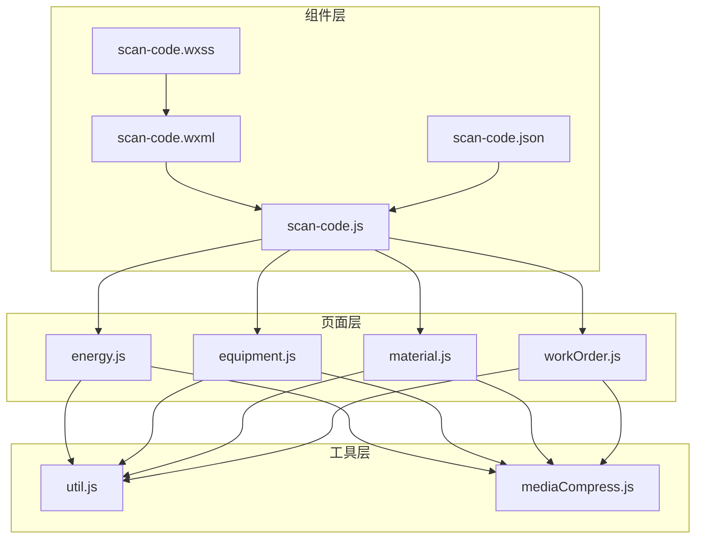
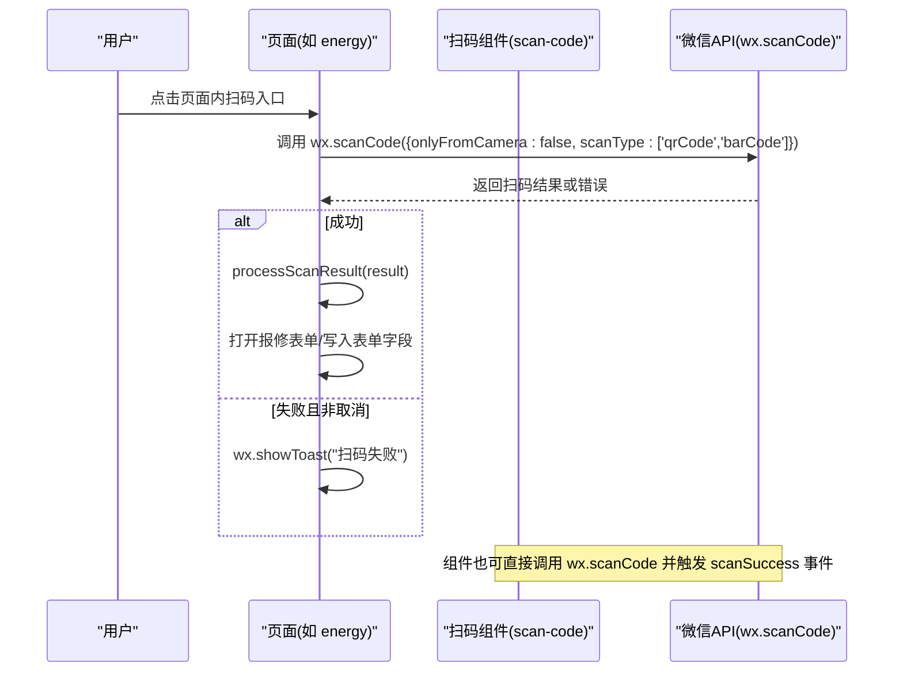
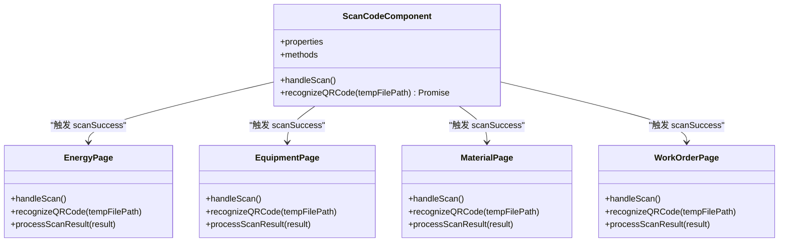
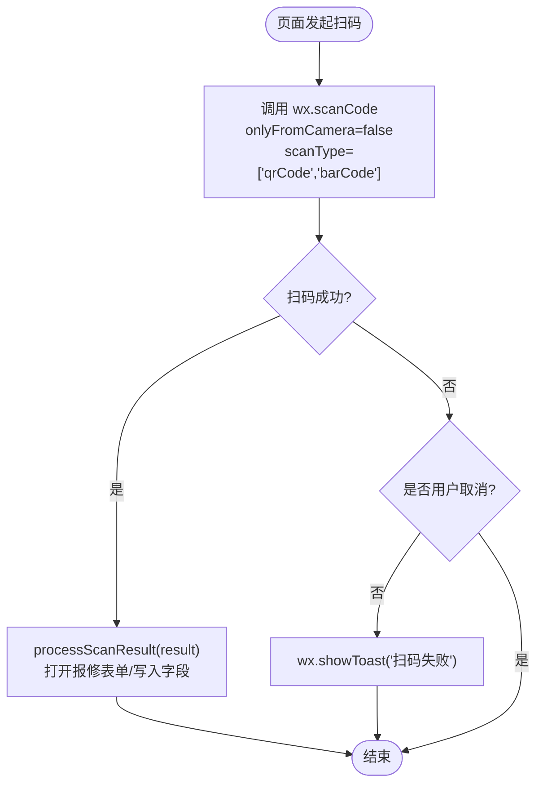
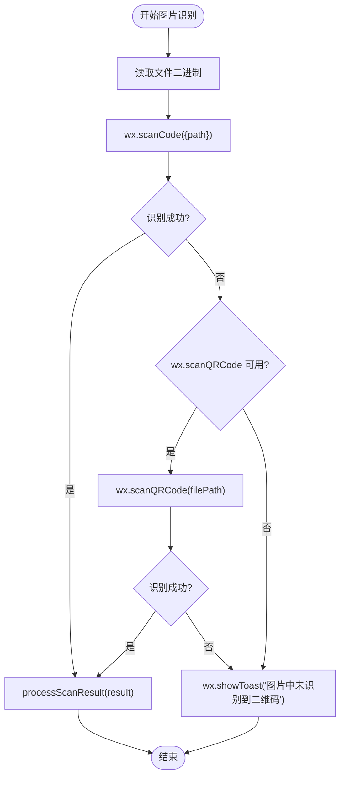
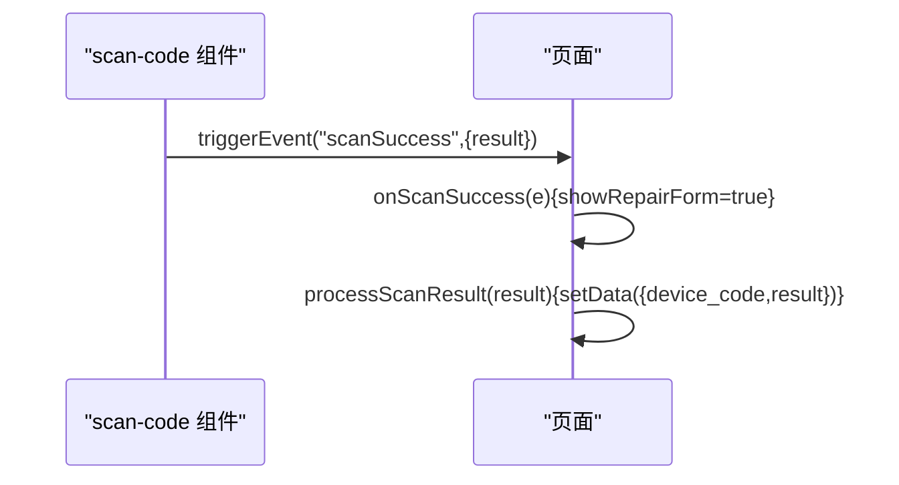
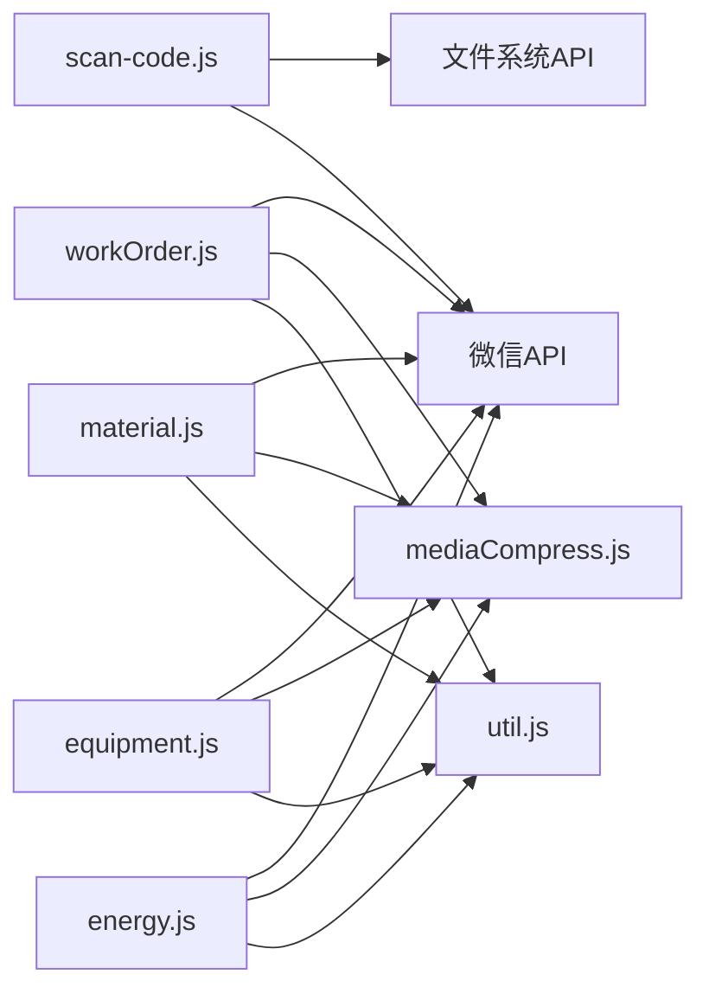

# 扫码组件

<cite>
**本文引用的文件**
- [scan-code.js](file://gccd_mini/pages/components/scan-code/scan-code.js)
- [scan-code.json](file://gccd_mini/pages/components/scan-code/scan-code.json)
- [scan-code.wxml](file://gccd_mini/pages/components/scan-code/scan-code.wxml)
- [scan-code.wxss](file://gccd_mini/pages/components/scan-code/scan-code.wxss)
- [energy.js](file://gccd_mini/pages/energy/energy.js)
- [equipment.js](file://gccd_mini/pages/equipment/equipment.js)
- [material.js](file://gccd_mini/pages/material/material.js)
- [workOrder.js](file://gccd_mini/pages/workOrder/workOrder.js)
- [util.js](file://gccd_mini/utils/util.js)
- [mediaCompress.js](file://gccd_mini/utils/mediaCompress.js)
</cite>

## 目录
1. [简介](#简介)
2. [项目结构](#项目结构)
3. [核心组件](#核心组件)
4. [架构总览](#架构总览)
5. [详细组件分析](#详细组件分析)
6. [依赖关系分析](#依赖关系分析)
7. [性能考虑](#性能考虑)
8. [故障排查指南](#故障排查指南)
9. [结论](#结论)
10. [附录](#附录)

## 简介
本文件系统性梳理“扫码组件”的实现与使用，覆盖以下方面：
- 微信小程序原生扫码 API 的封装与调用
- 相机权限与相册入口的处理策略
- 二维码/条形码识别流程与图片识别回退方案
- 组件生命周期与事件流（初始化、扫码状态监控、结果处理）
- 错误处理策略（权限拒绝、设备不支持、识别失败等）
- 组件配置参数（扫码区域、闪光灯、相册选择等）
- 实际使用示例与集成指南（页面间交互与数据传递）

## 项目结构
扫码组件位于页面级组件目录，采用“组件 + 页面”协同模式：
- 组件层：提供统一的扫码入口与事件输出
- 页面层：消费组件事件，处理扫码结果并联动业务流程

**图表来源**
- [scan-code.js:1-63](file://gccd_mini/pages/components/scan-code/scan-code.js#L1-L63)
- [scan-code.json:1-6](file://gccd_mini/pages/components/scan-code/scan-code.json#L1-L6)
- [scan-code.wxml:1-6](file://gccd_mini/pages/components/scan-code/scan-code.wxml#L1-L6)
- [scan-code.wxss:1-13](file://gccd_mini/pages/components/scan-code/scan-code.wxss#L1-L13)
- [energy.js:1-480](file://gccd_mini/pages/energy/energy.js#L1-L480)
- [equipment.js:1-800](file://gccd_mini/pages/equipment/equipment.js#L1-L800)
- [material.js:1-800](file://gccd_mini/pages/material/material.js#L1-L800)
- [workOrder.js:1-796](file://gccd_mini/pages/workOrder/workOrder.js#L1-L796)
- [util.js:1-98](file://gccd_mini/utils/util.js#L1-L98)
- [mediaCompress.js:1-104](file://gccd_mini/utils/mediaCompress.js#L1-L104)

**章节来源**
- [scan-code.js:1-63](file://gccd_mini/pages/components/scan-code/scan-code.js#L1-L63)
- [scan-code.json:1-6](file://gccd_mini/pages/components/scan-code/scan-code.json#L1-L6)
- [scan-code.wxml:1-6](file://gccd_mini/pages/components/scan-code/scan-code.wxml#L1-L6)
- [scan-code.wxss:1-13](file://gccd_mini/pages/components/scan-code/scan-code.wxss#L1-L13)

## 核心组件
- 组件职责
  - 提供扫码按钮与图标
  - 调用微信原生扫码 API，支持二维码与条形码
  - 支持从相册选择图片进行识别（可选）
  - 通过自定义事件向外抛出扫码结果
- 组件对外暴露
  - 事件：scanSuccess(result)
  - 方法：recognizeQRCode(tempFilePath)（Promise 包装的图片识别）
- 组件内部行为
  - 调用 wx.scanCode 并监听 success/fail
  - 图片识别时读取二进制文件并通过 wx.scanCode(path) 识别
  - 成功时触发 scanSuccess，失败时提示并区分用户取消场景

**章节来源**
- [scan-code.js:6-61](file://gccd_mini/pages/components/scan-code/scan-code.js#L6-L61)
- [scan-code.json:1-6](file://gccd_mini/pages/components/scan-code/scan-code.json#L1-L6)
- [scan-code.wxml:3-6](file://gccd_mini/pages/components/scan-code/scan-code.wxml#L3-L6)
- [scan-code.wxss:2-13](file://gccd_mini/pages/components/scan-code/scan-code.wxss#L2-L13)

## 架构总览
扫码组件在页面中的典型交互链路如下：

**图表来源**
- [energy.js:106-126](file://gccd_mini/pages/energy/energy.js#L106-L126)
- [equipment.js:336-356](file://gccd_mini/pages/equipment/equipment.js#L336-L356)
- [material.js:540-560](file://gccd_mini/pages/material/material.js#L540-L560)
- [workOrder.js:404-423](file://gccd_mini/pages/workOrder/workOrder.js#L404-L423)
- [scan-code.js:9-26](file://gccd_mini/pages/components/scan-code/scan-code.js#L9-L26)

## 详细组件分析

### 组件类图（代码级）

**图表来源**
- [scan-code.js:1-63](file://gccd_mini/pages/components/scan-code/scan-code.js#L1-L63)
- [energy.js:106-126](file://gccd_mini/pages/energy/energy.js#L106-L126)
- [equipment.js:336-356](file://gccd_mini/pages/equipment/equipment.js#L336-L356)
- [material.js:540-560](file://gccd_mini/pages/material/material.js#L540-L560)
- [workOrder.js:404-423](file://gccd_mini/pages/workOrder/workOrder.js#L404-L423)

**章节来源**
- [scan-code.js:1-63](file://gccd_mini/pages/components/scan-code/scan-code.js#L1-L63)
- [energy.js:106-126](file://gccd_mini/pages/energy/energy.js#L106-L126)
- [equipment.js:336-356](file://gccd_mini/pages/equipment/equipment.js#L336-L356)
- [material.js:540-560](file://gccd_mini/pages/material/material.js#L540-L560)
- [workOrder.js:404-423](file://gccd_mini/pages/workOrder/workOrder.js#L404-L423)

### 扫码流程（页面直调）

**图表来源**
- [energy.js:106-126](file://gccd_mini/pages/energy/energy.js#L106-L126)
- [equipment.js:336-356](file://gccd_mini/pages/equipment/equipment.js#L336-L356)
- [material.js:540-560](file://gccd_mini/pages/material/material.js#L540-L560)
- [workOrder.js:404-423](file://gccd_mini/pages/workOrder/workOrder.js#L404-L423)

**章节来源**
- [energy.js:106-126](file://gccd_mini/pages/energy/energy.js#L106-L126)
- [equipment.js:336-356](file://gccd_mini/pages/equipment/equipment.js#L336-L356)
- [material.js:540-560](file://gccd_mini/pages/material/material.js#L540-L560)
- [workOrder.js:404-423](file://gccd_mini/pages/workOrder/workOrder.js#L404-L423)

### 图片识别回退流程
当页面或组件需要从相册选择图片识别时，流程如下：
- 读取图片二进制内容
- 调用 wx.scanCode({ path }) 识别
- 若失败，尝试 wx.scanQRCode(filePath)（若可用）
- 最终失败则提示“图片中未识别到二维码”

**图表来源**
- [energy.js:129-185](file://gccd_mini/pages/energy/energy.js#L129-L185)
- [equipment.js:359-415](file://gccd_mini/pages/equipment/equipment.js#L359-L415)
- [material.js:563-619](file://gccd_mini/pages/material/material.js#L563-L619)
- [workOrder.js:426-478](file://gccd_mini/pages/workOrder/workOrder.js#L426-L478)

**章节来源**
- [energy.js:129-185](file://gccd_mini/pages/energy/energy.js#L129-L185)
- [equipment.js:359-415](file://gccd_mini/pages/equipment/equipment.js#L359-L415)
- [material.js:563-619](file://gccd_mini/pages/material/material.js#L563-L619)
- [workOrder.js:426-478](file://gccd_mini/pages/workOrder/workOrder.js#L426-L478)

### 组件事件与页面响应
- 组件触发 scanSuccess(result)
- 页面 onScanSuccess(e) 接收并打开报修表单
- 页面 processScanResult(result) 写入设备编号并展示表单

**图表来源**
- [scan-code.js:13-15](file://gccd_mini/pages/components/scan-code/scan-code.js#L13-L15)
- [energy.js:454-462](file://gccd_mini/pages/energy/energy.js#L454-L462)
- [workOrder.js:769-777](file://gccd_mini/pages/workOrder/workOrder.js#L769-L777)

**章节来源**
- [scan-code.js:13-15](file://gccd_mini/pages/components/scan-code/scan-code.js#L13-L15)
- [energy.js:454-462](file://gccd_mini/pages/energy/energy.js#L454-L462)
- [workOrder.js:769-777](file://gccd_mini/pages/workOrder/workOrder.js#L769-L777)

## 依赖关系分析
- 组件依赖
  - 微信原生 API：wx.scanCode、wx.showToast、wx.showLoading、wx.hideLoading
  - 文件系统：wx.getFileSystemManager().readFile
  - 第三方 UI：@vant/weapp/icon、toast、dialog（页面侧）
- 页面依赖
  - 工具库：util.js（统一封装 wx.request）
  - 媒体压缩：mediaCompress.js（上传前压缩与体积校验）
- 组件与页面耦合点
  - 组件只负责扫码与事件分发
  - 页面负责业务处理（打开表单、写入字段、调用后端接口）

**图表来源**
- [scan-code.js:9-52](file://gccd_mini/pages/components/scan-code/scan-code.js#L9-L52)
- [energy.js:1-4](file://gccd_mini/pages/energy/energy.js#L1-L4)
- [equipment.js:1-4](file://gccd_mini/pages/equipment/equipment.js#L1-L4)
- [material.js:1-4](file://gccd_mini/pages/material/material.js#L1-L4)
- [workOrder.js:1-4](file://gccd_mini/pages/workOrder/workOrder.js#L1-L4)
- [util.js:1-98](file://gccd_mini/utils/util.js#L1-L98)
- [mediaCompress.js:1-104](file://gccd_mini/utils/mediaCompress.js#L1-L104)

**章节来源**
- [scan-code.js:9-52](file://gccd_mini/pages/components/scan-code/scan-code.js#L9-L52)
- [energy.js:1-4](file://gccd_mini/pages/energy/energy.js#L1-L4)
- [equipment.js:1-4](file://gccd_mini/pages/equipment/equipment.js#L1-L4)
- [material.js:1-4](file://gccd_mini/pages/material/material.js#L1-L4)
- [workOrder.js:1-4](file://gccd_mini/pages/workOrder/workOrder.js#L1-L4)
- [util.js:1-98](file://gccd_mini/utils/util.js#L1-L98)
- [mediaCompress.js:1-104](file://gccd_mini/utils/mediaCompress.js#L1-L104)

## 性能考虑
- 图片识别前的体积控制
  - 使用 mediaCompress.prepareLocalPathForUpload 对图片进行压缩与体积校验，避免上传过大导致失败
- 识别失败的快速反馈
  - 用户取消场景不弹错误提示，减少打扰
- 并发上传与批量处理
  - 页面侧使用 Promise.all 并行上传多张图片，提升效率
- 识别回退策略
  - wx.scanCode(path) 失败时尝试 wx.scanQRCode(filePath)，提高识别成功率

**章节来源**
- [mediaCompress.js:48-98](file://gccd_mini/utils/mediaCompress.js#L48-L98)
- [energy.js:223-285](file://gccd_mini/pages/energy/energy.js#L223-L285)
- [equipment.js:458-520](file://gccd_mini/pages/equipment/equipment.js#L458-L520)
- [material.js:646-713](file://gccd_mini/pages/material/material.js#L646-L713)
- [workOrder.js:504-565](file://gccd_mini/pages/workOrder/workOrder.js#L504-L565)

## 故障排查指南
- 权限拒绝
  - 现象：扫码失败且非用户取消
  - 处理：页面侧对 err.errMsg 进行判断，非“cancel”时提示“扫码失败”
  - 建议：引导用户在设置中开启相机/相册权限
- 设备不支持或版本差异
  - 现象：wx.scanCode(path) 不支持 path 参数
  - 处理：页面侧检测 wx.scanQRCode(filePath) 并回退
- 识别失败
  - 现象：图片中未识别到二维码
  - 处理：提示“图片中未识别到二维码”，建议更换清晰度更高的图片
- 网络异常
  - 现象：提交报修或上传失败
  - 处理：util.js 统一拦截并提示，必要时跳转登录页

**章节来源**
- [energy.js:115-125](file://gccd_mini/pages/energy/energy.js#L115-L125)
- [equipment.js:379-403](file://gccd_mini/pages/equipment/equipment.js#L379-L403)
- [material.js:583-607](file://gccd_mini/pages/material/material.js#L583-L607)
- [workOrder.js:443-466](file://gccd_mini/pages/workOrder/workOrder.js#L443-L466)
- [util.js:22-94](file://gccd_mini/utils/util.js#L22-L94)

## 结论
扫码组件以“低耦合、高复用”为目标，将微信原生扫码能力封装为通用组件，并通过事件驱动页面侧业务处理。页面侧负责识别结果的落地与后续流程（如打开报修表单、上传图片、调用后端接口）。整体设计简洁清晰，具备良好的扩展性与容错能力。

## 附录

### 组件配置参数与行为
- 扫码类型
  - qrCode：二维码
  - barCode：条形码
- 扫描来源
  - onlyFromCamera=false：允许从相册选择
- 闪光灯控制
  - 当前实现未显式控制闪光灯
- 扫码区域
  - 由微信原生界面决定，组件未自定义裁剪区域
- 相册选择
  - 通过 onlyFromCamera=false 开启相册入口

**章节来源**
- [scan-code.js:9-11](file://gccd_mini/pages/components/scan-code/scan-code.js#L9-L11)
- [energy.js:109-111](file://gccd_mini/pages/energy/energy.js#L109-L111)
- [equipment.js:339-341](file://gccd_mini/pages/equipment/equipment.js#L339-L341)
- [material.js:543-545](file://gccd_mini/pages/material/material.js#L543-L545)
- [workOrder.js:407-409](file://gccd_mini/pages/workOrder/workOrder.js#L407-L409)

### 实际使用示例与集成指南
- 在页面中引入组件
  - 在目标页面的 wxml 中插入自定义组件节点，并绑定 scanSuccess 事件
- 页面响应步骤
  - onScanSuccess(e)：接收 result，打开报修表单并写入设备编号
  - processScanResult(result)：通用处理逻辑，写入设备编号并展示表单
- 数据传递机制
  - 组件通过自定义事件向页面传递 result
  - 页面将 result 写入 data，驱动视图与后续接口调用

**章节来源**
- [energy.js:454-462](file://gccd_mini/pages/energy/energy.js#L454-L462)
- [workOrder.js:769-777](file://gccd_mini/pages/workOrder/workOrder.js#L769-L777)