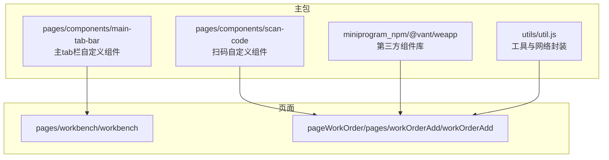
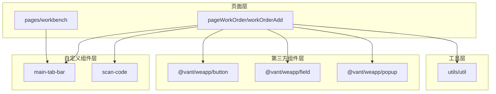
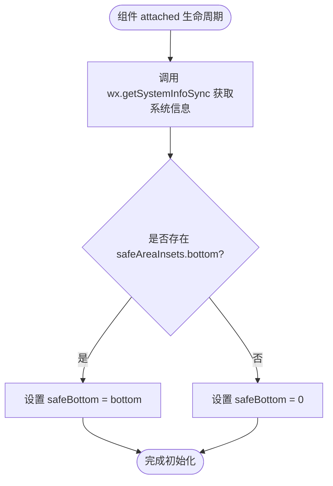
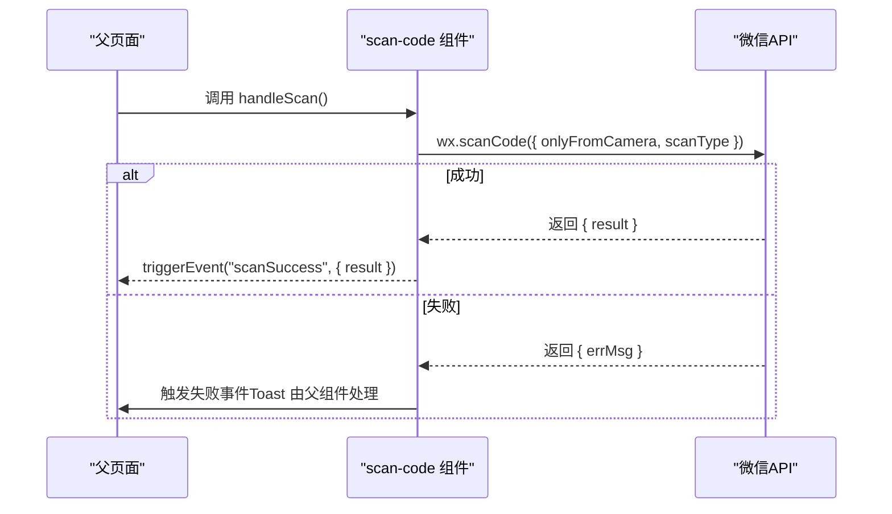
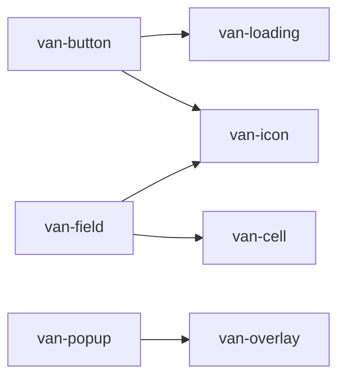
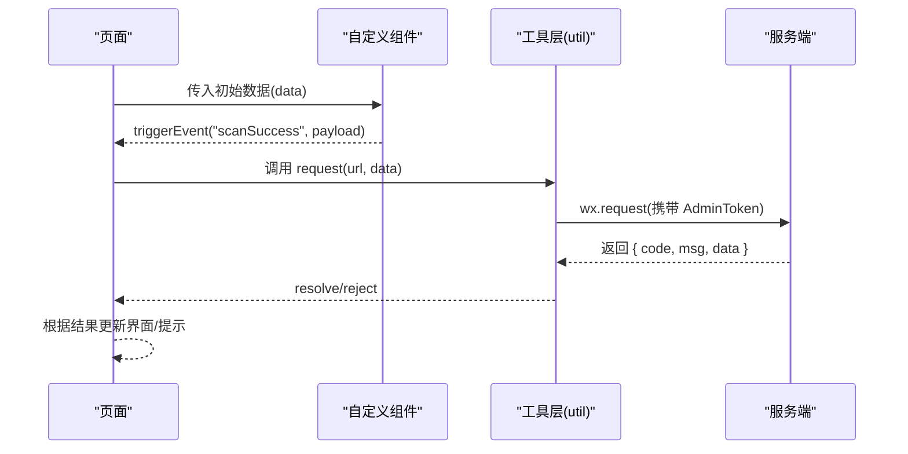
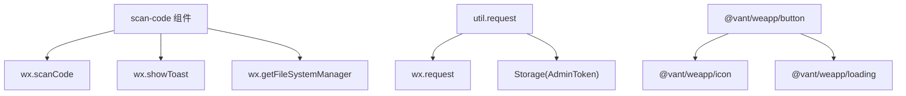

# 组件系统设计

<cite>
**本文引用的文件**
- [app.json](file://gccd_mini/app.json)
- [main-tab-bar.js](file://gccd_mini/pages/components/main-tab-bar/main-tab-bar.js)
- [main-tab-bar.json](file://gccd_mini/pages/components/main-tab-bar/main-tab-bar.json)
- [scan-code.js](file://gccd_mini/pages/components/scan-code/scan-code.js)
- [scan-code.json](file://gccd_mini/pages/components/scan-code/scan-code.json)
- [button/index.json](file://gccd_mini/miniprogram_npm/@vant/weapp/button/index.json)
- [button/index.js](file://gccd_mini/miniprogram_npm/@vant/weapp/button/index.js)
- [field/index.json](file://gccd_mini/miniprogram_npm/@vant/weapp/field/index.json)
- [field/index.js](file://gccd_mini/miniprogram_npm/@vant/weapp/field/index.js)
- [popup/index.json](file://gccd_mini/miniprogram_npm/@vant/weapp/popup/index.json)
- [popup/index.js](file://gccd_mini/miniprogram_npm/@vant/weapp/popup/index.js)
- [apply-vant-theme.js](file://gccd_mini/scripts/apply-vant-theme.js)
- [util.js](file://gccd_mini/utils/util.js)
- [workbench.js](file://gccd_mini/pages/workbench/workbench.js)
- [workbench.json](file://gccd_mini/pages/workbench/workbench.json)
- [workOrderAdd.js](file://gccd_mini/pageWorkOrder/pages/workOrderAdd/workOrderAdd.js)
- [workOrderAdd.json](file://gccd_mini/pageWorkOrder/pages/workOrderAdd/workOrderAdd.json)
</cite>

## 目录
1. [简介](#简介)
2. [项目结构](#项目结构)
3. [核心组件](#核心组件)
4. [架构总览](#架构总览)
5. [详细组件分析](#详细组件分析)
6. [依赖分析](#依赖分析)
7. [性能考虑](#性能考虑)
8. [故障排查指南](#故障排查指南)
9. [结论](#结论)
10. [附录](#附录)

## 简介
本文件面向“高齿传动”小程序的组件系统设计，围绕以下目标展开：
- 自定义组件与第三方组件的使用模式
- 主tab栏组件的设计与实现要点（结构、数据绑定、事件处理、样式定制）
- 扫码组件的功能实现（二维码扫描、相机权限、数据解析、错误处理）
- Vant Weapp 组件库的集成与定制（button、field、popup 等）
- 组件间通信机制（父子传值、事件传递、全局状态管理）
- 组件开发最佳实践与性能优化建议

## 项目结构
小程序采用分包策略与自定义组件体系，主包包含基础页面与公共组件，子包按功能域划分。Vant Weapp 作为第三方组件库通过 npm 安装并映射为本地 usingComponents。

图表来源
- [app.json:1-99](file://gccd_mini/app.json#L1-L99)
- [main-tab-bar.js:1-56](file://gccd_mini/pages/components/main-tab-bar/main-tab-bar.js#L1-L56)
- [scan-code.js:1-63](file://gccd_mini/pages/components/scan-code/scan-code.js#L1-L63)
- [workOrderAdd.json:1-17](file://gccd_mini/pageWorkOrder/pages/workOrderAdd/workOrderAdd.json#L1-L17)

章节来源
- [app.json:1-99](file://gccd_mini/app.json#L1-L99)

## 核心组件
- 主tab栏组件：用于非 Tab 页面的底部导航，与 app.json 的 tabBar 结构保持一致，支持安全区适配与页面跳转。
- 扫码组件：封装 wx.scanCode 能力，提供扫码回调与图片识别能力，并触发自定义事件。
- Vant Weapp 组件：通过 usingComponents 在页面中直接使用，如 van-button、van-field、van-popup 等。

章节来源
- [main-tab-bar.js:1-56](file://gccd_mini/pages/components/main-tab-bar/main-tab-bar.js#L1-L56)
- [scan-code.js:1-63](file://gccd_mini/pages/components/scan-code/scan-code.js#L1-L63)
- [button/index.json:1-8](file://gccd_mini/miniprogram_npm/@vant/weapp/button/index.json#L1-L8)
- [field/index.json:1-8](file://gccd_mini/miniprogram_npm/@vant/weapp/field/index.json#L1-L8)
- [popup/index.json:1-8](file://gccd_mini/miniprogram_npm/@vant/weapp/popup/index.json#L1-L8)

## 架构总览
整体架构由“页面 + 自定义组件 + 第三方组件库”三层组成。页面通过 usingComponents 引入第三方组件，同时可组合自定义组件实现统一交互体验。网络层通过 utils/util.js 封装请求与鉴权逻辑，供页面与组件共同使用。

图表来源
- [workOrderAdd.json:1-17](file://gccd_mini/pageWorkOrder/pages/workOrderAdd/workOrderAdd.json#L1-L17)
- [workbench.js:1-15](file://gccd_mini/pages/workbench/workbench.js#L1-L15)
- [main-tab-bar.js:1-56](file://gccd_mini/pages/components/main-tab-bar/main-tab-bar.js#L1-L56)
- [scan-code.js:1-63](file://gccd_mini/pages/components/scan-code/scan-code.js#L1-L63)
- [util.js:1-98](file://gccd_mini/utils/util.js#L1-L98)

## 详细组件分析

### 主tab栏组件（main-tab-bar）
- 组件职责
  - 维护底部导航项（工作台、设备、盘点、我的），与 app.json 的 tabBar 保持一致
  - 适配安全区底部内边距，保证胶囊屏体验
  - 处理点击事件，使用 switchTab 或 reLaunch 实现页面跳转
- 数据绑定
  - tabs 列表与图标路径来自组件内部常量
  - safeBottom 通过 wx.getSystemInfoSync 动态计算
- 事件处理
  - onSwitch 根据路径判断是否使用 reLaunch，确保从子页返回时回到首页
- 样式定制
  - 通过组件 json 的 usingComponents 空配置，避免额外依赖
  - 图标与文字颜色由 app.json 的 tabBar 配置统一控制

图表来源
- [main-tab-bar.js:32-42](file://gccd_mini/pages/components/main-tab-bar/main-tab-bar.js#L32-L42)

章节来源
- [main-tab-bar.js:1-56](file://gccd_mini/pages/components/main-tab-bar/main-tab-bar.js#L1-L56)
- [main-tab-bar.json:1-5](file://gccd_mini/pages/components/main-tab-bar/main-tab-bar.json#L1-L5)
- [app.json:24-55](file://gccd_mini/app.json#L24-L55)

### 扫码组件（scan-code）
- 功能点
  - 调用 wx.scanCode 扫描二维码/条形码，触发 scanSuccess 事件
  - 支持从图片识别二维码（可选），封装 Promise 并处理错误
- 权限与错误处理
  - 对用户取消扫码进行区分，避免提示“扫码失败”
  - 图片识别失败时抛出错误，便于上层捕获
- 事件与数据流
  - 成功时向父组件传递 result 字段
  - 失败时通过 Toast 提示（在父组件中消费）

图表来源
- [scan-code.js:6-27](file://gccd_mini/pages/components/scan-code/scan-code.js#L6-L27)

章节来源
- [scan-code.js:1-63](file://gccd_mini/pages/components/scan-code/scan-code.js#L1-L63)
- [scan-code.json:1-6](file://gccd_mini/pages/components/scan-code/scan-code.json#L1-L6)

### Vant Weapp 组件集成
- 组件清单与依赖
  - button：依赖 icon 与 loading
  - field：依赖 cell 与 icon
  - popup：依赖 overlay 与 transition 混入
- 在页面中的使用
  - 通过 workOrderAdd.json 的 usingComponents 注册，直接在 wxml 中使用 van-button、van-field、van-popup 等
- 主题定制
  - 通过脚本替换 Vant 内部蓝色常量为项目主色，结合 app.wxss 的 CSS 变量形成统一主题

图表来源
- [button/index.json:1-8](file://gccd_mini/miniprogram_npm/@vant/weapp/button/index.json#L1-L8)
- [field/index.json:1-8](file://gccd_mini/miniprogram_npm/@vant/weapp/field/index.json#L1-L8)
- [popup/index.json:1-8](file://gccd_mini/miniprogram_npm/@vant/weapp/popup/index.json#L1-L8)

章节来源
- [button/index.js:1-68](file://gccd_mini/miniprogram_npm/@vant/weapp/button/index.js#L1-L68)
- [field/index.js:1-153](file://gccd_mini/miniprogram_npm/@vant/weapp/field/index.js#L1-L153)
- [popup/index.js:1-100](file://gccd_mini/miniprogram_npm/@vant/weapp/popup/index.js#L1-L100)
- [workOrderAdd.json:1-17](file://gccd_mini/pageWorkOrder/pages/workOrderAdd/workOrderAdd.json#L1-L17)
- [apply-vant-theme.js:1-95](file://gccd_mini/scripts/apply-vant-theme.js#L1-L95)

### 页面与组件通信
- 父子传值
  - 页面通过 data 向自定义组件传递导航项与状态，组件通过事件回传结果
- 事件传递
  - 自定义组件通过 triggerEvent 发出事件，父页面在 wxml 中绑定相应事件处理函数
- 全局状态管理
  - 项目中通过 util.js 的 request 方法集中处理鉴权与错误提示，减少页面重复逻辑

图表来源
- [util.js:22-94](file://gccd_mini/utils/util.js#L22-L94)
- [scan-code.js:12-26](file://gccd_mini/pages/components/scan-code/scan-code.js#L12-L26)

章节来源
- [workOrderAdd.js:1-800](file://gccd_mini/pageWorkOrder/pages/workOrderAdd/workOrderAdd.js#L1-L800)
- [util.js:1-98](file://gccd_mini/utils/util.js#L1-L98)

## 依赖分析
- 组件耦合
  - 自定义组件与页面之间通过事件解耦，降低耦合度
  - Vant 组件通过 usingComponents 引入，避免直接引入源码，利于版本管理
- 外部依赖
  - 微信原生 API：wx.scanCode、wx.request、wx.showToast、wx.getSystemInfoSync 等
  - 第三方库：@vant/weapp
- 潜在风险
  - 若未正确处理用户取消扫码场景，可能导致误提示
  - 图片识别需注意文件读取权限与编码问题

图表来源
- [scan-code.js:1-63](file://gccd_mini/pages/components/scan-code/scan-code.js#L1-L63)
- [util.js:1-98](file://gccd_mini/utils/util.js#L1-L98)
- [button/index.json:1-8](file://gccd_mini/miniprogram_npm/@vant/weapp/button/index.json#L1-L8)

章节来源
- [scan-code.js:1-63](file://gccd_mini/pages/components/scan-code/scan-code.js#L1-L63)
- [util.js:1-98](file://gccd_mini/utils/util.js#L1-L98)

## 性能考虑
- 按需加载
  - app.json 启用 lazyCodeLoading 与 componentFramework，有助于减小首包体积
- 组件懒加载
  - 使用 usingComponents 按需引入第三方组件，避免全量打包
- 请求优化
  - 在 util.js 中集中处理鉴权头与错误提示，减少重复逻辑
- 事件节流
  - 表单输入可结合防抖策略（示例中存在注释的计时器变量），避免频繁请求
- 图片识别
  - 仅在必要时调用 readFile 与 scanCode，识别完成后及时隐藏加载态

章节来源
- [app.json:21-24](file://gccd_mini/app.json#L21-L24)
- [workOrderAdd.js:89-118](file://gccd_mini/pageWorkOrder/pages/workOrderAdd/workOrderAdd.js#L89-L118)
- [util.js:22-94](file://gccd_mini/utils/util.js#L22-L94)

## 故障排查指南
- 扫码失败
  - 区分“用户取消”与“其他错误”，避免误提示
  - 图片识别失败时，检查文件路径与编码参数
- 登录过期
  - 当服务端返回 401 时，清除本地 token 并跳转登录页
- 网络异常
  - 统一提示“网络异常，请检查网络”，便于用户感知
- 主题不一致
  - 确认 apply-vant-theme 脚本已执行，且 node_modules 未被重装覆盖

章节来源
- [scan-code.js:17-26](file://gccd_mini/pages/components/scan-code/scan-code.js#L17-L26)
- [util.js:57-68](file://gccd_mini/utils/util.js#L57-L68)
- [apply-vant-theme.js:1-95](file://gccd_mini/scripts/apply-vant-theme.js#L1-L95)

## 结论
本项目通过自定义组件与 Vant Weapp 的组合，实现了统一的交互体验与良好的扩展性。主tab栏组件与扫码组件分别解决了导航与采集两大核心场景；通过 usingComponents 与工具层封装，提升了开发效率与一致性。建议在后续迭代中进一步完善事件命名规范、错误分类与日志埋点，持续优化性能与用户体验。

## 附录
- 最佳实践
  - 统一事件命名与参数结构，便于跨页面复用
  - 对第三方组件进行二次封装，屏蔽细节差异
  - 在页面入口集中处理权限与登录校验
- 性能优化建议
  - 合理使用分包与按需加载
  - 对高频请求进行缓存与去重
  - 控制组件渲染范围，避免不必要的 setData