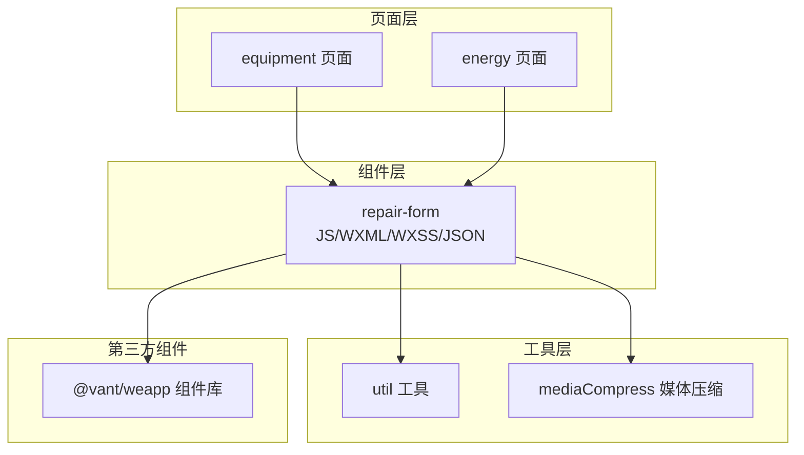
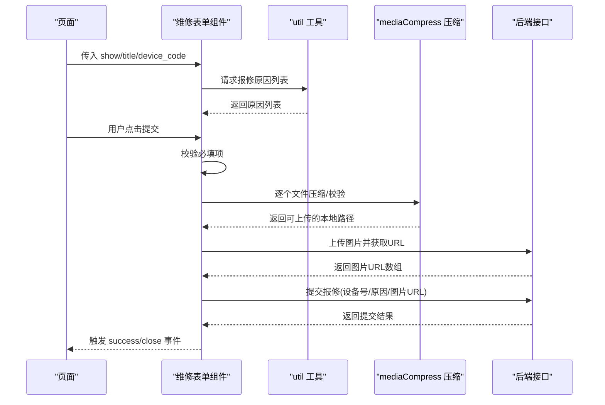
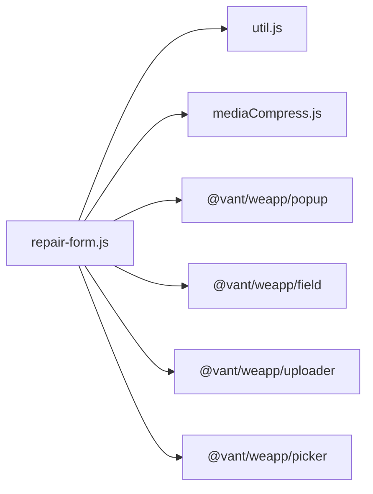
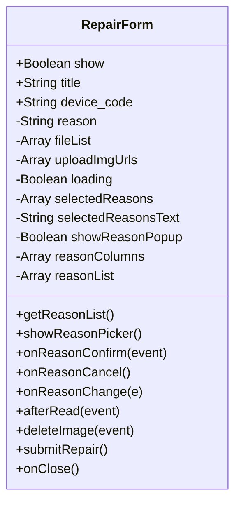
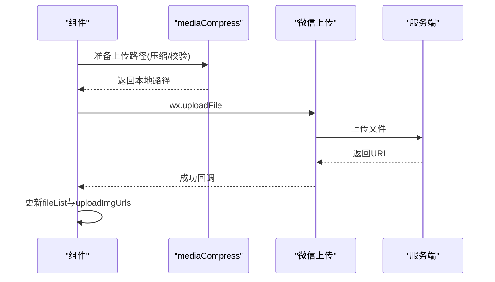

# 维修表单组件

<cite>
**本文档引用的文件**
- [repair-form.js](file://gccd_mini/pages/components/repair-form/repair-form.js)
- [repair-form.json](file://gccd_mini/pages/components/repair-form/repair-form.json)
- [repair-form.wxml](file://gccd_mini/pages/components/repair-form/repair-form.wxml)
- [repair-form.wxss](file://gccd_mini/pages/components/repair-form/repair-form.wxss)
- [util.js](file://gccd_mini/utils/util.js)
- [mediaCompress.js](file://gccd_mini/utils/mediaCompress.js)
- [equipment.js](file://gccd_mini/pages/equipment/equipment.js)
- [energy.js](file://gccd_mini/pages/energy/energy.js)
</cite>

## 目录
1. [简介](#简介)
2. [项目结构](#项目结构)
3. [核心组件](#核心组件)
4. [架构总览](#架构总览)
5. [详细组件分析](#详细组件分析)
6. [依赖关系分析](#依赖关系分析)
7. [性能考虑](#性能考虑)
8. [故障排查指南](#故障排查指南)
9. [结论](#结论)
10. [附录](#附录)

## 简介
本技术文档围绕“维修表单组件”展开，系统性介绍其表单设计与实现，涵盖输入字段配置、数据验证规则、提交处理流程；阐述数据绑定机制（表单数据收集、实时验证、错误提示）、交互设计（输入框类型、日期时间选择器、文件上传）、样式定制能力（主题颜色、布局、响应式适配），并提供使用示例与集成方法（表单重置、数据回显、异步提交等高级功能）。

## 项目结构
维修表单组件位于小程序前端工程的组件目录中，采用 WXML + WXSS + JS 的标准组合模式，并通过 usingComponents 引入 Vant Weapp 组件库以实现统一的 UI 体验。页面侧通过自定义组件的方式在多个页面中复用该表单。

图表来源
- [repair-form.js:1-261](file://gccd_mini/pages/components/repair-form/repair-form.js#L1-L261)
- [repair-form.json:1-11](file://gccd_mini/pages/components/repair-form/repair-form.json#L1-L11)
- [equipment.js:1170-1195](file://gccd_mini/pages/equipment/equipment.js#L1170-L1195)
- [energy.js:454-472](file://gccd_mini/pages/energy/energy.js#L454-L472)

章节来源
- [repair-form.js:1-261](file://gccd_mini/pages/components/repair-form/repair-form.js#L1-L261)
- [repair-form.json:1-11](file://gccd_mini/pages/components/repair-form/repair-form.json#L1-L11)

## 核心组件
维修表单组件对外暴露以下属性与行为：
- 属性
  - show: 控制组件弹窗显示/隐藏
  - title: 表单标题
  - device_code: 设备编号（只读展示）
- 数据
  - reason: 报修详情（文本域）
  - fileList: 已选择文件列表（用于上传预览）
  - uploadImgUrls: 已上传成功图片的 URL 数组
  - loading: 提交按钮加载态
  - selectedReasons: 已选择的报修原因集合（多选）
  - selectedReasonsText: 已选择原因的文本展示
  - showReasonPopup: 原因选择弹窗显示控制
  - reasonColumns: 原因选择器列数据
  - reasonList: 原因列表（完整数据）
- 方法
  - getReasonList(): 拉取报修原因列表
  - showReasonPicker()/onReasonConfirm()/onReasonCancel(): 原因选择弹窗交互
  - onReasonChange(): 实时更新报修详情
  - afterRead()/deleteImage(): 文件上传与删除
  - submitRepair(): 提交报修
  - onClose(): 关闭并重置表单

章节来源
- [repair-form.js:5-35](file://gccd_mini/pages/components/repair-form/repair-form.js#L5-L35)
- [repair-form.js:43-261](file://gccd_mini/pages/components/repair-form/repair-form.js#L43-L261)

## 架构总览
组件内部通过 Vant Weapp 的弹窗、字段、上传器、选择器等组件构建表单界面；数据流由页面传入 device_code 并在组件内完成收集与校验，最终通过工具函数发起网络请求。

图表来源
- [repair-form.js:44-67](file://gccd_mini/pages/components/repair-form/repair-form.js#L44-L67)
- [repair-form.js:145-206](file://gccd_mini/pages/components/repair-form/repair-form.js#L145-L206)
- [repair-form.js:221-259](file://gccd_mini/pages/components/repair-form/repair-form.js#L221-L259)
- [util.js:22-94](file://gccd_mini/utils/util.js#L22-L94)
- [mediaCompress.js:48-98](file://gccd_mini/utils/mediaCompress.js#L48-L98)

## 详细组件分析

### 表单设计与字段配置
- 设备编码：只读展示，来源于页面传入
- 报修原因：多选，通过弹窗选择器实现，支持单次切换选中/取消
- 报修详情：文本域，支持自动高度
- 上传图片：支持多图上传、预览、删除
- 操作按钮：提交（带加载态）、取消

章节来源
- [repair-form.wxml:1-39](file://gccd_mini/pages/components/repair-form/repair-form.wxml#L1-L39)
- [repair-form.js:21-35](file://gccd_mini/pages/components/repair-form/repair-form.js#L21-L35)

### 数据绑定机制
- 单向数据流：页面通过属性传入初始值，组件内部 setData 更新
- 双向绑定：通过事件回调实时更新组件内部 data
- 文件列表与上传 URL：fileList 用于展示，uploadImgUrls 用于提交

章节来源
- [repair-form.js:139-143](file://gccd_mini/pages/components/repair-form/repair-form.js#L139-L143)
- [repair-form.js:194-201](file://gccd_mini/pages/components/repair-form/repair-form.js#L194-L201)

### 数据验证规则
- 必填校验：设备编码存在性、至少选择一个报修原因
- 上传校验：图片大小限制、格式判断、压缩策略
- 错误提示：Toast 统一提示，失败场景包含具体原因

章节来源
- [repair-form.js:230-231](file://gccd_mini/pages/components/repair-form/repair-form.js#L230-L231)
- [mediaCompress.js:48-98](file://gccd_mini/utils/mediaCompress.js#L48-L98)

### 提交处理逻辑
- 组装参数：设备编码、报修详情、图片URL数组、已选原因ID
- 发起请求：通过 util.request 封装的网络层
- 结果处理：成功则提示并关闭弹窗，触发父级 success 事件；失败则提示错误

章节来源
- [repair-form.js:221-259](file://gccd_mini/pages/components/repair-form/repair-form.js#L221-L259)
- [util.js:22-94](file://gccd_mini/utils/util.js#L22-L94)

### 交互设计
- 原因选择：底部弹窗 + 选择器，支持多次切换
- 文件上传：点击上传区域触发，支持多选、预览、删除
- 提交按钮：加载态避免重复提交

章节来源
- [repair-form.wxml:10-23](file://gccd_mini/pages/components/repair-form/repair-form.wxml#L10-L23)
- [repair-form.js:81-118](file://gccd_mini/pages/components/repair-form/repair-form.js#L81-L118)
- [repair-form.js:145-206](file://gccd_mini/pages/components/repair-form/repair-form.js#L145-L206)

### 样式定制能力
- 主题颜色：通过 Vant Weapp 组件的 type/size 等属性控制
- 布局与间距：容器、标签、输入框、操作区的样式类可按需调整
- 响应式适配：组件宽度与弹窗尺寸在 WXSS 中设置，适配不同屏幕

章节来源
- [repair-form.wxss:1-36](file://gccd_mini/pages/components/repair-form/repair-form.wxss#L1-L36)
- [repair-form.json:3-10](file://gccd_mini/pages/components/repair-form/repair-form.json#L3-L10)

### 使用示例与集成方法
- 在页面中引入组件并在模板中使用，传入 show、title、device_code
- 监听组件的 close 与 success 事件，分别用于关闭弹窗与刷新数据
- 支持扫码后直接打开表单并回显设备编码

章节来源
- [equipment.js:1170-1195](file://gccd_mini/pages/equipment/equipment.js#L1170-L1195)
- [energy.js:454-472](file://gccd_mini/pages/energy/energy.js#L454-L472)

## 依赖关系分析
组件依赖 Vant Weapp 的弹窗、字段、上传器、选择器等基础组件；数据访问通过 util.request 统一封装；媒体上传前通过 mediaCompress 进行体积与格式处理。

图表来源
- [repair-form.js:1-3](file://gccd_mini/pages/components/repair-form/repair-form.js#L1-L3)
- [repair-form.json:3-10](file://gccd_mini/pages/components/repair-form/repair-form.json#L3-L10)

章节来源
- [repair-form.json:1-11](file://gccd_mini/pages/components/repair-form/repair-form.json#L1-L11)

## 性能考虑
- 上传优化：对图片进行多级压缩与尺寸裁剪，确保不超过体积阈值
- 并发上传：多文件上传采用 Promise.all 并行处理，提升效率
- 网络封装：统一处理状态码、鉴权头、错误提示，减少重复逻辑
- UI 体验：加载态与 Toast 提示，避免用户误操作

章节来源
- [mediaCompress.js:48-98](file://gccd_mini/utils/mediaCompress.js#L48-L98)
- [repair-form.js:191-205](file://gccd_mini/pages/components/repair-form/repair-form.js#L191-L205)
- [util.js:22-94](file://gccd_mini/utils/util.js#L22-L94)

## 故障排查指南
- 接口失败：检查网络状态与后端返回码，关注 401 自动跳转登录
- 上传失败：确认文件类型与大小是否满足压缩与体积限制
- 原因列表为空：确认接口返回与 Toast 提示
- 表单无法关闭：检查事件绑定与 data 重置逻辑

章节来源
- [util.js:49-83](file://gccd_mini/utils/util.js#L49-L83)
- [repair-form.js:64-66](file://gccd_mini/pages/components/repair-form/repair-form.js#L64-L66)
- [repair-form.js:128-137](file://gccd_mini/pages/components/repair-form/repair-form.js#L128-L137)

## 结论
维修表单组件以 Vant Weapp 为基础，结合统一封装的网络与媒体处理能力，实现了设备报修场景下的高效表单体验。组件具备良好的可扩展性与可维护性，适合在多页面中复用，并可通过属性与事件灵活集成到业务流程中。

## 附录

### 类图（组件内部结构）

图表来源
- [repair-form.js:5-35](file://gccd_mini/pages/components/repair-form/repair-form.js#L5-L35)
- [repair-form.js:43-261](file://gccd_mini/pages/components/repair-form/repair-form.js#L43-L261)

### 顺序图（文件上传流程）

图表来源
- [repair-form.js:145-206](file://gccd_mini/pages/components/repair-form/repair-form.js#L145-L206)
- [mediaCompress.js:48-98](file://gccd_mini/utils/mediaCompress.js#L48-L98)