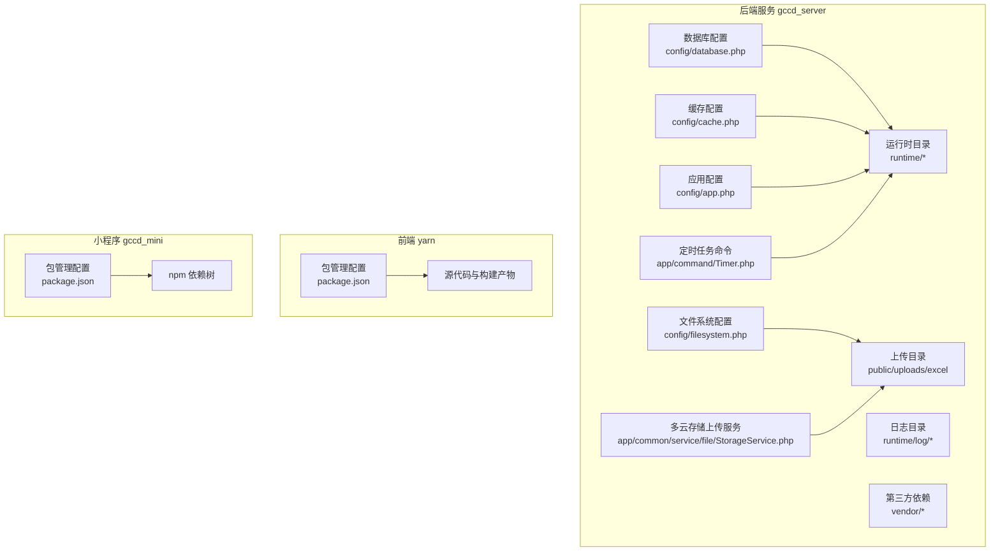
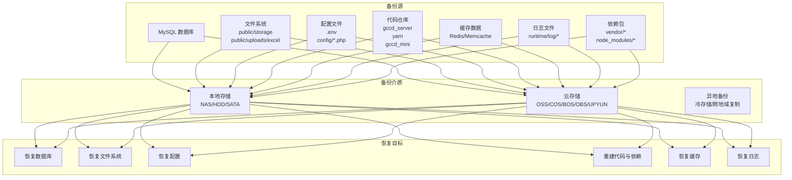
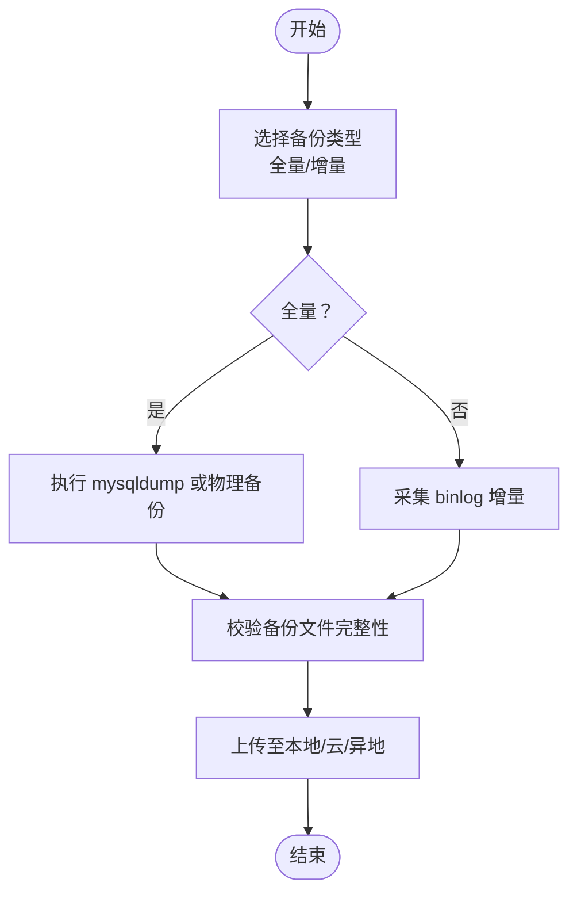
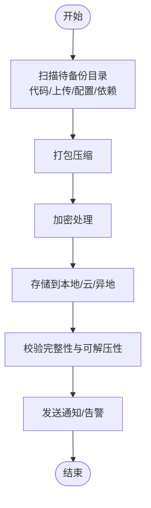
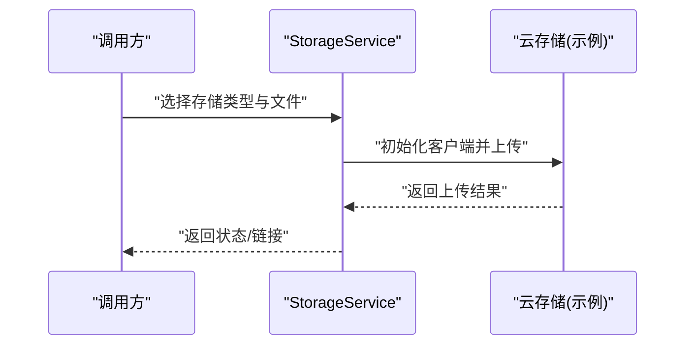
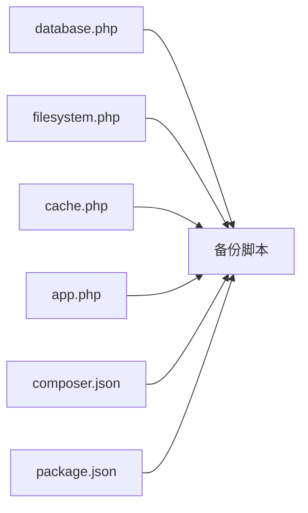

# 备份恢复

<cite>
**本文引用的文件**
- [gccd_server/config/database.php](file://gccd_server/config/database.php)
- [gccd_server/config/filesystem.php](file://gccd_server/config/filesystem.php)
- [gccd_server/config/cache.php](file://gccd_server/config/cache.php)
- [gccd_server/config/app.php](file://gccd_server/config/app.php)
- [gccd_server/composer.json](file://gccd_server/composer.json)
- [yarn/package.json](file://yarn/package.json)
- [gccd_server/app/command/Timer.php](file://gccd_server/app/command/Timer.php)
- [gccd_server/app/common/service/file/StorageService.php](file://gccd_server/app/common/service/file/StorageService.php)
- [gccd_server/public/uploads/excel](file://gccd_server/public/uploads/excel)
- [gccd_server/.gitignore](file://gccd_server/.gitignore)
- [gccd_server/private/database/db_init_sql.txt](file://gccd_server/private/database/db_init_sql.txt)
</cite>

## 目录
1. [简介](#简介)
2. [项目结构](#项目结构)
3. [核心组件](#核心组件)
4. [架构总览](#架构总览)
5. [详细组件分析](#详细组件分析)
6. [依赖关系分析](#依赖关系分析)
7. [性能考虑](#性能考虑)
8. [故障排查指南](#故障排查指南)
9. [结论](#结论)
10. [附录](#附录)

## 简介
本方案面向“高齿传动”项目，提供一套完整的备份与恢复体系，覆盖数据库（全量/增量）、代码与上传文件、配置文件、以及缓存与日志等；明确本地/云存储/异地备份策略；给出灾难恢复流程、验证与测试方法，并配套自动化脚本与监控告警建议，确保备份数据的完整性与可恢复性。

## 项目结构
项目由三部分构成：
- 后端服务（ThinkPHP 8）：gccd_server
- 前端管理（Vue 3 + Vite）：yarn
- 小程序前端：gccd_mini

备份关注点主要集中在后端服务的数据库、文件存储、配置与运行时产物，以及前端构建产物与依赖。

图表来源
- [gccd_server/config/database.php:1-71](file://gccd_server/config/database.php#L1-L71)
- [gccd_server/config/filesystem.php:1-33](file://gccd_server/config/filesystem.php#L1-L33)
- [gccd_server/config/cache.php:1-86](file://gccd_server/config/cache.php#L1-L86)
- [gccd_server/config/app.php:1-44](file://gccd_server/config/app.php#L1-L44)
- [gccd_server/app/command/Timer.php:1-113](file://gccd_server/app/command/Timer.php#L1-L113)
- [gccd_server/app/common/service/file/StorageService.php:65-135](file://gccd_server/app/common/service/file/StorageService.php#L65-L135)
- [gccd_server/public/uploads/excel](file://gccd_server/public/uploads/excel)
- [gccd_server/.gitignore:1-27](file://gccd_server/.gitignore#L1-L27)
- [gccd_server/composer.json:1-65](file://gccd_server/composer.json#L1-L65)
- [yarn/package.json:1-88](file://yarn/package.json#L1-L88)

章节来源
- [gccd_server/config/database.php:1-71](file://gccd_server/config/database.php#L1-L71)
- [gccd_server/config/filesystem.php:1-33](file://gccd_server/config/filesystem.php#L1-L33)
- [gccd_server/config/cache.php:1-86](file://gccd_server/config/cache.php#L1-L86)
- [gccd_server/config/app.php:1-44](file://gccd_server/config/app.php#L1-L44)
- [gccd_server/app/command/Timer.php:1-113](file://gccd_server/app/command/Timer.php#L1-L113)
- [gccd_server/app/common/service/file/StorageService.php:65-135](file://gccd_server/app/common/service/file/StorageService.php#L65-L135)
- [gccd_server/public/uploads/excel](file://gccd_server/public/uploads/excel)
- [gccd_server/.gitignore:1-27](file://gccd_server/.gitignore#L1-L27)
- [gccd_server/composer.json:1-65](file://gccd_server/composer.json#L1-L65)
- [yarn/package.json:1-88](file://yarn/package.json#L1-L88)

## 核心组件
- 数据库层：基于 ThinkPHP ORM 的 MySQL 连接配置，支持主从部署与字段缓存，便于制定备份策略与恢复路径。
- 文件系统层：本地磁盘作为默认存储，上传目录位于 public/storage 与 public/uploads/excel；同时集成多云 SDK，支持阿里云 OSS、腾讯 COS、百度 BOS、又拍云、华为 OBS 等。
- 缓存与日志：支持 file/redis/memcache 等多种缓存后端；日志按日期分目录存放，便于归档与清理。
- 定时任务：内置定时清理日志的服务，可作为备份调度的参考或联动。
- 构建与依赖：前后端均通过包管理器管理依赖，需纳入代码与依赖备份范围。

章节来源
- [gccd_server/config/database.php:27-66](file://gccd_server/config/database.php#L27-L66)
- [gccd_server/config/filesystem.php:15-31](file://gccd_server/config/filesystem.php#L15-L31)
- [gccd_server/config/cache.php:18-84](file://gccd_server/config/cache.php#L18-L84)
- [gccd_server/app/command/Timer.php:41-61](file://gccd_server/app/command/Timer.php#L41-L61)
- [gccd_server/composer.json:23-47](file://gccd_server/composer.json#L23-L47)
- [yarn/package.json:16-24](file://yarn/package.json#L16-L24)

## 架构总览
下图展示备份与恢复涉及的关键组件及其交互关系：

## 详细组件分析

### 数据库备份策略
- 全量备份
  - 使用逻辑导出（如 mysqldump）生成 SQL 备份，包含结构与数据；或使用物理备份（如 Percona XtraBackup）实现热备。
  - 建议：每日全量，保留最近 7-14 天；每周/月做归档快照。
- 增量备份
  - 基于二进制日志（binlog）进行增量备份，结合全量备份进行时间点恢复（PITR）。
  - 建议：每 5-15 分钟切分一次 binlog，保留至少 7 天。
- 定时任务配置
  - 可利用系统计划任务（crontab）或容器编排的 CronJob 触发备份脚本。
  - 备份完成后校验文件完整性与可导入性，失败告警。
- 数据库配置要点
  - 连接参数、字符集、表前缀、字段缓存路径等均影响备份与恢复过程，应保持一致。

章节来源
- [gccd_server/config/database.php:27-66](file://gccd_server/config/database.php#L27-L66)
- [gccd_server/app/command/Timer.php:41-61](file://gccd_server/app/command/Timer.php#L41-L61)

### 文件备份方案
- 代码文件
  - gccd_server、yarn、gccd_mini 三个子项目均需纳入备份；.gitignore 中已排除 vendor/runtime/public/storage 等目录，备份时应明确包含必要代码与配置。
- 上传文件
  - public/storage 与 public/uploads/excel 为上传目录，需定期打包备份；若使用多云存储，应同步到云端并校验一致性。
- 配置文件
  - .env 与 config/*.php 为敏感配置，需加密保护与版本控制；建议单独加密归档。
- 依赖包
  - vendor/* 与 node_modules/* 需纳入备份，以便快速重建；可结合 composer.lock 与 package-lock.json 精确还原。

章节来源
- [gccd_server/.gitignore:1-27](file://gccd_server/.gitignore#L1-L27)
- [gccd_server/config/filesystem.php:15-31](file://gccd_server/config/filesystem.php#L15-L31)
- [gccd_server/public/uploads/excel](file://gccd_server/public/uploads/excel)
- [gccd_server/composer.json:23-47](file://gccd_server/composer.json#L23-L47)
- [yarn/package.json:16-24](file://yarn/package.json#L16-L24)

### 多云存储与上传
- StorageService 提供多种云厂商上传能力，适合将备份结果同步到多个云存储，提升可用性与容灾能力。
- 建议：对上传对象设置生命周期策略与跨区域复制，确保异地可用。

图表来源
- [gccd_server/app/common/service/file/StorageService.php:65-135](file://gccd_server/app/common/service/file/StorageService.php#L65-L135)

章节来源
- [gccd_server/app/common/service/file/StorageService.php:65-135](file://gccd_server/app/common/service/file/StorageService.php#L65-L135)

### 缓存与日志备份
- 缓存
  - file 驱动：缓存文件位于 runtime 下，可随代码一并备份；redis/memcache 需在恢复后重建实例或导入 RDB/AOF。
- 日志
  - 按日期分目录存放，建议定期归档到离线存储；恢复时优先恢复近期日志以辅助问题定位。

章节来源
- [gccd_server/config/cache.php:18-84](file://gccd_server/config/cache.php#L18-L84)
- [gccd_server/config/app.php:12-43](file://gccd_server/config/app.php#L12-L43)

### 定时任务与备份联动
- 当前定时任务用于清理日志，可作为备份调度的参考：在备份窗口内暂停或调整清理任务，避免备份期间日志被清理。
- 建议：将备份脚本注册为系统计划任务或容器 CronJob，统一触发与监控。

章节来源
- [gccd_server/app/command/Timer.php:41-61](file://gccd_server/app/command/Timer.php#L41-L61)

## 依赖关系分析
- 备份范围与依赖
  - 数据库依赖 config/database.php 的连接参数；文件系统依赖 config/filesystem.php 的磁盘根路径；缓存依赖 config/cache.php 的驱动与主机；应用配置影响日志与调试行为。
- 第三方依赖
  - 后端通过 composer.json 管理 PHP 依赖；前端通过 package.json 管理 JS 依赖；二者均需纳入备份，以保证可重现构建。

图表来源
- [gccd_server/config/database.php:27-66](file://gccd_server/config/database.php#L27-L66)
- [gccd_server/config/filesystem.php:15-31](file://gccd_server/config/filesystem.php#L15-L31)
- [gccd_server/config/cache.php:18-84](file://gccd_server/config/cache.php#L18-L84)
- [gccd_server/config/app.php:12-43](file://gccd_server/config/app.php#L12-L43)
- [gccd_server/composer.json:23-47](file://gccd_server/composer.json#L23-L47)
- [yarn/package.json:16-24](file://yarn/package.json#L16-L24)

章节来源
- [gccd_server/config/database.php:27-66](file://gccd_server/config/database.php#L27-L66)
- [gccd_server/config/filesystem.php:15-31](file://gccd_server/config/filesystem.php#L15-L31)
- [gccd_server/config/cache.php:18-84](file://gccd_server/config/cache.php#L18-L84)
- [gccd_server/config/app.php:12-43](file://gccd_server/config/app.php#L12-L43)
- [gccd_server/composer.json:23-47](file://gccd_server/composer.json#L23-L47)
- [yarn/package.json:16-24](file://yarn/package.json#L16-L24)

## 性能考虑
- 备份窗口与业务影响
  - 全量备份建议在业务低峰期执行；增量备份可缩短窗口，但需平衡 IO 压力。
- 并行与去重
  - 对大文件可启用并行压缩与去重算法，减少存储与网络传输。
- 存储分层
  - 热数据本地高速存储，温数据归档到云对象存储，冷数据异地归档。
- 缓存与日志
  - 备份前可临时降低日志级别或暂停高频日志写入，减少干扰。

## 故障排查指南
- 备份失败
  - 检查数据库连接参数与权限；确认磁盘空间与权限；核对压缩/加密工具可用性。
- 恢复异常
  - 校验备份文件完整性与版本兼容性；按“配置→代码→数据库→文件→缓存→日志”的顺序逐步恢复。
- 多云一致性
  - 对比对象存储中同名对象的哈希值，确保上传一致性；必要时启用跨区域复制与生命周期策略。
- 监控告警
  - 建议通过系统计划任务或 CI/CD 的 CronJob 记录备份状态，失败时邮件/IM 告警。

## 结论
通过明确的数据库与文件备份策略、多介质存储与异地容灾、规范的灾难恢复流程、严格的验证与测试机制，以及自动化脚本与监控告警，可以显著提升“高齿传动”项目的业务连续性与数据安全水平。

## 附录
- 备份清单建议
  - 数据库：全量+binlog 增量
  - 文件：代码、上传、配置、依赖
  - 运行时：缓存、日志
  - 存储：本地、云、异地
- 恢复清单建议
  - 代码与依赖 → 配置 → 数据库 → 文件 → 缓存 → 日志 → 业务验证
- 自动化与监控建议
  - 使用 crontab 或容器 CronJob 执行备份脚本；记录退出码与耗时；失败告警；定期演练恢复流程。