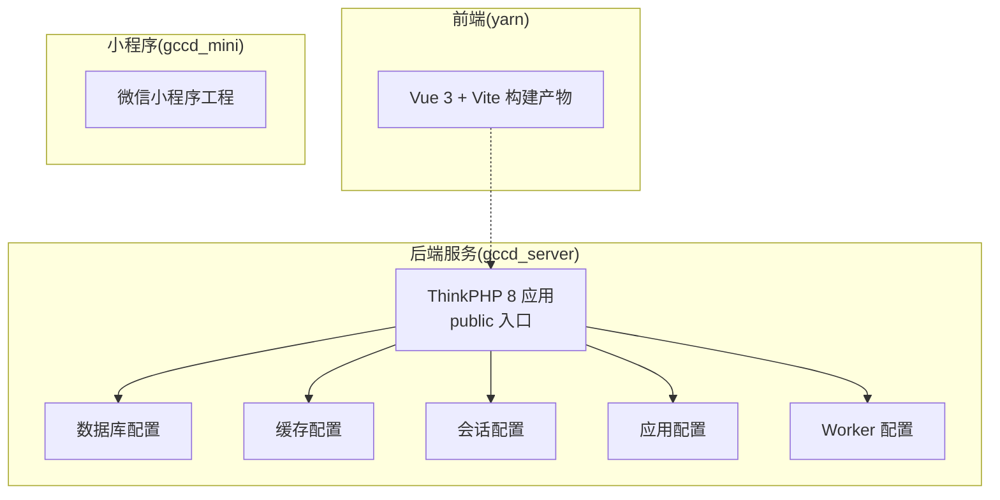
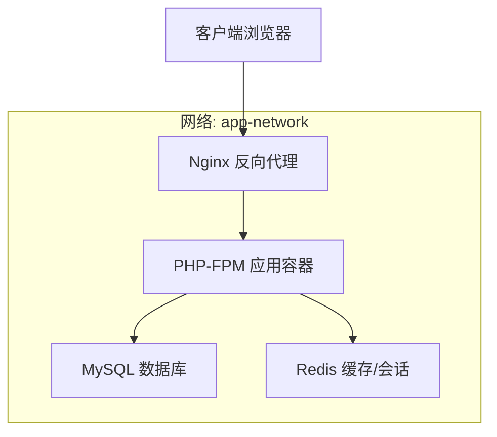
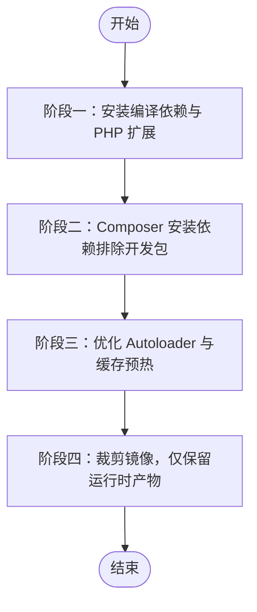
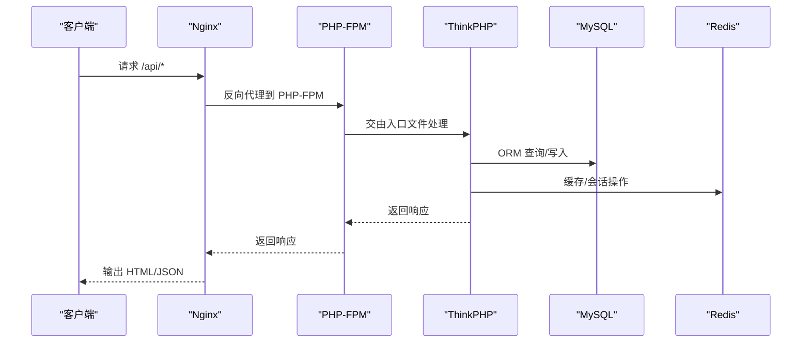
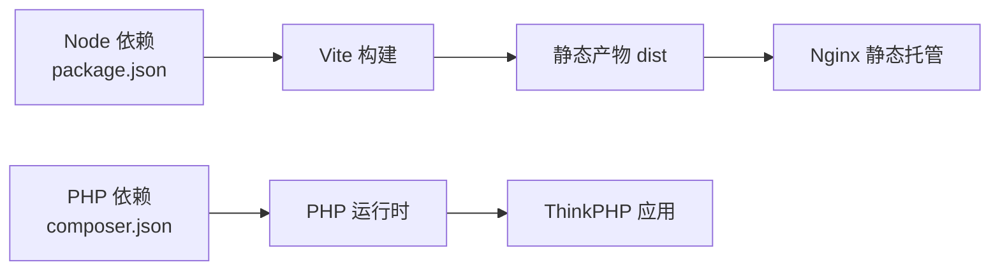

# 容器化部署

<cite>
**本文引用的文件**
- [composer.json](file://gccd_server/composer.json)
- [package.json](file://yarn/package.json)
- [project.config.json](file://gccd_mini/project.config.json)
- [index.php](file://gccd_server/public/index.php)
- [database.php](file://gccd_server/config/database.php)
- [cache.php](file://gccd_server/config/cache.php)
- [session.php](file://gccd_server/config/session.php)
- [app.php](file://gccd_server/config/app.php)
- [worker.php](file://gccd_server/config/worker.php)
- [Utils.php](file://gccd_server/app/common/service/utils/Utils.php)
- [SettingServers.vue](file://yarn/src/views/system/components/SettingServers.vue)
</cite>

## 目录
1. [简介](#简介)
2. [项目结构](#项目结构)
3. [核心组件](#核心组件)
4. [架构总览](#架构总览)
5. [详细组件分析](#详细组件分析)
6. [依赖关系分析](#依赖关系分析)
7. [性能考虑](#性能考虑)
8. [故障排查指南](#故障排查指南)
9. [结论](#结论)
10. [附录](#附录)

## 简介
本指南面向“高齿传动”项目的容器化部署，覆盖后端 ThinkPHP 8 与前端 Vue 3 的镜像构建、多阶段优化、Docker Compose 编排（PHP-FPM、Nginx、MySQL、Redis），以及生产环境最佳实践（资源限制、健康检查、日志管理、监控与性能优化）。文档同时提供关键配置点（网络、数据卷、环境变量）与常见问题排查方法，帮助团队在容器环境中稳定、高效地交付系统。

## 项目结构
该项目由三部分组成：
- 后端服务：基于 ThinkPHP 8 的 API 与管理后台服务，位于 gccd_server。
- 前端管理后台：Vue 3 + Vite 构建产物，位于 yarn。
- 微信小程序：位于 gccd_mini，用于打包与上传，不直接参与容器部署。

图表来源
- [index.php:12-25](file://gccd_server/public/index.php#L12-L25)
- [database.php:11-71](file://gccd_server/config/database.php#L11-L71)
- [cache.php:10-86](file://gccd_server/config/cache.php#L10-L86)
- [session.php:10-25](file://gccd_server/config/session.php#L10-L25)
- [app.php:10-44](file://gccd_server/config/app.php#L10-L44)
- [worker.php:12-27](file://gccd_server/config/worker.php#L12-L27)
- [package.json:16-24](file://yarn/package.json#L16-L24)

章节来源
- [index.php:12-25](file://gccd_server/public/index.php#L12-L25)
- [database.php:11-71](file://gccd_server/config/database.php#L11-L71)
- [cache.php:10-86](file://gccd_server/config/cache.php#L10-L86)
- [session.php:10-25](file://gccd_server/config/session.php#L10-L25)
- [app.php:10-44](file://gccd_server/config/app.php#L10-L44)
- [worker.php:12-27](file://gccd_server/config/worker.php#L12-L27)
- [package.json:16-24](file://yarn/package.json#L16-L24)

## 核心组件
- 后端入口与框架
  - 入口文件通过 public/index.php 加载 vendor 并执行 HTTP 应用，作为容器内 Web 服务器（如 Nginx）反向代理的目标。
  - 应用配置支持通过环境变量控制调试、时区、默认应用等。
- 数据库与缓存
  - 数据库配置通过 env 读取主机、端口、用户名、密码、字符集等，便于容器内通过环境变量注入。
  - 缓存支持 file、redis、memcache、wincache 等驱动，Redis 配置可通过环境变量覆盖 host、port、password 等。
- 会话与 Worker
  - 会话默认 file 驱动，可按需切换至缓存驱动；Worker 配置用于命令行守护进程模式。
- 前端构建
  - 前端使用 Vite，提供开发与生产构建脚本，最终产物静态托管于 Nginx。

章节来源
- [index.php:12-25](file://gccd_server/public/index.php#L12-L25)
- [app.php:10-44](file://gccd_server/config/app.php#L10-L44)
- [database.php:11-71](file://gccd_server/config/database.php#L11-L71)
- [cache.php:10-86](file://gccd_server/config/cache.php#L10-L86)
- [session.php:10-25](file://gccd_server/config/session.php#L10-L25)
- [worker.php:12-27](file://gccd_server/config/worker.php#L12-L27)
- [package.json:16-24](file://yarn/package.json#L16-L24)

## 架构总览
容器化部署推荐采用四层编排：Nginx（反向代理与静态资源）、PHP-FPM（应用运行时）、MySQL（持久化存储）、Redis（缓存与会话）。容器间通过自定义网络通信，数据卷挂载实现持久化与热更新。

图表来源
- [index.php:12-25](file://gccd_server/public/index.php#L12-L25)
- [database.php:11-71](file://gccd_server/config/database.php#L11-L71)
- [cache.php:10-86](file://gccd_server/config/cache.php#L10-L86)

## 详细组件分析

### Docker 镜像构建策略
- PHP-FPM 镜像
  - 基础镜像选择：建议使用官方 php:8-fpm-alpine 或 php:8-fpm-bullseye，兼顾体积与兼容性。
  - 多阶段构建：第一阶段安装编译依赖与扩展（如 pdo_mysql、redis、opcache），第二阶段仅复制运行时产物，减少镜像体积。
  - Composer 安装：利用缓存层加速，先复制 composer.json/composer.lock，再执行 install --no-dev --optimize-autoloader。
  - 权限与用户：以非 root 用户运行，确保 public 与 runtime 目录可写（用于日志与缓存）。
- Nginx 镜像
  - 使用官方 nginx:alpine，仅拷贝站点配置与前端静态产物，避免冗余。
  - 静态资源 gzip/缓存头优化，隐藏 server 版本信息。
- 前端构建镜像
  - 使用 node:alpine 作为构建镜像，安装依赖后执行生产构建，输出 dist 目录供 Nginx 使用。
  - 多阶段：构建完成后仅复制 dist 到最小化镜像中。

### Docker Compose 编排要点
- 服务定义
  - php-fpm：挂载后端源码，暴露 PHP-FPM Socket 或 TCP 端口；设置环境变量覆盖数据库与缓存配置。
  - nginx：挂载前端 dist 与 Nginx 配置，反代到 php-fpm；开放 80/443。
  - mysql：持久化数据卷，初始化 SQL（如存在），设置 root 密码与字符集。
  - redis：持久化或无持久化视业务而定，开放端口。
- 网络与数据卷
  - 自定义网络 app-network，确保服务间通过服务名互通。
  - 数据卷：mysql 存放 /var/lib/mysql，redis 可选持久化到卷；runtime 日志与缓存目录挂载到宿主机或匿名卷。
- 环境变量
  - 数据库：DATABASE_DRIVER、DATABASE_HOSTNAME、DATABASE_DATABASE、DATABASE_USERNAME、DATABASE_PASSWORD、DATABASE_HOSTPORT、DATABASE_CHARSET。
  - 缓存：CACHE_DRIVER、CACHE_HOST、CACHE_PORT、CACHE_PASSWORD、CACHE_PREFIX。
  - 应用：APP_DEBUG、APP_DEFAULT_TIMEZONE、APP_HOST。
  - Worker：WORKER_HOST、WORKER_PORT、WORKER_COUNT（根据实际需求）。

图表来源
- [index.php:12-25](file://gccd_server/public/index.php#L12-L25)
- [database.php:11-71](file://gccd_server/config/database.php#L11-L71)
- [cache.php:10-86](file://gccd_server/config/cache.php#L10-L86)

### 关键配置点
- 数据库配置
  - 通过环境变量动态注入主机、端口、账号、密码、字符集等，便于容器编排时替换。
- 缓存配置
  - Redis 驱动时，通过环境变量覆盖 host、port、password、prefix 等，确保与 Redis 服务一致。
- 会话配置
  - 若使用缓存驱动（如 Redis），需保证会话存储与缓存一致；否则使用 file 驱动时需挂载可写目录。
- 应用配置
  - APP_DEBUG 控制调试输出；APP_DEFAULT_TIMEZONE 统一时区；APP_HOST 用于生成外链域名。
- Worker 配置
  - Worker 仅对 CLI 命令有效，容器内如需常驻任务，建议使用独立服务或系统级任务调度。

章节来源
- [database.php:11-71](file://gccd_server/config/database.php#L11-L71)
- [cache.php:10-86](file://gccd_server/config/cache.php#L10-L86)
- [session.php:10-25](file://gccd_server/config/session.php#L10-L25)
- [app.php:10-44](file://gccd_server/config/app.php#L10-L44)
- [worker.php:12-27](file://gccd_server/config/worker.php#L12-L27)

### 生产环境最佳实践
- 资源限制
  - 为 php-fpm、nginx、mysql、redis 设置 CPU/内存限额与启动重启策略，避免资源争抢。
- 健康检查
  - php-fpm：通过 curl 访问 /index.php 或 /api/health（自定义）进行存活探针。
  - mysql：使用 mysqladmin ping 或自定义 SQL 探针。
  - redis：使用 redis-cli ping。
- 日志管理
  - 将 PHP 错误日志、访问日志、SQL 日志、应用日志统一输出到 stdout/stderr，结合 Docker 日志驱动收集。
- 安全加固
  - 非 root 用户运行；禁用危险函数；限制敏感目录挂载；使用只读根文件系统（必要时）。
- 配置热更新
  - 将配置文件挂载为只读卷，通过环境变量注入敏感信息；运行时配置（如缓存）通过环境变量覆盖。

### 性能优化建议
- PHP 层
  - 启用 opcache；合理设置 memory_limit 与 request execution time；使用 Redis 缓存热点数据。
- 数据库层
  - 合理索引与查询计划；连接池与长连接配置；慢查询日志与分析。
- 缓存层
  - 使用 Redis 作为缓存与会话存储；设置合理的过期策略与键前缀；避免大对象与阻塞操作。
- 前端与 Nginx
  - 启用 gzip/br 压缩；静态资源强缓存；隐藏版本信息；CDN 加速。

## 依赖关系分析
后端 ThinkPHP 8 通过 Composer 管理依赖，前端通过 npm/yarn 管理依赖。容器构建时应分别处理两套依赖安装流程，并在生产镜像中剔除开发依赖。

图表来源
- [composer.json:23-47](file://gccd_server/composer.json#L23-L47)
- [package.json:16-24](file://yarn/package.json#L16-L24)

章节来源
- [composer.json:23-47](file://gccd_server/composer.json#L23-L47)
- [package.json:16-24](file://yarn/package.json#L16-L24)

## 性能考虑
- PHP-FPM 进程模型与并发
  - 合理设置 pm.max_children/pm.start_servers/pm.min_spare_servers/pm.max_spare_servers，结合请求峰值与内存占用评估。
- 缓存命中率
  - 通过 Redis 降低数据库压力；对热点接口做多级缓存（如本地+Redis）。
- 数据库连接
  - 使用连接池与长连接（需配合持久化配置）；避免 N+1 查询。
- 前端资源
  - 合理拆分与懒加载；开启压缩与缓存；CDN 加速静态资源。

## 故障排查指南
- 无法访问后端接口
  - 检查 Nginx 是否正确反代到 PHP-FPM；确认 php-fpm 地址与端口；查看 PHP 错误日志。
- 数据库连接失败
  - 校验 DATABASE_HOSTNAME/HOSTPORT/USERNAME/PASSWORD；确认容器网络可达；检查 MySQL 是否启动。
- 缓存不可用
  - 校验 CACHE_DRIVER/CACHE_HOST/CACHE_PORT/CACHE_PASSWORD；确认 Redis 可达；检查键前缀与过期策略。
- 会话异常
  - 若使用 Redis 会话，需确保会话存储与缓存一致；否则使用 file 驱动时需挂载可写目录。
- Worker 任务未执行
  - 确认 Worker 配置与命令行执行权限；检查守护进程模式与日志输出。

章节来源
- [database.php:11-71](file://gccd_server/config/database.php#L11-L71)
- [cache.php:10-86](file://gccd_server/config/cache.php#L10-L86)
- [session.php:10-25](file://gccd_server/config/session.php#L10-L25)
- [worker.php:12-27](file://gccd_server/config/worker.php#L12-L27)
- [Utils.php:146-163](file://gccd_server/app/common/service/utils/Utils.php#L146-L163)
- [SettingServers.vue:34-65](file://yarn/src/views/system/components/SettingServers.vue#L34-L65)

## 结论
通过多阶段构建与合理的容器编排，高齿传动项目可在 Docker 中实现稳定、可扩展、易维护的部署方案。结合资源限制、健康检查、日志管理与监控告警，可进一步提升生产环境的可靠性与可观测性。建议在预发布环境先行验证镜像构建与编排配置，再逐步推广到生产。

## 附录
- 小程序工程配置
  - 小程序工程（gccd_mini/project.config.json）主要用于开发者工具打包与上传，不直接参与容器部署。如需容器化小程序构建，可参考前端构建镜像策略，但通常无需容器化运行。

章节来源
- [project.config.json:1-78](file://gccd_mini/project.config.json#L1-L78)