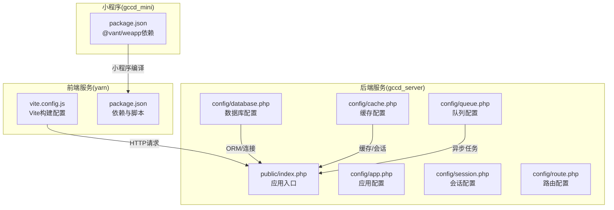
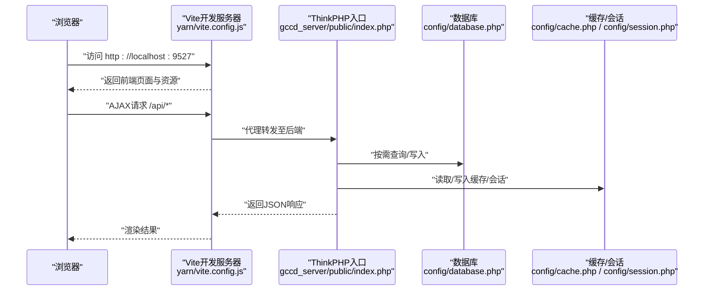
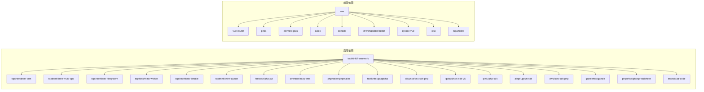

# 环境搭建

<cite>
**本文引用的文件**
- [gccd_server/composer.json](file://gccd_server/composer.json)
- [yarn/package.json](file://yarn/package.json)
- [gccd_mini/package.json](file://gccd_mini/package.json)
- [gccd_server/config/app.php](file://gccd_server/config/app.php)
- [gccd_server/config/database.php](file://gccd_server/config/database.php)
- [gccd_server/config/cache.php](file://gccd_server/config/cache.php)
- [gccd_server/config/queue.php](file://gccd_server/config/queue.php)
- [gccd_server/config/session.php](file://gccd_server/config/session.php)
- [gccd_server/config/route.php](file://gccd_server/config/route.php)
- [gccd_server/public/index.php](file://gccd_server/public/index.php)
- [yarn/vite.config.js](file://yarn/vite.config.js)
- [gccd_server/README.md](file://gccd_server/README.md)
- [yarn/README.md](file://yarn/README.md)
</cite>

## 目录
1. [简介](#简介)
2. [项目结构](#项目结构)
3. [核心组件](#核心组件)
4. [架构总览](#架构总览)
5. [详细组件分析](#详细组件分析)
6. [依赖关系分析](#依赖关系分析)
7. [性能考虑](#性能考虑)
8. [故障排查指南](#故障排查指南)
9. [结论](#结论)
10. [附录](#附录)

## 简介
本文件面向“高齿传动”项目的开发者与运维人员，提供从零开始的完整环境搭建指南。内容覆盖开发与生产环境的系统要求、服务器配置步骤、ThinkPHP 8 后端框架安装配置、Vue 3 前端项目安装配置，以及环境验证与常见问题解决方案。目标是帮助团队快速、稳定地完成本地与线上环境的准备与部署。

## 项目结构
该项目采用前后端分离架构：
- 后端服务位于 gccd_server，基于 ThinkPHP 8，提供 API 与管理后台。
- 前端服务位于 yarn，基于 Vue 3 + Vite，提供管理端界面。
- 微信小程序前端位于 gccd_mini，基于 @vant/weapp 组件库。

图表来源
- [gccd_server/public/index.php:12-24](file://gccd_server/public/index.php#L12-L24)
- [gccd_server/config/app.php:11-43](file://gccd_server/config/app.php#L11-L43)
- [gccd_server/config/database.php:11-70](file://gccd_server/config/database.php#L11-L70)
- [gccd_server/config/cache.php:13-85](file://gccd_server/config/cache.php#L13-L85)
- [gccd_server/config/queue.php:23-55](file://gccd_server/config/queue.php#L23-L55)
- [gccd_server/config/session.php:11-24](file://gccd_server/config/session.php#L11-L24)
- [gccd_server/config/route.php:11-50](file://gccd_server/config/route.php#L11-L50)
- [yarn/vite.config.js:13-184](file://yarn/vite.config.js#L13-L184)
- [yarn/package.json:16-86](file://yarn/package.json#L16-L86)
- [gccd_mini/package.json:8-11](file://gccd_mini/package.json#L8-L11)

章节来源
- [gccd_server/public/index.php:12-24](file://gccd_server/public/index.php#L12-L24)
- [gccd_server/config/app.php:11-43](file://gccd_server/config/app.php#L11-L43)
- [gccd_server/config/database.php:11-70](file://gccd_server/config/database.php#L11-L70)
- [gccd_server/config/cache.php:13-85](file://gccd_server/config/cache.php#L13-L85)
- [gccd_server/config/queue.php:23-55](file://gccd_server/config/queue.php#L23-L55)
- [gccd_server/config/session.php:11-24](file://gccd_server/config/session.php#L11-L24)
- [gccd_server/config/route.php:11-50](file://gccd_server/config/route.php#L11-L50)
- [yarn/vite.config.js:13-184](file://yarn/vite.config.js#L13-L184)
- [yarn/package.json:16-86](file://yarn/package.json#L16-L86)
- [gccd_mini/package.json:8-11](file://gccd_mini/package.json#L8-L11)

## 核心组件
- ThinkPHP 8 应用入口与运行流程：通过入口文件加载自动加载器并执行 HTTP 应用，响应客户端请求。
- 数据库连接：支持多连接配置，默认使用 mysql，可通过环境变量覆盖主机、端口、库名、用户名、密码等。
- 缓存与会话：支持 file、redis、memcache、wincache 等多种驱动，可通过环境变量切换与配置。
- 队列：支持 sync、database、redis 三种驱动，便于异步任务处理。
- 路由与中间件：默认启用路由与事件，支持多应用模式与控制器层配置。
- 前端构建：Vite 提供开发服务器、热更新与生产打包，统一管理依赖与脚本。

章节来源
- [gccd_server/public/index.php:12-24](file://gccd_server/public/index.php#L12-L24)
- [gccd_server/config/database.php:27-66](file://gccd_server/config/database.php#L27-L66)
- [gccd_server/config/cache.php:18-52](file://gccd_server/config/cache.php#L18-L52)
- [gccd_server/config/queue.php:24-49](file://gccd_server/config/queue.php#L24-L49)
- [gccd_server/config/route.php:11-50](file://gccd_server/config/route.php#L11-L50)
- [yarn/vite.config.js:33-184](file://yarn/vite.config.js#L33-L184)

## 架构总览
下图展示从浏览器到后端 ThinkPHP 的典型请求链路，以及前端 Vite 在开发阶段如何代理与转发请求。

图表来源
- [yarn/vite.config.js:33-70](file://yarn/vite.config.js#L33-L70)
- [gccd_server/public/index.php:12-24](file://gccd_server/public/index.php#L12-L24)
- [gccd_server/config/database.php:27-66](file://gccd_server/config/database.php#L27-L66)
- [gccd_server/config/cache.php:18-52](file://gccd_server/config/cache.php#L18-L52)
- [gccd_server/config/session.php:11-24](file://gccd_server/config/session.php#L11-L24)

## 详细组件分析

### ThinkPHP 8 后端环境要求与安装
- 系统要求
  - PHP 版本：≥ 8.0
  - 必要扩展：fileinfo、redis
  - 函数白名单：putenv、proc_open
  - 数据库：MySQL ≥ 5.5
  - 缓存：Redis ≥ 5.0
  - 前端工具链：Node ≥ 18.18，NPM ≥ 8.19
- 安装步骤
  - 使用 Composer 安装依赖
  - 导入数据库 SQL（字符集 utf8mb4，排序规则 utf8mb4_general_ci）
  - 复制并编辑环境变量文件（后端 README 中提供示例文件名）
  - 配置 Web 服务器伪静态（Nginx/Apache）
- 关键配置要点
  - 应用配置：调试、时区、默认应用、路由与事件开关
  - 数据库配置：默认驱动、主机、端口、库名、用户名、密码、字符集、表前缀、断线重连等
  - 缓存配置：默认驱动 file 或 redis，支持序列化、前缀、持久化等
  - 队列配置：默认 database，也可选择 redis
  - 会话配置：默认 file，过期时间与前缀
  - 路由配置：URL 后缀、默认控制器/动作、完全匹配等

章节来源
- [gccd_server/README.md:46-114](file://gccd_server/README.md#L46-L114)
- [gccd_server/composer.json:23-47](file://gccd_server/composer.json#L23-L47)
- [gccd_server/config/app.php:11-43](file://gccd_server/config/app.php#L11-L43)
- [gccd_server/config/database.php:27-66](file://gccd_server/config/database.php#L27-L66)
- [gccd_server/config/cache.php:18-52](file://gccd_server/config/cache.php#L18-L52)
- [gccd_server/config/queue.php:24-49](file://gccd_server/config/queue.php#L24-L49)
- [gccd_server/config/session.php:11-24](file://gccd_server/config/session.php#L11-L24)
- [gccd_server/config/route.php:11-50](file://gccd_server/config/route.php#L11-L50)

### Vue 3 前端环境要求与安装
- 系统要求
  - Node ≥ 18.18
  - NPM ≥ 8.19
- 安装步骤
  - 切换到 yarn 目录，配置 npm 镜像源
  - 安装依赖（支持 npm、cnpm、pnpm、yarn）
  - 复制并编辑 .env.*.local 环境变量文件
  - 启动开发服务器或打包生产/测试环境
- 关键配置要点
  - Vite 开发服务器：监听 0.0.0.0:9527，自动打开浏览器
  - 构建输出：按文件类型分类命名，生产环境移除 console/debugger 注释
  - 插件生态：Vue、UnoCSS、AutoImport、Components、图标、SVG 图标等
  - 依赖与脚本：dev/build/preview/lint/format 等

章节来源
- [yarn/README.md:46-150](file://yarn/README.md#L46-L150)
- [yarn/package.json:16-86](file://yarn/package.json#L16-L86)
- [yarn/vite.config.js:13-184](file://yarn/vite.config.js#L13-L184)

### 微信小程序前端（可选）
- 依赖与脚本
  - @vant/weapp 组件库
  - postinstall 脚本用于应用主题脚本
- 适用场景：企业微信/小程序端的配套前端

章节来源
- [gccd_mini/package.json:8-11](file://gccd_mini/package.json#L8-L11)

### 环境变量与配置文件
- ThinkPHP
  - 应用配置：app.debug、app.host、app_trace、default_timezone 等
  - 数据库配置：database.type、hostname、database、username、password、hostport、charset、prefix、break_reconnect、trigger_sql、fields_cache 等
  - 缓存配置：cache.driver、host、port、password、persistent、prefix 等
  - 队列配置：queue.default、redis host/port/password/select/persistent 等
  - 会话配置：name、type、expire、prefix 等
  - 路由配置：pathinfo_depr、url_html_suffix、default_controller、default_action 等
- Vue 前端
  - Vite 通过 loadEnv(mode) 读取 .env.* 文件中的变量（如 VITE_APP_BASE、VITE_APP_OUT_DIR）

章节来源
- [gccd_server/config/app.php:11-43](file://gccd_server/config/app.php#L11-L43)
- [gccd_server/config/database.php:27-66](file://gccd_server/config/database.php#L27-L66)
- [gccd_server/config/cache.php:18-52](file://gccd_server/config/cache.php#L18-L52)
- [gccd_server/config/queue.php:24-49](file://gccd_server/config/queue.php#L24-L49)
- [gccd_server/config/session.php:11-24](file://gccd_server/config/session.php#L11-L24)
- [gccd_server/config/route.php:11-50](file://gccd_server/config/route.php#L11-L50)
- [yarn/vite.config.js:13-14](file://yarn/vite.config.js#L13-L14)

## 依赖关系分析
- 后端依赖
  - ThinkPHP 8 框架与 ORM、多应用、文件系统、Worker、限流、队列、JWT、拼音、短信、邮件、验证码、对象存储、HTTP 客户端、Excel、二维码等
- 前端依赖
  - Vue 3、Vue Router、Pinia、Element Plus、Axios、ECharts、WangEditor、QRCode、XLSX、Particles 等
- 工具链
  - Vite、ESLint、Prettier、UnoCSS、图标插件、SVG 图标、px 转 viewport 插件等

图表来源
- [gccd_server/composer.json:23-47](file://gccd_server/composer.json#L23-L47)
- [yarn/package.json:25-58](file://yarn/package.json#L25-L58)

章节来源
- [gccd_server/composer.json:23-47](file://gccd_server/composer.json#L23-L47)
- [yarn/package.json:25-58](file://yarn/package.json#L25-L58)

## 性能考虑
- 前端构建
  - 生产构建启用 Terser 压缩，移除 console 与 debugger，减少包体积
  - 按文件类型分类输出，利于 CDN 缓存策略
- 缓存与会话
  - 生产环境推荐使用 Redis 作为缓存与会话驱动，提升并发与一致性
  - 合理设置缓存前缀与过期时间，避免键冲突与内存占用过高
- 数据库
  - 启用字段缓存与断线重连，降低频繁查询与异常恢复成本
  - 表前缀统一管理，便于多租户或多实例隔离
- 队列
  - 生产环境使用 Redis 队列，合理设置重试次数与超时时间，避免任务堆积

章节来源
- [yarn/vite.config.js:146-182](file://yarn/vite.config.js#L146-L182)
- [gccd_server/config/cache.php:33-52](file://gccd_server/config/cache.php#L33-L52)
- [gccd_server/config/session.php:20-22](file://gccd_server/config/session.php#L20-L22)
- [gccd_server/config/database.php:59-65](file://gccd_server/config/database.php#L59-L65)
- [gccd_server/config/queue.php:39-49](file://gccd_server/config/queue.php#L39-L49)

## 故障排查指南
- 伪静态未配置导致接口文档无法访问
  - 检查 Nginx/Apache 的重写规则是否正确启用
- PHP 扩展缺失
  - 确认已安装 fileinfo、redis 扩展，并在 php.ini 中启用
- 函数被禁用
  - 确保 putenv、proc_open 函数未被禁用
- 数据库连接失败
  - 核对数据库主机、端口、库名、用户名、密码与字符集
  - 确认 MySQL 版本满足 ≥ 5.5
- 缓存/会话异常
  - 若使用 Redis，确认 Redis 版本 ≥ 5.0 且网络连通
  - 检查缓存前缀与持久化配置
- 队列任务不执行
  - 生产环境使用 php think queue:work，开发环境使用 queue:listen
  - 确认队列驱动与 Redis 配置一致
- 前端开发服务器无法访问
  - 确认 Vite 监听地址为 0.0.0.0，端口 9527
  - 检查防火墙与代理设置

章节来源
- [gccd_server/README.md:92-114](file://gccd_server/README.md#L92-L114)
- [gccd_server/README.md:46-54](file://gccd_server/README.md#L46-L54)
- [gccd_server/config/database.php:27-66](file://gccd_server/config/database.php#L27-L66)
- [gccd_server/config/cache.php:33-52](file://gccd_server/config/cache.php#L33-L52)
- [gccd_server/config/queue.php:10-18](file://gccd_server/config/queue.php#L10-L18)
- [yarn/vite.config.js:33-37](file://yarn/vite.config.js#L33-L37)

## 结论
通过遵循本文档提供的系统要求、安装步骤与配置要点，团队可在本地与生产环境中快速搭建高齿传动项目的开发与运行环境。建议在生产环境中优先采用 Redis 缓存/会话与队列，配合合理的伪静态与安全加固，确保系统的稳定性与可维护性。

## 附录

### 环境验证清单
- 后端
  - PHP 版本与扩展检查
  - 数据库连通性与字符集校验
  - 缓存/会话驱动可用性（file/redis）
  - 队列驱动可用性（database/redis）
  - Web 服务器伪静态生效
- 前端
  - Vite 开发服务器启动成功
  - 依赖安装完成，无严重警告
  - 构建产物生成正常

章节来源
- [gccd_server/README.md:46-114](file://gccd_server/README.md#L46-L114)
- [yarn/README.md:46-150](file://yarn/README.md#L46-L150)
- [yarn/package.json:16-86](file://yarn/package.json#L16-L86)
- [gccd_server/composer.json:23-47](file://gccd_server/composer.json#L23-L47)