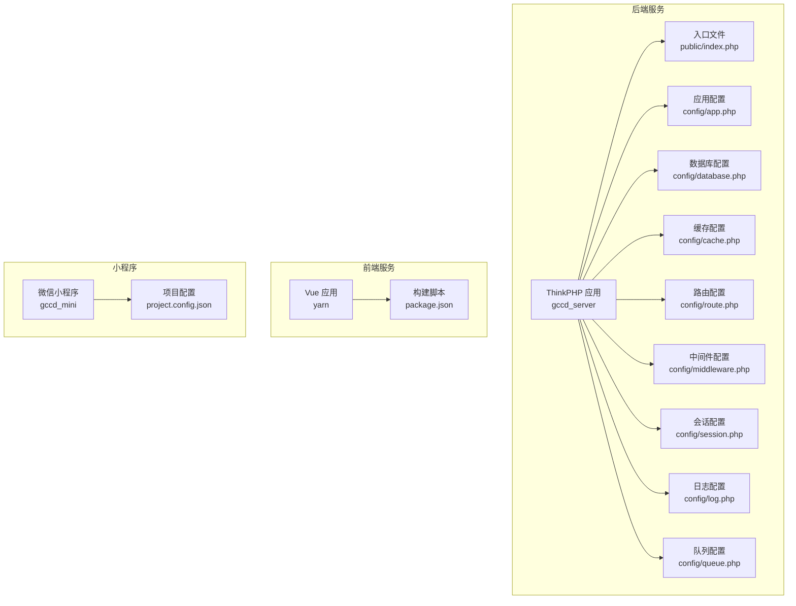
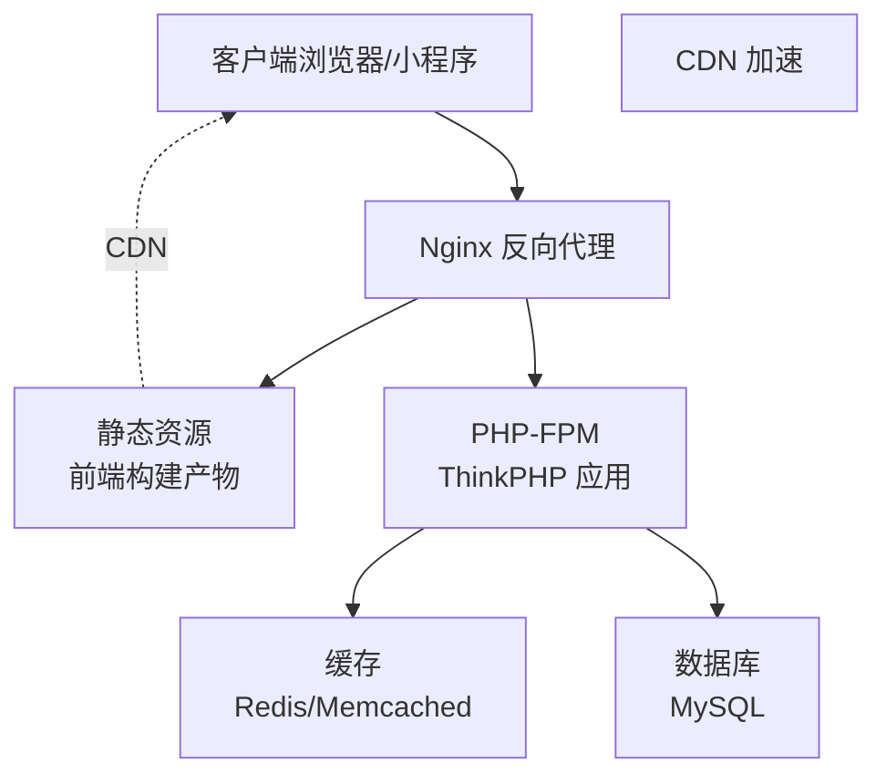
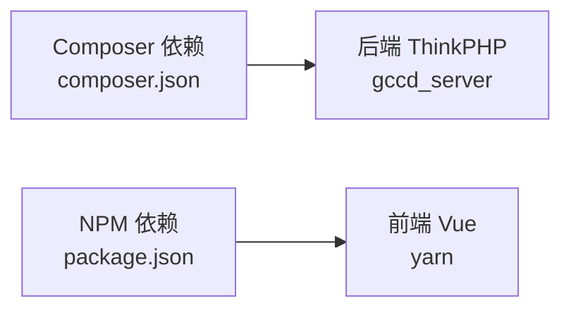

# 生产环境部署

<cite>
**本文引用的文件**
- [gccd_server/config/app.php](file://gccd_server/config/app.php)
- [gccd_server/config/database.php](file://gccd_server/config/database.php)
- [gccd_server/config/cache.php](file://gccd_server/config/cache.php)
- [gccd_server/config/route.php](file://gccd_server/config/route.php)
- [gccd_server/config/middleware.php](file://gccd_server/config/middleware.php)
- [gccd_server/config/session.php](file://gccd_server/config/session.php)
- [gccd_server/config/log.php](file://gccd_server/config/log.php)
- [gccd_server/config/queue.php](file://gccd_server/config/queue.php)
- [gccd_server/public/index.php](file://gccd_server/public/index.php)
- [gccd_server/composer.json](file://gccd_server/composer.json)
- [yarn/package.json](file://yarn/package.json)
- [gccd_mini/project.config.json](file://gccd_mini/project.config.json)
- [README.md](file://README.md)
</cite>

## 目录
1. [简介](#简介)
2. [项目结构](#项目结构)
3. [核心组件](#核心组件)
4. [架构总览](#架构总览)
5. [详细组件分析](#详细组件分析)
6. [依赖关系分析](#依赖关系分析)
7. [性能考虑](#性能考虑)
8. [故障排查指南](#故障排查指南)
9. [结论](#结论)
10. [附录](#附录)

## 简介
本指南面向“高齿传动项目”的生产环境部署与运维，围绕以下目标展开：Nginx 反向代理与虚拟主机、静态资源处理、PHP 请求转发；SSL 证书申请与安装、自动续期；负载均衡与高可用（Nginx 负载均衡、Keepalived 高可用、CDN 加速）；应用部署流程（代码发布、数据库迁移、缓存清理）；性能优化（PHP-FPM、数据库、静态资源压缩）；安全加固与监控配置。  
本项目包含三部分：后端 ThinkPHP 8 应用（gccd_server）、前端 Vue 应用（yarn）与微信小程序（gccd_mini）。生产部署建议将后端与前端分别托管于独立服务器或容器中，并通过 Nginx 提供统一入口。

## 项目结构
- 后端应用（ThinkPHP 8）位于 gccd_server，对外入口为 public/index.php，通过 Composer 管理依赖。
- 前端应用（Vue 3 + Vite）位于 yarn，通过 npm 脚本构建产物。
- 微信小程序位于 gccd_mini，使用微信开发者工具配置。

图表来源
- [gccd_server/public/index.php:1-25](file://gccd_server/public/index.php#L1-L25)
- [gccd_server/config/app.php:11-43](file://gccd_server/config/app.php#L11-L43)
- [gccd_server/config/database.php:11-70](file://gccd_server/config/database.php#L11-L70)
- [gccd_server/config/cache.php:13-85](file://gccd_server/config/cache.php#L13-L85)
- [gccd_server/config/route.php:11-50](file://gccd_server/config/route.php#L11-L50)
- [gccd_server/config/middleware.php:11-16](file://gccd_server/config/middleware.php#L11-L16)
- [gccd_server/config/session.php:11-24](file://gccd_server/config/session.php#L11-L24)
- [gccd_server/config/log.php:11-50](file://gccd_server/config/log.php#L11-L50)
- [gccd_server/config/queue.php:23-55](file://gccd_server/config/queue.php#L23-L55)
- [yarn/package.json:16-24](file://yarn/package.json#L16-L24)
- [gccd_mini/project.config.json:1-78](file://gccd_mini/project.config.json#L1-L78)

章节来源
- [gccd_server/public/index.php:1-25](file://gccd_server/public/index.php#L1-L25)
- [gccd_server/config/app.php:11-43](file://gccd_server/config/app.php#L11-L43)
- [gccd_server/config/database.php:11-70](file://gccd_server/config/database.php#L11-L70)
- [gccd_server/config/cache.php:13-85](file://gccd_server/config/cache.php#L13-L85)
- [gccd_server/config/route.php:11-50](file://gccd_server/config/route.php#L11-L50)
- [gccd_server/config/middleware.php:11-16](file://gccd_server/config/middleware.php#L11-L16)
- [gccd_server/config/session.php:11-24](file://gccd_server/config/session.php#L11-L24)
- [gccd_server/config/log.php:11-50](file://gccd_server/config/log.php#L11-L50)
- [gccd_server/config/queue.php:23-55](file://gccd_server/config/queue.php#L23-L55)
- [yarn/package.json:16-24](file://yarn/package.json#L16-L24)
- [gccd_mini/project.config.json:1-78](file://gccd_mini/project.config.json#L1-L78)

## 核心组件
- 应用配置（app.php）：控制调试、时区、默认应用、异常模板、错误提示等。
- 数据库配置（database.php）：支持 MySQL，默认 utf8mb4，可配置主从、字段缓存、断线重连等。
- 缓存配置（cache.php）：支持 file、redis、memcache 等驱动，可配置过期、序列化、标签前缀等。
- 路由配置（route.php）：URL 后缀、默认控制器/动作、完全匹配等。
- 中间件配置（middleware.php）：别名与优先级预留。
- 会话配置（session.php）：存储方式、过期时间、前缀等。
- 日志配置（log.php）：通道、独立级别、文件大小、实时写入等。
- 队列配置（queue.php）：支持 sync、database、redis，含失败任务表配置。
- 入口文件（public/index.php）：加载自动加载器并执行 HTTP 应用响应。
- 依赖管理（composer.json、package.json）：后端 PHP 依赖与前端 Node 依赖。

章节来源
- [gccd_server/config/app.php:11-43](file://gccd_server/config/app.php#L11-L43)
- [gccd_server/config/database.php:11-70](file://gccd_server/config/database.php#L11-L70)
- [gccd_server/config/cache.php:13-85](file://gccd_server/config/cache.php#L13-L85)
- [gccd_server/config/route.php:11-50](file://gccd_server/config/route.php#L11-L50)
- [gccd_server/config/middleware.php:11-16](file://gccd_server/config/middleware.php#L11-L16)
- [gccd_server/config/session.php:11-24](file://gccd_server/config/session.php#L11-L24)
- [gccd_server/config/log.php:11-50](file://gccd_server/config/log.php#L11-L50)
- [gccd_server/config/queue.php:23-55](file://gccd_server/config/queue.php#L23-L55)
- [gccd_server/public/index.php:1-25](file://gccd_server/public/index.php#L1-L25)
- [gccd_server/composer.json:23-47](file://gccd_server/composer.json#L23-L47)
- [yarn/package.json:16-24](file://yarn/package.json#L16-L24)

## 架构总览
生产环境建议采用“Nginx 反向代理 + 多后端实例 + 缓存 + 数据库 + CDN”的整体架构。Nginx 负责虚拟主机、静态资源、HTTPS 终端、上游 PHP 请求转发；后端 ThinkPHP 应用通过 PHP-FPM 提供服务；Redis/Memcached 作为缓存；MySQL 作为数据存储；CDN 加速静态资源；Keepalived 实现高可用。

图表来源
- [gccd_server/public/index.php:1-25](file://gccd_server/public/index.php#L1-L25)
- [gccd_server/config/cache.php:13-85](file://gccd_server/config/cache.php#L13-L85)
- [gccd_server/config/database.php:11-70](file://gccd_server/config/database.php#L11-L70)
- [yarn/package.json:16-24](file://yarn/package.json#L16-L24)

## 详细组件分析

### Nginx 反向代理与虚拟主机
- 虚拟主机：按域名划分站点，区分前端静态资源与后端 API。
- 静态资源：将前端构建产物目录交由 Nginx 直接提供，启用 gzip/br 压缩与强缓存策略。
- PHP 请求转发：将 /api 或特定路径下的 PHP 请求代理至 PHP-FPM（如 unix socket 或 127.0.0.1:9000），传递必要的 FastCGI 参数。
- 安全头：设置 X-Frame-Options、X-Content-Type-Options、Referrer-Policy、Permissions-Policy 等。
- 访问/错误日志：按站点拆分日志，便于审计与排障。

章节来源
- [gccd_server/public/index.php:1-25](file://gccd_server/public/index.php#L1-L25)
- [yarn/package.json:16-24](file://yarn/package.json#L16-L24)

### SSL 证书配置
- 证书申请：推荐使用 ACME 协议（如 certbot）自动化申请与验证。
- 安装配置：在 Nginx 中为站点启用 HTTPS，配置 TLS 版本与密码套件，启用 HSTS。
- 自动续期：配置定时任务定期续期并重载 Nginx；结合 fail2ban 降低证书申请失败风险。

章节来源
- [README.md:1-4](file://README.md#L1-L4)

### 负载均衡与高可用
- Nginx 负载均衡：配置 upstream 池，后端多实例轮询/加权轮询/健康检查。
- Keepalived 高可用：配置主备节点，VRRP 抢占与 VIP 切换，结合 Nginx/LVS 实现故障切换。
- CDN 加速：静态资源走 CDN，动态接口通过边缘节点就近回源，提升全球访问体验。

章节来源
- [gccd_server/config/cache.php:13-85](file://gccd_server/config/cache.php#L13-L85)
- [gccd_server/config/database.php:11-70](file://gccd_server/config/database.php#L11-L70)

### 应用部署流程
- 代码发布：后端通过 Composer 安装依赖并生成自动加载；前端通过 Vite 生产构建，拷贝到 Nginx 静态目录。
- 数据库迁移：执行迁移脚本或 SQL 初始化文件，确保表结构与索引完整。
- 缓存清理：清空 Redis/Memcached 缓存，避免脏数据影响上线。
- 队列处理：启动队列工作进程（database/redis），设置超时与内存限制。
- 平滑重启：Nginx 与 PHP-FPM 使用优雅重启策略，避免中断请求。

章节来源
- [gccd_server/composer.json:17-22](file://gccd_server/composer.json#L17-L22)
- [gccd_server/config/queue.php:10-18](file://gccd_server/config/queue.php#L10-L18)
- [yarn/package.json:16-24](file://yarn/package.json#L16-L24)

### 性能优化
- PHP-FPM：调整 pm.* 参数（static/on-demand/dynamic），设置合适的进程数与内存上限，启用慢日志定位热点。
- 数据库：开启查询缓存、慢查询日志、连接池复用；索引优化与分区策略；读写分离与只读副本。
- 静态资源：开启 gzip/br 压缩、HTTP/2 多路复用、CDN 边缘缓存；合理设置 Cache-Control 与 ETag。
- 缓存：Redis/Memcached 合理设置过期与序列化策略，避免热 key 与雪崩。

章节来源
- [gccd_server/config/cache.php:13-85](file://gccd_server/config/cache.php#L13-L85)
- [gccd_server/config/database.php:11-70](file://gccd_server/config/database.php#L11-L70)

### 安全加固与监控
- 安全加固：隐藏敏感头部、限制 HTTP 方法、启用 WAF/IPS、最小权限原则；对上传与富文本进行白名单过滤。
- 监控告警：Nginx 访问/错误日志、PHP-FPM 慢日志、数据库慢查询、缓存命中率、队列堆积；结合 Prometheus/Grafana 做可视化。

章节来源
- [gccd_server/config/log.php:11-50](file://gccd_server/config/log.php#L11-L50)
- [gccd_server/config/session.php:11-24](file://gccd_server/config/session.php#L11-L24)

## 依赖关系分析
后端 ThinkPHP 应用通过 Composer 管理第三方扩展，前端 Vue 应用通过 npm 管理依赖。两者在生产环境中应独立构建与部署。

图表来源
- [gccd_server/composer.json:23-47](file://gccd_server/composer.json#L23-L47)
- [yarn/package.json:25-58](file://yarn/package.json#L25-L58)

章节来源
- [gccd_server/composer.json:23-47](file://gccd_server/composer.json#L23-L47)
- [yarn/package.json:25-58](file://yarn/package.json#L25-L58)

## 性能考虑
- PHP-FPM：根据并发与请求时长选择合适的 pm 模式与进程数；限制单进程内存，避免 OOM。
- 数据库：开启连接池、慢查询日志与 EXPLAIN 分析；对热点表建立复合索引；读写分离与只读副本。
- 静态资源：启用压缩与缓存；CDN 回源策略与刷新机制；图片与字体资源优化。
- 缓存：合理设置过期时间与键前缀；避免缓存穿透与击穿；监控命中率与内存使用。

章节来源
- [gccd_server/config/cache.php:13-85](file://gccd_server/config/cache.php#L13-L85)
- [gccd_server/config/database.php:11-70](file://gccd_server/config/database.php#L11-L70)

## 故障排查指南
- Nginx 无法访问：检查站点配置、静态目录权限、防火墙放行。
- PHP 请求失败：查看 PHP-FPM 状态与错误日志、确认 fastcgi_pass 配置正确。
- 数据库连接异常：核对 host/port/用户名/密码、网络连通性与防火墙策略。
- 缓存不可用：确认 Redis/Memcached 连接参数、持久化与内存上限。
- 队列堆积：检查队列驱动、失败任务表、worker 进程状态与超时设置。
- 日志定位：按通道与级别查看日志文件，结合错误码与堆栈信息快速定位。

章节来源
- [gccd_server/config/log.php:11-50](file://gccd_server/config/log.php#L11-L50)
- [gccd_server/config/queue.php:10-18](file://gccd_server/config/queue.php#L10-L18)
- [gccd_server/config/cache.php:13-85](file://gccd_server/config/cache.php#L13-L85)
- [gccd_server/config/database.php:11-70](file://gccd_server/config/database.php#L11-L70)

## 结论
本指南提供了高齿传动项目在生产环境的部署与运维要点：以 Nginx 为核心入口，结合 PHP-FPM、缓存与数据库，配合 CDN 与高可用方案，实现高性能、高可用与易维护的系统架构。建议在上线前完成压测与演练，确保变更流程标准化与可观测性完善。

## 附录
- 小程序开发工具配置：项目内含微信小程序工程配置，上线需在微信公众平台上传代码并配置业务域名与 TLS。
- 前端构建：使用 Vite 生产构建，产物目录需与 Nginx 静态资源根目录一致。

章节来源
- [gccd_mini/project.config.json:1-78](file://gccd_mini/project.config.json#L1-L78)
- [yarn/package.json:16-24](file://yarn/package.json#L16-L24)