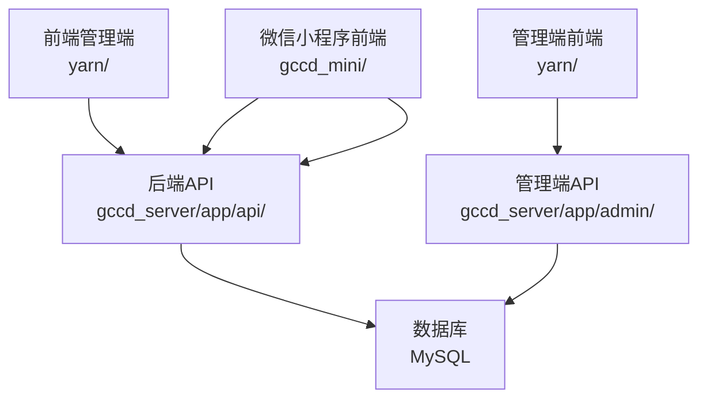
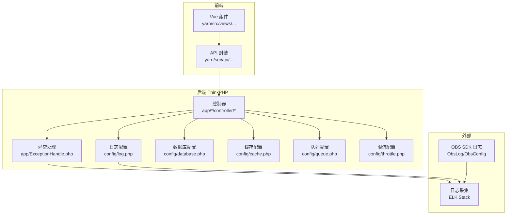
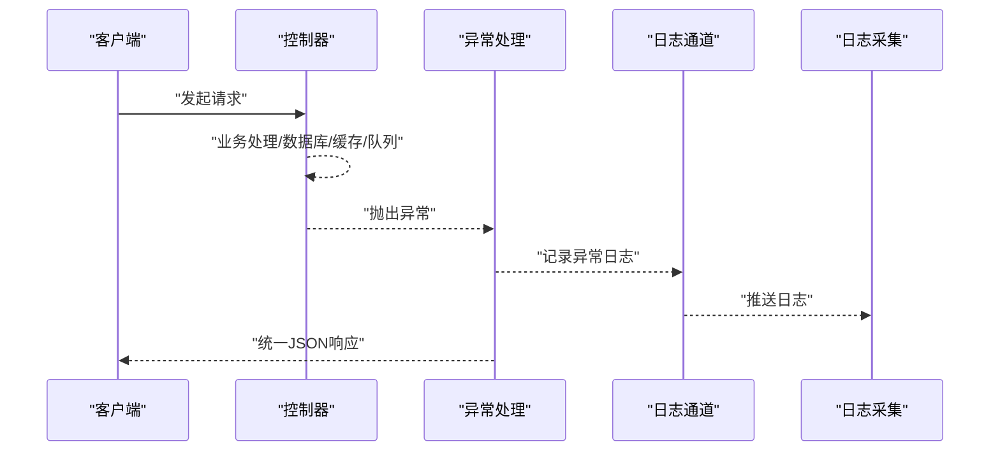
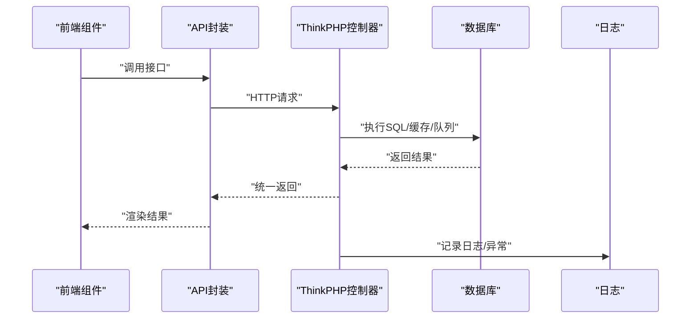
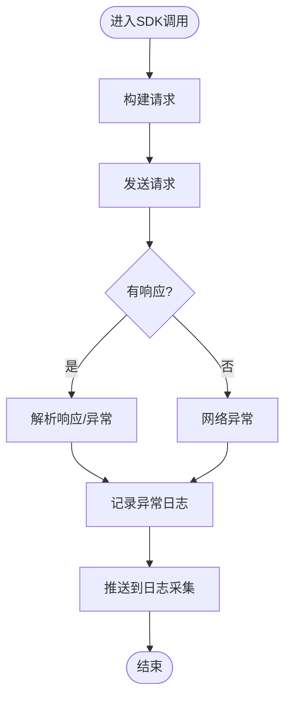
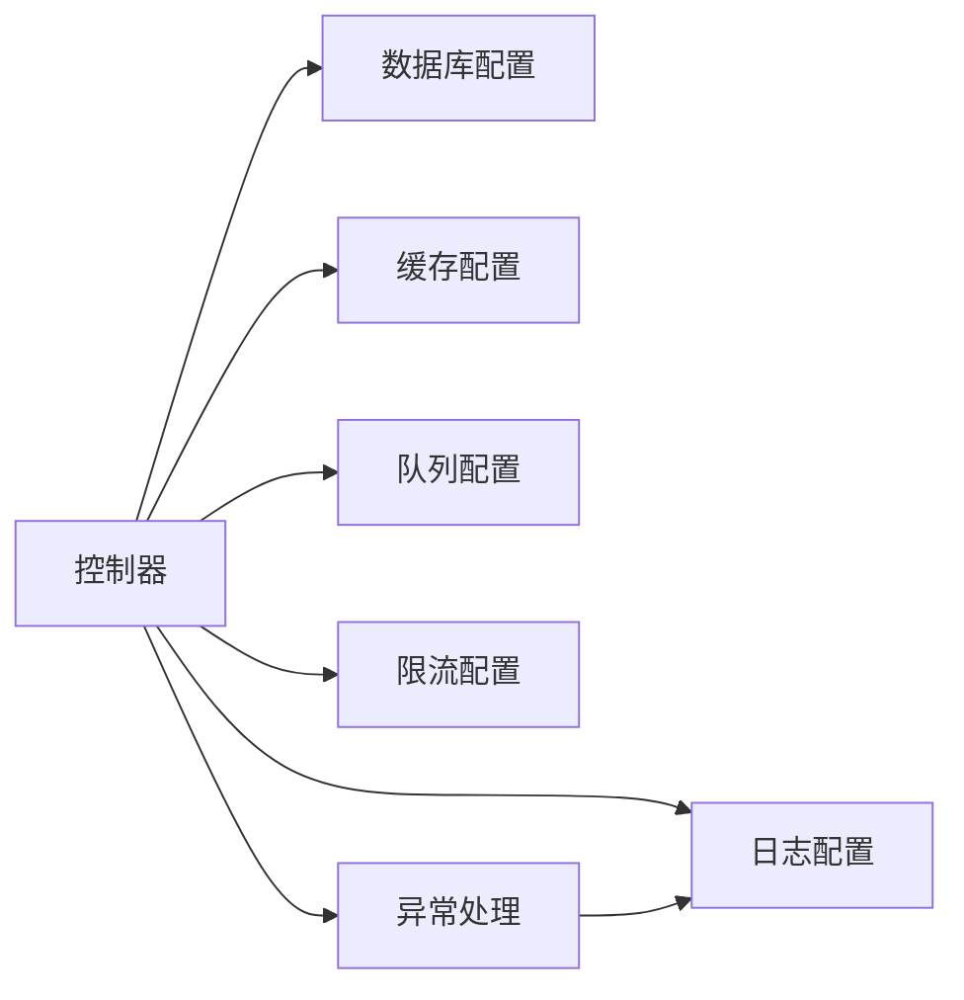

# 监控告警

<cite>
**本文引用的文件**   
- [gccd_server/config/log.php](file://gccd_server/config/log.php)
- [gccd_server/config/database.php](file://gccd_server/config/database.php)
- [gccd_server/config/app.php](file://gccd_server/config/app.php)
- [gccd_server/config/cache.php](file://gccd_server/config/cache.php)
- [gccd_server/config/queue.php](file://gccd_server/config/queue.php)
- [gccd_server/config/throttle.php](file://gccd_server/config/throttle.php)
- [gccd_server/app/ExceptionHandle.php](file://gccd_server/app/ExceptionHandle.php)
- [gccd_server/app/common.php](file://gccd_server/app/common.php)
- [gccd_server/extend/esdk-obs-php-3.23.11/Obs/Log/ObsLog.php](file://gccd_server/extend/esdk-obs-php-3.23.11/Obs/Log/ObsLog.php)
- [gccd_server/extend/esdk-obs-php-3.23.11/Obs/Log/ObsConfig.php](file://gccd_server/extend/esdk-obs-php-3.23.11/Obs/Log/ObsConfig.php)
- [gccd_server/extend/esdk-obs-php-3.23.11/Obs/Internal/GetResponseTrait.php](file://gccd_server/extend/esdk-obs-php-3.23.11/Obs/Internal/GetResponseTrait.php)
- [gccd_server/extend/esdk-obs-php-3.23.11/Obs/ObsException.php](file://gccd_server/extend/esdk-obs-php-3.23.11/Obs/ObsException.php)
- [gccd_server/app/admin/controller/production/ProductReport.php](file://gccd_server/app/admin/controller/production/ProductReport.php)
- [yarn/src/api/mes/EnergyConsumption/EnergyConsumption.js](file://yarn/src/api/mes/EnergyConsumption/EnergyConsumption.js)
- [yarn/admin/js/EnergyConsumption.DF1tSNZR.js](file://yarn/admin/js/EnergyConsumption.DF1tSNZR.js)
</cite>

## 目录
1. [简介](#简介)
2. [项目结构](#项目结构)
3. [核心组件](#核心组件)
4. [架构总览](#架构总览)
5. [详细组件分析](#详细组件分析)
6. [依赖关系分析](#依赖关系分析)
7. [性能考量](#性能考量)
8. [故障排查指南](#故障排查指南)
9. [结论](#结论)
10. [附录](#附录)

## 简介
本指南面向“高齿传动”项目，提供一套可落地的监控告警系统配置与实践建议，覆盖应用监控（ThinkPHP日志、API调用、数据库性能）、系统资源监控（CPU、内存、磁盘、网络）、日志采集与分析（ELK Stack、日志轮转、异常日志分析）、告警规则（阈值、级别、通知渠道）、监控仪表板（Grafana、Prometheus指标、自定义报表），以及常见指标解读与故障定位方法。文档以仓库现有配置与代码为依据，结合通用最佳实践给出实施路径。

## 项目结构
项目由三部分组成：
- 前端管理端（Vue + Vite）：位于 yarn/，负责业务界面与API调用。
- 后端服务（ThinkPHP）：位于 gccd_server/，提供REST接口、业务逻辑、日志与异常处理。
- 微信小程序前端：位于 gccd_mini/，与后端交互完成部分业务。

**图示来源**
- [gccd_server/config/database.php:27-66](file://gccd_server/config/database.php#L27-L66)
- [gccd_server/config/app.php:25](file://gccd_server/config/app.php#L25)

**章节来源**
- [gccd_server/config/app.php:11-44](file://gccd_server/config/app.php#L11-L44)
- [gccd_server/config/database.php:11-71](file://gccd_server/config/database.php#L11-L71)

## 核心组件
- 应用监控
  - ThinkPHP日志：通道、级别、独立级别、格式化、实时写入等。
  - 异常处理：统一异常渲染与上报。
  - API调用：公共HTTP工具函数与前端API封装。
  - 数据库性能：连接参数、触发SQL、字段缓存、断线重连等。
  - 缓存：文件/Redis/Memcache等多驱动配置。
  - 队列：同步/数据库/Redis队列配置与失败任务处理。
  - 限流：基于用户/菜单或会员/接口的节流策略。
- 系统监控：CPU、内存、磁盘、网络等系统资源监控（通用建议）。
- 日志采集与分析：ELK Stack、日志轮转、异常日志分析（通用建议）。
- 告警规则：阈值、级别、通知渠道（通用建议）。
- 监控仪表板：Grafana、Prometheus指标、自定义报表（通用建议）。

**章节来源**
- [gccd_server/config/log.php:24-46](file://gccd_server/config/log.php#L24-L46)
- [gccd_server/app/ExceptionHandle.php:24-97](file://gccd_server/app/ExceptionHandle.php#L24-L97)
- [gccd_server/app/common.php:148-201](file://gccd_server/app/common.php#L148-L201)
- [gccd_server/config/database.php:27-66](file://gccd_server/config/database.php#L27-L66)
- [gccd_server/config/cache.php:18-84](file://gccd_server/config/cache.php#L18-L84)
- [gccd_server/config/queue.php:24-55](file://gccd_server/config/queue.php#L24-L55)
- [gccd_server/config/throttle.php:17-79](file://gccd_server/config/throttle.php#L17-L79)

## 架构总览
下图展示从前端到后端、数据库与外部SDK的日志与异常处理链路，以及与日志采集的衔接点。

**图示来源**
- [gccd_server/config/log.php:24-46](file://gccd_server/config/log.php#L24-L46)
- [gccd_server/app/ExceptionHandle.php:45-96](file://gccd_server/app/ExceptionHandle.php#L45-L96)
- [gccd_server/config/database.php:27-66](file://gccd_server/config/database.php#L27-L66)
- [gccd_server/config/cache.php:18-84](file://gccd_server/config/cache.php#L18-L84)
- [gccd_server/config/queue.php:24-55](file://gccd_server/config/queue.php#L24-L55)
- [gccd_server/config/throttle.php:17-79](file://gccd_server/config/throttle.php#L17-L79)
- [gccd_server/extend/esdk-obs-php-3.23.11/Obs/Log/ObsLog.php:24-49](file://gccd_server/extend/esdk-obs-php-3.23.11/Obs/Log/ObsLog.php#L24-L49)
- [gccd_server/extend/esdk-obs-php-3.23.11/Obs/Log/ObsConfig.php:22-27](file://gccd_server/extend/esdk-obs-php-3.23.11/Obs/Log/ObsConfig.php#L22-L27)

## 详细组件分析

### 应用监控：ThinkPHP日志配置
- 通道与级别
  - 默认通道、按类型分配通道、关闭全局写入、处理器钩子等。
  - 独立日志级别：如 error、sql、timer、queue、easysms、phpmailer、oss 等。
- 文件通道
  - 文件路径、单文件写入、最大文件数、JSON格式、格式化模板、实时写入等。
- 实施建议
  - 生产环境建议开启独立级别，便于按模块拆分日志。
  - 对高频模块（如队列、短信、对象存储）单独通道，配合日志轮转与集中采集。

**章节来源**
- [gccd_server/config/log.php:11-51](file://gccd_server/config/log.php#L11-L51)

### 应用监控：异常处理与统一返回
- 忽略上报异常类型：HTTP、响应、模型未找到、验证错误等。
- 渲染策略：接口文档异常、参数验证错误、请求异常、其他异常统一JSON返回。
- 调试模式：开启时返回行号、文件、堆栈。
- 实施建议
  - 在统一异常处理中增加关键指标埋点（如耗时、状态码分布）。
  - 结合日志通道与ELK进行异常聚合与趋势分析。

**图示来源**
- [gccd_server/app/ExceptionHandle.php:24-97](file://gccd_server/app/ExceptionHandle.php#L24-L97)
- [gccd_server/config/log.php:24-46](file://gccd_server/config/log.php#L24-L46)

**章节来源**
- [gccd_server/app/ExceptionHandle.php:24-97](file://gccd_server/app/ExceptionHandle.php#L24-L97)

### API调用监控
- 后端公共HTTP工具
  - GET/POST封装，统一头部、JSON编解码。
- 前端API封装
  - MES能源消耗相关接口封装，统一请求入口。
- 实施建议
  - 在公共HTTP工具中增加请求耗时、状态码、重试次数等指标。
  - 前端对失败请求进行重试与降级，并记录到日志。

**图示来源**
- [gccd_server/app/common.php:148-201](file://gccd_server/app/common.php#L148-L201)
- [yarn/src/api/mes/EnergyConsumption/EnergyConsumption.js:1-100](file://yarn/src/api/mes/EnergyConsumption/EnergyConsumption.js#L1-L100)
- [yarn/admin/js/EnergyConsumption.DF1tSNZR.js:1-1](file://yarn/admin/js/EnergyConsumption.DF1tSNZR.js#L1-L1)

**章节来源**
- [gccd_server/app/common.php:148-201](file://gccd_server/app/common.php#L148-L201)
- [yarn/src/api/mes/EnergyConsumption/EnergyConsumption.js:1-100](file://yarn/src/api/mes/EnergyConsumption/EnergyConsumption.js#L1-L100)

### 数据库性能监控
- 连接参数：主机、端口、用户名、密码、字符集、表前缀、读写分离、断线重连、字段缓存等。
- SQL监听：可通过配置项开启SQL触发，便于定位慢查询与异常SQL。
- 实施建议
  - 开启SQL监听与独立SQL日志通道，结合慢查询日志与EXPLAIN分析。
  - 对高频查询建立索引与缓存，监控QPS、连接数、锁等待。

**章节来源**
- [gccd_server/config/database.php:27-66](file://gccd_server/config/database.php#L27-L66)

### 缓存监控
- 多驱动支持：文件、Redis、Memcache、WinCache。
- 关键参数：过期时间、序列化、前缀、标签前缀、持久化等。
- 实施建议
  - 监控命中率、内存使用、连接数与延迟。
  - 对热点数据设置合理TTL，避免缓存雪崩。

**章节来源**
- [gccd_server/config/cache.php:18-84](file://gccd_server/config/cache.php#L18-L84)

### 队列监控
- 驱动：同步、数据库、Redis。
- 失败任务：失败表记录，便于重放与分析。
- 实施建议
  - 监控队列长度、消费速率、失败率与重试次数。
  - 对耗时任务设置超时与内存上限。

**章节来源**
- [gccd_server/config/queue.php:24-55](file://gccd_server/config/queue.php#L24-L55)

### 限流与稳定性
- 动态限流：按管理员/菜单或会员/接口维度配置限流规则。
- 算法：计数固定窗口、滑动窗口、令牌桶、漏桶。
- 实施建议
  - 为关键接口设置更严格的限流阈值。
  - 在响应头中暴露限流信息，便于前端提示与重试策略。

**章节来源**
- [gccd_server/config/throttle.php:17-79](file://gccd_server/config/throttle.php#L17-L79)

### 外部SDK日志与异常采集
- SDK日志
  - 自定义日志工厂与轮转文件，统一格式输出。
- 异常解析
  - 响应体解析为异常对象，提取请求ID、状态码、消息等。
- 实施建议
  - 将SDK日志接入统一日志采集，结合业务日志进行关联分析。

**图示来源**
- [gccd_server/extend/esdk-obs-php-3.23.11/Obs/Internal/GetResponseTrait.php:448-492](file://gccd_server/extend/esdk-obs-php-3.23.11/Obs/Internal/GetResponseTrait.php#L448-L492)
- [gccd_server/extend/esdk-obs-php-3.23.11/Obs/ObsException.php:119-147](file://gccd_server/extend/esdk-obs-php-3.23.11/Obs/ObsException.php#L119-L147)
- [gccd_server/extend/esdk-obs-php-3.23.11/Obs/Log/ObsLog.php:24-49](file://gccd_server/extend/esdk-obs-php-3.23.11/Obs/Log/ObsLog.php#L24-L49)
- [gccd_server/extend/esdk-obs-php-3.23.11/Obs/Log/ObsConfig.php:22-27](file://gccd_server/extend/esdk-obs-php-3.23.11/Obs/Log/ObsConfig.php#L22-L27)

## 依赖关系分析
- 控制器层依赖配置层（日志、数据库、缓存、队列、限流）。
- 异常处理贯穿所有请求，确保统一输出与日志记录。
- 外部SDK通过日志与异常解析与统一采集对接。

**图示来源**
- [gccd_server/config/log.php:24-46](file://gccd_server/config/log.php#L24-L46)
- [gccd_server/config/database.php:27-66](file://gccd_server/config/database.php#L27-L66)
- [gccd_server/config/cache.php:18-84](file://gccd_server/config/cache.php#L18-L84)
- [gccd_server/config/queue.php:24-55](file://gccd_server/config/queue.php#L24-L55)
- [gccd_server/config/throttle.php:17-79](file://gccd_server/config/throttle.php#L17-L79)
- [gccd_server/app/ExceptionHandle.php:45-96](file://gccd_server/app/ExceptionHandle.php#L45-L96)

**章节来源**
- [gccd_server/config/log.php:24-46](file://gccd_server/config/log.php#L24-L46)
- [gccd_server/config/database.php:27-66](file://gccd_server/config/database.php#L27-L66)
- [gccd_server/config/cache.php:18-84](file://gccd_server/config/cache.php#L18-L84)
- [gccd_server/config/queue.php:24-55](file://gccd_server/config/queue.php#L24-L55)
- [gccd_server/config/throttle.php:17-79](file://gccd_server/config/throttle.php#L17-L79)
- [gccd_server/app/ExceptionHandle.php:45-96](file://gccd_server/app/ExceptionHandle.php#L45-L96)

## 性能考量
- 日志
  - 文件通道建议开启独立级别与轮转，避免单文件过大。
  - 实时写入在高并发场景可能成为瓶颈，建议评估。
- 数据库
  - 启用SQL监听与字段缓存，减少重复元数据查询。
  - 断线重连与只读分离提升可用性与扩展性。
- 缓存
  - 合理设置TTL与序列化策略，避免内存浪费。
- 队列
  - 对耗时任务设置超时与内存上限，失败任务及时重试与告警。
- 限流
  - 根据接口特性动态调整限流阈值，保障系统稳定。

[本节为通用性能建议，无需特定文件来源]

## 故障排查指南
- 异常定位
  - 通过统一异常处理返回的调试信息（行号、文件、堆栈）快速定位问题。
  - 结合日志通道与ELK进行异常聚合与趋势分析。
- SQL问题
  - 开启SQL监听，定位慢查询与异常SQL，配合索引优化与EXPLAIN分析。
- 缓存问题
  - 监控命中率与内存使用，排查缓存穿透、击穿与雪崩。
- 队列问题
  - 关注队列长度、失败率与重试次数，必要时人工干预失败任务。
- SDK异常
  - 通过SDK日志与异常解析提取请求ID、状态码、消息，进行关联排查。

**章节来源**
- [gccd_server/app/ExceptionHandle.php:86-96](file://gccd_server/app/ExceptionHandle.php#L86-L96)
- [gccd_server/config/database.php:61](file://gccd_server/config/database.php#L61)
- [gccd_server/extend/esdk-obs-php-3.23.11/Obs/ObsException.php:119-147](file://gccd_server/extend/esdk-obs-php-3.23.11/Obs/ObsException.php#L119-L147)

## 结论
本指南基于仓库现有配置与代码，给出了ThinkPHP应用监控、系统资源监控、日志采集与分析、告警规则与仪表板的实施建议。建议优先完善日志通道与异常处理的统一输出，结合ELK实现集中采集与分析；同时针对数据库、缓存、队列与限流进行专项优化与监控，形成闭环的监控告警体系。

[本节为总结性内容，无需特定文件来源]

## 附录
- 常见监控指标解读
  - QPS/吞吐：衡量接口负载与系统处理能力。
  - 响应时间：P50/P95/P99，定位慢请求。
  - 错误率：HTTP 5xx、业务错误码分布。
  - 数据库指标：连接数、慢查询、锁等待、缓冲池命中率。
  - 缓存指标：命中率、内存使用、连接数、延迟。
  - 队列指标：队列长度、消费速率、失败率、重试次数。
- 告警规则配置建议
  - 阈值：基于历史基线与SLA设定。
  - 级别：严重、警告、提醒三级。
  - 通知渠道：邮件、IM、电话等。
- 监控仪表板建议
  - Grafana：结合Prometheus/自定义指标构建面板。
  - 自定义报表：按业务维度（部门、产线、设备）生成报表。

[本节为通用附录内容，无需特定文件来源]