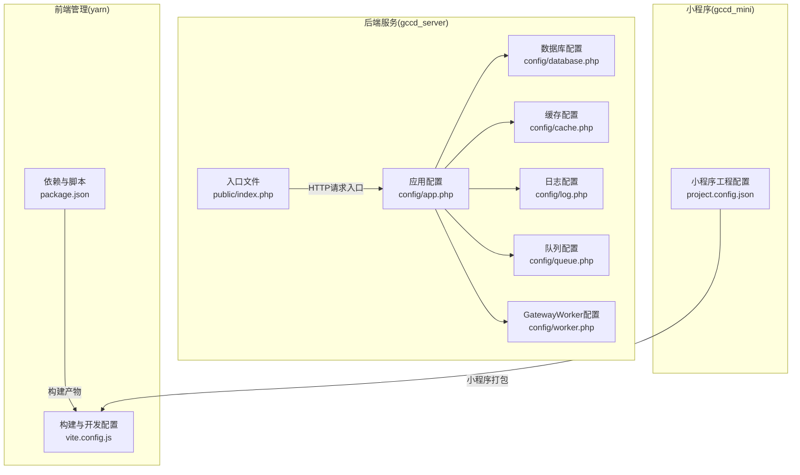
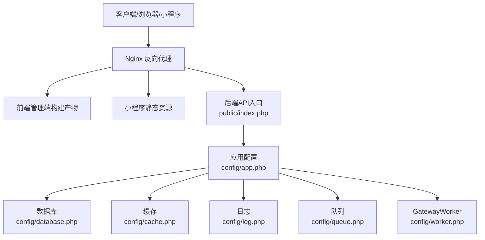
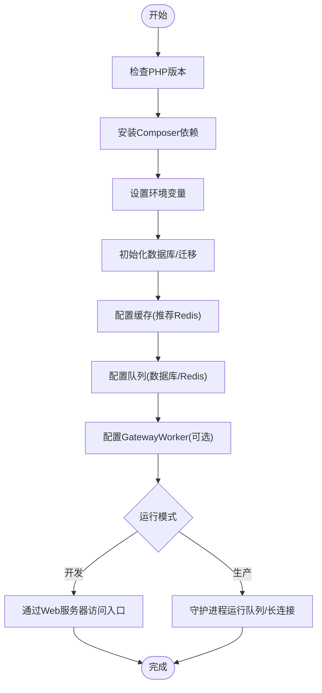
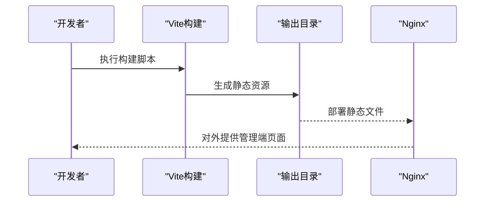
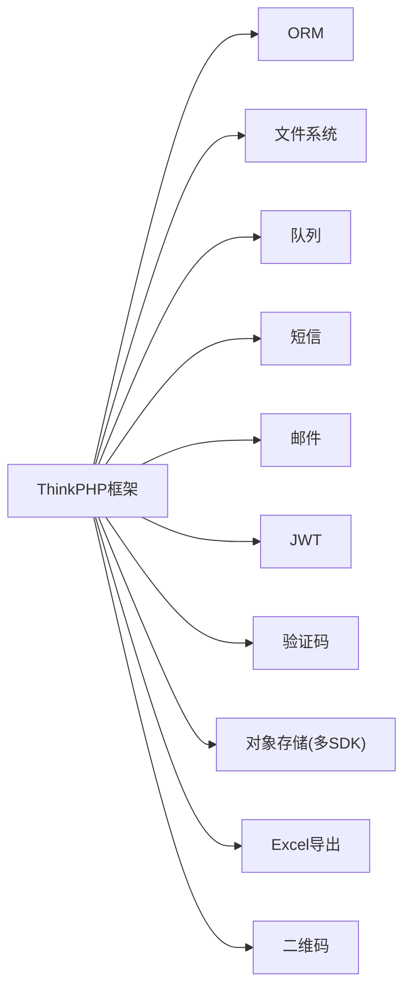

# 部署与运维

<cite>
**本文引用的文件**
- [gccd_server/composer.json](file://gccd_server/composer.json)
- [gccd_server/config/app.php](file://gccd_server/config/app.php)
- [gccd_server/config/database.php](file://gccd_server/config/database.php)
- [gccd_server/config/cache.php](file://gccd_server/config/cache.php)
- [gccd_server/config/session.php](file://gccd_server/config/session.php)
- [gccd_server/config/log.php](file://gccd_server/config/log.php)
- [gccd_server/config/queue.php](file://gccd_server/config/queue.php)
- [gccd_server/config/worker.php](file://gccd_server/config/worker.php)
- [gccd_server/public/index.php](file://gccd_server/public/index.php)
- [yarn/package.json](file://yarn/package.json)
- [yarn/vite.config.js](file://yarn/vite.config.js)
- [gccd_mini/project.config.json](file://gccd_mini/project.config.json)
- [README.md](file://README.md)
</cite>

## 目录
1. [简介](#简介)
2. [项目结构](#项目结构)
3. [核心组件](#核心组件)
4. [架构总览](#架构总览)
5. [详细组件分析](#详细组件分析)
6. [依赖关系分析](#依赖关系分析)
7. [性能考虑](#性能考虑)
8. [故障排查指南](#故障排查指南)
9. [结论](#结论)
10. [附录](#附录)

## 简介
本文件面向高齿传动项目的部署与运维团队，提供从开发到生产的完整落地指南。内容覆盖服务器环境准备、环境变量与依赖安装、前后端构建与发布、容器化与编排、Nginx反向代理与SSL、监控与日志、备份与恢复、自动化部署与CI/CD建议，以及常见运维问题排查。

## 项目结构
该项目由三部分组成：
- 后端服务（ThinkPHP 8）：位于 gccd_server，提供API与管理后台能力。
- 前端管理端（Vue 3 + Vite）：位于 yarn，提供管理端界面。
- 微信小程序前端：位于 gccd_mini，基于微信小程序工具链进行打包与上传。

图表来源
- [gccd_server/public/index.php:1-25](file://gccd_server/public/index.php#L1-L25)
- [gccd_server/config/app.php:1-44](file://gccd_server/config/app.php#L1-L44)
- [gccd_server/config/database.php:1-71](file://gccd_server/config/database.php#L1-L71)
- [gccd_server/config/cache.php:1-86](file://gccd_server/config/cache.php#L1-L86)
- [gccd_server/config/log.php:1-51](file://gccd_server/config/log.php#L1-L51)
- [gccd_server/config/queue.php:1-56](file://gccd_server/config/queue.php#L1-L56)
- [gccd_server/config/worker.php:1-28](file://gccd_server/config/worker.php#L1-L28)
- [yarn/package.json:1-88](file://yarn/package.json#L1-L88)
- [yarn/vite.config.js:1-185](file://yarn/vite.config.js#L1-L185)
- [gccd_mini/project.config.json:1-78](file://gccd_mini/project.config.json#L1-L78)

章节来源
- [README.md:1-4](file://README.md#L1-L4)
- [gccd_server/public/index.php:1-25](file://gccd_server/public/index.php#L1-L25)
- [gccd_server/config/app.php:1-44](file://gccd_server/config/app.php#L1-L44)
- [gccd_server/config/database.php:1-71](file://gccd_server/config/database.php#L1-L71)
- [gccd_server/config/cache.php:1-86](file://gccd_server/config/cache.php#L1-L86)
- [gccd_server/config/log.php:1-51](file://gccd_server/config/log.php#L1-L51)
- [gccd_server/config/queue.php:1-56](file://gccd_server/config/queue.php#L1-L56)
- [gccd_server/config/worker.php:1-28](file://gccd_server/config/worker.php#L1-L28)
- [yarn/package.json:1-88](file://yarn/package.json#L1-L88)
- [yarn/vite.config.js:1-185](file://yarn/vite.config.js#L1-L185)
- [gccd_mini/project.config.json:1-78](file://gccd_mini/project.config.json#L1-L78)

## 核心组件
- 应用入口与运行时
  - 后端通过入口文件加载自动加载器并执行HTTP应用，返回响应。
  - 应用配置控制调试、时区、默认应用、路由与事件开关等。
- 数据层
  - 数据库驱动默认为MySQL，支持主机、端口、用户名、密码、字符集、表前缀等可由环境变量注入。
  - 提供断线重连、SQL监听、字段缓存等可选特性。
- 缓存与会话
  - 支持文件与Redis/Memcache等多种缓存驱动；会话默认文件存储，可按需切换。
- 日志
  - 默认文件通道，支持独立级别与单文件写入等选项。
- 队列与长连接
  - 队列默认数据库驱动，也支持Redis；提供失败任务记录。
  - GatewayWorker提供WebSocket/长连接服务配置。
- 前端构建
  - 前端使用Vite，支持开发服务器、构建产物优化、别名与插件生态。
- 小程序打包
  - 小程序工程配置包含打包忽略项、编译选项、appid等。

章节来源
- [gccd_server/public/index.php:1-25](file://gccd_server/public/index.php#L1-L25)
- [gccd_server/config/app.php:11-43](file://gccd_server/config/app.php#L11-L43)
- [gccd_server/config/database.php:27-69](file://gccd_server/config/database.php#L27-L69)
- [gccd_server/config/cache.php:13-85](file://gccd_server/config/cache.php#L13-L85)
- [gccd_server/config/session.php:11-24](file://gccd_server/config/session.php#L11-L24)
- [gccd_server/config/log.php:11-50](file://gccd_server/config/log.php#L11-L50)
- [gccd_server/config/queue.php:23-55](file://gccd_server/config/queue.php#L23-L55)
- [gccd_server/config/worker.php:12-27](file://gccd_server/config/worker.php#L12-L27)
- [yarn/package.json:16-24](file://yarn/package.json#L16-L24)
- [yarn/vite.config.js:13-184](file://yarn/vite.config.js#L13-L184)
- [gccd_mini/project.config.json:1-78](file://gccd_mini/project.config.json#L1-L78)

## 架构总览
整体架构由“小程序前端 + 管理端前端 + 后端API + 数据库/缓存/队列”构成。生产环境通常通过Nginx作为反向代理，结合SSL/TLS与负载均衡，实现高可用与安全。

图表来源
- [gccd_server/public/index.php:1-25](file://gccd_server/public/index.php#L1-L25)
- [gccd_server/config/app.php:11-43](file://gccd_server/config/app.php#L11-L43)
- [gccd_server/config/database.php:27-69](file://gccd_server/config/database.php#L27-L69)
- [gccd_server/config/cache.php:13-85](file://gccd_server/config/cache.php#L13-L85)
- [gccd_server/config/log.php:11-50](file://gccd_server/config/log.php#L11-L50)
- [gccd_server/config/queue.php:23-55](file://gccd_server/config/queue.php#L23-L55)
- [gccd_server/config/worker.php:12-27](file://gccd_server/config/worker.php#L12-L27)
- [yarn/vite.config.js:13-184](file://yarn/vite.config.js#L13-L184)
- [gccd_mini/project.config.json:1-78](file://gccd_mini/project.config.json#L1-L78)

## 详细组件分析

### 后端服务（ThinkPHP 8）部署要点
- 服务器要求
  - PHP版本：>= 8.0（来自composer约束）。
  - Web服务器：Nginx/Apache均可，推荐Nginx + PHP-FPM。
  - 数据库：MySQL（默认），可按需替换为其他驱动。
  - 缓存：可选Redis/Memcache，建议生产使用Redis。
- 环境变量（示例键位）
  - 应用相关：app.debug、app.host、app.trace、app.default_timezone。
  - 数据库相关：database.driver、database.type、database.hostname、database.database、database.username、database.password、database.hostport、database.charset、database.prefix、database.break_reconnect、database.trigger_sql、database.fields_cache。
  - 缓存相关：cache.driver、cache.expire、cache.serialize、cache.prefix、cache.tag_prefix、cache.host、cache.port、cache.password、cache.persistent。
  - 日志相关：log.channel。
  - 队列相关：queue默认驱动与Redis连接参数（复用缓存host/port/password/persistent）。
- 依赖安装
  - 使用Composer安装后端依赖，确保自动加载与服务发现脚本已执行。
- 运行方式
  - 开发：直接通过Web服务器访问入口文件。
  - 队列：根据配置选择同步或数据库/Redis驱动；生产建议使用守护进程方式运行队列工作进程。
  - 长连接：GatewayWorker可按需启动，注意守护化与进程数配置。

图表来源
- [gccd_server/composer.json:23-47](file://gccd_server/composer.json#L23-L47)
- [gccd_server/config/app.php:11-27](file://gccd_server/config/app.php#L11-L27)
- [gccd_server/config/database.php:11-69](file://gccd_server/config/database.php#L11-L69)
- [gccd_server/config/cache.php:13-52](file://gccd_server/config/cache.php#L13-L52)
- [gccd_server/config/queue.php:23-55](file://gccd_server/config/queue.php#L23-L55)
- [gccd_server/config/worker.php:12-27](file://gccd_server/config/worker.php#L12-L27)

章节来源
- [gccd_server/composer.json:23-47](file://gccd_server/composer.json#L23-L47)
- [gccd_server/config/app.php:11-27](file://gccd_server/config/app.php#L11-L27)
- [gccd_server/config/database.php:11-69](file://gccd_server/config/database.php#L11-L69)
- [gccd_server/config/cache.php:13-52](file://gccd_server/config/cache.php#L13-L52)
- [gccd_server/config/queue.php:10-18](file://gccd_server/config/queue.php#L10-L18)
- [gccd_server/config/worker.php:12-27](file://gccd_server/config/worker.php#L12-L27)

### 前端管理端（Vue 3 + Vite）部署要点
- 服务器要求
  - Node版本：>= 18.18.0（来自package.json engines）。
- 构建与发布
  - 开发：使用Vite开发服务器，端口与域名在配置中定义。
  - 生产/预发：通过构建脚本生成静态资源，输出目录由环境变量控制。
- 静态资源与反向代理
  - 将构建产物部署至Nginx静态目录，或通过反向代理指向前端服务。
- 依赖安装
  - 使用包管理器安装依赖后进行构建。

图表来源
- [yarn/package.json:16-24](file://yarn/package.json#L16-L24)
- [yarn/vite.config.js:13-184](file://yarn/vite.config.js#L13-L184)

章节来源
- [yarn/package.json:83-86](file://yarn/package.json#L83-L86)
- [yarn/package.json:16-24](file://yarn/package.json#L16-L24)
- [yarn/vite.config.js:13-184](file://yarn/vite.config.js#L13-L184)

### 小程序前端部署要点
- 工程配置
  - 包含打包忽略项、编译设置、appid等，确保上传前清理无关文件。
- 上传与发布
  - 使用微信开发者工具进行预览与上传，或在CI中集成对应流程。

章节来源
- [gccd_mini/project.config.json:1-78](file://gccd_mini/project.config.json#L1-L78)

### Docker容器化部署方案
- 镜像构建建议
  - 后端：基于PHP 8 + Composer + Nginx/PHP-FPM镜像，拷贝后端源码与vendor，暴露端口，挂载日志与缓存目录。
  - 前端：基于Node 18 + Nginx镜像，先构建再复制静态资源，暴露静态资源端口。
  - 小程序：无需容器化，使用微信开发者工具或CI流程上传。
- 容器编排
  - 使用Compose编排：后端容器、数据库容器、缓存容器（Redis）、队列容器（可选）。
  - 通过网络隔离与持久卷管理数据与日志。
- 服务发现
  - 使用容器网络名称解析服务，避免硬编码IP；通过环境变量注入服务地址。

[本节为概念性说明，不直接分析具体文件，故无图表来源]

### Nginx反向代理、SSL与负载均衡
- 反向代理
  - 将管理端静态资源与后端API统一接入Nginx，配置上游至前端静态目录或后端入口。
- SSL证书
  - 使用Let’s Encrypt或其他CA签发证书，配置HTTPS监听与强制跳转。
- 负载均衡
  - 多实例后端横向扩展，配合健康检查与会话粘性策略（如需）。

[本节为概念性说明，不直接分析具体文件，故无图表来源]

### 监控告警与日志
- 应用监控
  - 后端：结合日志通道与队列状态，观察异常与失败任务。
  - 前端：通过Nginx访问日志与错误上报（如引入前端埋点）。
- 系统监控
  - CPU、内存、磁盘、网络与连接数监控，结合告警阈值。
- 日志收集
  - 前端：Nginx访问/错误日志；后端：文件日志通道与独立级别日志。
- 告警通知
  - 建议使用Prometheus/Grafana + Alertmanager或类似方案。

章节来源
- [gccd_server/config/log.php:11-50](file://gccd_server/config/log.php#L11-L50)
- [gccd_server/config/queue.php:10-18](file://gccd_server/config/queue.php#L10-L18)

### 备份与恢复
- 数据库备份
  - MySQL：使用逻辑备份（mysqldump）或物理备份（xtrabackup），定期校验与异地存放。
- 文件备份
  - 上传目录、日志目录、构建产物目录均需纳入备份策略。
- 灾难恢复
  - 制定RTO/RPO目标，演练恢复流程，验证备份数据完整性。

[本节为通用运维实践，不直接分析具体文件，故无章节来源]

### 自动化部署与CI/CD
- 建议流水线阶段
  - 代码检出 → 依赖安装（Composer/NPM）→ 前端构建 → 后端测试（可选）→ 镜像构建 → 部署（回滚策略）→ 健康检查。
- 关键参数
  - 使用环境变量注入数据库、缓存、日志等配置，避免硬编码。
- 回滚策略
  - 版本化镜像与配置，保留最近N个版本以便快速回滚。

[本节为通用实践建议，不直接分析具体文件，故无章节来源]

## 依赖关系分析
后端依赖以ThinkPHP框架为核心，围绕ORM、文件系统、队列、短信、邮件、验证码、对象存储、Excel导出、二维码等扩展库组织；前端依赖Vue 3与生态工具链。

图表来源
- [gccd_server/composer.json:23-47](file://gccd_server/composer.json#L23-L47)

章节来源
- [gccd_server/composer.json:23-47](file://gccd_server/composer.json#L23-L47)

## 性能考虑
- 后端
  - 启用缓存（推荐Redis），合理设置过期与序列化策略。
  - 数据库连接池与只读分离（如适用），开启字段缓存减少元数据查询。
  - 队列异步化耗时操作，设置合理的超时与内存限制。
- 前端
  - 构建时移除console与debugger，按需拆分代码块，优化静态资源体积。
- 网络
  - 启用Gzip/HTTP/2，合理设置缓存头，CDN加速静态资源。

[本节提供通用指导，不直接分析具体文件，故无章节来源]

## 故障排查指南
- 访问异常
  - 检查Nginx与PHP-FPM配置、后端入口文件权限与可访问性。
- 数据库连接失败
  - 核对环境变量中的主机、端口、用户名、密码与数据库名；确认网络连通与防火墙策略。
- 缓存不可用
  - 核对缓存驱动与连接参数；Redis需检查认证与持久化配置。
- 队列不执行
  - 确认队列驱动与参数；生产环境使用守护进程方式运行工作进程，设置重试次数与超时。
- 日志未输出
  - 检查日志通道配置与文件权限；必要时开启独立级别日志定位问题。
- 小程序上传失败
  - 检查工程配置与忽略规则，确保构建产物完整且appid正确。

章节来源
- [gccd_server/config/database.php:27-69](file://gccd_server/config/database.php#L27-L69)
- [gccd_server/config/cache.php:13-52](file://gccd_server/config/cache.php#L13-L52)
- [gccd_server/config/queue.php:10-18](file://gccd_server/config/queue.php#L10-L18)
- [gccd_server/config/log.php:11-50](file://gccd_server/config/log.php#L11-L50)
- [gccd_mini/project.config.json:1-78](file://gccd_mini/project.config.json#L1-L78)

## 结论
本指南提供了从开发到生产的全栈部署与运维路径。建议优先完成环境变量标准化、数据库与缓存初始化、Nginx反向代理与SSL配置、日志与监控体系建立，并制定完善的备份与回滚策略。在此基础上，逐步完善CI/CD流水线与自动化运维工具，持续提升交付效率与系统稳定性。

## 附录
- 环境变量清单（示例）
  - 应用：app.debug、app.host、app.trace、app.default_timezone。
  - 数据库：database.driver、database.type、database.hostname、database.database、database.username、database.password、database.hostport、database.charset、database.prefix、database.break_reconnect、database.trigger_sql、database.fields_cache。
  - 缓存：cache.driver、cache.expire、cache.serialize、cache.prefix、cache.tag_prefix、cache.host、cache.port、cache.password、cache.persistent。
  - 日志：log.channel。
  - 队列：queue默认驱动与Redis连接参数（复用缓存host/port/password/persistent）。
- 前端构建脚本
  - 开发：vite serve --mode development
  - 生产：vite build --mode production
  - 预览：vite preview --mode production/staging

章节来源
- [gccd_server/config/app.php:11-27](file://gccd_server/config/app.php#L11-L27)
- [gccd_server/config/database.php:11-69](file://gccd_server/config/database.php#L11-L69)
- [gccd_server/config/cache.php:13-52](file://gccd_server/config/cache.php#L13-L52)
- [gccd_server/config/log.php:11-13](file://gccd_server/config/log.php#L11-L13)
- [gccd_server/config/queue.php:23-49](file://gccd_server/config/queue.php#L23-L49)
- [yarn/package.json:16-24](file://yarn/package.json#L16-L24)