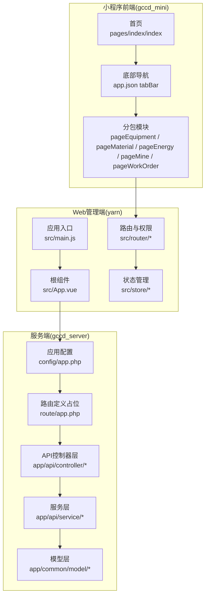
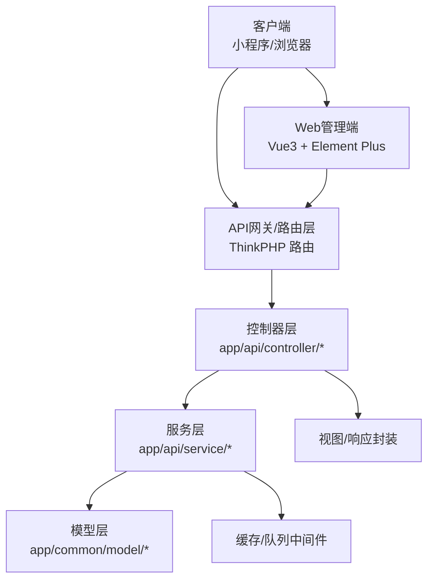
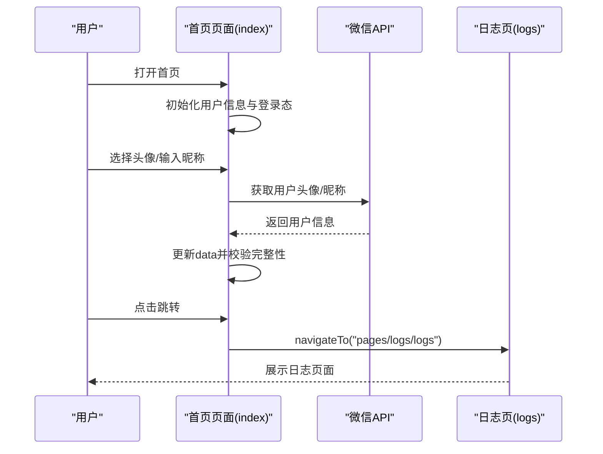
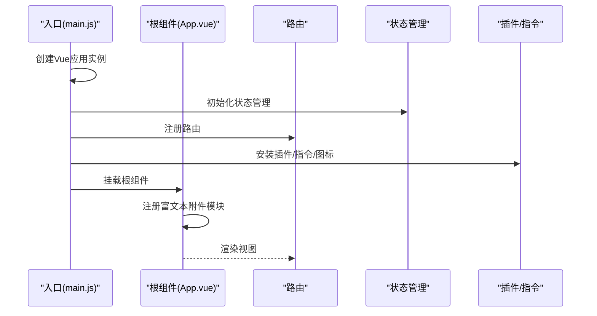
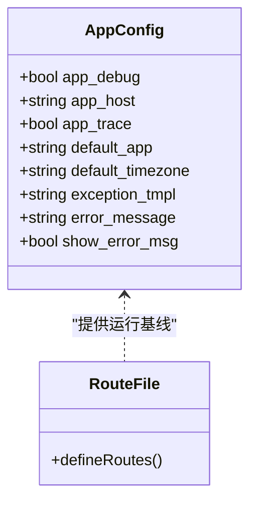
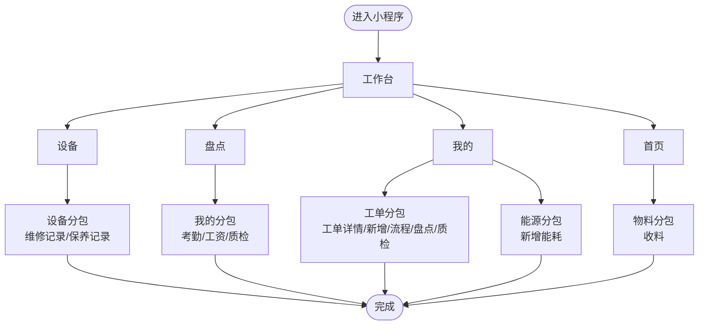
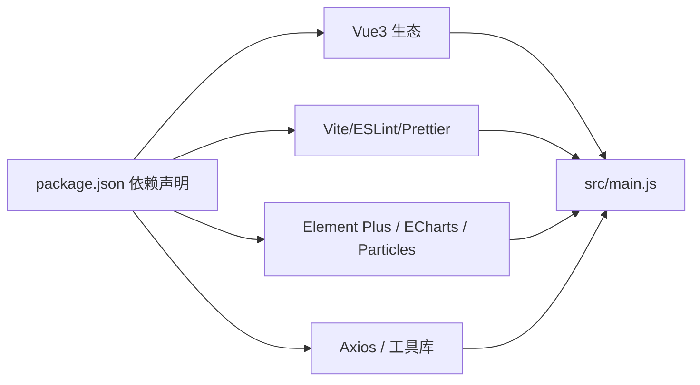

# 项目概述

<cite>
**本文引用的文件**
- [gccd_mini/app.json](file://gccd_mini/app.json)
- [gccd_mini/pages/index/index.js](file://gccd_mini/pages/index/index.js)
- [gccd_server/config/app.php](file://gccd_server/config/app.php)
- [gccd_server/route/app.php](file://gccd_server/route/app.php)
- [yarn/package.json](file://yarn/package.json)
- [yarn/src/main.js](file://yarn/src/main.js)
- [yarn/src/App.vue](file://yarn/src/App.vue)
- [README.md](file://README.md)
</cite>

## 目录
1. [引言](#引言)
2. [项目结构](#项目结构)
3. [核心组件](#核心组件)
4. [架构总览](#架构总览)
5. [详细组件分析](#详细组件分析)
6. [依赖分析](#依赖分析)
7. [性能考虑](#性能考虑)
8. [故障排查指南](#故障排查指南)
9. [结论](#结论)
10. [附录](#附录)

## 引言
本项目是面向齿轮传动制造企业的综合性数字化管理平台，旨在通过“前端小程序 + 后端管理系统 + 服务端框架”的一体化架构，覆盖生产管理、设备管理、物料管理、能源管理、质量管理、人员管理等核心业务场景。项目采用前后端分离设计，前端以微信小程序与 Vue3 技术栈为主，后端基于 ThinkPHP 框架，配合现代化的构建工具链与组件生态，实现高效开发与稳定运行。

项目的核心价值主张包括：
- 统一入口与多业务聚合：通过统一的导航与分包结构，将设备、盘点、我的等模块整合到工作台门户。
- 可扩展的后端能力：基于 ThinkPHP 的多应用模式与路由配置，便于按业务域扩展 API 与服务层。
- 开发体验与可维护性：前端采用 Vue3 + Vite + Pinia + Element Plus，后端采用现代化依赖管理与配置体系，提升团队协作效率。

目标用户群体：
- 生产现场管理人员与一线员工（通过小程序进行日常作业与数据采集）
- 中后台运营与质量管理人员（通过 Web 管理端进行流程审批、报表统计与系统配置）

## 项目结构
项目采用“三端协同”的组织方式：
- 小程序前端（gccd_mini）：负责移动端入口、基础页面与业务子包（设备、物料、能源、我的等），通过分包机制优化首屏加载与资源管理。
- Web 管理端（yarn）：基于 Vue3 + Vite + Element Plus，提供后台管理界面与系统配置能力。
- 服务端（gccd_server）：基于 ThinkPHP 的后端框架，提供 API 服务、中间件、缓存与队列等基础设施。

图表来源
- [gccd_mini/app.json:1-99](file://gccd_mini/app.json#L1-L99)
- [gccd_mini/pages/index/index.js:1-50](file://gccd_mini/pages/index/index.js#L1-L50)
- [yarn/src/main.js:1-44](file://yarn/src/main.js#L1-L44)
- [yarn/src/App.vue:1-57](file://yarn/src/App.vue#L1-L57)
- [gccd_server/config/app.php:1-44](file://gccd_server/config/app.php#L1-L44)
- [gccd_server/route/app.php:1-10](file://gccd_server/route/app.php#L1-L10)

章节来源
- [gccd_mini/app.json:1-99](file://gccd_mini/app.json#L1-L99)
- [gccd_mini/pages/index/index.js:1-50](file://gccd_mini/pages/index/index.js#L1-L50)
- [yarn/src/main.js:1-44](file://yarn/src/main.js#L1-L44)
- [yarn/src/App.vue:1-57](file://yarn/src/App.vue#L1-L57)
- [gccd_server/config/app.php:1-44](file://gccd_server/config/app.php#L1-L44)
- [gccd_server/route/app.php:1-10](file://gccd_server/route/app.php#L1-L10)

## 核心组件
- 小程序首页与用户态管理：提供用户头像与昵称采集、登录态切换与页面跳转能力，支撑后续业务模块的用户授权与数据绑定。
- Web 管理端应用入口：完成应用初始化、路由挂载、国际化、粒子动画插件与全局指令注册，形成统一的前端运行环境。
- 服务端应用配置：定义默认应用、时区、异常模板与调试开关等，为 API 层提供一致的运行基线。
- 路由与分包：小程序通过分包策略隔离设备、物料、能源、我的、工单等子域，降低主包体积并提升加载速度；Web 端通过路由与权限守卫控制访问。

章节来源
- [gccd_mini/pages/index/index.js:1-50](file://gccd_mini/pages/index/index.js#L1-L50)
- [yarn/src/main.js:1-44](file://yarn/src/main.js#L1-L44)
- [yarn/src/App.vue:1-57](file://yarn/src/App.vue#L1-L57)
- [gccd_server/config/app.php:1-44](file://gccd_server/config/app.php#L1-L44)
- [gccd_server/route/app.php:1-10](file://gccd_server/route/app.php#L1-L10)

## 架构总览
系统采用“小程序前端 + Web 管理端 + ThinkPHP 服务端”的三层架构：
- 前端层：小程序负责移动端作业入口与数据采集；Web 管理端负责后台配置与流程审批。
- 服务层：ThinkPHP 提供多应用模式、中间件、事件与缓存等能力，API 控制器负责对外接口。
- 数据与资源：通过统一的配置与路由，前后端解耦协作，支持后续扩展至设备物联网、能耗监控与质量追溯等场景。

图表来源
- [gccd_server/config/app.php:1-44](file://gccd_server/config/app.php#L1-L44)
- [gccd_server/route/app.php:1-10](file://gccd_server/route/app.php#L1-L10)
- [yarn/src/main.js:1-44](file://yarn/src/main.js#L1-L44)

## 详细组件分析

### 小程序首页与用户态组件
- 功能要点：头像与昵称采集、登录态判断、页面跳转与用户信息展示。
- 设计意图：为后续业务模块提供统一的用户上下文，保证数据安全与体验一致性。
- 交互流程（序列图）：

图表来源
- [gccd_mini/pages/index/index.js:1-50](file://gccd_mini/pages/index/index.js#L1-L50)

章节来源
- [gccd_mini/pages/index/index.js:1-50](file://gccd_mini/pages/index/index.js#L1-L50)

### Web 管理端应用启动与全局配置
- 功能要点：应用实例创建、路由挂载、国际化、粒子动画、自定义指令与全局图标注册。
- 设计意图：提供一致的主题、布局与交互体验，同时为后续业务模块预留扩展点。
- 启动流程（序列图）：

图表来源
- [yarn/src/main.js:1-44](file://yarn/src/main.js#L1-L44)
- [yarn/src/App.vue:1-57](file://yarn/src/App.vue#L1-L57)

章节来源
- [yarn/src/main.js:1-44](file://yarn/src/main.js#L1-L44)
- [yarn/src/App.vue:1-57](file://yarn/src/App.vue#L1-L57)

### 服务端应用配置与路由占位
- 功能要点：应用调试、时区、默认应用、异常模板与错误提示配置；路由定义文件作为扩展入口。
- 设计意图：为 API 层提供标准化运行参数与扩展点，便于按模块拆分与独立演进。
- 配置与路由关系（类图）：

图表来源
- [gccd_server/config/app.php:1-44](file://gccd_server/config/app.php#L1-L44)
- [gccd_server/route/app.php:1-10](file://gccd_server/route/app.php#L1-L10)

章节来源
- [gccd_server/config/app.php:1-44](file://gccd_server/config/app.php#L1-L44)
- [gccd_server/route/app.php:1-10](file://gccd_server/route/app.php#L1-L10)

### 小程序分包与导航结构
- 功能要点：主包页面与分包页面划分，底部导航与图标切换，子包内业务页面组织。
- 设计意图：通过分包降低主包体积，提升小程序启动性能；通过统一导航增强用户体验。
- 导航与分包关系（流程图）：

图表来源
- [gccd_mini/app.json:1-99](file://gccd_mini/app.json#L1-L99)

章节来源
- [gccd_mini/app.json:1-99](file://gccd_mini/app.json#L1-L99)

## 依赖分析
- 前端依赖（Vue3 生态）：Vue3、Vue Router、Pinia、Element Plus、Axios、ECharts、Particles 等，构成现代前端开发栈。
- 构建与工具：Vite、ESLint、Prettier、UnoCSS、SVG 图标等，保障开发效率与代码质量。
- 服务端依赖：ThinkPHP 多应用模式、中间件、事件与缓存等，支撑 API 与业务服务。

图表来源
- [yarn/package.json:1-88](file://yarn/package.json#L1-L88)
- [yarn/src/main.js:1-44](file://yarn/src/main.js#L1-L44)

章节来源
- [yarn/package.json:1-88](file://yarn/package.json#L1-L88)
- [yarn/src/main.js:1-44](file://yarn/src/main.js#L1-L44)

## 性能考虑
- 小程序分包策略：通过 subPackages 将设备、物料、能源、我的、工单等模块拆分为独立包，减少主包体积，提升冷启动速度。
- 资源懒加载：开启 lazyCodeLoading，仅在需要时加载组件，进一步优化首屏性能。
- 前端构建优化：Vite 提供快速热更新与打包能力；按需引入组件与图标，避免全量引入导致的体积膨胀。
- 服务端运行参数：合理配置 app_debug、app_trace 与默认时区，避免不必要的性能损耗与安全风险。

## 故障排查指南
- 登录与用户态问题：检查首页用户信息采集逻辑与页面跳转路径，确认 getUserProfile 回调与 data 更新是否正确。
- Web 管理端启动异常：核对入口文件中的插件安装顺序与全局指令注册，确认路由与状态管理初始化是否成功。
- 服务端配置问题：核对应用配置项（如默认应用、时区、异常模板），确保与部署环境一致；检查路由定义文件是否正确加载。
- 性能问题定位：结合小程序分包与懒加载配置，逐步排除主包过大与组件未按需加载的问题；前端可通过构建产物分析与网络面板定位资源加载瓶颈。

章节来源
- [gccd_mini/pages/index/index.js:1-50](file://gccd_mini/pages/index/index.js#L1-L50)
- [yarn/src/main.js:1-44](file://yarn/src/main.js#L1-L44)
- [gccd_server/config/app.php:1-44](file://gccd_server/config/app.php#L1-L44)

## 结论
本项目以“小程序 + Web 管理端 + ThinkPHP 服务端”为核心架构，围绕齿轮传动制造企业的多业务场景，提供了从用户入口、业务编排到数据服务的完整解决方案。通过合理的分包与路由设计、现代化的前端技术栈与服务端配置，项目具备良好的可扩展性与可维护性，能够支撑未来在设备互联、能耗监测与质量追溯等方面的持续演进。

## 附录
- 项目背景与迁移说明：项目设计系统文档已迁移至外部链接，相关内容可在 README 中查看。
  
章节来源
- [README.md:1-4](file://README.md#L1-L4)